# Advanced Mermaid Features

Advanced configuration, styling, theming, layout, and export options for producing
professional diagrams in the LIA-SEC documentation pipeline.

## LIA-SEC Mandatory Init Block

Every `.mmd` file in `_alire/01_DOCUMENTATION/diagrams/` MUST start with this block:

```
%%{init: {'theme': 'dark', 'themeVariables': {'primaryColor': '#0d1b2a', 'primaryTextColor': '#a8dadc', 'primaryBorderColor': '#1e6091', 'lineColor': '#00b4d8', 'secondaryColor': '#1a1a2e', 'tertiaryColor': '#0f3460', 'background': '#050d1a', 'mainBkg': '#0d1b2a', 'nodeBorder': '#1e6091', 'clusterBkg': '#0f1e30', 'titleColor': '#90e0ef', 'edgeLabelBackground': '#0f3460', 'fontSize': '14px', 'fontFamily': 'JetBrains Mono, monospace'}}}%%
```

This is enforced by `render_diagrams.sh` and the doc-librarian verification gate.
Files without this block will fail SVG pre-rendering.

> NOTE (2026-05-29): render_diagrams.sh / SVG pre-rendering is VESTIGIAL -- the actual rendering is client-side (mermaidClient.js, dark theme global). diagrams/svg/ is not consumed by any .md file and is empty. Do not install mmdc for this reason. See _alire/01_DOCUMENTATION/architecture/mermaid_render_pipeline_arch_en.md.

---

## Frontmatter Configuration (Alternative Syntax)

For inline `.md` diagrams that don't go through `generate_mermaid.py`, you can use
YAML frontmatter instead:

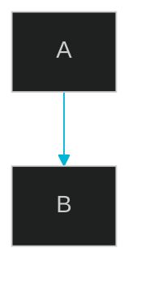

**Note**: `.mmd` standalone files MUST use `%%{init}%%` (LIA-SEC standard).
Frontmatter works for diagrams embedded directly in Markdown, but `mmdc` rendering
uses `%%{init}%%` blocks. Do not mix the two formats in the same file.

---

## Built-in Themes

| Theme | Use case |
|-------|----------|
| `dark` | LIA-SEC standard -- dark cybersecurity aesthetic |
| `default` | Standard blue -- acceptable for customer-facing exports |
| `forest` | Green earth -- avoid (conflicts with LIA-SEC brand colors) |
| `neutral` | Grayscale -- for print/PDF exports |
| `base` | Minimal -- use when overriding all variables manually |

**LIA-SEC rule**: always use `dark` theme for `.mmd` files committed to the repo.
Use `neutral` only for `.docx` Word exports where dark backgrounds look wrong.

---

## Custom Theme Variables

Override specific variables on top of `base`:

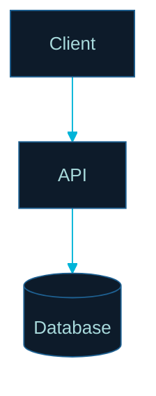

---

## Layout Options

### Dagre Layout (Default)

Hierarchical layout. Works well for most flowcharts and architecture diagrams.

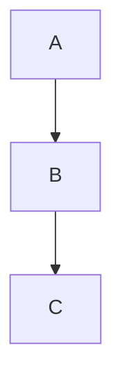

### ELK Layout (Advanced)

Use for complex diagrams with many crossing edges. Requires `mermaid-js/mermaid-cli`
with ELK support (`@mermaid-js/layout-elk` package).

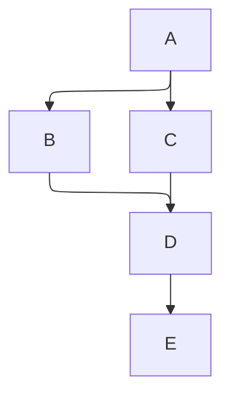

**ELK node placement strategies:**
- `SIMPLE` -- Basic placement
- `NETWORK_SIMPLEX` -- Network optimization
- `LINEAR_SEGMENTS` -- Linear arrangement
- `BRANDES_KOEPF` -- Balanced layout (best for security architecture diagrams)

**LIA-SEC recommendation**: Use ELK for diagrams with 20+ nodes (e.g., PostgreSQL
schema ERDs, full platform architecture diagrams).

---

## Look Options

### Classic Look

Standard Mermaid appearance. Use for all technical documentation:

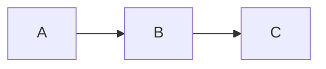

### Hand-Drawn Look

Sketch-like style. Do NOT use in LIA-SEC -- audience is professional RSSI/auditors.

```
# FORBIDDEN for LIA-SEC documentation
config:
  look: handDrawn
```

---

## Diagram-Specific Styling

### Class-Based Styling (Flowcharts)

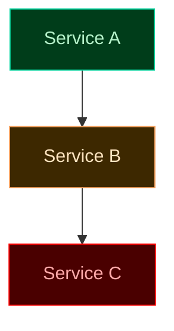

**LIA-SEC color palette for classDef:**

| Status | fill | stroke | color |
|--------|------|--------|-------|
| secure/ok | `#003d1a` | `#06d6a0` | `#b7f4cc` |
| warning | `#3d2800` | `#f4a261` | `#ffe5c0` |
| critical | `#4a0000` | `#ff0000` | `#ffaaaa` |
| info | `#0d1b2a` | `#00b4d8` | `#a8dadc` |
| neutral | `#1a1a2e` | `#555577` | `#aaaacc` |

### Individual Node Styling

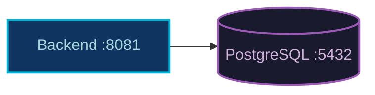

### Link Styling

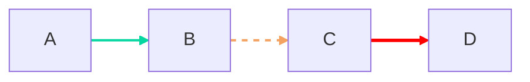

### Subgraph Styling

```mermaid
flowchart TB
    subgraph internet[Internet]
        client[Browser]
    end

    subgraph vps[VPS inspect-ia-agents.tech]
        nginx[Nginx :443]
        backend[Go Backend :8081]
        db[(PostgreSQL :5432)]
    end

    client --> nginx
    nginx --> backend
    backend --> db

    style internet fill:#0d1b2a,stroke:#1e6091,stroke-width:2px
    style vps fill:#0f1e30,stroke:#00b4d8,stroke-width:2px
```

---

## Comments

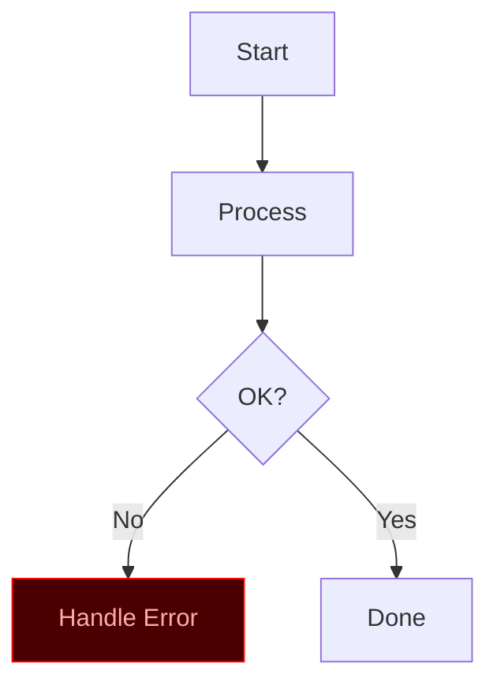

---

## Click Events and Links

Add interactive navigation in Docusaurus-rendered diagrams:

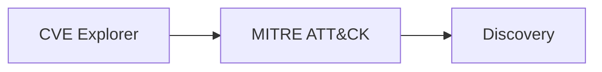

---

## SVG Export Options

```bash
# Standard export (used by render_diagrams.sh)
mmdc -i diagram.mmd -o diagram.svg -b "#050d1a"

# High-resolution for docs
mmdc -i diagram.mmd -o diagram.svg -w 1920 -H 1080 -b "#050d1a"

# Transparent background (for HTML embedding)
mmdc -i diagram.mmd -o diagram.svg -b "transparent"

# PNG for Word/PPTX exports
mmdc -i diagram.mmd -o diagram.png -w 1600 -H 900 -b "#ffffff"
```

**render_diagrams.sh** handles all LIA-SEC diagrams in `_alire/01_DOCUMENTATION/diagrams/`.
Manual export is only needed for one-off diagrams.

> NOTE (2026-05-29): render_diagrams.sh / SVG pre-rendering is VESTIGIAL -- the actual rendering is client-side (mermaidClient.js, dark theme global). diagrams/svg/ is not consumed by any .md file and is empty. Do not install mmdc for this reason. See _alire/01_DOCUMENTATION/architecture/mermaid_render_pipeline_arch_en.md.

---

## Complex Styling Example (LIA-SEC Platform)

```mermaid
flowchart TB
    subgraph internet[Internet Layer]
        direction LR
        browser[Browser]
    end

    subgraph vps[VPS inspect-ia-agents.tech :443]
        nginx[Nginx]

        subgraph app[Application Layer]
            frontend[React Build]
            backend[Go Backend :8081]
        end

        subgraph data[Data Layer]
            postgres[(PostgreSQL 17)]
            n8n[n8n :5678]
        end
    end

    browser --> nginx
    nginx --> frontend
    nginx --> backend
    backend --> postgres
    n8n --> postgres

    style internet fill:#0d1b2a,stroke:#1e6091,stroke-width:1px
    style vps fill:#0f1e30,stroke:#00b4d8,stroke-width:2px
    style app fill:#1a1a2e,stroke:#1e6091,stroke-width:1px
    style data fill:#1a1a2e,stroke:#9b59b6,stroke-width:1px

    classDef apiNode fill:#0f3460,stroke:#00b4d8,color:#a8dadc
    classDef dbNode fill:#1a1a2e,stroke:#9b59b6,color:#d2b4de
    class backend,frontend,nginx apiNode
    class postgres,n8n dbNode
```

---

## Integration in Docusaurus (docs-site)

Docusaurus 3 renders Mermaid natively via the `@docusaurus/theme-mermaid` plugin.
No extra configuration needed -- diagrams in `.md` files render automatically.

For standalone `.mmd` files committed to `_alire/01_DOCUMENTATION/diagrams/`:
1. `render_diagrams.sh` pre-renders them to `.svg` via `mmdc`
2. The `.svg` files are placed in `diagrams/svg/` (gitignored)
3. Docusaurus picks up the SVG files for static serving

> NOTE (2026-05-29): render_diagrams.sh / SVG pre-rendering is VESTIGIAL -- the actual rendering is client-side (mermaidClient.js, dark theme global). diagrams/svg/ is not consumed by any .md file and is empty. Do not install mmdc for this reason. See _alire/01_DOCUMENTATION/architecture/mermaid_render_pipeline_arch_en.md.

```markdown
<!-- In a .md doc, inline Mermaid is preferred: -->
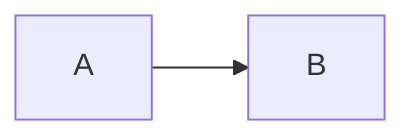

<!-- For pre-rendered SVG (large diagrams): -->

```

---

## Performance Considerations

For large diagrams (20+ nodes):

```mermaid
---
config:
  layout: elk
  elk:
    mergeEdges: true
    nodePlacementStrategy: BRANDES_KOEPF
---
flowchart TD
    %% ELK handles complex layouts better than dagre
    %% mergeEdges reduces visual clutter in dense graphs
```

**Guidelines:**
- Use ELK for diagrams with > 20 nodes
- Enable `mergeEdges` for dense connection patterns (e.g., microservices mesh)
- Split very large diagrams into multiple focused views (Context / Container / Component)
- Use C4 hierarchy instead of one monolithic flowchart

---

## Accessibility

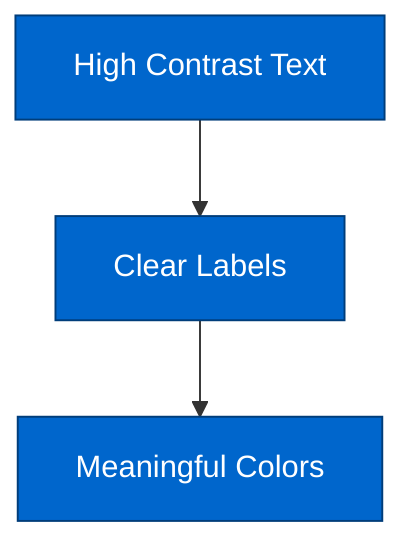

**Tips for RSSI/auditor audience:**
- Use text labels that are self-explanatory without color
- Ensure WCAG AA contrast ratio (4.5:1 minimum) for text
- LIA-SEC dark theme already meets contrast requirements for dark backgrounds

---

## Detect Broken .mmd Files

```bash
# Missing %%{init}%% block
grep -rL "%%{init}" _alire/01_DOCUMENTATION/diagrams/*.mmd

# Wrapped in markdown fence (must NOT be present in .mmd files)
grep -rl "^\`\`\`mermaid" _alire/01_DOCUMENTATION/diagrams/

# Fix: prepend the init block
sed -i '1s/^/%%{init: ...}%%\n/' broken.mmd
```

---

## References Index

| File | Content |
|------|---------|
| `mermaid-syntax-guide.md` | Type selection, quick start, best practices |
| `mermaid-flowcharts.md` | Node shapes, connections, subgraphs, styling |
| `mermaid-sequence-diagrams.md` | Participants, message types, alt/par/loop |
| `mermaid-erd-diagrams.md` | Entities, relationships, LIA-SEC CVE schema |
| `mermaid-c4-diagrams.md` | C4Context / C4Container / C4Component |
| `mermaid-architecture-diagrams.md` | architecture-beta, groups, services, edges |
| `mermaid-class-diagrams.md` | Classes, relationships, stereotypes |
| `mermaid-templates.md` | JSON descriptor templates for generate_mermaid.py |
