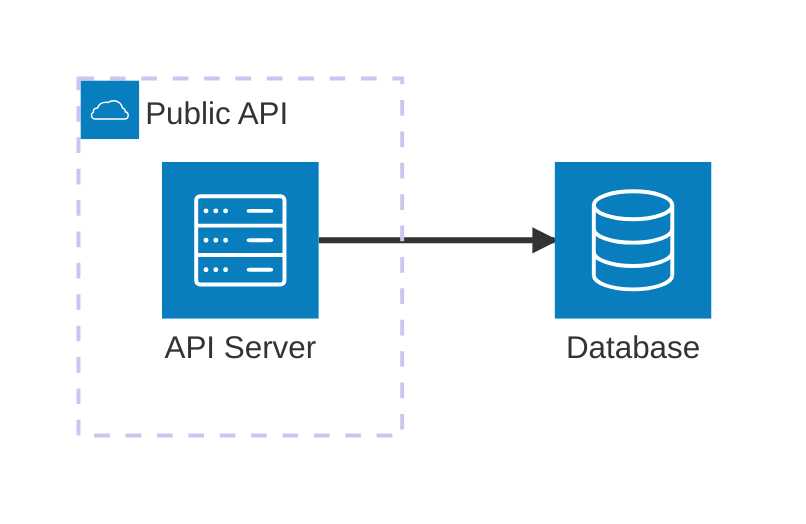
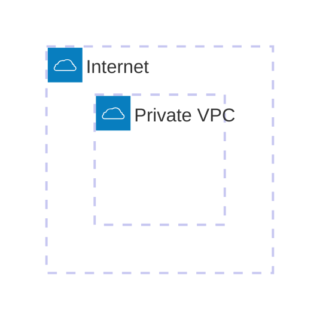
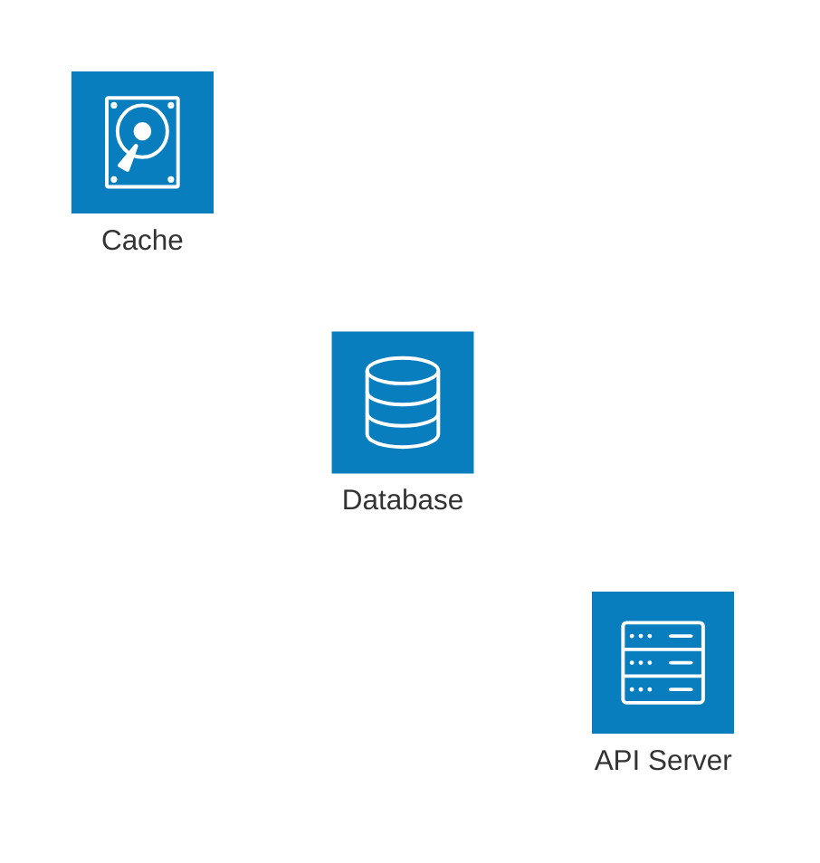
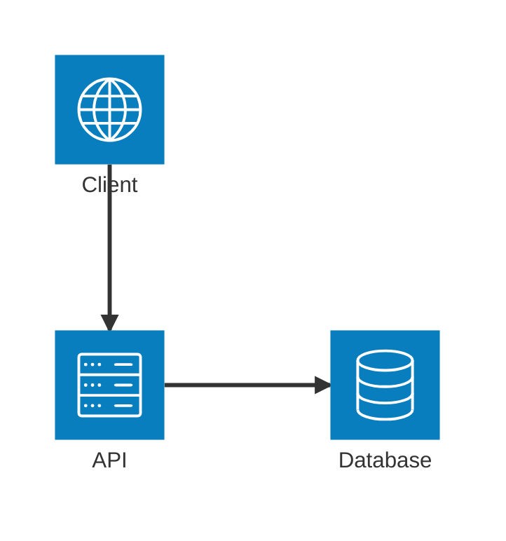
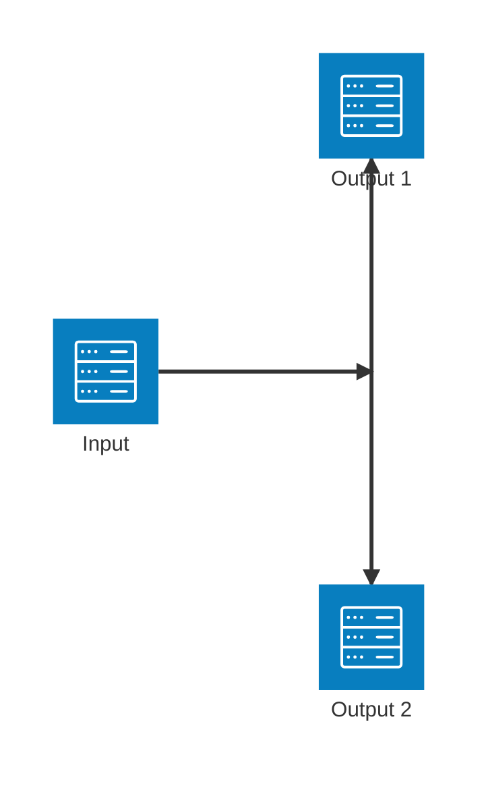
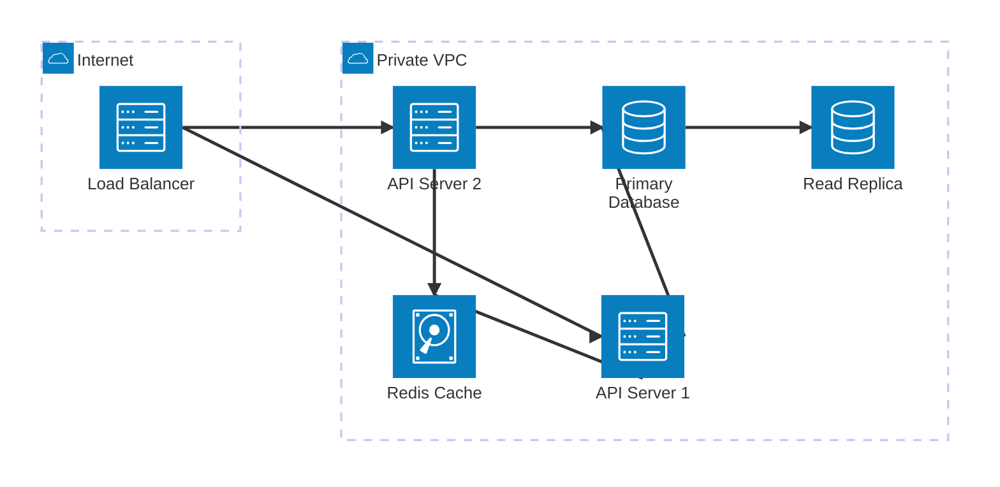
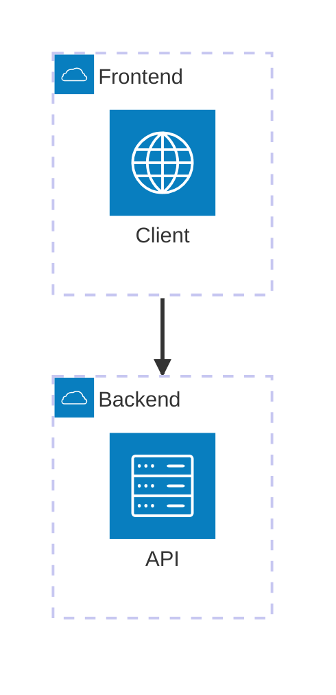

# Architecture Diagrams Reference (`architecture-beta`)

Architecture diagrams visualize cloud services, CI/CD deployments, and infrastructure relationships. Introduced in Mermaid v11.1.0.

## Basic Syntax



## Building Blocks

### Groups

Group related services together:

```
group {groupId}({icon})[{title}] (in {parentId})?
```



### Services

Declare services (nodes):

```
service {serviceId}({icon})[{title}] (in {parentId})?
```

**Default icons:** `cloud`, `database`, `disk`, `internet`, `server`



### Edges

Connect services with edges:

```
{serviceId}:{T|B|L|R} {<}?--{>}? {T|B|L|R}:{serviceId}
```

**Directions:** `T` (top), `B` (bottom), `L` (left), `R` (right)
**Arrows:** `<` incoming, `>` outgoing, `<-->` bidirectional



### Junctions

Create 4-way splits:



## Icons

**Custom icons via @iconify-json:**
```bash
npm install @iconify-json/logos @mermaid-js/mermaid-cli
mmdc --iconPacks @iconify-json/logos -i diagram.mmd -o output.svg
```

| Icon Pack | Description | Install |
|-----------|-------------|---------|
| `@iconify-json/logos` | Tech brands (Docker, AWS, GitHub...) | `npm i @iconify-json/logos` |
| `@iconify-json/mdi` | Material Design icons | `npm i @iconify-json/mdi` |
| `@iconify-json/bi` | Bootstrap icons | `npm i @iconify-json/bi` |

Usage: `pack:icon-name` (e.g., `logos:docker`, `mdi:database`)

```mermaid
architecture-beta
    service web(logos:docker)[Docker Container]
    service k8s(logos:kubernetes)[Kubernetes]
    service aws(logos:aws)[AWS Services]

    web:R --> L:k8s
    k8s:R --> L:aws
```



## LIA-SEC VPS Architecture


## Complex Infrastructure Example



## Edge Patterns Reference

| Pattern | Description |
|---------|-------------|
| `A:R -- L:B` | Horizontal edge (no arrow) |
| `A:T -- B:B` | Vertical edge |
| `A:R --> L:B` | Edge with arrow |
| `A:R <--> L:B` | Bidirectional edge |
| `A{group}:R --> L:B` | Edge from group boundary |

## Group Edges

Connect groups using the `{group}` modifier:



## Best Practices

1. Group services by environment (public/private) or layer (frontend/backend/data)
2. Use consistent icons for service types across diagrams
3. Label edges with protocols (HTTPS, TCP, SQL, etc.)
4. Use junctions for fan-out patterns (load balancer -> multiple backends)
5. Keep diagrams focused; split complex architectures into multiple views
6. Prefer `architecture-beta` for cloud/infra, `C4Container` for software architecture
