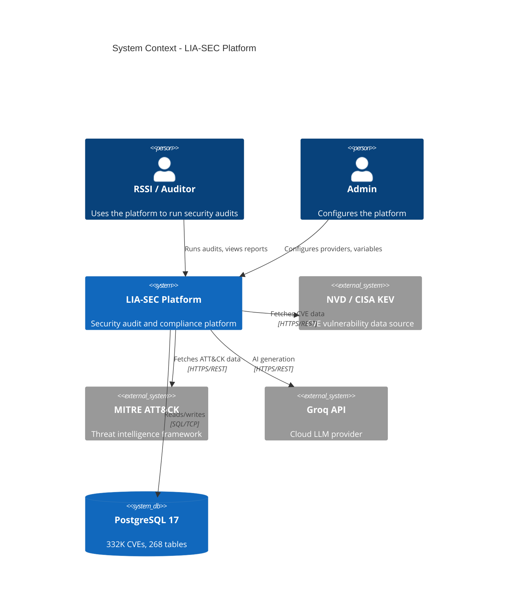
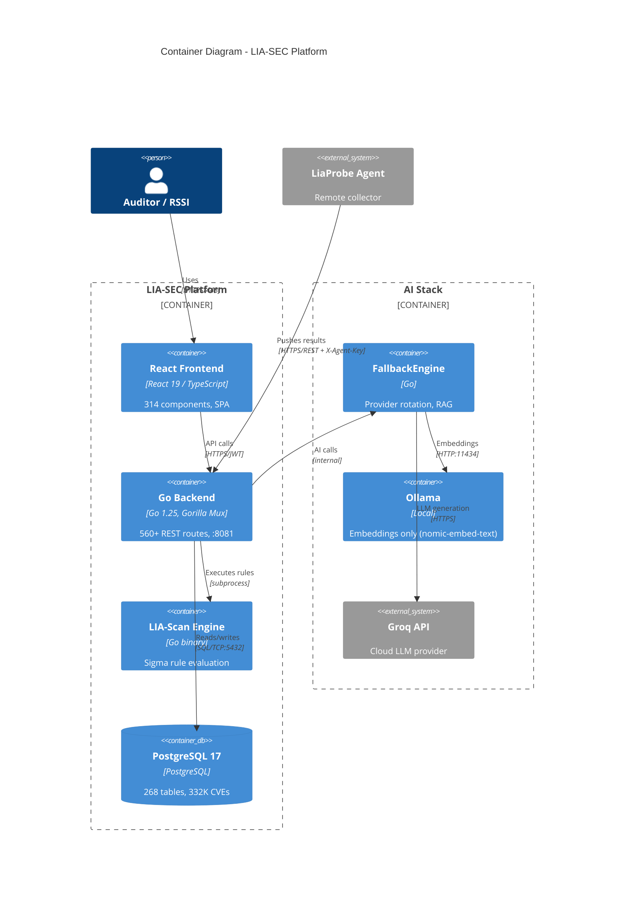
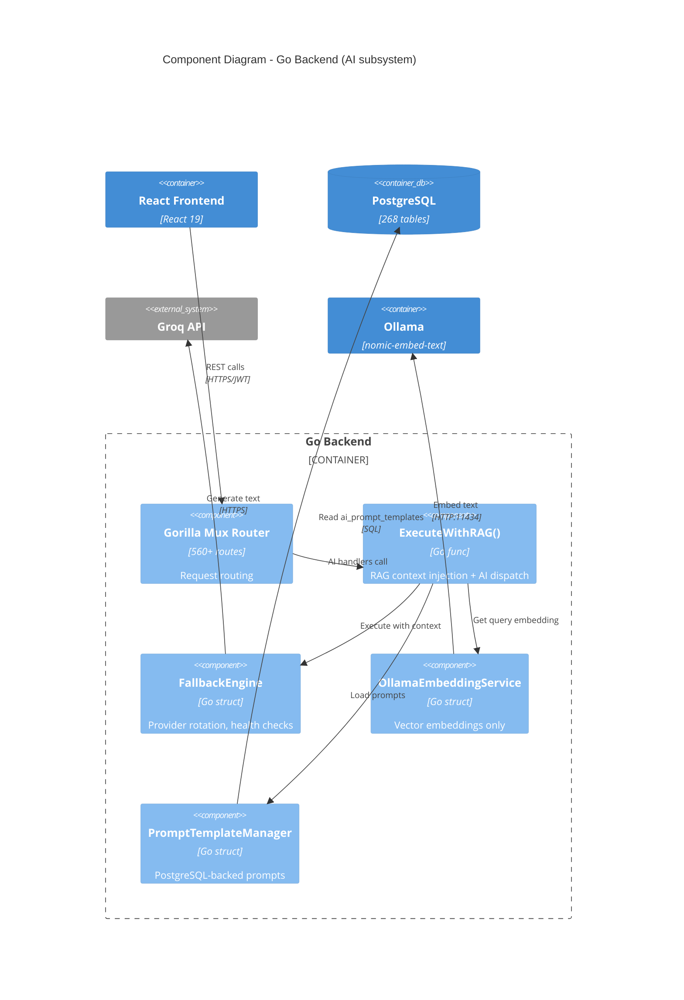
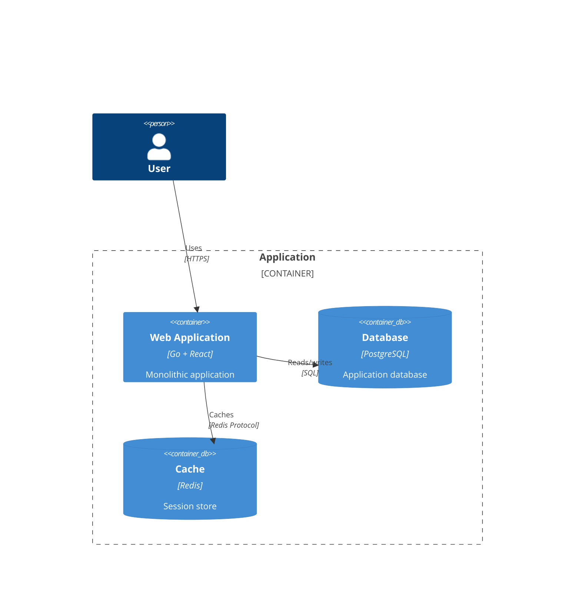
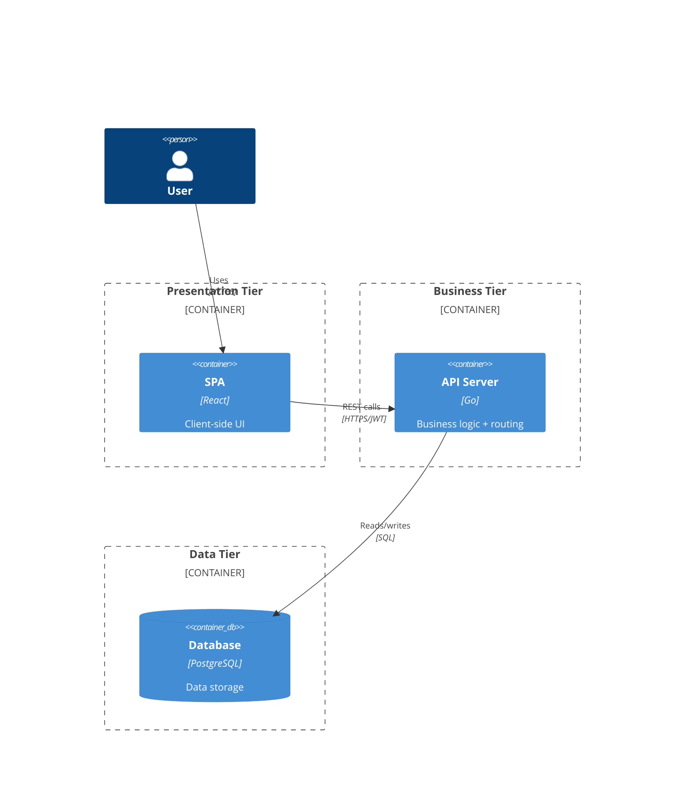
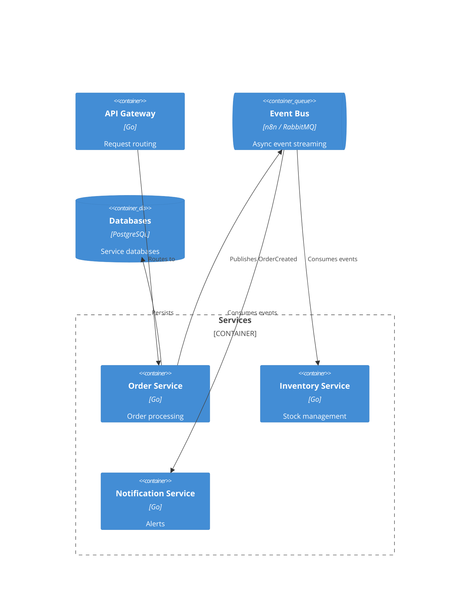

# C4 Model Diagrams

The C4 model provides a hierarchical way to visualize software architecture at different levels of abstraction: Context, Containers, Components, and Code.

## C4 Model Levels

1. **System Context** (`C4Context`) -- Shows the system and its users/external systems
2. **Container** (`C4Container`) -- Shows applications, databases, and services within the system
3. **Component** (`C4Component`) -- Shows internal structure of containers
4. **Code** -- Use regular `classDiagram` for class-level details

## C4 Context Diagram

Shows the big picture: your system and its relationships with users and external systems.



### Elements

**People:**
```
Person(id, "Label", "Description")
Person_Ext(id, "Label", "Description")   -- external user
```

**Systems:**
```
System(id, "Label", "Description")
System_Ext(id, "Label", "Description")  -- external system
SystemDb(id, "Label", "Description")    -- database system
SystemQueue(id, "Label", "Description") -- message queue
```

**Relationships:**
```
Rel(from, to, "Label")
Rel(from, to, "Label", "Technology")
BiRel(a, b, "Label")
```

## C4 Container Diagram

Zooms into the system to show containers (applications, databases, services).



### Container Elements

```
Container(id, "Label", "Technology", "Description")
ContainerDb(id, "Label", "Technology", "Description")
ContainerQueue(id, "Label", "Technology", "Description")
Container_Ext(id, "Label", "Technology", "Description")
Container_Boundary(id, "Label") { ... }
```

## C4 Component Diagram

Zooms into a container to show its internal components.



### Component Elements

```
Component(id, "Label", "Technology", "Description")
```

## Common Architecture Patterns

### Monolithic Application


### Three-Tier Architecture


### Event-Driven Architecture


## Best Practices

1. **Use appropriate level** -- Context for stakeholders, Container for architects, Component for developers
2. **Keep it focused** -- One system per Context diagram, one container per Component diagram
3. **Show key relationships** -- Don't clutter with every possible connection
4. **Add technology details** -- Specify frameworks, languages, protocols at Container/Component level
5. **Update regularly** -- Keep diagrams in sync with architecture changes (R20)
6. **Use boundaries** -- Group related containers/components logically
7. **Document protocols** -- Show communication methods (REST, gRPC, SQL, etc.)
8. **Highlight external systems** -- Use `*_Ext` variants for clarity
9. **Start simple** -- Begin with Context, drill down as needed
