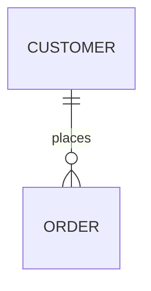
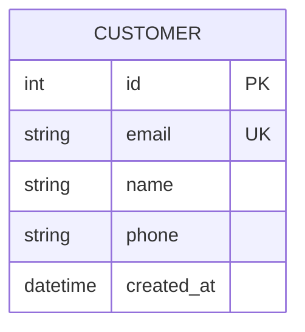
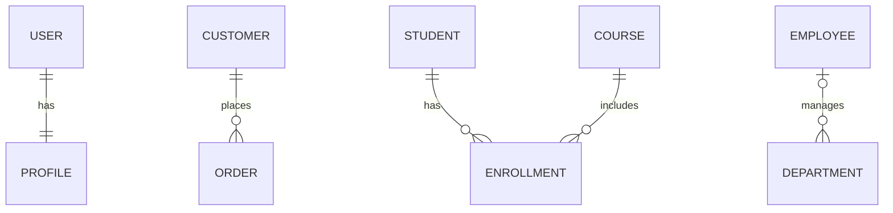
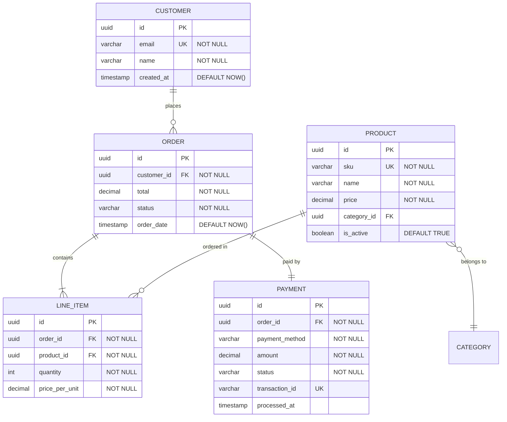
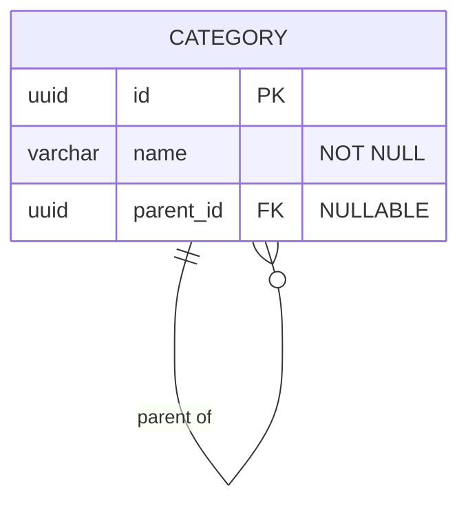
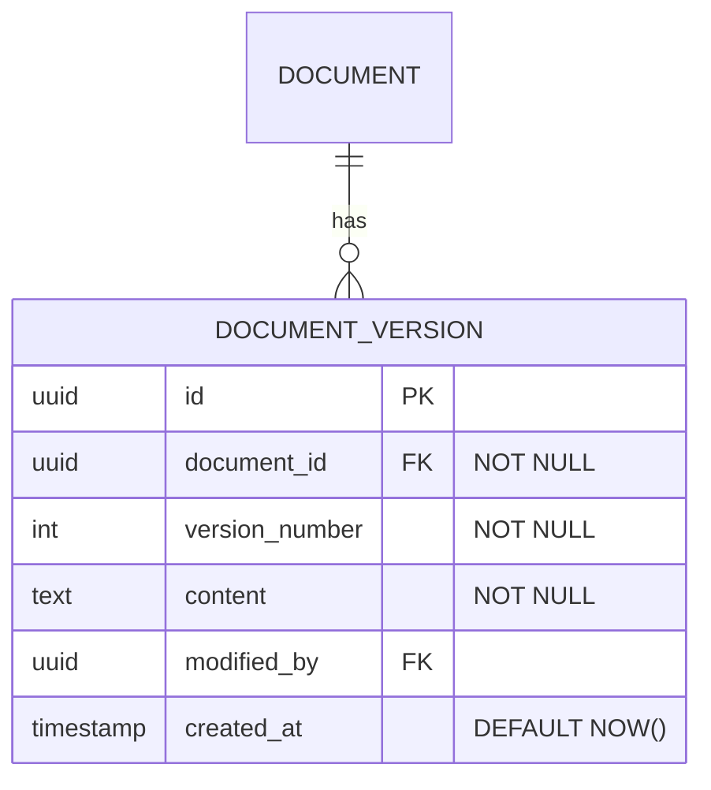
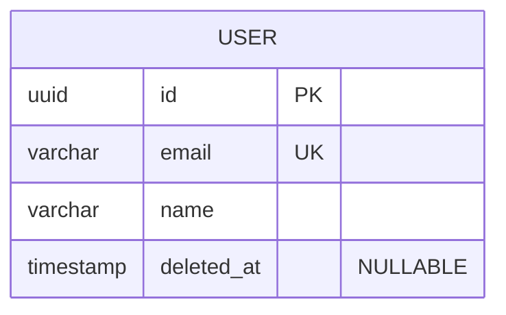

# Entity Relationship Diagrams (ERD)

ERDs model database schemas, showing tables (entities), their columns (attributes), and relationships between tables. Essential for database design and documentation.

## Basic Syntax



## Defining Entities



**Attribute format:** `type name constraints`

**Common constraints:**
- `PK` - Primary Key
- `FK` - Foreign Key
- `UK` - Unique Key
- `NN` - Not Null

## Relationship Symbols

**Cardinality indicators:**
- `||` - Exactly one
- `|o` - Zero or one
- `}{` - One or many
- `}o` - Zero or many

**Relationship line:**
- `--` - Non-identifying relationship
- `..` - Identifying relationship

### Common Relationships



## Data Types

Standard database types:
- `int`, `bigint`, `smallint`
- `varchar`, `text`, `char`
- `decimal`, `float`, `double`
- `boolean`, `bool`
- `date`, `datetime`, `timestamp`
- `json`, `jsonb`
- `uuid`
- `blob`, `bytea`

## LIA-SEC CVE Core Schema

```mermaid
erDiagram
    cve_nvd_data ||--o{ cisa_kev : tracked_in
    cve_nvd_data ||--o{ exploit_db : exploited_by
    cve_nvd_data ||--o{ cve_attack_mapping : mapped_to
    cve_nvd_data ||--o{ apt_mitre_mapping : linked_via
    apt_groups_reference ||--o{ apt_mitre_mapping : performs
    mitre_techniques ||--o{ cve_attack_mapping : covers

    cve_nvd_data {
        varchar cve_id PK
        decimal cvss_score
        varchar severity
        text description
        jsonb cpe_matches
        decimal epss_score
        timestamp published_date
        timestamp updated_at
    }

    cisa_kev {
        varchar cve_id FK PK
        date date_added
        date due_date
        text required_action
        boolean ransomware_use
    }

    exploit_db {
        integer exploit_id PK
        varchar cve_id FK
        varchar type
        text description
        date published
    }

    apt_groups_reference {
        varchar mitre_id PK
        varchar name UK
        varchar country
        text description
        jsonb aliases
    }
```

## Comprehensive Example: E-Commerce Database



## Common Patterns

### Self-Referencing (Hierarchical)


### Junction Table (Many-to-Many)
```mermaid
erDiagram
    STUDENT ||--o{ ENROLLMENT : has
    COURSE ||--o{ ENROLLMENT : includes

    ENROLLMENT {
        uuid student_id FK PK
        uuid course_id FK PK
        date enrolled_date
        varchar grade
    }
```

### Audit Trail


### Soft Deletes


## Best Practices

1. **Name entities in UPPERCASE** -- Convention for clarity
2. **Use singular names** -- `USER` not `USERS`, `ORDER` not `ORDERS`
3. **Define all constraints** -- Document PKs, FKs, UKs, NOT NULL
4. **Show cardinality accurately** -- Be precise about one-to-many vs many-to-many
5. **Include timestamps** -- created_at, updated_at for auditing
6. **Document computed columns** -- Mark calculated/derived values
7. **Show indexes** -- Document UK (unique keys) beyond PKs
8. **Consider junction tables** -- Explicitly model many-to-many relationships

## LIA-SEC ERD Guidelines

- Always show `created_at` / `updated_at` for audit tables
- JSONB columns: use comment `"JSONB"` to clarify
- Migrations live in `cmd/sigma_web/migrations/NNN_*.sql` -- ERD must stay in sync
- Use the `db-schema-designer` skill for new schema design with migration generation
