# Flowcharts

Flowcharts visualize processes, algorithms, decision trees, and user journeys. They show step-by-step progression through a system or workflow.

## Basic Syntax

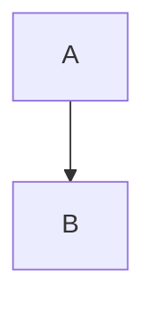

**Directions:**
- `TD` or `TB` - Top to Bottom (default)
- `BT` - Bottom to Top
- `LR` - Left to Right
- `RL` - Right to Left

## Node Shapes

| Shape | Syntax | Use case |
|-------|--------|----------|
| Rectangle (default) | `A[Process step]` | Standard process |
| Rounded rectangle | `B([Rounded])` | Start/end |
| Stadium/Pill | `C(Start or End)` | Entry/exit points |
| Subroutine | `D[[Subroutine]]` | Called subprocess |
| Cylindrical | `E[(Database)]` | Storage |
| Circle | `F((Circle))` | Events |
| Rhombus | `G{Decision?}` | Yes/No branch |
| Hexagon | `H{{Hexagon}}` | Preparation |
| Parallelogram | `I[/Input Output/]` | I/O operations |
| Trapezoid | `J[/Trapezoid\]` | Manual operation |

## Connections

```mermaid
flowchart LR
    A --> B           %% Basic arrow
    C --- D           %% Open link (no arrow)
    E -->|Label| F    %% Labeled arrow
    G -.-> H          %% Dotted arrow
    I ==> J           %% Thick arrow
    K -.Label.-> L    %% Dotted labeled
    M ==Label==> N    %% Thick labeled
```

### Multi-target chaining
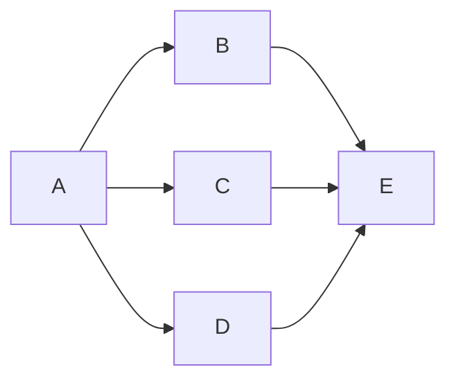

## Subgraphs

Group related nodes:

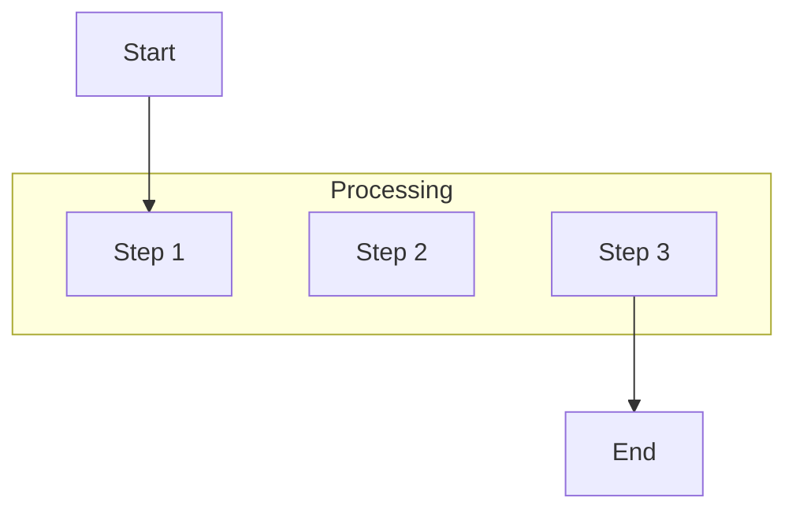

### Nested Subgraphs with Direction
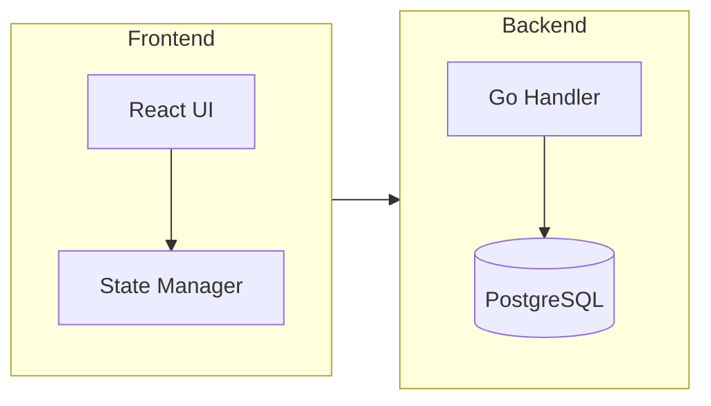

## Styling

### Class-based Styling
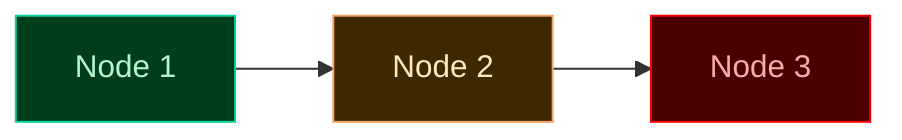

### Individual Node Styling
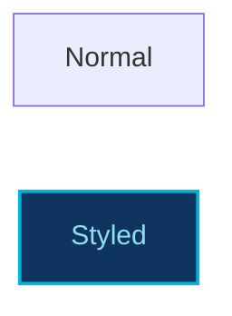

## Comprehensive Example: LIA-Scan Rule Validation Pipeline

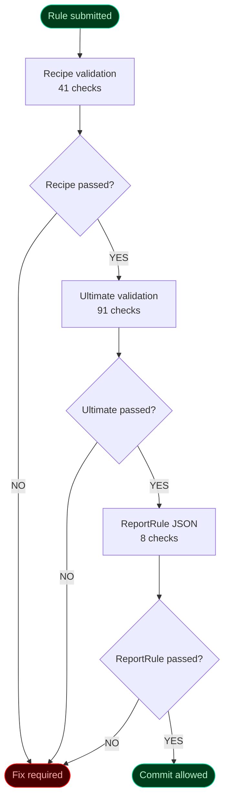

## CI/CD Pipeline Example

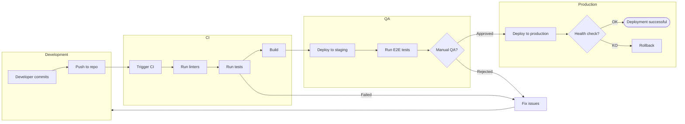

## Common Patterns

### Branching Decision
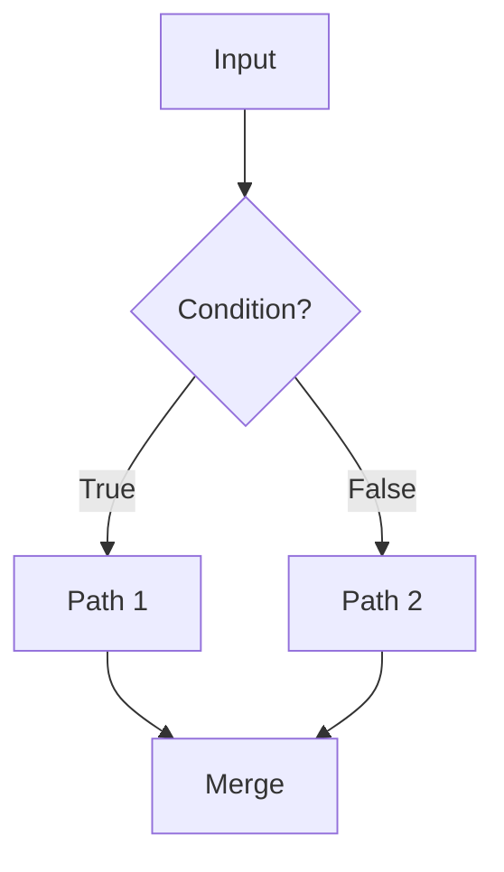

### Loop Pattern
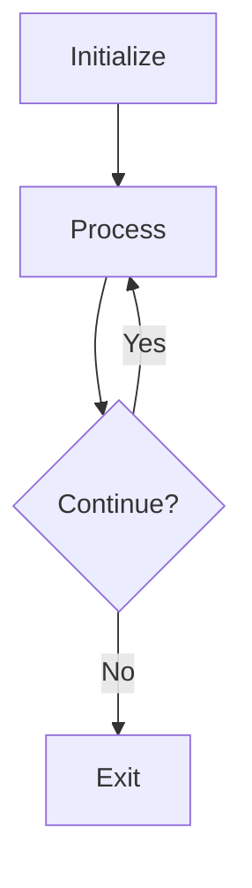

### Error Handling
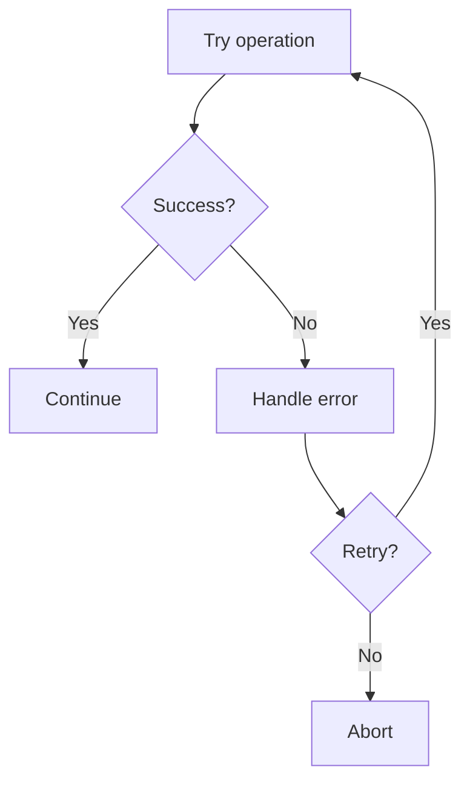

## Best Practices

1. **Meaningful labels** -- Node text should be clear and action-oriented
2. **Consistent shapes** -- Same shapes for same types of actions
3. **Decision nodes as diamonds** -- Standard convention for yes/no decisions
4. **Flow top-to-bottom or left-to-right** -- Natural reading direction
5. **Start and end nodes** -- Use stadium shapes to mark entry/exit
6. **Group related steps** -- Use subgraphs for logical groupings
7. **Color code** -- Highlight different types of actions (see classDef above)
8. **Keep it focused** -- One process per diagram; split complex flows
