# Sequence Diagrams

Sequence diagrams show interactions between participants over time. Ideal for API flows, authentication sequences, and system component interactions.

## Basic Syntax

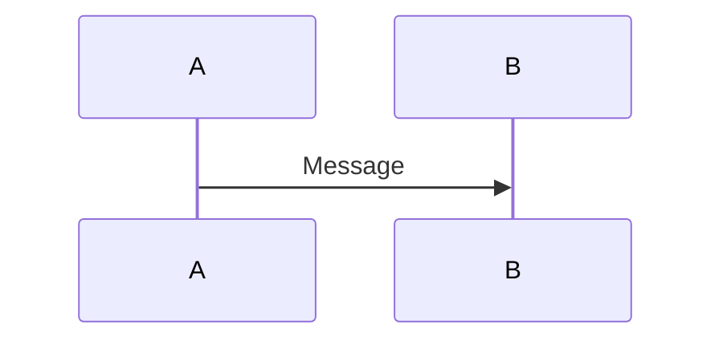

## Participants and Actors

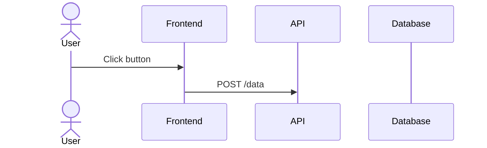

**Difference:**
- `participant` - System components (services, classes, databases)
- `actor` - External entities (users, external systems)

## Message Types

### Solid Arrow (Synchronous)
- `->>`  Solid arrow (request)
- `-->>`  Dotted arrow (response/return)

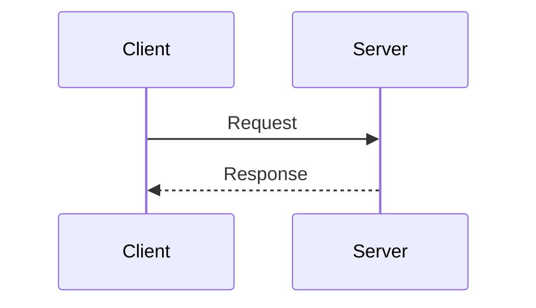

### Open Arrow (Asynchronous)
- `-)` Solid open arrow
- `--)` Dotted open arrow

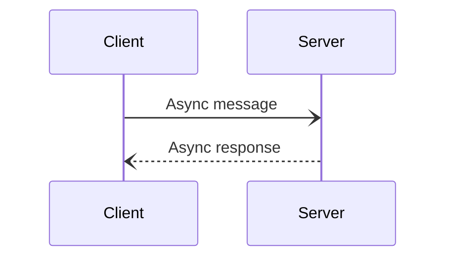

### Cross/X (Delete)
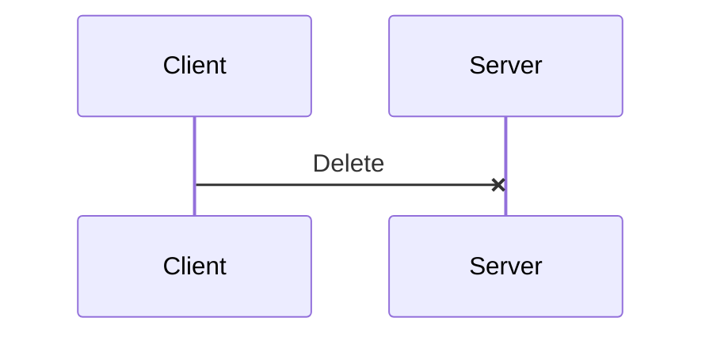

## Activations

Show when a participant is actively processing:

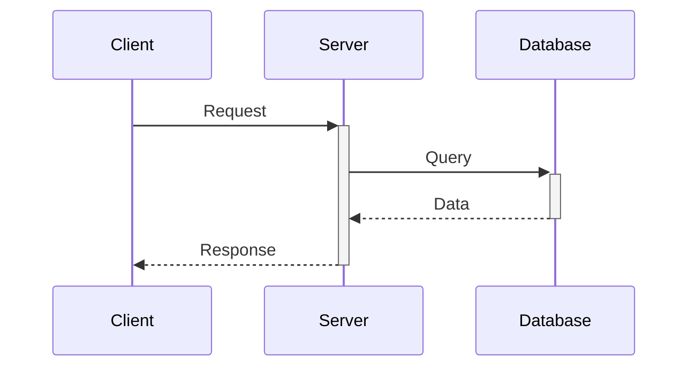

- `+` after arrow activates
- `-` before arrow deactivates

## Alt/Else (Conditional Logic)

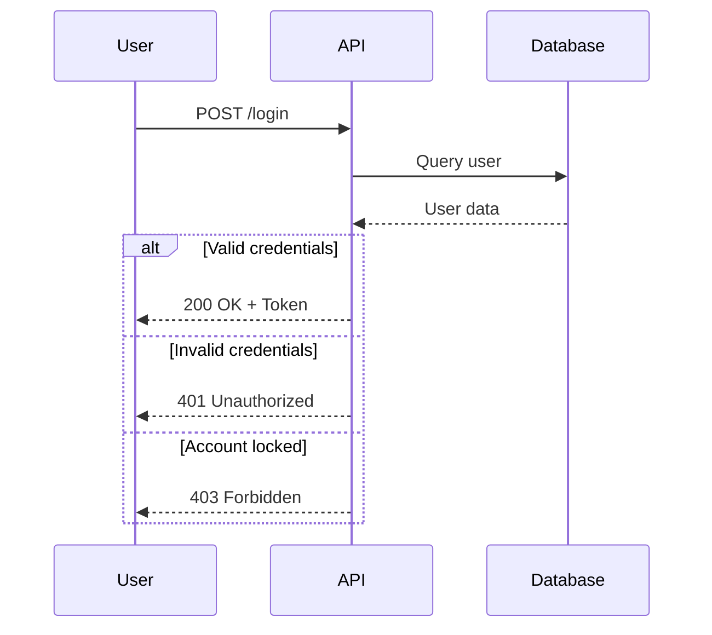

## Opt (Optional)

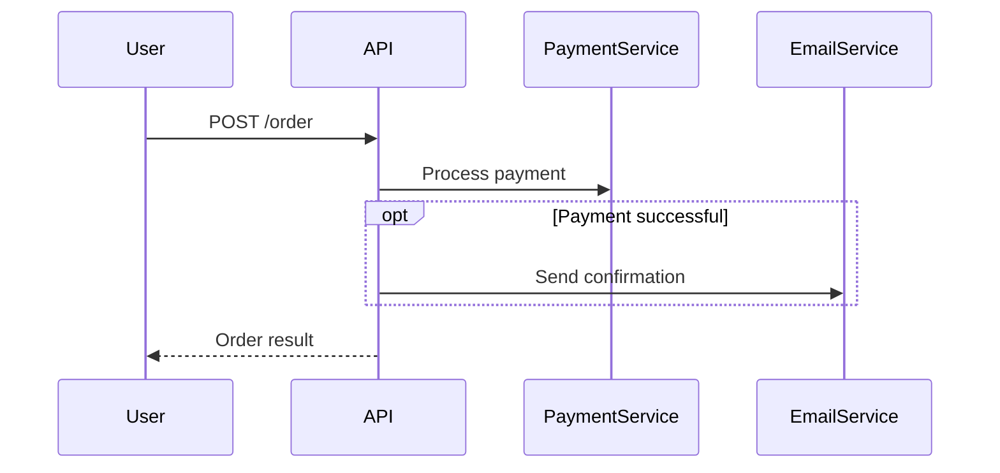

## Par (Parallel)

Show concurrent operations:

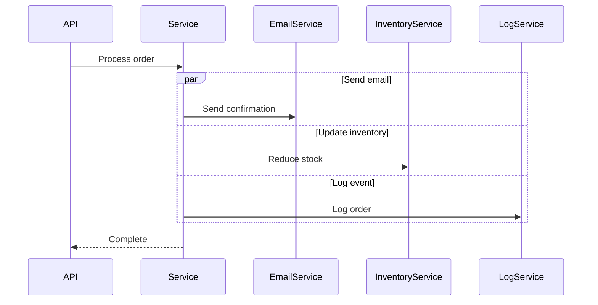

## Loop

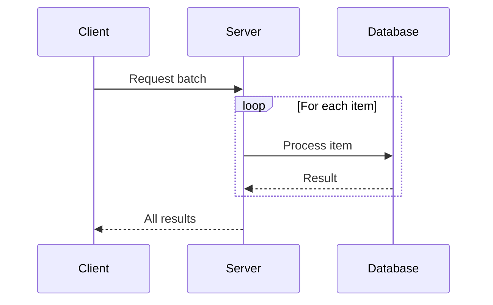

## Break (Early Exit)

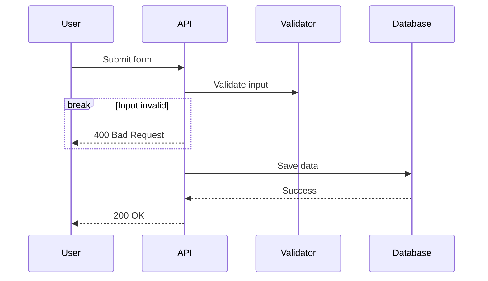

## Notes

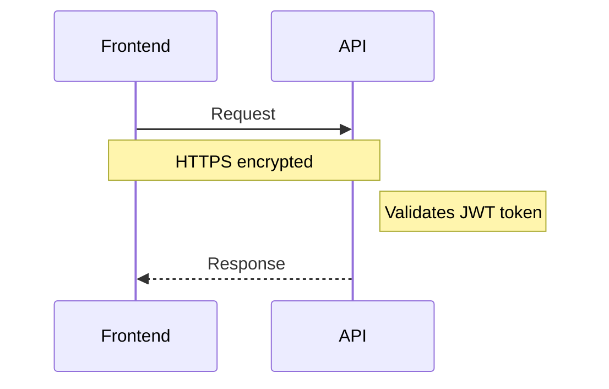

## Sequence Numbers

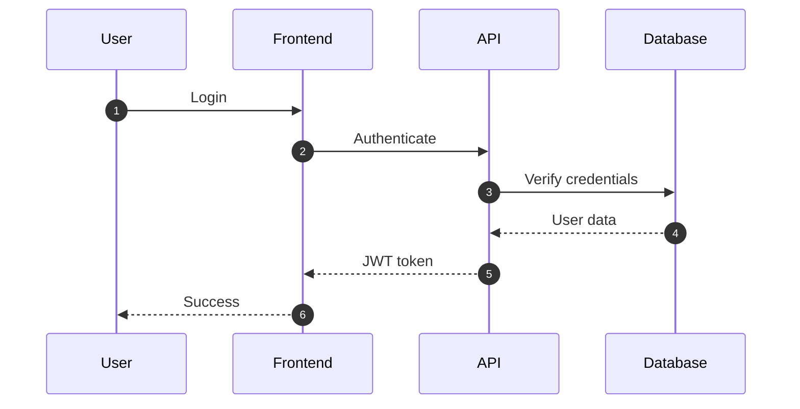

## Comprehensive Example: LIA-SEC JWT Auth Flow

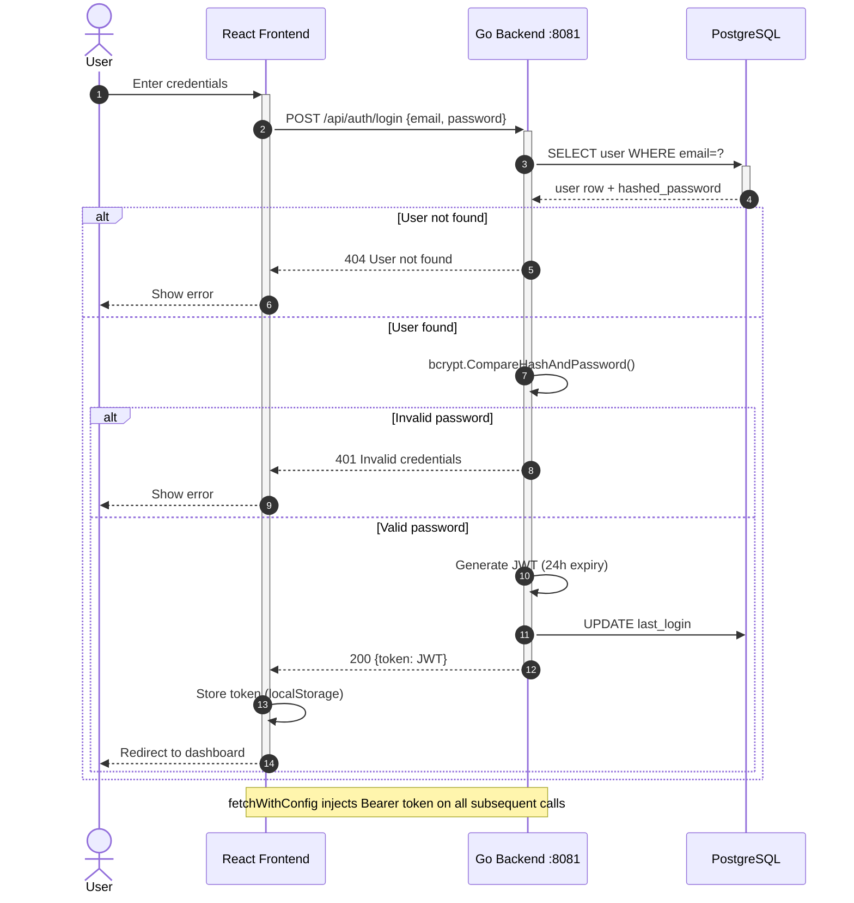

## Microservices Communication

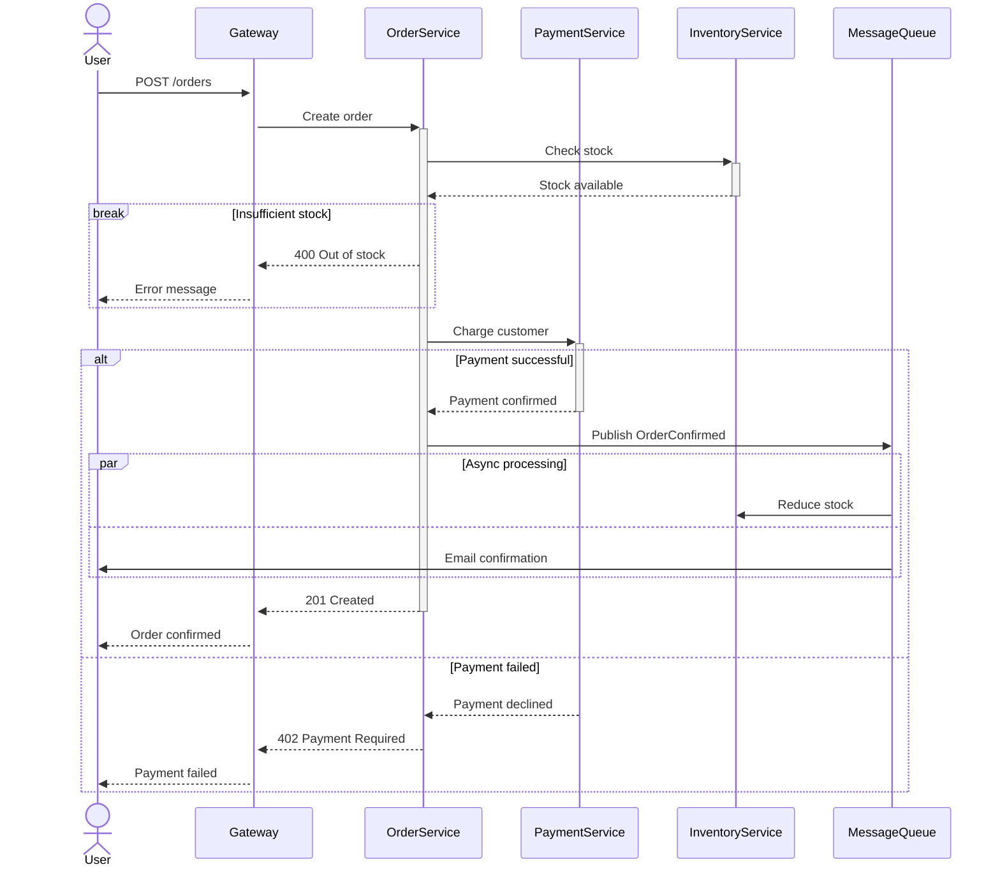

## Best Practices

1. **Order participants logically** -- User -> Frontend -> Backend -> Database
2. **Use activations** -- Shows when components are actively processing
3. **Group related logic** -- Use `alt`/`opt`/`par` to organize conditional flows
4. **Add descriptive notes** -- Explain complex logic or important details
5. **Keep diagrams focused** -- One scenario per diagram
6. **Number messages** -- Use `autonumber` for complex flows
7. **Show error paths** -- Document failure scenarios with `alt`/`else`
8. **Indicate async operations** -- Use open arrows (`-)`) for fire-and-forget

## Common Use Cases (LIA-SEC)

| Scenario | Participants |
|----------|-------------|
| JWT authentication | User, React, Go Backend, PostgreSQL |
| AI call (ExecuteWithRAG) | Handler, FallbackEngine, Groq API, Ollama |
| ETL pipeline trigger | n8n, ETL Scheduler, PostgreSQL, External APIs |
| Rule validation | UI, Backend, LIA-Scan Engine, PostgreSQL |
| Discovery scan | Frontend, Backend, LiaProbe Agent, CMDB |
