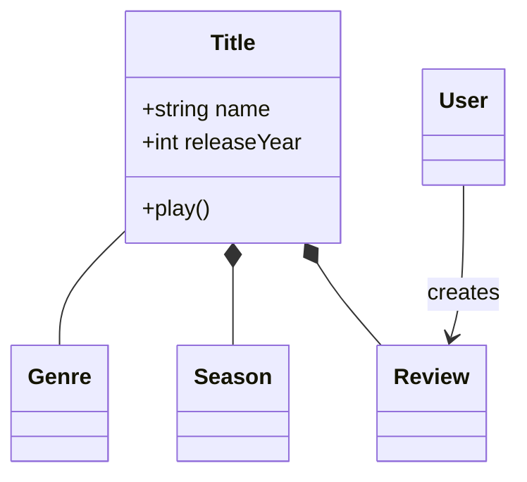
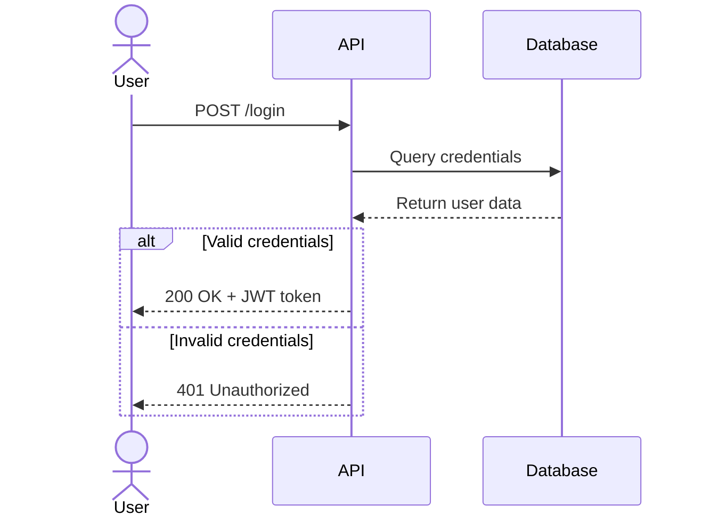
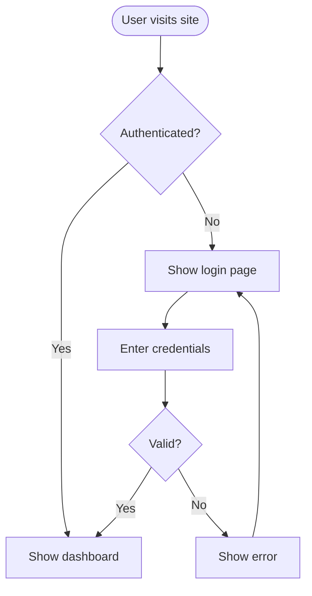
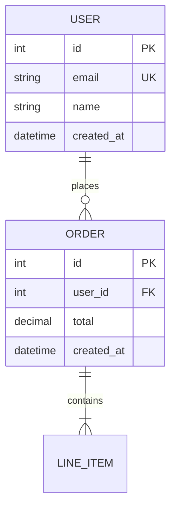
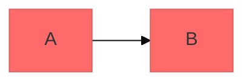

# Mermaid Diagramming -- Syntax & Type Selection Guide

Comprehensive guide for creating software diagrams using Mermaid syntax.
Source: softaworks/agent-toolkit (adapted for LIA-SEC).

## Core Syntax Structure

All Mermaid diagrams follow this pattern:

```
diagramType
  definition content
```

**Key principles:**
- First line declares diagram type (`classDiagram`, `sequenceDiagram`, `flowchart`, etc.)
- Use `%%` for comments
- Line breaks and indentation improve readability but are not required
- Unknown words break diagrams; parameters fail silently

**LIA-SEC MANDATORY: all `.mmd` files must start with the `%%{init}%%` block:**
```
%%{init: {'theme': 'dark', 'themeVariables': {'primaryColor': '#0d1b2a', 'primaryTextColor': '#a8dadc', 'primaryBorderColor': '#1e6091', 'lineColor': '#00b4d8', 'secondaryColor': '#1a1a2e', 'tertiaryColor': '#0f3460', 'background': '#050d1a', 'mainBkg': '#0d1b2a', 'nodeBorder': '#1e6091', 'clusterBkg': '#0f1e30', 'titleColor': '#90e0ef', 'edgeLabelBackground': '#0f3460', 'fontSize': '14px', 'fontFamily': 'JetBrains Mono, monospace'}}}%%
```

---

## Diagram Type Selection Guide

| Situation | Diagram Type | Reference |
|-----------|-------------|-----------|
| Domain modeling, OOP design, entity relationships | `classDiagram` | `mermaid-class-diagrams.md` |
| API request/response flows, auth sequences | `sequenceDiagram` | `mermaid-sequence-diagrams.md` |
| Processes, algorithms, decision trees, user journeys | `flowchart` | `mermaid-flowcharts.md` |
| Database schemas, table relationships | `erDiagram` | `mermaid-erd-diagrams.md` |
| Software architecture (system/container/component levels) | `C4Context`, `C4Container`, `C4Component` | `mermaid-c4-diagrams.md` |
| Cloud infra, CI/CD deployments, service topology | `architecture-beta` | `mermaid-architecture-diagrams.md` |
| State machines, lifecycle states | `stateDiagram-v2` | - |
| Project timelines, PDCA cycles, kill chains | `gantt` | `mermaid-templates.md` |
| Versioning strategy | `gitGraph` | - |
| Data distribution | `pie`, `xychart-beta` | - |
| Configuration, theming, layouts | - | `mermaid-advanced-features.md` |

---

## Quick Start Examples

### Class Diagram (Domain Model)


### Sequence Diagram (API Flow)


### Flowchart (Process)


### ERD (Database Schema)


---

## Best Practices

1. **Start Simple** -- Begin with core entities/components, add details incrementally
2. **Use Meaningful Names** -- Clear labels make diagrams self-documenting
3. **Comment Extensively** -- Use `%%` comments to explain complex relationships
4. **Keep Focused** -- One diagram per concept; split large diagrams into multiple focused views
5. **Version Control** -- Store `.mmd` files alongside code for easy updates
6. **Add Context** -- Include titles and notes to explain diagram purpose
7. **Iterate** -- Refine diagrams as understanding evolves

---

## Configuration and Theming

Configure diagrams using frontmatter (alternative to `%%{init}%%` for inline use):



**Available themes:** `default`, `forest`, `dark`, `neutral`, `base`

**Layout options:**
- `layout: dagre` (default) -- Classic balanced layout
- `layout: elk` -- Advanced layout for complex diagrams (>20 nodes)

**Look options:**
- `look: classic` -- Traditional Mermaid style
- `look: handDrawn` -- Sketch-like appearance

---

## Common Pitfalls

- **Breaking characters** -- Avoid `{}` in comments; use proper escape sequences for special characters
- **Syntax errors** -- Misspellings break diagrams; validate syntax in Mermaid Live (`https://mermaid.live`)
- **Overcomplexity** -- Split complex diagrams into multiple focused views
- **Missing `%%{init}%%`** (LIA-SEC) -- All `.mmd` files must start with the dark theme init block
- **Markdown fence wrapper** -- `.mmd` files must NOT be wrapped in ` ```mermaid ``` ` fences

---

## When to Create Diagrams

Always diagram when:
- Starting new modules or features (architecture, component tree)
- Documenting complex API flows (sequence diagram)
- Designing database schemas (ERD)
- Planning refactoring efforts (before/after diagrams)
- Onboarding: document relations, flows, and dependencies

**B5 rule (CLAUDE.md):** Systematically propose a diagram when relations, flows, or dependencies exist.

---

## Exporting and Rendering

> NOTE (2026-05-29): render_diagrams.sh / SVG pre-rendering is VESTIGIAL -- the actual rendering is client-side (mermaidClient.js, dark theme global). diagrams/svg/ is not consumed by any .md file and is empty. Do not install mmdc for this reason. See _alire/01_DOCUMENTATION/architecture/mermaid_render_pipeline_arch_en.md.

**Pre-render SVG (LIA-SEC pipeline):**
```bash
bash .claude/skills/doc-librarian/scripts/render_diagrams.sh
# Output: _alire/01_DOCUMENTATION/diagrams/svg/
```

**Manual export:**
```bash
mmdc -i input.mmd -o output.svg -w 1920 -H 1080 -b transparent
```

**Online:** https://mermaid.live (PNG/SVG export)

---

## References Index

| File | Content |
|------|---------|
| `mermaid-class-diagrams.md` | Class relationships, multiplicity, stereotypes, DDD patterns |
| `mermaid-sequence-diagrams.md` | Participants, message types, alt/loop/par, autonumber |
| `mermaid-flowcharts.md` | Node shapes, connections, subgraphs, styling |
| `mermaid-erd-diagrams.md` | Entities, relationships, cardinality, constraints, patterns |
| `mermaid-c4-diagrams.md` | C4Context, C4Container, C4Component, microservices patterns |
| `mermaid-architecture-diagrams.md` | architecture-beta, groups, services, icon packs |
| `mermaid-advanced-features.md` | Themes, layouts, ELK, click events, SVG export options |
| `mermaid-templates.md` | LIA-SEC JSON templates for generate_mermaid.py |
