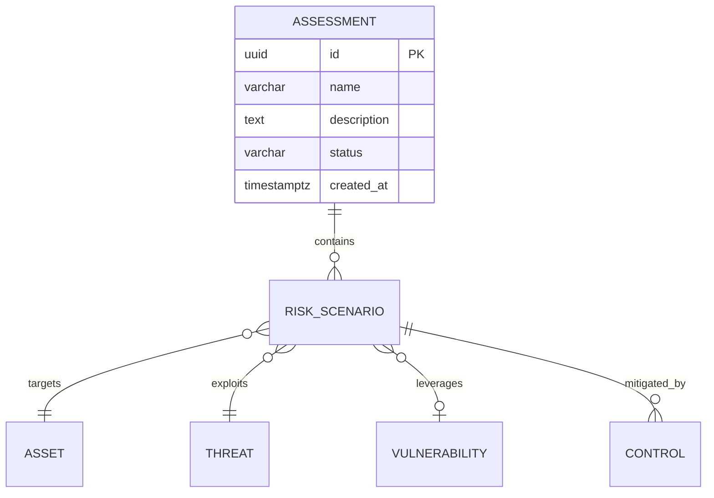

# Schema Templates -- Spec-Builder Reference

## ERD Mermaid Template (Phase 3a)



## SQL DDL Template (Phase 3b)

```sql
-- Migration : cmd/sigma_web/migrations/NNN_{module}.sql
-- Date : YYYY-MM-DD
-- Description : {Module} schema

CREATE TABLE {prefix}_assessments (
    id UUID PRIMARY KEY DEFAULT gen_random_uuid(),
    name VARCHAR(200) NOT NULL,
    description TEXT,
    status VARCHAR(20) DEFAULT 'draft'
        CHECK (status IN ('draft','in_progress','review','validated','archived')),
    created_by TEXT,
    created_at TIMESTAMPTZ DEFAULT NOW(),
    updated_at TIMESTAMPTZ DEFAULT NOW()
);

-- Index
CREATE INDEX idx_{prefix}_assessments_status ON {prefix}_assessments(status);
```

## SQL Rules LIA-SEC

- `UUID PRIMARY KEY DEFAULT gen_random_uuid()` (jamais SERIAL)
- `TIMESTAMPTZ DEFAULT NOW()` (jamais TIMESTAMP)
- `CHECK` constraints pour les enums
- `GENERATED ALWAYS AS ... STORED` pour les colonnes calculees
- `ON DELETE CASCADE` pour les FK enfants
- `ON DELETE SET NULL` pour les FK optionnelles
- Index sur les colonnes de filtre frequentes
- Prefixe module sur toutes les tables

## Data Dictionary Template (Phase 3c)

| Table | Colonne | Type | Nullable | Description | Exemple |
|-------|---------|------|----------|-------------|---------|
| {prefix}_assessments | id | UUID | NOT NULL | Identifiant unique | `a1b2c3...` |
| {prefix}_assessments | name | VARCHAR(200) | NOT NULL | Nom de l'evaluation | "Audit Q1 2026" |
