# Foundational architecture -- inspect_ia_agents (acceptance-testing platform)

> Product name: **inspect_ia_agents** (formerly "AgentRail").
>
> Reference document. Explains what this repo does, how it is built,
> and what kinds of test agents it produces. The operational runbooks
> (launching the lab, the API, the console) are in `docs/runbooks/`.

Date: 2026-06-12
Verified against the code (R13): `recette/`, `corpus/`, `console/src/`.
Diagrams generated from `scripts/diagrams/architecture.py`
(`python3 scripts/gen_diagrams.py --write|--check|--render`, see section 10).

---

## 1. Raison d'etre: acceptance-test the tools, do not build them

This repo is **not** the discovery tool, nor the identification tool, nor the
inspect_ia_agents governance platform. It is the **acceptance-testing platform** for those
tools: it manufactures **test subjects with known ground truth**,
brings them to life (launch, campaigns, replayable recordings), and measures whether
the product's tools give the right answer.

Two tools are under test:

| Tool under test | Question asked | Corresponding recette |
|---|---|---|
| **Discovery** | "Can it SPOT an AI agent and understand what it connects to?" | `corpus/repos|gitlab|temporal|openapi|manifests` + `python -m recette discovery` |
| **Identification / evaluation** | "Can it JUDGE whether an agent is correct (4 dimensions)?" | `corpus/agents/` + `python -m recette run` |

<!-- mermaid:context-recette (generated: scripts/diagrams/architecture.py) -->
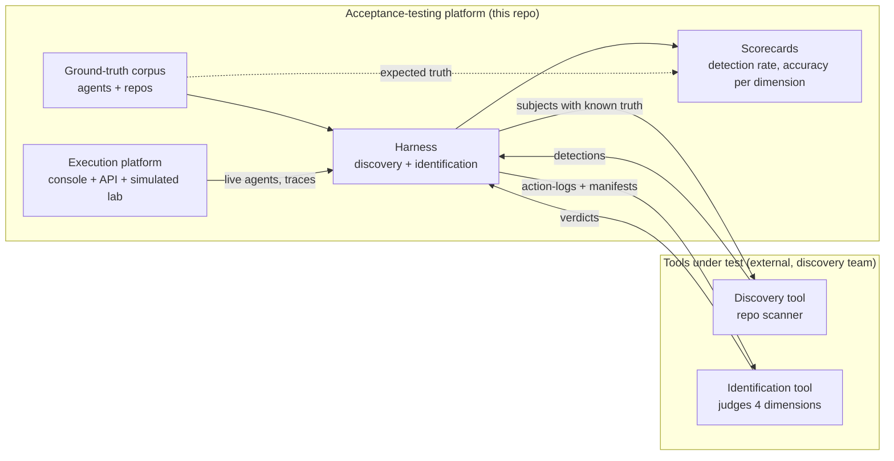

The acceptance-testing loop is always the same:

```
author un agent (proprietes connues, verdict attendu)
  -> discovery doit le trouver          (detecte ? oui/non vs expected_discovery.detectable)
  -> identification rend un verdict     (verdict == ground-truth ?)
  -> comparer, tracer la preuve, agreger en scorecard
```

The real tools plug in via the `DiscoveryAdapter` /
`IdentificationAdapter` / `SourceScanAdapter` protocols (`recette/adapters.py`,
`recette/http_adapter.py`). The provided `Reference*Adapter` implementations are a correct
reference evaluator: they serve as an oracle (self-consistency of the corpus) and as a
template of what a real tool must produce.

---

## 2. Component overview

<!-- mermaid:components (generated: scripts/diagrams/architecture.py) -->
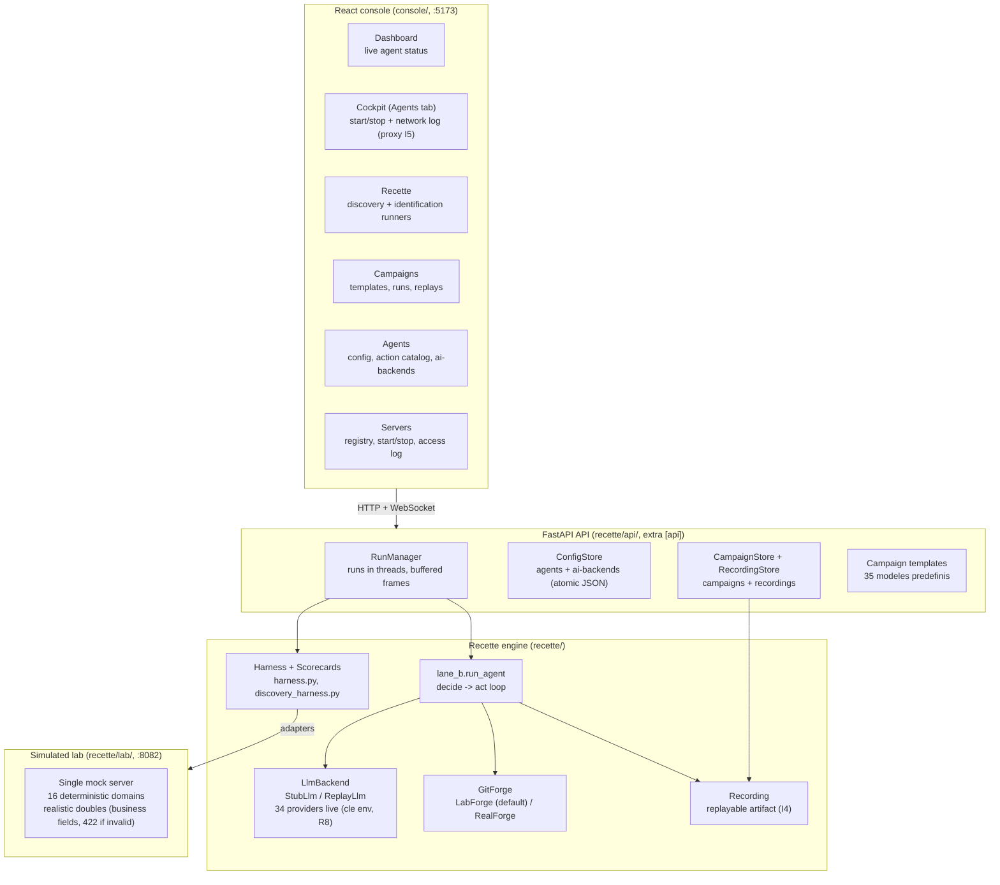

Three layers, three responsibilities:

1. **Console** (`console/`, React + Vite + TS): the discovery team's
   control station. Seven recette tabs (including Servers, the target registry); the governance pages (Catalog,
   Approvals, Audit), separated in the nav, expose the governed
   execution path from section 8 (policy catalog, approvals inbox I6,
   audit trail I1).
2. **API** (`recette/api/`): optional FastAPI (extra `[api]`). Exposes the
   agent config, run launch/stop, campaigns, the
   recordings, the action catalog -- plus the routes of the governed
   path (section 8): `/actions/execute`, `/policies`, `/approvals`,
   `/audit`. All persistent state is atomic JSON under `config/` and
   `data/` (paths overridable by env, R5), except the governed event store
   (append-only SQLite).
3. **Engine** (`recette/`): pure stdlib Python (zero hard dependency beyond
   `jsonschema`), deterministic. This is what the `unittest` tests exercise
   without any installation.

### Flow of a run (lifecycle)

<!-- mermaid:run-lifecycle (generated: scripts/diagrams/architecture.py) -->
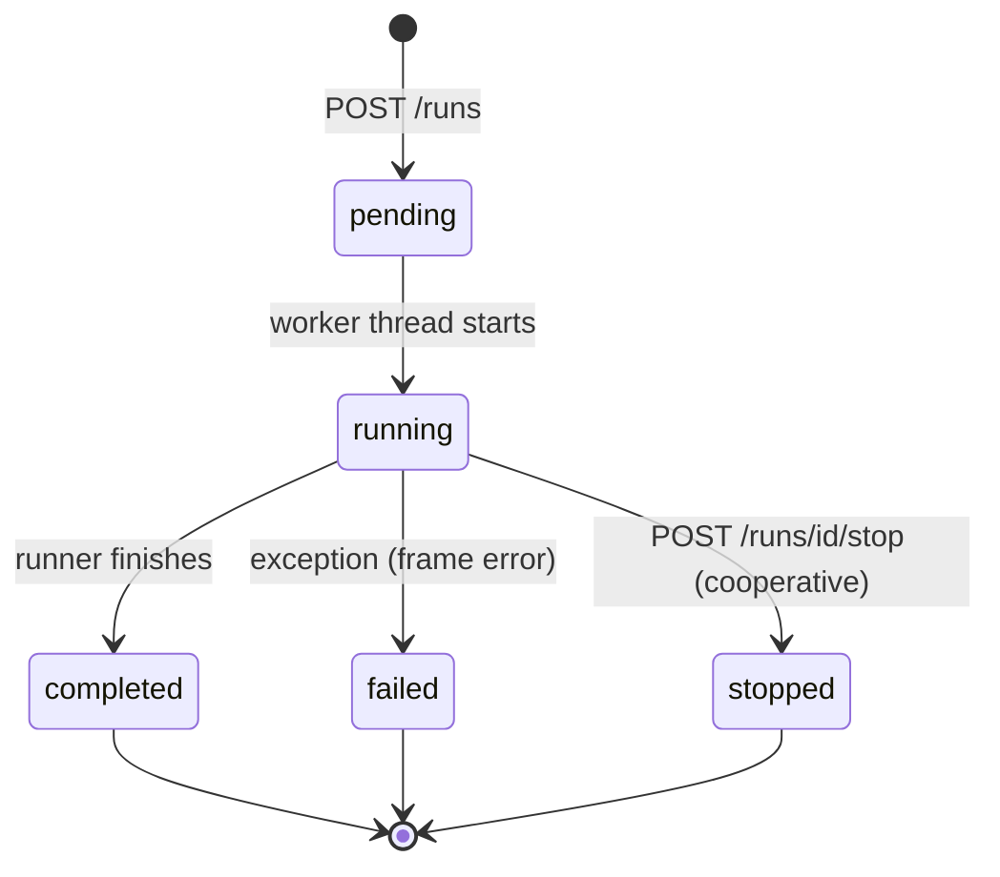

Each run emits ordered **frames** `{seq, type, data}` (types: `start`,
`step`, `result`, `agent_start`, `agent_done`, `step_error`, `campaign_done`,
`replay_result`, `error`, `end`). They are buffered (re-readable via
`GET /runs/{id}/events`) and pushed live on `GET /runs/{id}/ws`. Five
run kinds: `lane_b`, `discovery`, `identification`, `campaign`, `replay`.

---

## 3. The two recettes in detail

### 3.1 Identification recette (action-log)

The test subject is an **agent with scripted, deterministic behavior**:

- `manifest.json` -- what the agent **declares** (identity, `capability_scope`
  with read/write mode and resource globs).
- `scenario.json` / stored scenario -- what the agent actually **does**
  (ordered actions).
- `ground-truth.json` -- what the tools **must conclude** (detectable
  yes/no, expected state of each of the 4 dimensions, overall verdict).

**The gap between the declared and the done is the raw material of the recette**:
a correct agent does exactly what it declares; an incorrect agent breaks
exactly one dimension.

The 4 judged dimensions (reference computation in
`ReferenceIdentificationAdapter`, `recette/adapters.py`):

| # | Dimension | Invariant | How the oracle computes it |
|---|---|---|---|
| 1 | **Identity** | I3 | all observed `principal`s == declared principal |
| 2 | **Declared vs actual capabilities** | I2 | every observed action is within the declared scope (known action, non-escalated mode, resource within the globs) |
| 3 | **Policy conformance** | I6 | every escalate-class action (`merge_pr`, `push`, `manage_webhook`, `manage_release`, `trigger_ci`) carries `approved=true` |
| 4 | **Behavior** | - | no spam (same action on the same resource >= 5 times = anomaly) |

Overall verdict `correct` iff all 4 dimensions pass.

### 3.2 Discovery recette (source repos)

The test subject is a **publishable repo** (code + CI/CD + declarative surface)
that the colleague's scanner analyzes. Five **surfaces** are covered, each
with the same 4 roles:

| Surface | Corpus | Detection signal |
|---|---|---|
| `github` | `corpus/repos/` | `.inspect_ia_agents/manifest.json` manifest or Python code importing the `github` SDK |
| `gitlab` | `corpus/gitlab/` | same on the GitLab side |
| `temporal` | `corpus/temporal/` | real `temporalio` code, `@activity.defn` whose name is a canonical action (static AST analysis) |
| `openapi` | `corpus/openapi/` | `openapi.json` whose `operationId` / `x-inspect_ia_agents-action` are canonical actions |
| `mcp` | `corpus/manifests/` | MCP manifests |

The 4 roles per surface: `pr-bot` (bounded write), `readonly-reporter` (read
only), `admin-overreach` (high blast radius), `no-agent` (**true negative** --
the scanner must find NOTHING).

The discovery ground truth fixes only **invariant properties**:
detection yes/no, number of distinct agents (dedup), coverage of the
`action_pattern`, `target_system`, **relative order** of risk levels,
determinism (two scans = same results), presence of a generated policy
for levels >= 2. Never an opaque value (exact canonical id, exact
score): the contract stays stable as the tool evolves.

---

## 4. Agent <-> server architecture: where the discovery engine captures an agent

The product's central question: **how can the inspect_ia_agents discovery engine
spot an AI agent and understand what it does?** The recette answers it
by building, for each possible capture point, a known-ground-truth test
field.

### 4.1 Agent <-> server topology in the lab

<!-- mermaid:lab-topology (generated: scripts/diagrams/architecture.py) -->
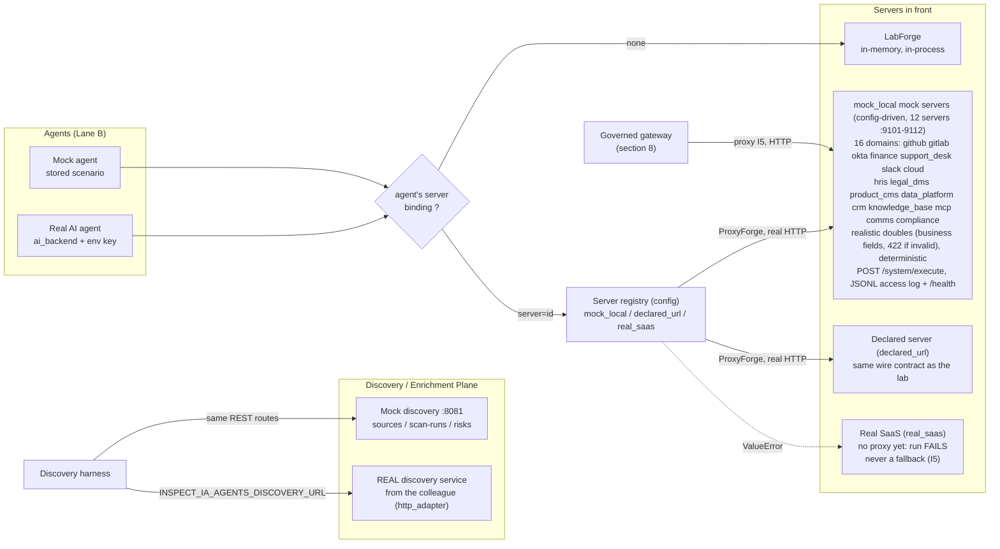

What an agent faces is chosen by the ConfigStore's **server registry**
(`servers[]`, three modes) and the agent's `server` field:

| Server mode | Implementation | Behavior |
|---|---|---|
| *(no binding)* | `LabForge` in-memory | historical, in-process, no network traffic |
| `mock_local` | `ProxyForge` -> mock lab on the declared port | **real observable HTTP traffic**, lifecycle driven by the `ServerManager` (start/stop/status/log via the API) |
| `declared_url` | `ProxyForge` -> provided `base_url` | any server speaking the lab's wire contract (`POST /{target_system}/execute`, `{success, data}` envelope) |
| `real_saas` | none (no real-SaaS proxy yet) | `ValueError` -> the run FAILS; never a silent fallback to another proxy (I5) |

Fail-safe routing rule (`recette/platform/proxy/router.py`): a dangling
server reference or an unknown mode makes the run FAIL --
executing side effects against the wrong system would be an
I5 violation, so no fallback by default.

On the discovery plane side, two interchangeable implementations: the mock :8081
answers exactly what a correct scanner MUST answer (backed by the
`ReferenceSourceScanAdapter` oracle), the real service plugs in via the same
REST interface (`recette/http_adapter.py`, URL and token by env).

### 4.2 The three agent capture points

An AI agent is observable at three moments. The recette provides
ground truth for each:

<!-- mermaid:capture-points (generated: scripts/diagrams/architecture.py) -->
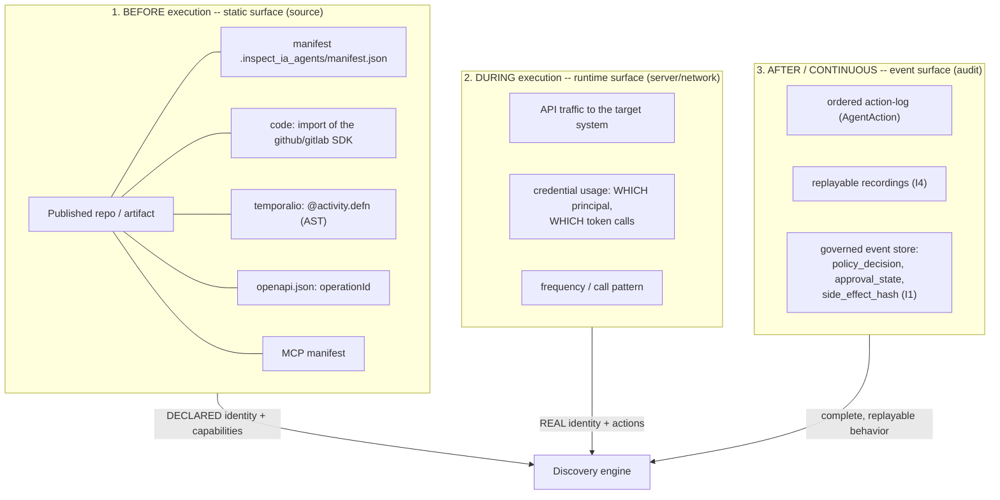

| Capture point | What discovery can deduce from it | What the recette provides as a test field | Verified by |
|---|---|---|---|
| **Static (source)**: scan the repo before the agent runs | declared identity, `target_system`, declared capabilities, CI/CD surface (broad permissions = risk bump) | 20 sources across 5 surfaces (`corpus/repos`, `gitlab`, `temporal`, `openapi`, `manifests`), including 5 true negatives `no-agent` | `python -m recette discovery` -- detection, dedup, action coverage, risk order, determinism |
| **Runtime (server)**: observe what arrives at the target system | identity ACTUALLY used (principal/token), real actions, resources touched, frequency | agents launchable on demand (cockpit, campaigns) against the lab :8082; **server-side JSONL access log** (`INSPECT_IA_AGENTS_LAB_ACCESS_LOG`: one line `{event_id, target_system, action_type, resource, status}` per received request -- the raw material a discovery sniffer/collector would consume); 17 graduated templates legit/suspect/destructive | `api_traffic` + `credential_usage` signals from `ReferenceDiscoveryAdapter`: an agent is detectable from its FIRST observable action |
| **Event-based (audit)**: consume the event stream/log | the whole picture: declared/actual gap, missing approvals (I6), spam, side-effect hashes | recordings persisted per campaign + hash-chained event store of the governed path | `event_stream` signal; an `IDENTICAL` replay proves the consumed trace is faithful |

### 4.3 From captured signal to verdict: mapping to the 4 dimensions

Cross-capture is what makes identification possible -- each
dimension compares TWO capture points:

<!-- mermaid:capture-to-dimensions (generated: scripts/diagrams/architecture.py) -->
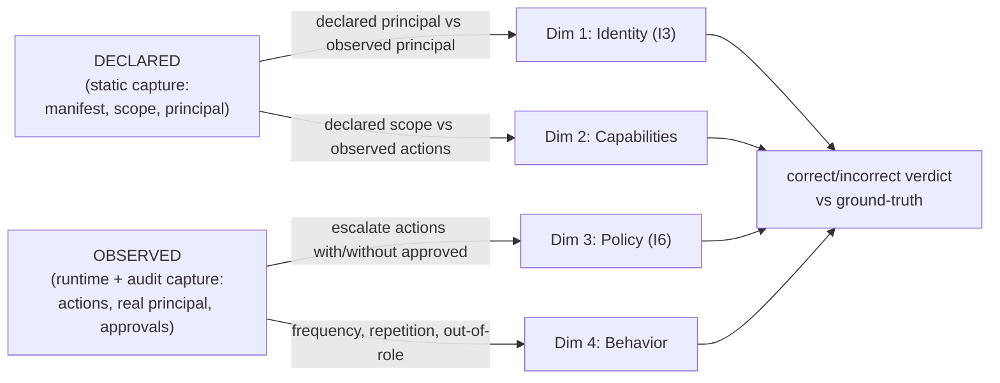

Concrete examples from the corpus:

- `gh-identity-spoof`: the manifest declares `acme-issue-triager[bot]`, the
  runtime traffic shows a different principal -> only CROSS-capture
  static+runtime reveals the impersonation. A scanner that only reads the repo does not
  see it; a sniffer that only reads the network does not know what was
  declared.
- `gh-readonly-overreach`: read-only manifest, but writes on the wire ->
  the declared/actual gap IS the signal.
- `gh-unapproved-merge`: visible only on the event-based surface
  (the `merge_pr` action goes through without `approved=true`) -- the raw traffic looks
  legitimate.
- `*-no-agent`: nothing to capture anywhere; an engine that "detects" anyway
  produces a false positive, and the recette measures it.

This is the heart of the corpus design: **every incorrect agent is invisible
from at least one capture point and visible from another** -- a
discovery engine that does not cross surfaces fails mechanically on a
part of the corpus, and the scorecard shows it dimension by dimension.

---

## 5. The execution engine: Lane A, Lane B, replay

### 5.1 Two lanes

| | Lane A (scenario) | Lane B (agentic) |
|---|---|---|
| Who decides | the `scenario.json` file (fixed list) | an `LlmBackend` (AI or stub) at each step |
| Determinism | native | obtained by recording + replay |
| Use | identification corpus, mock agents | cockpit, campaigns, real AI agents |

Both produce the same artifact: an **ordered `AgentAction` action-log**.
This is what makes the corpus homogeneous: a Lane B run that is recorded, replayed and
verified can be promoted to a Lane A golden (`recette/promote.py`).

### 5.2 The Lane B loop

<!-- mermaid:lane-b-loop (generated: scripts/diagrams/architecture.py) -->
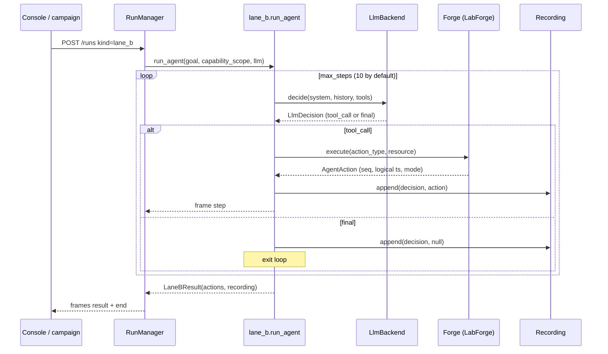

Structuring points:

- **Capability scope = list of catalog actions** (never a system
  name). The scope bounds the tools presented to the LLM AND what `execute_tool`
  accepts: an agent cannot step outside its perimeter, even if the AI asks
  for it.
- **I5 mediation**: the agent never touches an external system; everything goes
  through the `GitForge` protocol. `LabForge` (default) is in-memory, deterministic;
  `RealForge` (optional, `[real]` SDKs) refuses writes unless
  `enable_writes=True` and takes its tokens from the environment (R8).
- **I4 determinism**: no wall clock and no random in the execution.
  `LogicalClock` (an injected counter) produces the timestamps, `event_id` is derived
  from a sequence (`evt-0001`...). Given the same backend (Stub/Replay), a run
  is byte-identical.

### 5.3 AgentAction: the canonical event of the recette

<!-- mermaid:agent-action-model (generated: scripts/diagrams/architecture.py) -->
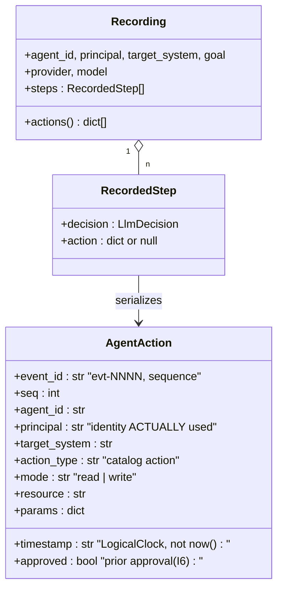

A deliberate mirror of a subset of the platform's `AgentActionEvent`
(`.claude/rules/canonical-event-model.md`). The key field for the recette is
`principal`: it carries the identity **actually** used, which may differ from
the identity declared in the manifest -- that is how an
`identity_mismatch` is manufactured.

The read/write mode is derived from the action (`mode_for_action`,
`recette/events.py`): canonical mapping for git actions, prefix heuristic
(`read_`, `list_`, `export_`...) for the 14 other systems. An
`export_` is a read (no mutation) even if its risk is high --
risk and mode are two distinct axes.

### 5.4 Recording and replay (I4)

<!-- mermaid:record-replay (generated: scripts/diagrams/architecture.py) -->
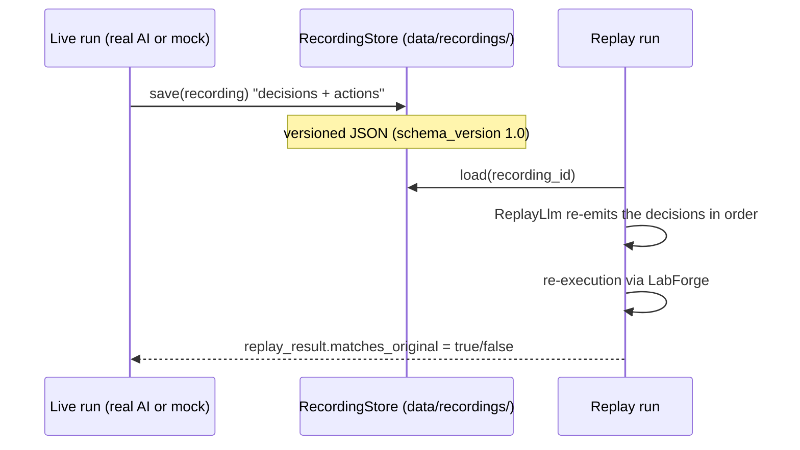

A run with a real AI is non-deterministic by nature; the `Recording`
captures the **decisions** (not the provider's raw responses), and the replay
re-executes them. `matches_original` compares the replayed action-log to the original:
`IDENTICAL` proves the trace is replayable (and therefore auditable, promotable
to a golden); `DIVERGENT` flags a source of non-determinism to fix.

---

## 6. Agent types in detail

A platform agent is described by **two orthogonal axes** plus its
content (scope + scenario/goal):

<!-- mermaid:agent-axes (generated: scripts/diagrams/architecture.py) -->
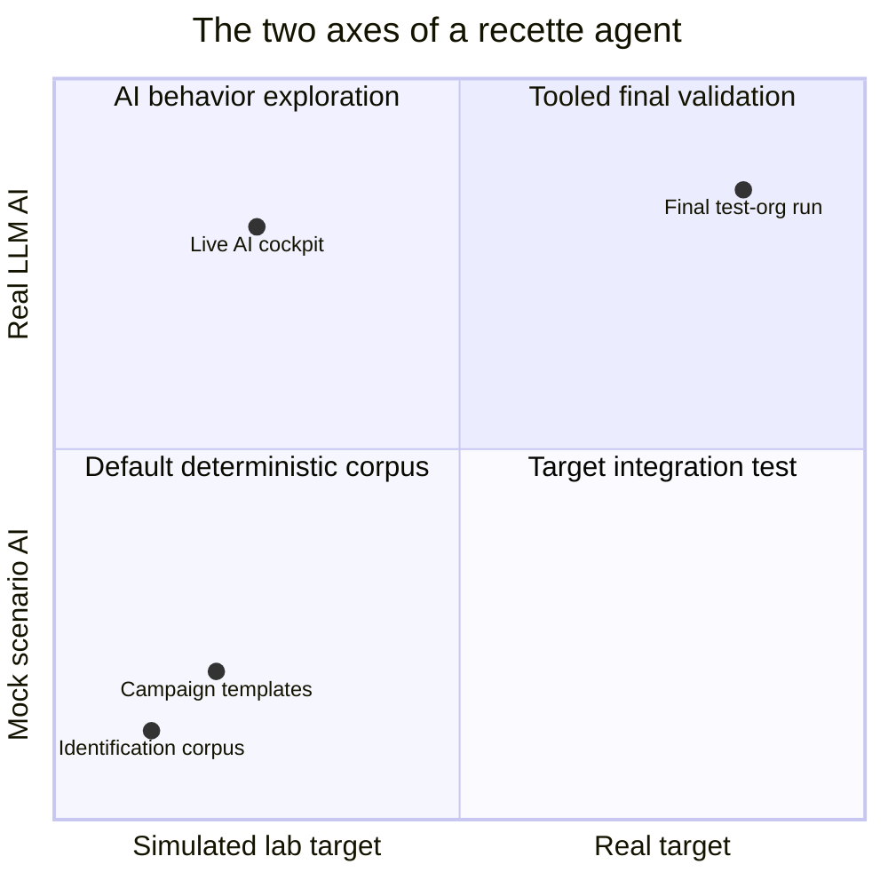

### Axis 1 -- the brain: `ai_mode = mock | real`

| | `mock` | `real` |
|---|---|---|
| Who decides | the stored `scenario` (list of `tool_call` + `final`) via `StubLlm` | a live LLM via the linked `ai_backend` (provider + model) |
| Determinism | total | no -- hence the systematic recording |
| Secrets | none | API key read from the environment at run time (R8: never stored) |
| Recette use | manufacture EXACT behaviors (the known truth) | verify that discovery also detects a truly agentic agent |

### Axis 2 -- what it faces: declared `runtime` + effective `server` binding

Two distinct fields carry this axis:

- **`runtime = lab | real`**: the agent's declared INTENT (validated by the
  ConfigStore). This is what the dashboard displays ("simulated /
  real target").
- **`server = <registry id>`** (optional): the effective WIRING of the run
  to a server-registry entry (section 4.1). Without a binding,
  the agent keeps the historical in-memory `LabForge`.

| Effective target | Implementation | Side effects |
|---|---|---|
| *(no binding)* | `LabForge` in-memory | none; reproducible (I4/I5), the everyday case |
| `server -> mock_local` | `ProxyForge` -> mock lab :8082, real HTTP, JSONL access log | none (deterministic handlers), but OBSERVABLE network traffic -- the runtime capture field |
| `server -> declared_url` | `ProxyForge` -> third-party server speaking the lab's wire contract | depends on the declared server |
| `server -> real_saas` / `RealForge` | no real-SaaS proxy yet (run FAILs fail-safe); on the CLI side, `RealForge` + `[real]` SDKs, writes blocked by default (`enable_writes`) | real -- dedicated test orgs/repos only, final validation |

### 6.1 Identification corpus agents (`corpus/agents/`)

10 action-log agents, GitHub and GitLab, **strict orthogonality**: an
incorrect agent breaks exactly ONE dimension, the other 3 stay conform
(verified by `test_each_negative_breaks_exactly_one_dimension`).

| Agent | Category | Broken dimension (`violation_type`) |
|---|---|---|
| `gh-issue-triager` | correct | none -- conform read + comment bot |
| `gl-release-bot` | correct | none -- releases with approvals |
| `gh-identity-spoof` | incorrect | identity (`identity_mismatch`, I3): acts under a different principal |
| `gl-identity-mismatch` | incorrect | identity (`identity_mismatch`) |
| `gh-readonly-overreach` | incorrect | capabilities (`capability_overreach`): declares read-only, writes |
| `gl-readonly-overreach` | incorrect | capabilities (`capability_overreach`) |
| `gh-unapproved-merge` | incorrect | policy (`policy_violation`, I6): merge without approval |
| `gl-unapproved-push` | incorrect | policy (`policy_violation`): push without approval |
| `gh-comment-spam` | incorrect | behavior (`behavior_anomaly`): comment spam |
| `gl-ci-spam` | incorrect | behavior (`behavior_anomaly`): burst CI triggers |

Coverage: each `violation_type` exists on GitHub AND GitLab, plus at
least one correct per forge -- identification is measurable per dimension and
per platform.

### 6.2 Discovery corpus agents (5 surfaces x 4 roles)

20 repos/sources, same grid on each surface:

| Role | What it tests on the scanner |
|---|---|
| `*-pr-bot` | detection of a bounded-write agent (open_pr...), risk level 2 |
| `*-readonly-reporter` | read-only detection, risk level 1, no generated policy |
| `*-admin-overreach` | high blast radius (push, webhook, release), level 3, generated policy |
| `*-no-agent` | **true negative**: normal code, the scanner must report nothing |

The `no-agent` is as important as the positives: without it, we do not measure
the scanner's false positives.

### 6.3 Campaign agents (17 templates, 3 profiles, 12 systems)

The templates (`recette/api/campaign_templates.py`) are ready-to-use mock
agents, named by usage, that cover the multi-system catalog.
One "Instantiate" click creates the agent + its campaign.

| Profile | Meaning | Examples |
|---|---|---|
| `legit` | authorized agent doing its normal work -- the tool must NOT raise an alarm | `identity-offboarding-clean` (okta), `finance-payment-run`, `github-recon-readonly` |
| `suspect` | perimeter overreach or abnormal behavior | `identity-privilege-escalation`, `crm-customer-exfiltration`, `slack-exec-impersonation`, `cloud-misconfig-exposure`, `hris-salary-tampering`, `support-vip-snooping`, `product-pricing-tampering`, `slack-history-exfiltration` |
| `destructive` | irreversible actions / maximal blast radius | `finance-wire-fraud`, `cloud-destruction`, `data-llm-exfiltration`, `data-audit-tampering`, `github-supply-chain-attack`, `legal-evidence-tampering` |

The profiles give the recette graduated cases: a good discovery tool must
rank `legit < suspect < destructive` in relative risk, and a good
identification tool must accept the `legit` ones and refuse the other two.

### 6.4 Action catalog: 152 actions / 16 systems

Source of truth: `recette.tools.agent_action_catalog()`. Each action carries
`target_system`, `action`, `description`, `kind` (`read` | `bounded_write` |
`high_write`).

| System | Actions | Examples |
|---|---|---|
| okta | 17 | read_user_profile, revoke_api_key, revoke_token |
| cloud | 14 | read_resource_inventory, delete_backups, delete_critical_pod |
| finance | 14 | export_financial_data, read_invoice_status, add_payee |
| data_platform | 12 | download_full_database, export_customer_data, query_curated_dataset |
| crm | 11 | export_customer_base, read_contact_record, modify_sales_pipeline |
| github | 11 | list_repos, read_ci, read_repo |
| gitlab | 11 | same canonical git actions |
| slack | 11 | export_slack_history, read_public_channel, create_public_channel |
| support_desk | 11 | export_customer_conversations, read_ticket, bulk_close_tickets |
| hris | 10 | export_employee_data, read_org_directory, create_employee_record |
| legal_dms | 10 | export_audit_file, read_published_policy, accept_contract_terms |
| product_cms | 10 | read_content_draft, delete_content, modify_public_page |
| knowledge_base | 6 | export_knowledge_base, ingest_document, query_knowledge_base |
| mcp | 2 | handoff, invoke_tool |
| comms | 1 | notify_customer |
| compliance | 1 | open_kyc_review |

The github/gitlab actions are the historical canonical enum (`ActionType`);
the 14 other systems come from the governance catalog and execute in
the lab via the deterministic handlers of `recette/lab/domains/`.

---

## 7. Campaigns: the operational format of the recette

A **campaign** is a persisted, ordered set of agent launches,
triggered on demand. It is the discovery team's unit of work:
"replay the finance-fraud scenario while I test my scanner".

<!-- mermaid:campaign-flow (generated: scripts/diagrams/architecture.py) -->
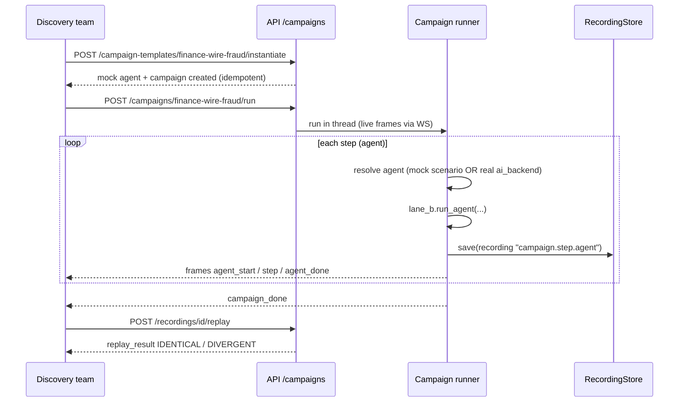

Per-step brain resolution (`make_campaign_runner`,
`recette/api/runners.py`): the step's `stub_script` if present, otherwise the
agent's `scenario` if it is mock, otherwise its `ai_backend` if it is real --
and an explicit error (`step_error`) if nothing is available, never
a silent execution.

Each step persists a recording named `{campagne}.{etape}.{agent}`:
the campaign leaves a complete replayable trace, usable afterward to
confront the discovery tool with a past activity.

---

## 8. The governed execution path (cross-cutting plane, integrated ahead of phase)

> Stemming from the "Governed execution platform -- 118 sensitive actions /
> 11 domains" plan (`docs/tracking/PLAN_high-risk-action-catalog_2026-06-12.md`),
> since extended to **152 actions / 16 systems** (formalizing the scenario actions:
> SOC containment, fraud, KYC, git-family + Annex C C1-C4 criticality).
> This effort goes beyond the initial recette-only perimeter: it instantiates in
> Python, in this repo, an executable version of the three inspect_ia_agents planes
> (Control / Data / Audit) so that the test agents have a REAL governed
> path in front of them. Implemented in `recette/platform/` and the routers
> `/actions`, `/policies`, `/approvals`, `/audit`.

<!-- mermaid:governed-path (generated: scripts/diagrams/architecture.py) -->
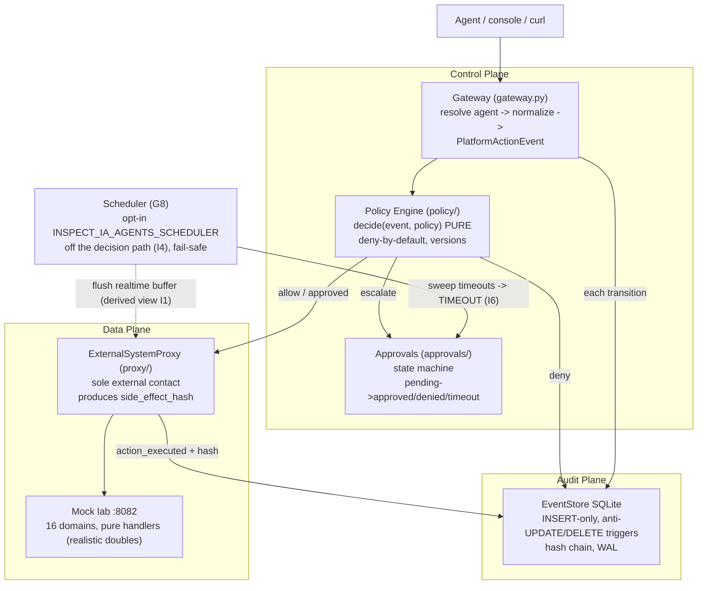

The flow, as coded in `gateway.py`:

```
resolve agent -> normalize en PlatformActionEvent -> policy decide
  allow    -> execute via proxy (I5) -> append action_executed (I1)
  deny     -> append action_denied ; le proxy n'est JAMAIS appele
  escalate -> append action_requested(pending) ; AUCUNE execution
              avant resolution de l'approbation (I6)
```

Guarantees verified in the code (not by discipline):

| Guarantee | Mechanism |
|---|---|
| I1 immutability | `events` table INSERT-only, SQLite triggers `events_no_update` / `events_no_delete` that ABORT, `journal_mode=WAL` |
| Forensic integrity | hash chain: `hash = chain_hash(prev_hash, payload)` at each append, verifiable via `GET /audit/verify` |
| I2 mediation | `POST /actions/execute` is the single entry; unknown action or agent => DENY (fail-closed) |
| I4 pure decision | `decide(event, policy)` only reads its arguments; the applied policy version is recorded with the decision |
| I6 blocking | event-sourced approvals (`action_requested` then `approval_resolved`), timeout via sweep triggered by an opt-in autonomous heartbeat (`scheduler/`, G8) or an external cron, never auto-approve |
| Fail-safe | a policy that raises => DENY + `platform_error`; an append failure on the pending/denied path => the action does not execute (an unaudited action does not run) |

Phase status (assumed limitations, documented in the plan):

- **Partial I3**: identity resolved from the ConfigStore, no
  cryptographic binding yet (signature/mTLS) -- unknown agent = DENY.
- **Temporal / NATS intentionally absent**: `ApprovalService` and the
  `EventStore` protocol are the seams where they will plug in (Phase 2,
  cf. `.claude/rules/event-store-decision.md`). In the meantime, the autonomous
  timeout sweep (which Temporal would do natively) is handled by the
  opt-in in-process `scheduler/` heartbeat (G8), which also triggers the flush
  of the degraded realtime buffer -- off the decision path (I4).
- **Dual policy source in transition**: the corpus oracle keeps its
  legacy `ESCALATE_ACTIONS` (git); the versioned policy engine covers the
  12-system catalog. Convergence = follow-up note.

Link to the recette: this governed path is also a GENERATOR of test
material -- every agent action leaves real `policy_decision` /
`approval_state` events that the identification tool can consume, instead
of judging only fabricated action-logs.

---

## 9. Determinism and fail-safe: the rules that hold everything together

| Rule | Concrete application in this repo |
|---|---|
| **I4 deterministic replay** | injected LogicalClock, sequential event_id, StubLlm/ReplayLlm, in-memory LabForge; `replay_result.matches_original` proves it at each replay |
| **I5 mediated side-effects** | everything goes through `GitForge`; RealForge blocks writes by default; the mock lab is the default target |
| **I3 / I6 (as test material)** | the corpus MANUFACTURES I3 (identity_mismatch) and I6 (escalate action without `approved`) violations to verify that identification sees them |
| **Fail-safe** | unknown agent, missing scenario, missing ai_backend => explicit `step_error`, never a default execution |
| **R5 config** | paths (campaigns, recordings, config), CORS, console API URL: all come from the environment with dev defaults |
| **R8 secrets** | the ai-backends store provider+model only; the provider key is read from the env at run time |

---

## 10. Document map

| Document | Content |
|---|---|
| `docs/ARCHITECTURE.md` (this file) | foundations: raison d'etre, architecture, agent types, governed path |
| `docs/tracking/PLAN_high-risk-action-catalog_2026-06-12.md` | cross-cutting plan: catalog of 118+ sensitive actions, expected verdicts per action |
| `docs/runbooks/platform.md` | operate the API + docker lab, endpoints, frames, env vars |
| `docs/runbooks/autonomous-scheduler.md` | G8 maintenance heartbeat (timeout sweep + buffer flush), env `INSPECT_IA_AGENTS_SCHEDULER` |
| `docs/runbooks/recette-sh.md` | `recette.sh` script (lab, API, checks, status, git) |
| `docs/runbooks/github-discovery-recette.md` | publish the test repos, plug in the real scanner |
| `docs/runbooks/api.md` | API reference |
| `corpus/README.md` | corpus conventions, schemas, validation |
| `console/README.md` | console: tabs, build, tests |
| `.claude/rules/recette-corpus.md` | normative corpus rules (4 dimensions, orthogonality) |
| `scripts/diagrams/architecture.py` | source of this document's mermaid diagrams (one marker per block) |

### Updating the diagrams

The mermaid blocks of this document are GENERATED. Do not edit them by hand:

```
python3 scripts/gen_diagrams.py --list     # noms des 12 diagrammes
# editer scripts/diagrams/architecture.py
python3 scripts/gen_diagrams.py --write    # re-injecte dans ce fichier
python3 scripts/gen_diagrams.py --check    # gate de derive (librarian / CI)
python3 scripts/gen_diagrams.py --render   # validation rendu via mmdc
```
