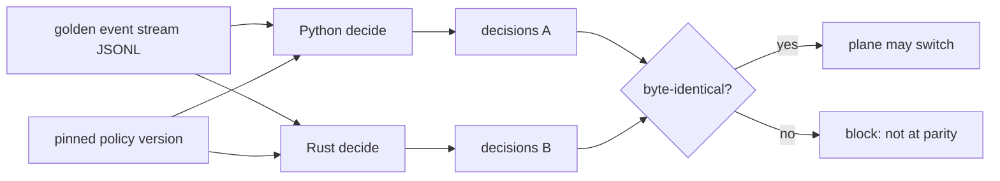

# ADR-0001 -- Runtime language phasing (Python reference now, Rust on trigger)

- Status: ACCEPTED (2026-06-13)
- Scope: the governance core (Control / Data / Audit planes). NOT the discovery
  scanner, which stays Rust.
- Decision owner: gabrielhociel@gmail.com (ratified the phased direction).
- Supersedes: nothing. Complements the phased event-store decision
  (`.claude/rules/event-store-decision.md`), same "defer until a trigger fires" shape.

## Context (verified facts, not assumptions -- R13/R18)

- `CLAUDE.md` names the TARGET stack as Rust (Axum gateway + planes). The working
  reality today is Python.
- Rust footprint measured: `cmd/inspect_ia_agents_recette` only (the discovery scanner,
  7 `.rs` files). There is **zero Rust in the governance core**.
- The governance core is Python: `recette/platform/` = **4229 LOC** (gateway,
  policy `decide()`, risk, eventstore, proxy, approvals, realtime, observability,
  catalog), with 800+ tests green.
- The decision path is a **pure function**:
  `decide(event, policy, catalog) -> Decision` (`recette/platform/policy/engine.py`).
  No clock, no randomness, no I/O in the decision (I4). This makes it the cleanest
  possible thing to port AND to prove equivalent by replay.
- **No measured performance pressure**: there is no gateway latency/throughput
  SLO, p99 target, or RPS benchmark anywhere. `recette/benchmark.py` is a
  judge-accuracy eval, not a perf bench. Nothing today demands the speed or
  memory profile a Rust port would buy.

## Decision

**Python stays the production reference of the governance core now. A Rust/Axum
port of the critical planes (gateway / policy / risk) is DEFERRED until an
explicit trigger fires.** No port is started before then; the decision path's
behavior must be allowed to stabilize in Python first (the corpus, catalog, and
policy model are still evolving fast).

This is a phased decision, not a punt: it commits to Python-now AND fixes the
exact conditions under which the port begins AND the safety net that will prove
the port correct.

## Triggers (any ONE flips to "begin the Rust port")

Record the date + which trigger fired in `decision_log.jsonl`, then open the port
as its own tracked effort:

1. **Perf SLO miss** -- a real latency/throughput SLO is set on the gateway and
   the Python implementation cannot meet it after reasonable tuning (measured,
   not assumed).
2. **Scale** -- sustained decision throughput beyond what a single Python process
   (GIL-bound) serves, with horizontal Python scaling already exhausted.
3. **Hard real-time / safety** -- a deployment requires bounded, predictable
   latency or a memory-safety guarantee a managed-runtime cannot give.
4. **Security mandate** -- a customer/regulator requires the memory-safety /
   supply-chain posture of a Rust core.

Absent any trigger, Python remains prod and this ADR stays in force.

## Parity-proof harness (REQUIRED before any Rust plane replaces Python)

A port may only replace a Python plane once behavior parity is PROVEN, not
assumed. The pure decision path makes this exact:

- A shared, committed **golden stream** (`AgentActionEvent` JSONL) + a **pinned
  policy version** are fed to BOTH engines.
- Both must emit **byte-identical** `policy_decision` (verdict + policy_version +
  rule_id) and the same `approval_state` transitions and `side_effect_hash`
  inputs, for every event (I4 determinism is the contract that makes this
  possible).
- The harness runs in CI as a blocking gate; a single divergence blocks the
  switch. Invariants I1-I6 are checked against the Rust output exactly as they
  are against Python.

## Consequences

- **Now**: no new Rust core code; effort stays on closing platform gaps in Python
  (G1-G6 done) and stabilizing the policy/catalog model.
- **The discovery scanner stays Rust** -- it is already shipped, isolated, and
  unaffected by this decision.
- **When a trigger fires**: the port is incremental, plane by plane, each gated by
  the parity harness above; Python remains the oracle until each plane proves
  equivalent. No big-bang rewrite.
- **Risk avoided**: freezing a still-moving target into Rust prematurely (the
  policy model, catalog, and corpus are evolving), paying a large rewrite cost
  with no measured benefit.

## Revisit

Re-evaluate this ADR when any trigger fires, or at the next architecture review.
Update Status and link a follow-up ADR if the direction changes.
