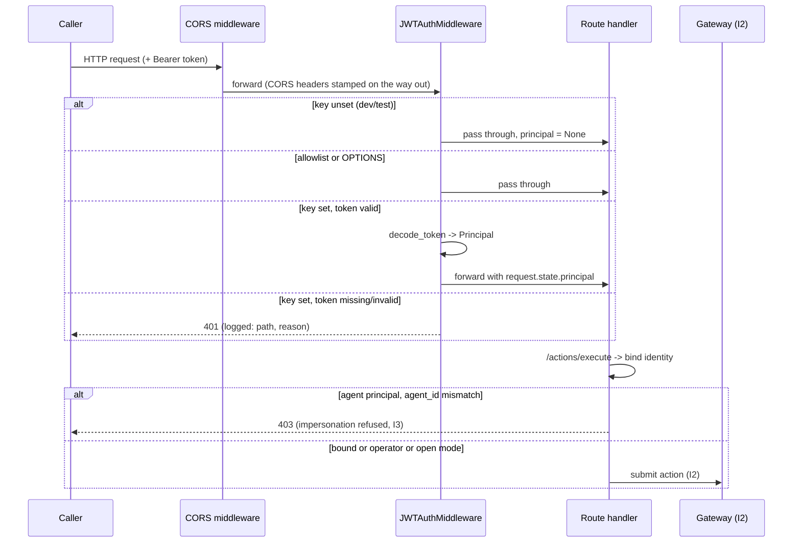
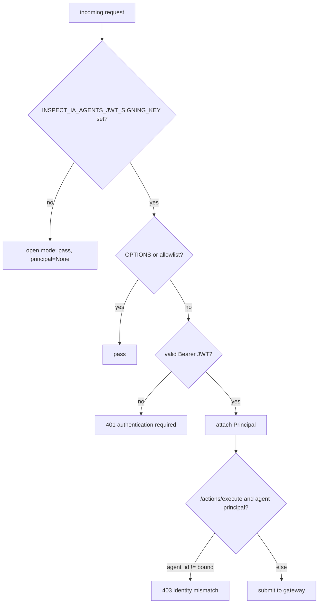

# API authentication & identity binding (I3)

How the console/API authenticates callers and binds an agent action to a verified
identity. Closes platform gap G1: before this, every route was unauthenticated and
`/actions/execute` trusted the `agent_id` sent in the body.

## Model

- A caller presents a compact **HS256 JWT** as `Authorization: Bearer <token>`.
- The token is signed with `INSPECT_IA_AGENTS_JWT_SIGNING_KEY` (R8 -- env/secret store, never
  hardcoded). The server only ever **verifies**; it never trusts an unsigned claim.
- A verified token yields a `Principal { sub, kind, agent_id }`:
  - `kind = "operator"` -- a console operator (manages config, policies, RAG, ...);
  - `kind = "agent"` -- an agent, bound to the `agent_id` it may act as.
- The verifier is stdlib-only (`hmac`/`hashlib`), no JWT dependency. The algorithm is
  PINNED to HS256: `alg: none` and any asymmetric `alg` (RS*/ES*) are refused, defeating
  the alg-confusion and `none` forgeries. Signature compare is constant-time; `exp`/`nbf`
  are enforced; a `sub` is required.

## Enforcement is gated on configuration

| `INSPECT_IA_AGENTS_JWT_SIGNING_KEY` | Behaviour |
|----------------------------|-----------|
| **set** (production) | deny-by-default: every non-allowlisted route needs a valid token, else **401**. Failures logged structured (R6). |
| **unset** (dev/test) | open mode: requests pass through, a loud `AUTH DISABLED` warning is logged once at startup. |

Production MUST set the key. The 749-test suite and the console dev server run in open
mode, so wiring auth did not break existing behaviour.

Allowlist (reachable without a token): `/health`, `/openapi.json`, `/docs`, `/redoc`,
`/docs/oauth2-redirect`, and any CORS `OPTIONS` preflight.

## Identity binding (I3) on /actions/execute

An authenticated **agent** principal may only act as itself: if the request body's
`agent_id` differs from the token's bound `agent_id`, the action is refused **403**
(audited), never executed. An operator principal is not so constrained. With auth
disabled there is no identity to bind against (unchanged).

## Request flow

## Enforcement decision

## Provisioning a token

`recette/api/auth.py::issue_token(claims, key, ttl_seconds=...)` mints a token (for
operator/agent provisioning and tests). Example claims:

- operator: `{"sub": "alice", "kind": "operator"}`
- agent:    `{"sub": "pr-bot", "kind": "agent", "agent_id": "pr-bot"}`

The server never issues tokens implicitly; provisioning is an explicit, out-of-band step.

## Env

| Variable | Usage |
|----------|-------|
| `INSPECT_IA_AGENTS_JWT_SIGNING_KEY` | HMAC signing key (>= 16 bytes). Set in prod to enforce; unset = open dev mode. |

## Tests

- `tests/test_api_auth.py` -- verifier (roundtrip, alg-confusion, `alg:none`, tampered
  signature, expired, `nbf`, missing subject, short key, principal mapping) + middleware
  (open mode, allowlist `/health`, 401 without token, operator token passes, bad token
  401, agent can only act as itself -> 403 on impersonation).

## Failure mode

Auth subsystem is fail-safe: a missing/short key with enforcement intended, or any
malformed token, results in **denial** (401), never an open bypass. The only open path
is the explicit, logged dev mode when no key is configured.
