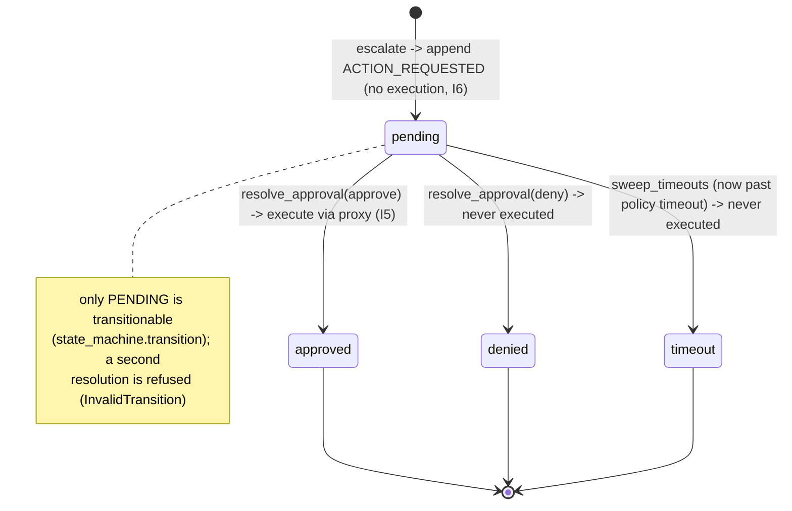
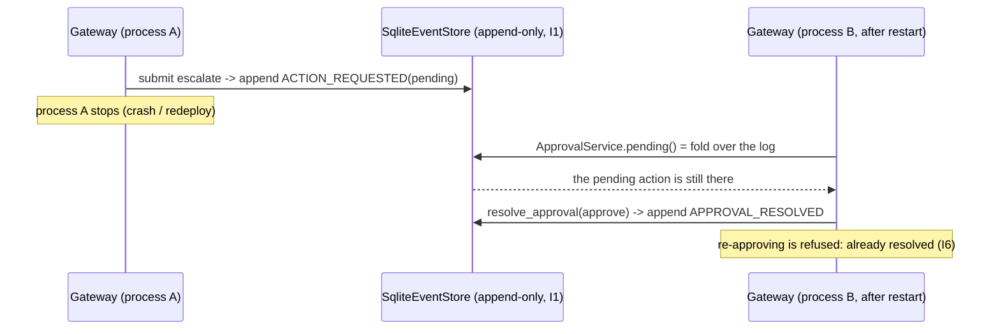

# Durable approval (I6)

How a `escalate` action blocks until a human resolves it or it times out, and why
that state survives a process restart -- without a Temporal cluster.

## Model: the inbox is a fold over the log, not a table

There is no mutable "pending approvals" table. The inbox is **derived** from the
append-only event log (I1) every time it is read:

- `pending()` = `ACTION_REQUESTED` events with **no** correlating `APPROVAL_RESOLVED`
  event. A resolution is always a NEW event (I1), the pending event is never mutated.
- `resolved_ids()` = the `APPROVAL_RESOLVED` events, mapping each pending id to its
  final state (`approved | denied | timeout`).

Because the state lives only in the durable log, it is reconstructed identically after
any restart: drop every in-memory object, rebuild the `Gateway`/`ApprovalService` from
the same store, and the pending inbox is exactly what it was. No in-memory wait, no
sleep, no lost approvals.

## Lifecycle



## Why it survives a restart



## Timeout: explicit, never auto-approve

`sweep_timeouts(now_iso)` resolves every pending older than the policy's
`approval_timeout_seconds` to **TIMEOUT** -- never approve, never execute (failure
modes: an approval system that cannot decide freezes, it does not fail open). `now_iso`
is captured once at the API boundary and passed as an input (I4); the decision path
never reads the host clock.

### The one residual vs a Temporal workflow

Event-sourcing gives durability for free, but NOT an autonomous timer: nothing fires
the timeout on its own. `POST /approvals/sweep-timeouts` must be triggered by an
external scheduler (cron / systemd timer / k8s CronJob). A Temporal durable workflow
would own that timer natively. Until the platform adopts Temporal, schedule the sweep:

```
# every minute, resolve any approval past its policy timeout
* * * * * curl -fsS -X POST http://127.0.0.1:8080/approvals/sweep-timeouts
```

(once auth is enforced -- see api-auth.md -- the sweep call carries an operator token.)

## Endpoints

| Method | Route | Purpose |
|--------|-------|---------|
| GET | `/approvals?state=pending` | the reconstructed pending inbox |
| POST | `/approvals/{event_id}/approve` | resolve -> execute (I5) |
| POST | `/approvals/{event_id}/deny` | resolve -> never executed |
| POST | `/approvals/sweep-timeouts` | resolve expired -> TIMEOUT (schedule this) |

A second resolution of the same action returns **409** (InvalidTransition).

## Tests

- `tests/test_approval_durability.py` -- restart durability against a persisted
  `SqliteEventStore`: pending survives, resolution survives, double-resolve after restart
  refused, timeout after restart -> TIMEOUT and never executes.
- `tests/test_gateway_flow.py`, `tests/test_approval_state_machine.py` -- escalate blocks,
  denied never executes, timeout never auto-approves, double resolution rejected.
