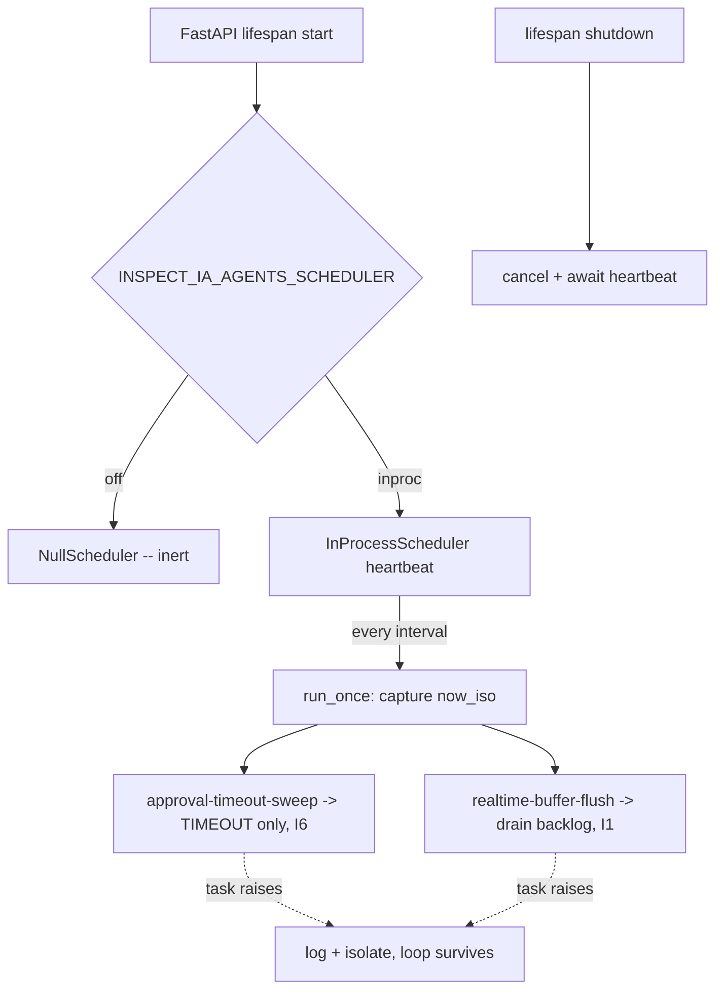

# Autonomous maintenance scheduler (G8)

The scheduler is the ops heartbeat that fires periodic platform maintenance without a
manual trigger. It closes two residuals of the same class left by the platform-gaps
campaign:

- **G2** -- approval timeout sweep (`Gateway.sweep_timeouts`) had no autonomous driver.
- **G4** -- realtime degraded-bus flush (`BoundedRetryBuffer.flush`) drained only on the
  next publish, not on a heartbeat.

It lives OUTSIDE the decision path (I4): it never calls `decide()`. The sweep takes its
clock as a captured input and only appends TIMEOUT events (never auto-approves, I6); the
flush drains an already-persisted derived copy (I1). The wall clock read at a tick boundary
is operational metadata, not a decision input.

## Configuration

| Env | Default | Effect |
|-----|---------|--------|
| `INSPECT_IA_AGENTS_SCHEDULER` | `off` | `off` -> `NullScheduler` (no timer). `inproc` -> real asyncio heartbeat. |
| `INSPECT_IA_AGENTS_SCHEDULER_INTERVAL_SECONDS` | `30` | Heartbeat period (floor `1`). Malformed/sub-floor -> `SchedulerConfigError` (fail-safe, no silent default). |

**Default is OFF on purpose.** A self-firing clock that mutates state (appends TIMEOUT)
must be enabled deliberately per deployment so tests and replay stay deterministic (I4).
A production deployment sets `INSPECT_IA_AGENTS_SCHEDULER=inproc`.

```
INSPECT_IA_AGENTS_SCHEDULER=inproc INSPECT_IA_AGENTS_SCHEDULER_INTERVAL_SECONDS=30 python -m recette.api
```

The heartbeat starts in the FastAPI lifespan and is cancelled and awaited on shutdown.

## Tasks registered

- `approval-timeout-sweep` -- always registered.
- `realtime-buffer-flush` -- registered only when the transport exposes `flush()` (the
  degraded-bus buffer, i.e. `INSPECT_IA_AGENTS_REALTIME=nats`). The in-process transport has no
  backlog, so no flush task is added.

A failing task is isolated: logged via the structured `inspect_ia_agents.scheduler` logger and
skipped, never killing the loop or the app (fail-safe, failure-modes.md).

## Failure mode

The scheduler is itself fail-safe. A tick that raises is caught at two levels (per-task in
`run_once`, and the whole tick in the loop). The sweep can only resolve to TIMEOUT, never
approve or execute (I6). The flush only retries an already-durable backlog (I1) and never
triggers an external side effect.

## Alternatives considered

- External cron/systemd hitting `POST /approvals/sweep-timeouts`: still possible with
  `INSPECT_IA_AGENTS_SCHEDULER=off`, but it cannot drive `flush()` (not an HTTP endpoint).
- Temporal workflow: native fit, deferred -- no Temporal server, a stub would be forbidden
  (same reason the G2 timer was deferred).

## Flow


