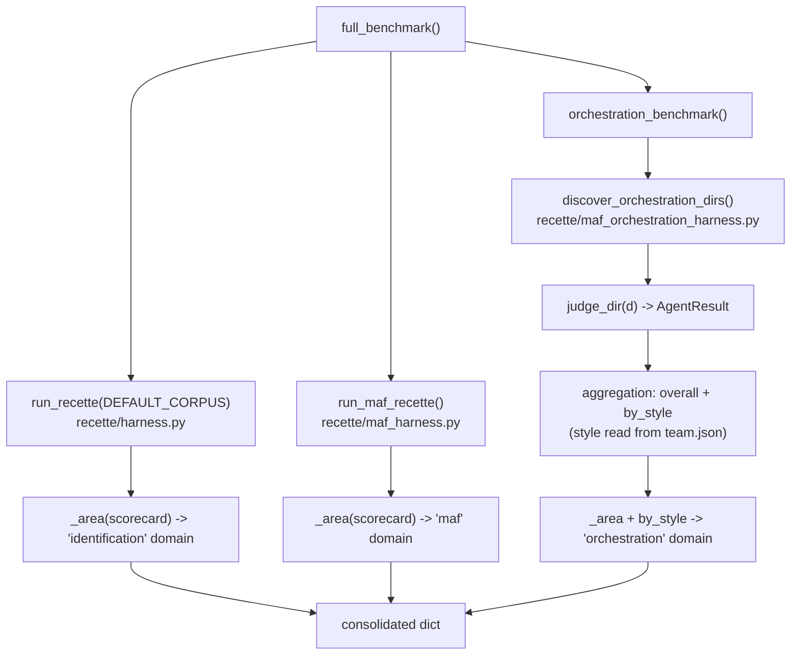

# Recette benchmark -- judge precision by dimension, style and domain

> The scorecard answers "does each subject match its ground-truth?" (pass /
> fail). The benchmark answers a different question: "how precise is the judge,
> by dimension, by orchestration style and by domain?" -- the metrics you
> compare across corpora or across judge versions. It is a pure deterministic
> aggregation (I4) on top of the same judges as the recette.

## What it is and why it exists

The benchmark (`recette/benchmark.py`) is an evaluation harness that aggregates
metrics beyond a simple pass/fail. There, instead of "passes / fails", it
computes the **judge precision by dimension** across the four recette
dimensions, the pass counts, and the false positives / false negatives, for
three domains:

- `identification` -- the frozen action-logs of `corpus/agents/` (`run_recette`
  on `DEFAULT_CORPUS`).
- `maf` -- the single-agent MAF subjects (`run_maf_recette`).
- `orchestration` -- the MAF teams of `corpus/maf_orchestration/`, aggregated
  globally AND broken down by orchestration `style`.

It is the in-house equivalent of the "AF Labs" metrics: we no longer merely
validate that everything passes, we measure the judge's quality to compare it
over time.

## The computed metrics

For each domain, `_area(scorecard)` produces (see `recette/benchmark.py`,
function `_area`):

| Field | Source (`recette/scorecard.py`) | Meaning |
|-------|--------------------------------|------|
| `total` | `Scorecard.total` | number of judged subjects |
| `passed` | `Scorecard.passed_count` | subjects whose every dimension matches the ground-truth |
| `false_positives` | `Scorecard.false_positives` | correct agent flagged as incorrect |
| `false_negatives` | `Scorecard.false_negatives` | incorrect agent passed as correct |
| `dimension_accuracy` | `Scorecard.dimension_accuracy(dim)` | precision per dimension: `identity`, `capabilities`, `policy`, `behavior` |

The four benchmark dimensions are fixed by the constant `_DIMS =
("identity", "capabilities", "policy", "behavior")` in `recette/benchmark.py`.
The `Scorecard` knows six dimensions (`detection`, `identity`, `capabilities`,
`policy`, `behavior`, `verdict`) but the benchmark exposes only these four.

There is NO time / latency measurement in this harness: the benchmark aggregates
only deterministic verdicts, not durations.

## Flow

`full_benchmark()` (the entry point, `recette/benchmark.py`) runs the three
domains and returns a consolidated dict:



For the orchestration domain, `orchestration_benchmark()` walks each team
directory, loads `team.json` via `load_validated("maf_orchestration",
...)`, judges the directory with `judge_dir(d)`, adds the result to a global
`Scorecard` AND to a per-`team.get("style", "handoff")` `Scorecard`. The output
therefore carries `by_style`: a sub-dict `{style: _area(...)}` sorted by style
name.

## Inputs / outputs

- **Input**: the committed corpus (`corpus/agents/`, the single-agent MAF corpus,
  `corpus/maf_orchestration/`). No external input, no network call, no real LLM:
  the benchmark replays pure judges on frozen artifacts.
- **Output**: a dict with the keys `identification`, `maf`, `orchestration`
  (the latter additionally carrying `by_style`). The text rendering is produced by
  `render(benchmark)`:

```
=== inspect_ia_agents Benchmark (judge accuracy) ===

identification  <passed>/<total>  ide=..  cap=..  pol=..  beh=..
maf             <passed>/<total>  ide=..  cap=..  pol=..  beh=..
orchestration   <passed>/<total>  ide=..  cap=..  pol=..  beh=..

orchestration by style:
  <style>     <passed>/<total>  ide=..  cap=..  pol=..  beh=..
```

(the abbreviations `ide/cap/pol/beh` are the first three characters of each
`_DIMS` dimension).

## Concrete contact points

### CLI

```
python3 -m recette benchmark
python3 -m recette benchmark --json
```

The subparser is declared in `recette/cli/parser.py` (`benchmark`, the `--json`
flag), the command is `_cmd_benchmark` in `recette/cli/corpus_cmds.py`
(wired in by `recette/__main__.py`). Without `--json` it prints `render(bench)`;
with `--json` it prints `json.dumps(bench, indent=2)`. The return code is
always `0` (the benchmark measures, it does not gate -- the gate is the scorecard
`python3 -m recette run`).

### API

| Verb | Route | Returns |
|------|-------|----------|
| GET | `/subjects/benchmark` | `full_benchmark()` dict (raw dict, no envelope) |

The router is `recette/api/routers/subjects.py` (prefix `/subjects`, handler
`benchmark()` which calls `full_benchmark()`). With the platform started
(`./recette.sh platform up`, API on `:8090`):

```
curl -s http://localhost:8090/subjects/benchmark
```

### Console

**Discovery** page (route `/discovery`, declared in `console/src/App.tsx`). The
`BenchmarkPanel` component (`console/src/pages/discovery/BenchmarkPanel.tsx`) is
rendered at the bottom of `console/src/pages/discovery/index.tsx`. It calls
`getBenchmark()` (`console/src/api/client.ts`, which does `request<Benchmark>(
"/subjects/benchmark")`) and displays a table: one row per domain
(`identification`, `maf`, `orchestration`) then one indented row per
orchestration style, with the `passed/total` column and the four precision
columns (green if `dimension_accuracy[d] >= 1`, red otherwise). The `Benchmark`
/ `BenchmarkArea` type is defined in `console/src/api/client.ts`.

## Failure mode (fail-safe)

The benchmark is read-only and purely deterministic: it executes no action,
does not touch the event store and triggers no side effect. It therefore cannot
"fail-open" on a governance decision -- it makes none. On the console side, if
`getBenchmark()` fails, the panel displays the error
(`data-testid="benchmark-error"` block, `alert` role) instead of fabricating
numbers; until the response has arrived it displays `Loading
benchmark...`. No value is invented in the absence of data.

## Invariants

- **I4 (deterministic replay)** -- the benchmark relies on the same
  deterministic judges as the recette; it is a pure aggregation over the committed
  corpus. No clock, no randomness, no I/O in the computation: the same corpus
  produces the same benchmark, byte-stable. This is what makes comparison across
  judge versions reliable.
- **I1 (immutability)** -- it reads the frozen corpus and mutates nothing; it
  never rewrites a ground-truth nor a record.

The benchmark MEASURES the judge's quality on the governance axes (identity,
capabilities, policy, behavior) but itself makes no governance decision:
mediation (I2), identity binding (I3) and approval blocking (I6) belong to the
judged decision path, not to the aggregator.

## Gates

```
.venv/bin/python -m unittest discover -s tests
make recette
./recette.sh console-test
./recette.sh console-build
```

## Related links

- `recette/scorecard.py` -- the aggregated `Scorecard` / `AgentResult` structure.
- `recette/harness.py`, `recette/maf_harness.py`,
  `recette/maf_orchestration_harness.py` -- the three source harnesses of the domains.
- `.claude/rules/determinism-replay.md` (I4) -- judge determinism.
- `.claude/rules/recette-corpus.md` -- the four dimensions, positives / negatives.
- `docs/runbooks/replay-model.md` -- the record / replay / freeze model of subjects.
