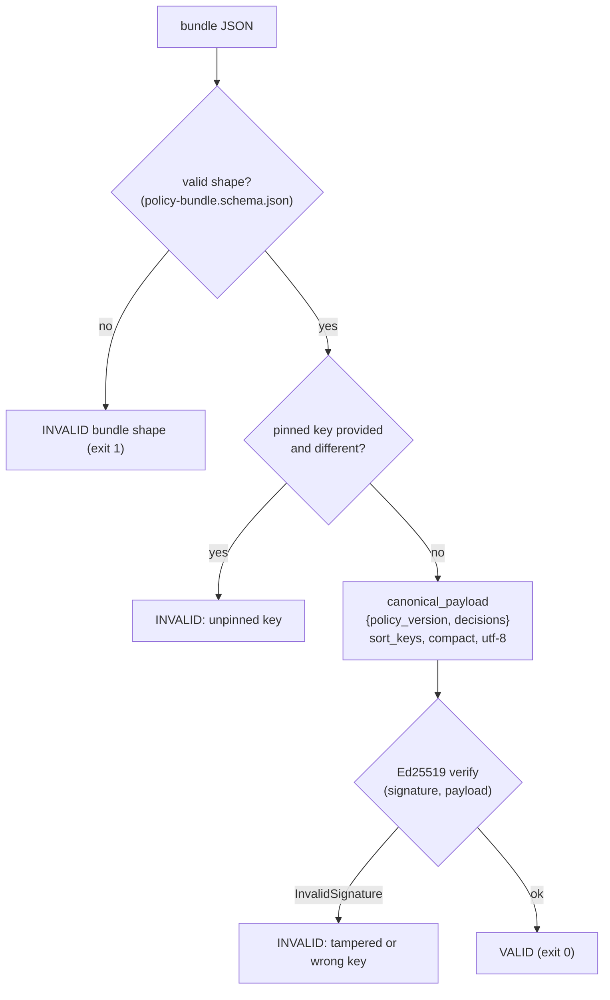
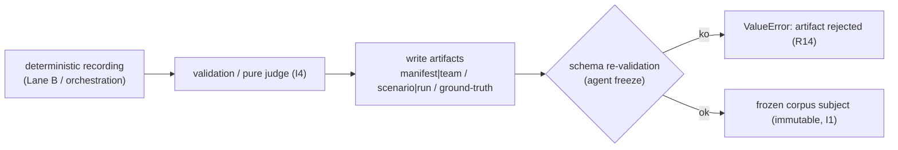

# Bundle, integrity verification and freeze -- runbook

> How inspect_ia_agents proves the integrity of a signed policy bundle (Ed25519
> signature over a canonical payload) and how a verified live run is **frozen**
> into an immutable corpus subject. Verification never produces a production
> bundle: it accepts what is valid and rejects anything that has been tampered
> with; freeze, in turn, transforms a deterministic recording into a ground-truth
> artifact.

## Why this subsystem exists

Two distinct integrity problems, two tools, one same I1 principle (immutability):

1. **Signed bundle (control plane input).** The Risk Scoring Engine emits a
   *policy bundle* -- the per-agent decisions + the policy version -- signed with
   Ed25519 **before** reaching the control plane. inspect_ia_agents must be able
   to verify that a received bundle has not been tampered with and that it indeed
   comes from the expected key. The code (`recette/bundle.py`) **verifies**, it
   **never produces** a production bundle.
2. **Freeze (output to the corpus).** A live run (Lane B or orchestration), once
   recorded and then replayed deterministically, is **frozen** into a corpus
   subject (manifest/scenario/ground-truth or team/run/ground-truth). The freeze
   writes a schema-valid ground-truth artifact that becomes the immutable truth
   against which external tools are judged.

## Part A -- The policy bundle and its verification

### The shape of a bundle

Schema: `corpus/schemas/policy-bundle.schema.json` (`additionalProperties: false`).
Required fields:

| Field | Type | Role |
|-------|------|------|
| `schema_version` | string | version of the bundle schema |
| `policy_version` | string | policy version under which the decisions were computed (relevant at replay, I4) |
| `decisions` | array (min 1) | one `{agent_id, action, decision}` entry per decision; `decision` in `allow` \| `deny` \| `escalate` |
| `public_key` | string | Ed25519 public key, hex (32 bytes -> 64 hex characters), `^[0-9a-f]{64}$` |
| `signature` | string | Ed25519 signature, hex (64 bytes -> 128 hex characters), `^[0-9a-f]{128}$` |

Reference fixture: `corpus/bundles/valid/bundle.json`. It is signed with a
**documented test key** (the all-zero Ed25519 seed, a known test vector) whose
public key is
`3b6a27bcceb6a42d62a3a8d02a6f0d73653215771de243a63ac048a18b59da29` -- it protects
nothing and is never a real signing key.

### The canonical payload (what the signature covers)

`recette/bundle.py::canonical_payload(bundle)` computes the exact bytes covered by
the signature: the canonical JSON of `{"policy_version", "decisions"}` with
`sort_keys=True`, compact separators `(",", ":")`, encoded in `utf-8`. This form
is stable from one run to another (I4) -- this is what makes a signature
verifiable and reproducible. Neither `public_key` nor `signature` is part of the
signed payload.

### The verification flow

`recette/bundle.py::verify_bundle(bundle, *, expected_public_key=None)` -> returns
a `BundleVerification(valid: bool, reason: str)`. Steps:

1. Lazy import of the verifier (`Ed25519PublicKey`, `InvalidSignature`) from
   `cryptography` (optional extra `[bundle]`). Absent => explicit `RuntimeError`.
2. `public_key` or `signature` missing -> `INVALID`, reason `missing public_key or signature`.
3. **Key pinning**: if `expected_public_key` is provided and the bundle's key
   differs -> `INVALID`, reason
   `public key does not match the pinned key`. Without this pinning, a valid
   signature from an unknown key would pass, which would defeat the purpose.
4. Hex decoding of the key then of the signature; invalid hex -> `INVALID`.
5. `public_key.verify(signature, canonical_payload(bundle))`; `InvalidSignature`
   -> `INVALID`, reason `signature does not match payload (tampered or wrong key)`.
6. Otherwise -> `VALID`, reason `signature valid over canonical payload`.

`verify_bundle_file(path, *, expected_public_key=None)` reads the JSON from disk
then delegates to `verify_bundle`.



### CLI touchpoint

Command: `python -m recette bundle-verify <path> [--pubkey <hex>]`
(defined in `recette/cli/parser.py`, dispatched by `recette/__main__.py`,
implemented in `recette/cli/discovery_cmds.py::_cmd_bundle_verify`).

Flow of `_cmd_bundle_verify`:

1. First validates the **shape** against `corpus/schemas/policy-bundle.schema.json`
   via `jsonschema.Draft202012Validator`. Shape error -> prints
   `INVALID bundle shape: ...` to stderr and returns `1`.
2. Calls `verify_bundle_file(path, expected_public_key=pubkey)`.
3. Prints `bundle: <path>` then `verdict: VALID|INVALID -- <reason>`.
4. Exit code: `0` if valid, `1` otherwise.

Example (pinned test key):

```
python -m recette bundle-verify corpus/bundles/valid/bundle.json --pubkey 3b6a27bcceb6a42d62a3a8d02a6f0d73653215771de243a63ac048a18b59da29
```

### Inputs / outputs

- **Input**: a bundle JSON file; optionally a public key to pin (`--pubkey`).
- **Output**: a text verdict on stdout + an exit code (0 valid / 1 invalid),
  or in code a `BundleVerification(valid, reason)`.

### Failure mode (fail-safe)

Any uncertainty is treated as a rejection, never as a pass:

- invalid shape, missing key/signature, invalid hex, signature that does not
  match, pinned key that does not match -> `INVALID` (exit 1).
- An attacker who re-signs with their own key produces an internally valid
  signature, but key pinning rejects it
  (`test_substituted_key_and_resign_fails_pinning`).
- `cryptography` absent -> explicit `RuntimeError` (loud failure), not a silent
  pass. The default remains closed, never fail-open.

Coverage (`tests/test_bundle.py`): valid accepted (with and without pinning);
modified decision, modified `policy_version`, wrong signature, missing signature,
wrong pinned key, substituted re-signed key -> all rejected; deterministic
canonical payload.

## Part B -- The freeze (freezing a run into an immutable corpus subject)

The freeze is the output-side integrity counterpart: a live recording that is
already **deterministic and replayable** (see `docs/runbooks/replay-model.md`) is
written as a ground-truth corpus subject. Once written, this subject is the
immutable truth of the test bench (I1) -- it is not mutated, a new one is added.

### Freezing a Lane B agent

CLI: `python -m recette agent freeze <recording> [--out corpus/agents/correct]`
(`recette/cli/agent_cmds.py::_cmd_agent_freeze` -> `recette/promote.py::freeze_recording`).

`freeze_recording(recording, out_dir, ...)`:

1. Refuses a recording with no actions (`recording has no actions; nothing to
   promote`).
2. Writes three files into `out_dir/<agent_id>/`: `manifest.json`,
   `scenario.json`, `ground-truth.json` (the frozen agent is assumed **correct**:
   `category: "correct"`, `expected_verdict: "correct"`).
3. Re-validates the three artifacts against the corpus schemas
   (`load_manifest` / `load_scenario` / `load_ground_truth`) -- loud failure
   (`ValueError`) rather than delivering an invalid golden (R14).
4. Returns the agent's directory.

### Freezing an orchestration

CLI:
`python -m recette orchestrate freeze <recording> --slug <slug> [--out corpus/maf_orchestration/correct] [--category correct|incorrect] [--violation-type <type>]`
(`recette/cli/orchestrate_cmds.py::_cmd_orchestrate_freeze` ->
`recette/orchestrate.py::freeze_to_corpus`).

`freeze_to_corpus(recording, dest_dir, *, slug, category, violation_type=None)`:

1. `category == "incorrect"` without `violation_type` -> `ValueError`
   (`an incorrect subject requires a violation_type`): a negative must name the
   broken axis (mono-axis, see `.claude/rules/recette-corpus.md`).
2. Judges the run via `judge_orchestration(team, run)` (pure function, I4) and
   derives the ground-truth of the 4 dimensions (`identity_match`,
   `capabilities_conform`, `policy_compliant`, `behavior_expected`) +
   `expected_verdict`.
3. Writes into `dest_dir/<slug>/`: `team.json`, `run.json`, `ground-truth.json`.
4. Returns the subject's directory.



### Freeze inputs / outputs

- **Input**: a recording file (`*.recording.json` Lane B or
  `*.orchestration.json`), an output directory, and for orchestration the
  `slug` (mandatory) + `category` + `violation-type`.
- **Output**: a corpus subject directory containing the ground-truth artifacts;
  a message `promoted to Lane A golden: <dir>` or
  `frozen corpus subject: <dir>`; exit code `2` if a guard fails
  (orchestration), error raised for the agent.

## Supported invariants

- **I1 (immutability)**: bundle verification mutates nothing; the freeze writes a
  ground-truth subject that becomes an immutable truth -- a correction goes
  through a new artifact, not through a mutation.
- **I4 (deterministic replay)**: the bundle's canonical payload is byte-stable
  (`sort_keys`, compact separators); the freeze starts from a deterministic
  recording and the orchestration judge is a pure function (no clock, no
  randomness).
- **Fail-safe** (cousin of the failure modes): any tampering or uncertainty
  yields `INVALID` / raises an error; never an optimistic pass.

## Dependencies and installation

Ed25519 verification needs the optional extra `[bundle]` (`cryptography`,
declared in `pyproject.toml`). The recette core remains free of any crypto
dependency (lazy import). To enable verification:

```
pip install -e '.[bundle]'
```

## Gates

```
.venv/bin/python -m unittest discover -s tests
make recette
```

`tests/test_bundle.py` skips the signature class if `cryptography` is not
installed (`@unittest.skipUnless`); the shape + canonical payload class always
runs.

## Related links

- `recette/bundle.py` -- Ed25519 verification + canonical payload.
- `recette/cli/discovery_cmds.py` (`_cmd_bundle_verify`), `recette/__main__.py`,
  `recette/cli/parser.py` -- the `bundle-verify` CLI.
- `recette/promote.py` (`freeze_recording`), `recette/orchestrate.py`
  (`freeze_to_corpus`), `recette/cli/agent_cmds.py`,
  `recette/cli/orchestrate_cmds.py` -- the freeze.
- `corpus/schemas/policy-bundle.schema.json`, `corpus/bundles/valid/bundle.json`,
  `corpus/bundles/README.md` -- schema + documented fixture.
- `docs/runbooks/replay-model.md` -- the unified record / replay / freeze model.
- `.claude/rules/invariants.md` (I1/I4), `.claude/rules/recette-corpus.md`
  (mono-axis, freezing subjects).
