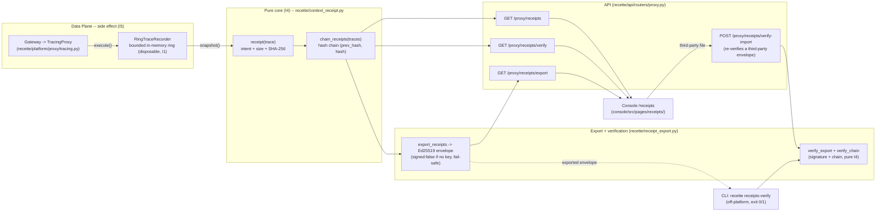

# Context receipts -- runbook

> A **context receipt** is the CONTENT-FREE projection of an agent <-> server
> exchange (`ProxyTrace`): it keeps the intent (who, target, action, resource,
> outcome) and replaces the request/response bodies with their **size in bytes** +
> their **SHA-256**. An auditor (CISO) can thus prove WHAT crossed the boundary
> and that it is unchanged, without the platform logging or exposing the raw content.
>
> Code: `recette/context_receipt.py` (pure, deterministic I4),
> `recette/receipt_export.py` (Ed25519 signed export + verification), endpoints
> in `recette/api/routers/proxy.py`, CLI `recette receipts-verify`
> (`recette/cli/discovery_cmds.py`), console page `console/src/pages/receipts/`.

## Why it exists

The full trace of a side effect (`ProxyTrace` in
`recette/platform/proxy/tracing.py`) carries `request_payload` AND `response`: the
real bodies of the exchange. For an audit intended for a CISO, exposing these
bodies is undesirable. The context receipt is the repo's legibility-first
compromise: the **intent** stays legible, the **content** is reduced to a
verifiable proof (size + fingerprint) that exposes nothing.

Two complementary properties are provided:

- **Content-free**: a receipt never contains `request_payload` nor `response`,
  only `request_bytes` / `request_sha256` and `response_bytes` /
  `response_sha256` (`receipt()` in `recette/context_receipt.py`).
- **Sequence integrity**: receipts are hash-chained (`chain_receipts`), each
  receipt carrying `prev_hash` and `hash`. A verifier proves that the SEQUENCE
  has not been reordered, truncated, or altered -- without touching the bodies.
  This is the same posture as the immutable audit log (I1), applied to a
  disposable view.

## From ProxyTrace to receipt -- the flow



Each `execute()` on the gateway side goes through the `TracingProxy`, which records a
`ProxyTrace` in a bounded ring (`RingTraceRecorder`). The receipt endpoints
read this buffer via `snapshot()`, project each trace into a receipt, and chain the
whole. The buffer is disposable -- the durable truth remains the append-only audit log
(I1); receipts are a read view.

## Prerequisite: the tracing proxy must be active

The ring is fed only if the proxy's debug tracing is enabled, via the
environment variable `INSPECT_IA_AGENTS_PROXY_DEBUG`
(`DEBUG_ENV` in `recette/platform/proxy/tracing.py`; truthy values: `1`,
`true`, `yes`, `on`). Wiring: `recette/api/app.py` builds
`TracingProxy(base_proxy, trace_recorder, enabled=proxy_debug_enabled)`.
Debug off => no trace recorded => the endpoints return an empty list of
receipts (and the console page shows the "No receipt" state).

## Endpoints (prefix `/proxy`, `recette/api/routers/proxy.py`)

| Method + path | Role | Parameters |
|------------------|------|------------|
| `GET /proxy/receipts` | Content-free receipts, chained, in ascending `seq` order. | `run_id` (filter one execution), `tail` (last N) -- `run_id` applied before `tail`. |
| `GET /proxy/receipts/verify` | Recomputes the chain from genesis and reports the first break. | `run_id` |
| `GET /proxy/receipts/export` | Transferable envelope, Ed25519-signed when a key is configured. | `run_id` |
| `POST /proxy/receipts/verify-import` | Re-verifies a THIRD-PARTY export envelope (Ed25519 signature + hash chain), trusting nothing in it. Stateless, pure (I4). | `expected_public_key` (pin the signer); body = the envelope |
| `GET /proxy/receipts/merkle` | Merkle root committing to all receipts (+ `count`). | `run_id` |
| `GET /proxy/receipts/merkle/proof` | Inclusion proof of ONE receipt under the root (`{leaf, index, count, root, path}`); unknown `seq` -> 404. | `seq` (required), `run_id` |
| `GET /proxy/receipts/root-attestation` | Tiny signed commitment `{chain_head, count, merkle_root}`, NO receipts (selective disclosure). Unsigned (fail-safe) with no key. | `run_id` |

The GET routes are read-only and content-free (no body is ever returned);
`verify-import` is stateless (touches neither the audit log nor the buffer). On
the TypeScript client side: `getContextReceipts`, `verifyContextReceipts`,
`exportContextReceipts`, `verifyImportedReceipts` in
`console/src/api/client.ts`.

### Inputs / outputs

- **Input**: the `ProxyTrace` from the buffer (`snapshot()`), optionally filtered
  by `run_id` / `tail`.
- **Output of `/proxy/receipts`**: `{"receipts": [ContextReceipt, ...]}`. Fields
  of a `ContextReceipt` (cf. `receipt()` and `console/src/types/platform.ts`):
  `seq`, `event_id`, `timestamp`, `agent_id`, `target_system`, `target`,
  `action_type`, `resource`, `ok`, `status_code`, `side_effect_hash`, `run_id`,
  `request_bytes`, `request_sha256`, `response_bytes`, `response_sha256`,
  `prev_hash`, `hash`. An empty body yields `0` bytes and an empty digest `""`.
- **Output of `/proxy/receipts/verify`**: `{"ok": bool, "checked": int,
  "first_break_seq": int | null}`.
- **Output of `/proxy/receipts/export`**: envelope
  `{"schema": "inspect_ia_agents-receipt-export-v1", "count", "chain_head",
  "receipts", "signed"}`. If signed, it adds `public_key` and `signature` (hex).
- **Output of `/proxy/receipts/verify-import`**: `{"signature": {"valid", "reason"},
  "chain": {"ok", "checked", "first_break_seq"}}`. The verdict is a function of the
  posted envelope alone (nothing read from the recorders); a non-object body -> 422.

## Signed export (recette/receipt_export.py)

The export wraps the chained receipts in an envelope and signs the canonical
payload with Ed25519, the same mechanism as the policy bundle
(`recette/bundle.py`). Key points:

- The signed payload is the canonical JSON of `{chain_head, receipts}`
  (`canonical_payload`): sorted, compact, utf-8 -- thus deterministic (I4).
- The signing key comes from the environment, never hardcoded (R8):
  `SIGNING_KEY_ENV = "INSPECT_IA_AGENTS_RECEIPT_SIGNING_KEY"` (32-byte seed in
  hex).
- `cryptography` is the optional extra `[bundle]`, imported lazily: the
  recette core keeps zero crypto dependency (R20).
- `verify_export(envelope, expected_public_key=...)` verifies the signature off
  platform with the public key alone; key pinning is optional.

Since the receipts are already content-free, the export carries no body: it
makes the audit trail verifiable by anyone holding the public key.

## Off-platform attestation (signed exchange -> verified)

The full loop is: **sign on one side**, **verify on the other**, always
content-free. Verification exists at three altitudes, all backed by the same pure
pair `verify_export` (signature) + `verify_chain` (chain):

| Surface | How | For whom |
|---------|-----|----------|
| **Console** | `/receipts` page, `Verify a third-party export` field: load an envelope file, the signature/chain verdict is shown. | Operator in the cockpit. |
| **API** | `POST /proxy/receipts/verify-import` (body = envelope, optional `expected_public_key`). | Machine-to-machine integration. |
| **CLI** | `python -m recette receipts-verify <export.json> [--pubkey HEX] [--json]`. | Third party (auditor, CISO, regulator) with only the file + the public key -- no console, no API, no network. |

The CLI is the terminal twin of `verify-import` (`_cmd_receipts_verify` in
`recette/cli/discovery_cmds.py`). It exits **0 if and only if** the signature is
valid AND the chain intact -- usable as a gate in a CI / attestation pipeline. The
public key is embedded in the envelope: a verifier needs NO secret (it can pin the
expected signer with `--pubkey`).

```
python -m recette receipts-verify export.json
# export: export.json
# signature: VALID -- signature valid over canonical payload
# chain: INTACT -- N receipt(s)
# verdict: VALID            (exit 0)
```

A tampered envelope (one modified receipt) breaks both the signature and the
chain -> `verdict: INVALID` (exit 1). A pinned key that does not match -> invalid
signature.

## Selective disclosure (Merkle: prove ONE side effect, not the batch)

The signed export proves the WHOLE sequence but forces transmitting every
receipt. To attest that ONE specific side effect crossed WITHOUT revealing the
others, the repo builds a **Merkle tree** over the receipts
(`recette/receipt_merkle.py`, pure I4, content-free, RFC 6962 domain separation:
`0x00` leaf / `0x01` node prefix, second-preimage safe):

- `merkle_root(receipts)` -- one root committing to the whole batch.
- `inclusion_proof(receipts, index)` -- `{leaf, index, count, root, path}`: the
  disclosed leaf + the audit path (sibling hashes). A leaf is computable from ONE
  receipt alone (excludes `prev_hash`/`hash`), so a receipt is disclosed and
  proven without the others.
- `verify_inclusion(leaf, path, root)` -- folds the leaf with the path; true iff
  it reconstructs the root.

The **root attestation** (`export_root_attestation`) signs the commitment
`{chain_head, count, merkle_root}` ALONE -- no receipts. A third party verifies
the root's authenticity from that tiny payload, then folds one disclosed leaf to
that root. It attests a single side effect without ever seeing the others.

Terminal verification (twin of `receipts-verify`, `_cmd_receipts_attest`):

```
python -m recette receipts-attest --attestation att.json --proof proof.json
# signature: VALID -- signature valid over canonical payload
# root match: YES (proof root vs attested merkle_root)
# inclusion: PROVEN (disclosed leaf folds to root)
# verdict: VALID            (exit 0)
```

`receipts-attest` exits **0 iff all three hold**: the root signature is valid, the
proof folds to a root, and that root equals the attested `merkle_root` (a proof
against any other root proves nothing here). Pure, offline, the public key is in
the attestation (verifier needs no secret; `--pubkey` pins the signer).

## Console page

Route `/receipts` (`console/src/App.tsx`), page `console/src/pages/receipts/`.
It loads `getContextReceipts()` + `verifyContextReceipts()`, displays a chain
integrity badge (`chain verified (N)` or `chain broken @ seq ...`), a
content-free table (agent, action, target/resource, status, sizes and truncated
SHA-256), an `Export (Ed25519 signed)` button that downloads the envelope
`context-receipts-export.json`, and a `Verify a third-party export` field that
reads an envelope file (via `FileReader`, test-safe) and shows the combined
signature/chain verdict (`verifyImportedReceipts`). The contract fixture (R16)
lives in `console/src/pages/receipts/__fixtures__/receipts.fixture.json`.

## Failure mode (fail-safe)

- **No signing key**: the export is returned UNsigned (`signed: false`),
  never a fake signature (`export_receipts`).
- **Extra `[bundle]` absent**: the envelope carries `sign_error` and stays unsigned
  (lazy import guarded).
- **Invalid key** (hex / length): explicit `sign_error`, unsigned.
- **Tampered chain**: `verify_chain` / `verify_export` return `ok/valid:
  false` with the reason or the `first_break_seq` -- a break is made loud.
- **Debug off / empty buffer**: empty response, never an open error.

No path degrades toward exposing a body nor toward a fabricated proof.

## Invariants upheld

- **I1 (immutability)**: the hash chain of receipts is a proof of sequence
  integrity (like the audit log); the buffer is disposable, the durable truth
  remains the append-only event store.
- **I4 (deterministic replay)**: `receipt`, `chain_receipts`, `canonical_payload`,
  `merkle_root`, `inclusion_proof`, `canonical_root_payload` are pure functions
  (SHA-256 over canonical JSON, genesis `prev_hash` empty, fixed Merkle pairing)
  -- no clock, no randomness.
- **I5 (mediated side effects)**: receipts project only `ProxyTrace`
  produced at the `ExternalSystemProxy` edge (`TracingProxy`), never a direct
  call.

## Quick verification (live)

Services launched ONLY by `./recette.sh` (R19), proxy debug active.

```
INSPECT_IA_AGENTS_PROXY_DEBUG=1 ./recette.sh platform up
curl -s http://localhost:8090/proxy/receipts | head
curl -s http://localhost:8090/proxy/receipts/verify
curl -s http://localhost:8090/proxy/receipts/export | head
```

Off-platform verification from the terminal (the verifier needs only the file;
the public key is in the envelope):

```
curl -s http://localhost:8090/proxy/receipts/export > export.json
python -m recette receipts-verify export.json --json
```

The console smoke covers the page: `_verify_receipts` in
`scripts/smoke_console.py` (via `./recette.sh smoke`).

## Gates

```
.venv/bin/python -m unittest discover -s tests
make recette
./recette.sh console-test
./recette.sh console-build
```

Dedicated tests: `tests/test_context_receipt.py` (content-free, verifiable
size/digest, determinism, chain + tamper detection, endpoint shape),
`tests/test_receipt_export.py` (unsigned fail-safe without key, signature
round-trip, tampering rejected, key pinning, deterministic payload),
`tests/test_api_receipt_verify_import.py` (cross-verification endpoint: signed
round-trip, tampering, pinning, non-object 422) and
`tests/test_cli_receipts_verify.py` (CLI: exit 0 when signed+intact, exit 1 when
unsigned / tampered / wrong key, `--json` output). Selective disclosure:
`tests/test_receipt_merkle.py` (deterministic + order-sensitive root, every-leaf
inclusion, leaf excludes chain fields, wrong leaf/root fails, RFC 6962),
`tests/test_api_receipt_merkle.py` (root + proof + attestation endpoints),
`tests/test_receipt_root_attestation.py` (signed attestation + end-to-end) and
`tests/test_cli_receipts_attest.py` (the `receipts-attest` CLI).

## Related links

- `docs/runbooks/replay-model.md` -- record/replay/freeze model (I4).
- `docs/runbooks/private-dns.md` -- another view of the proxy path / `ProxyTrace.target`.
- `.claude/rules/determinism-replay.md` (I4) -- pure core tested at replay.
- `.claude/rules/no-hardcoded-secrets.md` (R8) -- the signing key comes from the env.
- `.claude/rules/frontend-contract-gate.md` (R16) -- fixture of the receipts page.
