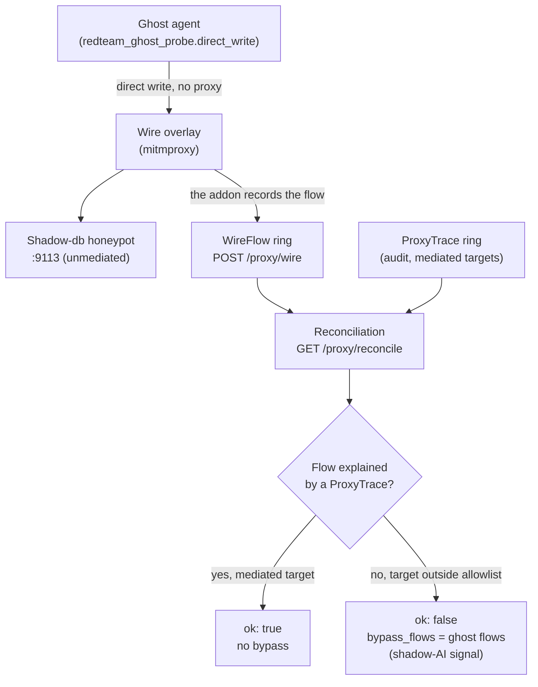

# Detection recette (adversarial) -- runbook

> The detection recette proves that a third party can SPOT an agent and detect
> that it escapes governance, across two complementary surfaces: the **static
> discovery** of observability tooling in an agent's source (`/detect`), and the
> **adversarial detection** of a ghost egress that bypasses the governed proxy,
> through wire-vs-audit reconciliation (`/proxy/reconcile`). All routes are pure
> functions of their inputs (I4) and fail-safe: they signal, they never collapse
> (no 500), and the lab OBSERVES the unmediated path -- it does not BLOCK the
> network.

Source code:

- Static discovery: `recette/api/routers/detect.py`, table
  `corpus/detect/observability-signatures.json`, aggregation
  `recette/api/routers/discovery.py`.
- Adversarial detection: `recette/redteam_ghost_probe.py`,
  `recette/platform/proxy/reconcile.py`, routes in
  `recette/api/routers/proxy.py`, eBPF capture in
  `recette/api/routers/probe.py`.
- Console: `console/src/pages/detect/`, `console/src/pages/discovery-overview/`,
  `console/src/pages/probe/`.
- Live proof: `scripts/smoke_reconcile.py`.

---

## 1. Why this subsystem exists

The product's legibility-first principle: we only recette what we can observe.
Detection answers two questions a third-party tool must be able to settle:

1. **Discovery (source view)** -- does an agent's source declare any
   observability tooling (tracing, LLM gateway, evaluation, audit, replay)? An
   agent that exposes neither audit nor replay is non-recettable: the governance
   axis (`audit` + `replay`) is surfaced.
2. **Adversarial detection (network view)** -- a ghost agent that writes directly
   to a target WITHOUT going through the `ExternalSystemProxy` is a deliberate
   violation of I2/I5. The red-team bench must detect it: a network flow with no
   audit event behind it is the shadow-AI signal.

---

## 2. Static discovery of observability tooling (`/detect`)

### What it is

A static detector: you give it the text of a source, it reports which agent/LLM
observability tools it uses, by matching against a committed table of PUBLIC
identifiers (package names, import paths, environment variable keys, call
markers). The table is the recette's own clean data, loaded from a single
committed file `corpus/detect/observability-signatures.json` (config-first R5,
overridable via `INSPECT_IA_AGENTS_DETECT_SIGNATURES`).

Each entry carries `tool`, `category` (one of `tracing` / `gateway` / `eval` /
`audit` / `replay`), a sorted `capabilities` list (defaulting to `[category]`
when the source omits it) and a `needles` list (the literal cues).

### Algorithm (verbatim from `_detect`)

For each signature in FILE ORDER, the first `needle` that is a substring of the
text triggers the tool (a single match per tool); the matches are then sorted by
ascending tool name. This algorithm AGREES byte for byte with the reference Rust
detector (`discoveryprobe/discoveryprobe-detect`). Determinism (I4): no clock, no
randomness; the same text produces the same report.

### Endpoints

| Verb | Route | Body | Returns |
|------|-------|------|---------|
| GET | `/detect/signatures` | -- | `{tools: [{tool, category, capabilities[], needles[]}], categories: [sorted]}` |
| POST | `/detect/scan` | `{text: str}` | `{matches: [{tool, category, matched}]}` |

Both responses are raw (no `{success, data}` envelope): the console client
returns the parsed JSON directly.

### Overview (`/discovery/overview`)

`GET /discovery/overview` aggregates the two discovery surfaces into a pure
projection (I4): the declarative catalog (`_load_catalog`) and the signatures
table (`_load_signatures`). It returns
`{catalog: {total, with_tools, tags}, detect: {tools, by_category, by_capability}}`.
`by_capability` surfaces `audit` and `replay` -- the governance axis -- even when
they are never a primary category. The keys are sorted for a stable result.

### Console

- **Discovery (Reperage)** page -- route `/detect`
  (`console/src/pages/detect/index.tsx`): on load, `GET /detect/signatures`
  lists the catalog by category; an input area POSTs `text` to `/detect/scan`
  and displays the matches (tool + category badge + the matching `needle` as
  proof). Explicit empty state: "no tool detected".
- **Discovery** page (overview) -- route `/discovery-overview`
  (`console/src/pages/discovery-overview/index.tsx`): catalog + discovery tiles,
  with a "governance" chip on `audit` and `replay`.

### Associated CLI (source side of published repos)

The discovery recette over the real repos goes through
`python -m recette discovery --adapter reference|http [--surface ...]`
(`recette/cli/discovery_cmds.py`, `_cmd_discovery`); `GET /discovery/check`
exposes the same result to the console.

---

## 3. Adversarial detection: the ghost probe and reconciliation

### The ghost probe (`recette/redteam_ghost_probe.py`)

This is a red-team bench probe, NOT a production path. It models an unregistered
agent that writes directly to a target (the shadow-db honeypot) without going
through the `ExternalSystemProxy` -- the I2/I5 violation the bench must detect.
The request construction is pure and tested (`build_probe_request`), the actual
send is separate (`direct_write`).

Fail-safe guard: `build_probe_request` rejects any scheme other than
`http`/`https` (a misconfigured `sink_url` cannot become a local file write).
`direct_write` routes via the wire proxy when `proxy_url` is provided, and
returns the error code (or `0`) instead of raising -- the probe does not crash
the smoke, DETECTION is the assertion. The default run header is
`x-inspect-run-id` (`DEFAULT_RUN_HEADER`).

### Wire-vs-audit reconciliation (`recette/platform/proxy/reconcile.py`)

A legitimate run only talks to MEDIATED targets (the lab, the `mock_local`
servers, the configured LLM backends). Any network flow whose target
(`host:port`) falls outside this allowlist is an unmediated path -- the ghost
signal. `build_allowlist` builds the allowlist; a honeypot (any `mode` other than
`mock_local`) is deliberately excluded from it, so a flow toward it is always a
bypass.

Three join levels, all pure and deterministic (I4):

- `reconcile(wire_flows, allowlist)` -- signals any flow outside the allowlist;
  an empty host is treated as SUSPECT (never silently allowed, deny-by-default
  classification). Output ordered by `seq`.
- `reconcile_run(wire_flows, proxy_traces, allowlist)` -- wire<->audit join per
  run (step 4 of the ghost-direct-db scenario); adds `audited_run_ids` (the runs
  that produced a mediated `ProxyTrace`).
- `reconcile_strict(...)` -- phase 3 join by `side_effect_hash` recomputed per
  flow: also catches a ghost that hits an ALLOWLISTED target directly. Each
  bypass carries a `bypass_reason`: `non_mediated_target` or `no_audit_event`.

The `ReconcileReport` report exposes `{ok, bypass_flows, audited_run_ids}`. `ok`
is true if and only if no flow fell outside the allowlist.

### Endpoints (`recette/api/routers/proxy.py`)

| Verb | Route | Parameters | Role |
|------|-------|-----------|------|
| GET | `/proxy/reconcile` | `run_id?`, `strict?` | Report `{run_id, strict, ok, bypass_flows, audited_run_ids}` |
| GET | `/proxy/reconcile/status` | `run_id?`, `strict?` | Synthetic status |
| GET | `/proxy/discovery-exchange` | `run_id?`, `strict=true` | Discovery verdict overlaid on the real exchange (hook + wire), ghosts in `scorecard.false_negatives` |

The lab OBSERVES the unmediated path; it does not BLOCK. Raising a bypass as a
compensatory event (immutability I1) goes through `POST /proxy/reconcile/raise`.

### Reference eBPF capture (`/probe`)

The eBPF surface is served separately by
`recette/api/routers/probe.py`:

- `GET /probe/status` -> `{configured, socket_env, mode}`; `mode` is `replay`
  (unprivileged broker, deterministic replay of the `corpus/surface` corpus) or
  `live` (privileged eBPF broker, CAP_BPF). The status is exposed so the console
  never presents a replay as a live capture (R13/R14).
- `POST /probe/capture` with `{agents: [ids], duration_ms: <int>}` -> relays a
  bounded capture to the broker and scores it. Validation: non-empty agent list,
  `duration_ms` a positive integer under the cap (`INSPECT_IA_AGENTS_PROBE_*`).
  Returns `{recording, scorecard}` (scorecard only if `status == "ok"`).

The console **eBPF Probe** page (route `/probe`,
`console/src/pages/probe/index.tsx`) shows, per agent and per observation surface
(`hook_subprocess`, `hook_mcp`, `hook_sdk`, `ebpf_wire`), what the probe SAW. An
agent seen nowhere is a false negative shown in red: the failure of the thesis
"if the tool does not see the agents, it is a failure". The
`DetectionScorecard` scorecard (`recette/surface/scorecard.py`) carries `ok`,
`total_agents` and `false_negatives`.

### CLI

`python -m recette surface [--recording <file.json>]`
(`recette/cli/discovery_cmds.py`, `_cmd_surface`) runs the per-surface detection
recette and prints the scorecard; exit 1 if an agent is detected on no surface.
With `--recording`, it scores a discoveryprobe broker capture frozen in JSON
through the SAME judge.

---

## 4. Adversarial detection flow



---

## 5. Inputs / outputs

| Surface | Input | Output |
|---------|-------|--------|
| Discovery | `text` (source) + signatures table | `matches[]` (tool, category, matched) |
| Overview | catalog + signatures table | `{catalog, detect}` (sorted counts) |
| Reconciliation | snapshots of the WireFlow + ProxyTrace rings + allowlist | `{ok, bypass_flows, audited_run_ids}` |
| eBPF capture | `{agents, duration_ms}` | `{recording, scorecard}` |

---

## 6. Failure mode (fail-safe)

- `/detect/signatures` and `/detect/scan`: a missing, unreadable or malformed
  signatures file produces an EMPTY catalog (no tool, no match) with a logged
  warning -- never a 500.
- `/discovery/overview`: empty or missing sources -> all counts at zero.
- `reconcile*`: an empty or unclassifiable host is SIGNALED (suspect), never
  silently allowed (deny-by-default).
- `direct_write`: a connection/HTTP error returns its code (or `0`) instead of
  raising; a non-`http(s)` scheme is rejected at construction.
- `/probe/capture`: unconfigured broker -> explicit 503; invalid input -> 400;
  deny-by-default lives in the broker.
- `scripts/smoke_reconcile.py`: without Docker or with the API down, it SKIPS
  with a reason instead of failing; the deterministic regression lives in the
  unittest suite.

In accordance with the system policy: the lab OBSERVES the unmediated path, it
does not ENFORCE it (no network blocking here) -- mediation remains the role of
the governed proxy.

---

## 7. Invariants upheld

- **I1 Immutability** -- raising a bypass is a compensatory event
  (`POST /proxy/reconcile/raise`), never a mutation of history.
- **I2 Control Plane Mediation** -- the ghost probe precisely models the path
  that BYPASSES the Gateway/the proxy; reconciliation is what makes it visible.
- **I4 Deterministic replay** -- all detection routes are pure functions of their
  inputs (sorted table, joins ordered by `seq`, no clock or randomness); the
  probe's `replay` mode replays the `corpus/surface` corpus byte for byte.
- **I5 Mediated side-effects** -- detection relies on the fact that only the
  proxy produces a `ProxyTrace`; a side effect with no trace is, by definition, a
  bypass.

---

## 8. Operating the recette

```
python -m recette discovery --adapter reference
python -m recette surface
./recette.sh platform up
python scripts/smoke_reconcile.py
```

- `recette discovery`: discovery recette over the published repos (offline,
  reference oracle).
- `recette surface`: per-surface detection recette (false negative = failure).
- `smoke_reconcile.py`: end-to-end live proof of the ghost-direct-db scenario
  (requires Docker + the governed API via `./recette.sh platform up` -- R19:
  single launcher, fixed ports).

On the console side, open `/detect` (discovery), `/discovery-overview` (overview)
and `/probe` (eBPF capture) once the platform is started.
