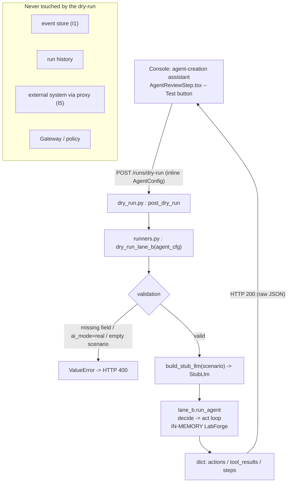

# Governed action dry-run -- runbook

> Pre-creation preview of an agent: we replay an agent's mock scenario
> IN MEMORY to see the action log it WOULD PRODUCE, without persisting
> anything, without touching any external system, and deterministically.
>
> Code: endpoint `recette/api/routers/dry_run.py`, logic
> `recette/api/runners.py` (`dry_run_lane_b`), agent loop
> `recette/lane_b.py` (`run_agent`), console page
> `console/src/pages/agents/AgentReviewStep.tsx`.

## What it is, and why

The dry-run is a preview meant for the console's agent-creation assistant.
Before saving an agent, the operator wants to know what the agent would
actually do based on its declared `scenario`. The dry-run answers that
question: it executes the agent's mock scenario and returns the action log
it would produce, all WITHOUT side effects and WITHOUT persistence.

The agent config is sent inline in the request body -- it does NOT need to
be already saved. It is a throwaway trial run: nothing is written to the
event store or to the run history.

Reading key: this is what the agent DECIDES / WOULD DO, legible before
saving it (legibility-first). The mock scenario is replayed, not a real LLM
nor a real server.

## Difference with `/actions/execute`

`/actions/execute` (`recette/api/routers/actions.py`) is the API face of the
Gateway: it submits an action to the Gateway, captures the wall clock once at
the boundary (`_capture_timestamp`), evaluates the policy (allow/deny/escalate),
mediates the side effect, appends the governed event to the append-only event
store and publishes it. An action in `escalate` returns `202` and blocks on
approval (I6).

`/runs/dry-run` does NONE of that. It does not evaluate any policy, does not call
the Gateway, writes no event, touches no external system. It builds a `StubLlm`
from the `scenario` and runs the Lane B loop over an in-memory `LabForge`. It is
a pure preview, not a governed execution.

## Control flow



## Concrete touch points

### HTTP endpoint

- `POST /runs/dry-run` -- prefix `/runs` (`router = APIRouter(prefix="/runs")`
  in `recette/api/routers/dry_run.py`), registered in the app via
  `app.include_router(dry_run_router.router)` (`recette/api/app.py`).
- Body: the inline `AgentConfig` (a JSON object).
- Response: raw JSON (no `{success, data}` envelope).
- `400` on invalid input: missing fields, real-AI agent, or empty scenario
  (the `ValueError` from `dry_run_lane_b` is remapped to `HTTPException(400)`).

### Console

- Agents page (`/agents`, route declared in `console/src/App.tsx`:
  `<Route path="/agents" element={<AgentsPage />} />`).
- Assistant review step: `AgentReviewStep.tsx`. The
  `Tester (dry-run, mock, sans sauver)` button calls `handleDryRun`, which invokes
  `dryRunAgent(preview.config)` (`console/src/api/client.ts`,
  `request<DryRunResult>("/runs/dry-run", { method: "POST", ... })`).
- The result displays the number of actions played and reminds that nothing was
  saved nor executed for real (testids `agents-dryrun-result`,
  `agents-dryrun-actions`).

### No dedicated CLI

The dry-run is an API endpoint driven by the console; it has no
`python -m recette ...` subcommand. To test it on the command line, call the
endpoint directly (see Live proof below).

## Inputs / outputs

Input (`agent_cfg`, validated by `dry_run_lane_b`) -- required fields:

- `principal`, `target_system`, `goal`, `capability_scope` (all mandatory;
  otherwise `ValueError: agent missing [...]`).
- `ai_mode` must be mock: `ai_mode == "real"` is refused
  (`dry-run is mock-only (a real-AI agent would call a live provider)`).
- `scenario`: a non-empty list of decisions (otherwise
  `dry-run needs a mock scenario`). Each entry carries `kind`
  (`tool_call` / `final`), `tool_name`, `tool_args`, `text` -- converted into
  an `LlmDecision` by `build_stub_llm`.
- `id` optional (default `"dry-run"`); `memory` optional (bounded memory
  window via `_memory_window`).

Output (dict returned by `dry_run_lane_b`):

- `actions` -- the ordered action log (`AgentAction.to_dict()` per executed
  action). In the console type `DryRunResult`
  (`console/src/types/platform.ts`) each action exposes at least
  `action_type`, `target_system`, `resource`.
- `tool_results` -- the tool-result text returned to the model per action,
  in order (auditable: legibility-first).
- `steps` -- the recorded steps (`recording.to_dict()["steps"]`), including
  the `tool_call`s AND the eventual `final` decision.

Note: the declared `scenario` may contain a `final` step, so `steps` is
generally longer than `actions` (only `tool_call`s produce an action).

## Determinism and invariants

- I1 -- Immutability: the dry-run writes NOTHING. No event store, no recording, no
  run record (`persisting nothing`).
- I4 -- Deterministic replay: `StubLlm` replays the scenario's decisions in
  order and the loop uses a logical clock; no wall clock, no
  randomness. The test `test_is_deterministic`
  (`tests/test_api_dry_run.py`) asserts that two dry-runs are byte-identical.
- I5 -- Mediated side-effects: no external system is touched. The default
  `LabForge` of `run_agent` (`forge = forge or LabForge()`) is in memory;
  no network proxy is built.

## Failure mode (fail-safe)

The dry-run refuses rather than acting blindly:

- Required fields missing -> `400` (`agent missing [...]`).
- Real-AI agent (`ai_mode == "real"`) -> `400`: a dry-run NEVER calls a live
  provider nor consumes an API key.
- Empty or missing scenario -> `400` (`dry-run needs a mock scenario`).

Any doubtful input is rejected; no partial execution, no write.
Since nothing is persisted nor sent over the network, a failed dry-run leaves
no residual state.

## Live proof (R14)

With the platform started (`./recette.sh platform up`, API on `:8090`):

```
curl -s -X POST http://localhost:8090/runs/dry-run -H 'content-type: application/json' -d '{"id":"dry-bot","principal":"bot@acme","target_system":"github","goal":"read then open","capability_scope":["read_repo","open_pr"],"ai_mode":"mock","scenario":[{"kind":"tool_call","tool_name":"read_repo","tool_args":{"resource":"acme/x"}},{"kind":"tool_call","tool_name":"open_pr","tool_args":{"resource":"acme/x"}},{"kind":"final","text":"done"}]}'
```

Expected: `actions` = two entries (`read_repo`, `open_pr`), `steps` = three
(two tool calls + final). The same call replaying the same body returns the same
JSON (I4). A body with `"ai_mode":"real"` returns `400`.

## Gates

```
.venv/bin/python -m unittest discover -s tests
make recette
./recette.sh console-test
./recette.sh console-build
```

Dedicated test: `tests/test_api_dry_run.py` (function `dry_run_lane_b` +
route `POST /runs/dry-run` via `TestClient`).

## Related links

- `docs/runbooks/replay-model.md` -- the record / replay / freeze pattern; the
  dry-run is the throwaway mock preview upstream of that pattern.
- `.claude/rules/determinism-replay.md` (I4) -- `StubLlm` + logical clock.
- `.claude/rules/invariants.md` -- I1 (immutability), I5 (mediated side-effects).
- `.claude/rules/frontend-contract-gate.md` (R16) -- the console's contract
  (`DryRunResult`, fixtures captured live).
