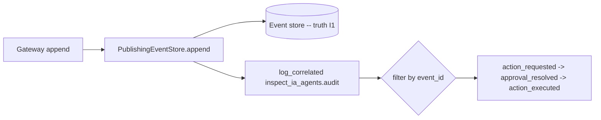

# Forensic correlation logging (G6, R6)

> Every governed event emits a structured log record keyed by `event_id` and
> `agent_id`, so an auditor reconstructs a single action's full flow from the
> logs alone. This complements the append-only event store (the source of truth,
> I1): the store is the durable record, the correlated logs are the operational
> forensic view.

## What it gives you

Filter the logs on one `event_id` and you get the action's whole lifecycle; an
approval resolution links back via `correlates_event_id`.



## Fields (the forensic join keys)

`event_id` (primary), `agent_id`, `correlates_event_id` (links a resolution to
its action), `kind`, `verdict`, `target_system`, `action_type`. Only these are
promoted onto the log record; everything else stays in the human message. None
of them adds non-determinism to the decision path (I4) -- they are read off the
event that already exists.

## Output format (R5 -- env-driven)

| `INSPECT_IA_AGENTS_LOG_FORMAT` | Output |
|------------------------|--------|
| `json` | one JSON object per line (forensic ingestion) |
| anything else (default) | human text |

`INSPECT_IA_AGENTS_LOG_LEVEL` sets the level (default INFO). Call
`configure_observability_from_env()` once at process start (idempotent -- it
replaces the handler set, never stacks duplicates).

## Worked example (a real escalate -> approve -> execute flow)

```
{"agent_id":"agent-admin","event_id":"EV...001","kind":"action_requested","level":"INFO","verdict":"escalate"}
{"agent_id":"agent-admin","correlates_event_id":"EV...001","event_id":"EV...002","kind":"approval_resolved"}
{"agent_id":"agent-admin","correlates_event_id":"EV...001","event_id":"EV...003","kind":"action_executed","verdict":"escalate"}
```

Querying `event_id == EV...001 OR correlates_event_id == EV...001` returns all
three records in order: the request, its approval, the execution.

## Where it is wired

`PublishingEventStore.append` (the API-path append funnel) emits one correlated
record per governed event before diffusing it to the realtime transport (G4).
Because the gateway funnels every outcome (executed / denied / requested /
resolved / error) through the store, every governed event is logged with its
correlation keys.

## Tests

`tests/test_observability.py` -- field promotion, None/unknown-field dropping,
flow reconstruction by event_id, JSON formatter validity, env configuration
(json/text/level/idempotent), and the wired `PublishingEventStore` emission. The
end-to-end escalate->approve->execute correlation was verified live through the
API gateway.

## Related ops state (G6 scope)

- CI: `.github/workflows/recette.yml` already runs the strict gates (ruff + ruff
  format + mypy + bandit) and the full test suite as blocking steps on every push
  to main AND every pull request -- a red CI blocks a merge.
- OTel: `recette/otel.py` exports an orchestration run as GenAI spans for any OTel
  backend (a separate, run-level view).

## Residual

- Secret manager: the per-backend `BackendSecretStore` plus env (R8) cover
  credentials today; a pluggable external secret-manager seam for the proxies is
  the remaining G6 item.
