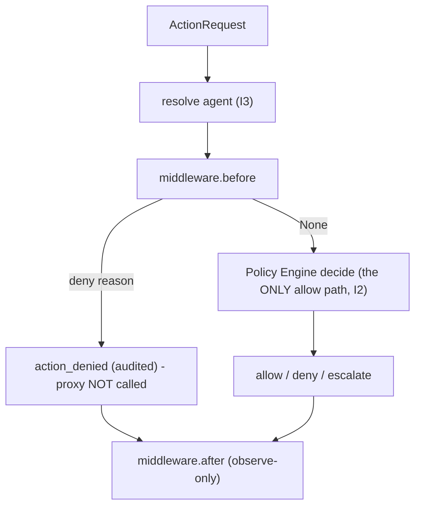

# Runbook -- gateway middleware pipeline (I2)

A reference pattern (agent-framework `_middleware.py`) adapted to inspect_ia_agents's
control-plane discipline. A middleware wraps the gateway submission with two
hooks; it can **observe** every submission and can force a **deny**, but it can
**never grant** -- only the Policy Engine produces an allow (I2 preserved).

## Contract (`recette/platform/middleware.py`)

```python
class Middleware(Protocol):
    def before(self, request) -> str | None: ...   # deny reason, or None to continue
    def after(self, request, outcome) -> None: ...  # observe-only
```

- `before` returns a deny reason -> the action is denied and audited (proxy never
  called), exactly like a policy deny.
- A `before` that **raises** -> deny (fail-safe, never fail-open).
- `after` observes the produced outcome; an exception there is swallowed so
  observation can never change an outcome.
- Middlewares must be **deterministic** (no clock/random) to preserve replay (I4).

## Wiring (additive, default unchanged)

```python
from recette.platform.middleware import MiddlewarePipeline, RecordingMiddleware, DenyListMiddleware

gateway = Gateway(
    catalog=..., policy_store=..., event_store=..., proxy=...,
    id_generator=..., agent_resolver=...,
    middleware=MiddlewarePipeline([RecordingMiddleware(), DenyListMiddleware(["legacy_system"])]),
)
```

A Gateway built without `middleware=` behaves exactly as before.



## Provided middlewares

- `RecordingMiddleware` -- observability: records `(agent, target, action)` before
  and `(action, verdict)` after.
- `DenyListMiddleware(targets)` -- a fail-safe guard that denies any submission to
  a listed `target_system` before policy evaluation.
