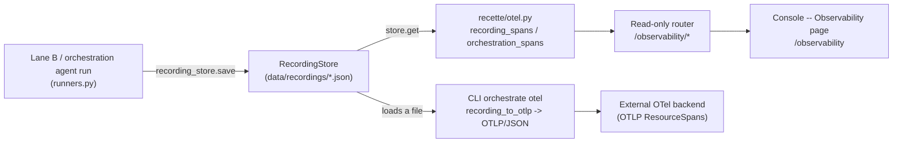

# Observability -- OTel GenAI, traces and spans (runbook)

> Observability makes an agent run **legible**: it projects a persisted recording
> into a tree of OpenTelemetry GenAI spans -- one root agent invocation, one tool
> execution span per action -- so that a third party who did not write the agent
> understands, from the trace alone, what the agent requested, on which system,
> with which identity and under which approval state.
>
> Code: span builder `recette/otel.py` (pure, deterministic), read-only router
> `recette/api/routers/observability.py`, console page `console/src/pages/observability/index.tsx`,
> CLI command `recette/cli/orchestrate_cmds.py` (`_cmd_orchestrate_otel`).

## Why this subsystem exists

The audit log is flat. For the legibility-first recette, the operator needs to
see a run as a **hierarchy**: who invoked what, in which order, and what each
tool call actually did. `recette/otel.py` maps the internal recordings to the
**OpenTelemetry GenAI** semantic conventions (operations `invoke_agent` /
`execute_tool`, attributes `gen_ai.provider.name`, `gen_ai.request.model`,
`gen_ai.agent.name`, `gen_ai.tool.name`), taken from
`microsoft/agent-framework`. Result: the inspect_ia_agents audit interoperates
with any OTel backend, and the console renders a native span tree.

The module is **dependency-free** and **deterministic by construction** (I4): the
`trace_id` / `span_id` identifiers derive from a stable digest
(`hashlib.blake2b`) of the run, and the timestamps are **logical** (a fixed base
plus a per-span step, `_STEP_NANO = 1_000_000`, i.e. 1 ms logical), never the
wall clock. The same recording therefore exports byte-identical spans. The export
is a **derived view, never a mutation** (I1): recordings are read, not modified.

## The data flow



1. An agent run (Lane B or orchestration) persists a recording via
   `recording_store.save(rec_id, result.recording)` (`recette/api/runners.py`).
2. Recordings live in `RecordingStore` (`recette/api/campaign_store.py`), by
   default under `data/recordings/` (override via `INSPECT_IA_AGENTS_RECORDINGS_DIR`).
3. The router reads the store (`request.app.state.recording_store`), rebuilds the
   spans with `recording_spans(recording, recording_id)` and serves them as flat
   JSON.
4. The console lists the traces then renders the selected tree. The CLI, for its
   part, exports an orchestration recording to OTLP/JSON for an external backend.

## The span builders (`recette/otel.py`)

Each builder produces a list of `GenAiSpan` (`name`, `span_id`,
`parent_span_id`, `trace_id`, `start_nano`, `end_nano`, `attributes`). They all
emit a root `invoke_agent {agent}` span then child spans.

| Function | Source | Spans produced |
|----------|--------|----------------|
| `recording_spans(recording, seed)` | a Lane B recording | root `invoke_agent`, then one `execute_tool` per step with an action (a final response without a tool-call produces no span) |
| `orchestration_spans(team, run)` | an orchestration run | root `invoke_agent` (the team), one `invoke_agent` per routed participant (hops + order), one `execute_tool` per tool call |
| `action_log_spans(action_log)` | a canonical action-log (git/MAF) | root `invoke_agent`, one `execute_tool` per recorded action |
| `capture_spans(traces, seed)` | the captured LLM traces of a run | **token-rich** `execute_tool` spans: `gen_ai.usage.input_tokens` / `output_tokens` and `inspect_ia_agents.cost_usd` when a pricing table has priced them; duration = captured `latency_ms` |

Attributes carried by the tool spans (beyond the standard GenAI attributes): the
canonical `AgentActionEvent` fields without a GenAI equivalent are emitted as
`inspect_ia_agents.*` -- `inspect_ia_agents.target_system`,
`inspect_ia_agents.principal` (I3), `inspect_ia_agents.mode` (read/write),
`inspect_ia_agents.resource`, `inspect_ia_agents.approved` (I6, `0`/`1`).

Output rendering:

- `span_to_dict(span)` -- flat JSON view for the console (with a precomputed
  `duration_nano`; `parent_span_id` lets the viewer reconstruct the tree).
- `to_otlp(spans, service_name="inspect_ia_agents-recette")` -- an
  **OTLP/JSON `resourceSpans`** document consumable by any OTel backend; each
  attribute is encoded via `_attr_value` (`boolValue` / `intValue` /
  `stringValue`).
- `recording_to_otlp(recording_path)` -- loads an orchestration recording and
  renders its GenAI OTLP (used by the CLI).

## Concrete touchpoints

### HTTP endpoints (read-only, prefix `/observability`)

| Verb | Route | Returns |
|------|-------|---------|
| GET | `/observability/traces` | one row per recording: `trace_id`, `recording_id`, `agent_id`, `target_system`, `provider`, `span_count` |
| GET | `/observability/traces/{trace_id}` | `{trace_id, recording_id, spans: [...]}` -- the full tree (flat spans linked by `parent_span_id`) |
| GET | `/observability/spans/{span_id}` | a single span looked up across all recordings; `404` if absent |

`span_count` is counted by actually rendering the tree (recordings are small and
the build is pure, I4): a final response without a tool call counts no span. An
unknown `trace_id` returns `404` (`no trace ...`).

### CLI

Export an orchestration recording to GenAI OTLP:

```
python -m recette orchestrate otel <path/recording.json>
python -m recette orchestrate otel <path/recording.json> --out spans.otlp.json
```

Without `--out`, the OTLP/JSON is printed to stdout; with `--out`, it is written
to the file and the span count is displayed (`wrote N GenAI spans (OTLP): ...`).

### Console page

Route `/observability` (mounted in `console/src/App.tsx`, navigation link
"Observability"). The page lists the traces (one per recording, filterable by
agent, system or recording), and on selection renders the span tree with, per
tool call: the action (tool), the target system, the resource, the access mode,
the principal and the approval state. A header summarizes the number of actions,
of writes, of unapproved actions, and the target systems. The raw attributes of a
span are expandable line by line.

## Correlation by event_id / agent_id

All builders **seed** the `trace_id` on the subject's identity
(`_trace_id(seed)`), and each `span_id` derives from `(seed, index)` -- so a same
agent / recording always produces the same ids. The spans carry `agent_id`
(`gen_ai.agent.id`) and the `gen_ai.tool.call.id` is the action identifier (the
action's `seq`). The console notes it: the **request/response payload** of each
tool is not in the span -- it lives in the **cockpit network log**, correlated by
the action's event id. The two surfaces thus connect by identity + seq.

## Inputs / outputs

- **Input**: a persisted recording (`RecordingStore`, `data/recordings/*.json`),
  or -- for the CLI -- an orchestration recording file; for `capture_spans`, the
  `LlmCallTrace.to_dict(pricing)` dicts.
- **Output**: either flat span dicts (console, via `span_to_dict`), or an
  OTLP/JSON `resourceSpans` document (CLI / external backend, via `to_otlp`).

## Failure mode (fail-safe)

Observability is **purely read-only**: it executes, decides and mutates nothing.
As a result there is no fail-open path to protect -- failure is bounded and
explicit:

- an unfindable `trace_id` or `span_id` returns `404` (never a fabricated trace);
- if there is no recording, `/observability/traces` returns an empty list and the
  console shows "No trace yet" (with a link to the cockpit);
- a step without a tool call simply generates no span (no data invention, R4).

No decision value is read here: a span's duration is logical (or the captured
`latency_ms`, an operational value), never the wall clock.

## Invariants upheld

- **I1 Immutability**: the export/projection is a read-only derived view of the
  recordings -- no mutation of the log.
- **I3 Identity binding**: each tool span carries the `principal`
  (`inspect_ia_agents.principal`) and the bound `agent_id`; nothing anonymous.
- **I4 Deterministic replay**: ids derived from a stable digest, logical
  timestamps, stable iteration order -> same run = byte-identical spans. The build
  is a pure function (no clock, no randomness, no I/O in the decision).
- **I6 Approval blocking**: the approval state of guarded actions
  (`inspect_ia_agents.approved`) is surfaced as-is; the console highlights the
  unapproved actions.

## Related links

- `docs/runbooks/replay-model.md` -- where the recordings (record / replay /
  freeze) that Observability projects come from.
- `.claude/rules/canonical-event-model.md` -- the `AgentActionEvent` fields
  (`target_system`, `principal`, `mode`, `resource`, `approved`) carried as
  `inspect_ia_agents.*` attributes.
- `.claude/rules/determinism-replay.md` (I4) -- the determinism property of the
  span builder.
