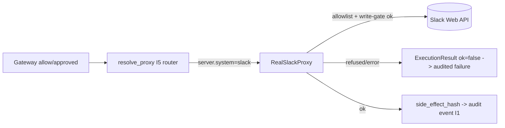
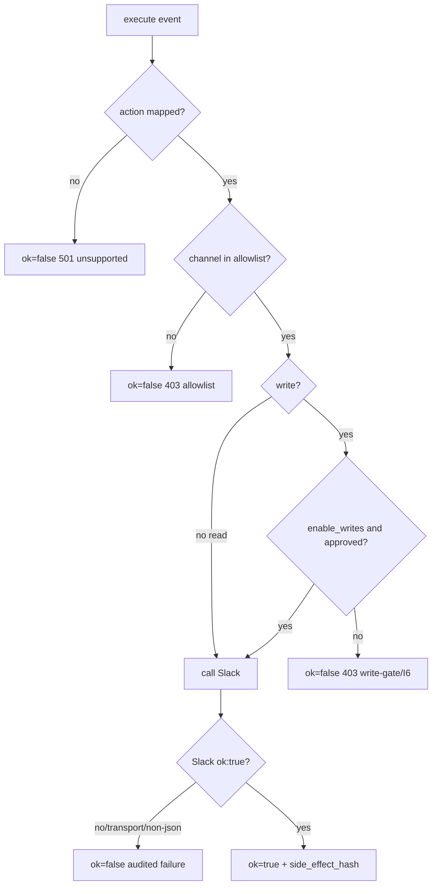

# Real Slack proxy (G5) -- a real-SaaS ExternalSystemProxy (I5)

> `RealSlackProxy` is the second real proxy after the git forge. It bridges the
> I5 proxy protocol to the real Slack Web API. Lab stays the default; this proxy
> is opt-in and fail-safe by construction -- it cannot touch a real workspace
> unless explicitly configured and approved.

## Where it sits (I5)

Business/decision code never calls Slack directly. Every side effect goes through
the proxy, which is the only component holding the token (R8) and which produces
the `side_effect_hash` recorded in the audit event.

## Configuration (R8/R5 -- env only, never in code)

| Variable | Meaning | Fail-safe default |
|----------|---------|-------------------|
| `SLACK_BOT_TOKEN` | Slack bot token, sent as `Authorization: Bearer` | required (else refuse to build) |
| `INSPECT_IA_AGENTS_SLACK_CHANNEL_ALLOWLIST` | comma-separated channel ids/names the proxy may touch | empty => refuse everything |
| `INSPECT_IA_AGENTS_SLACK_API_URL` | API base (override for self-host/test) | `https://slack.com/api` |
| `INSPECT_IA_AGENTS_SLACK_ENABLE_WRITES` | `true` to allow write methods | off => writes refused |

## Action mapping (canonical action_type -> Slack method)

Only the existing `slack` catalog action_types are mapped (no invented action):

| Canonical action_type | Slack method | Side |
|-----------------------|--------------|------|
| `send_message_external_channel` | `chat.postMessage` | write |
| `publish_company_announcement` | `chat.postMessage` | write |
| `create_public_channel` | `conversations.create` | write |
| `delete_channel` | `conversations.archive` | write |
| `access_confidential_channel` | `conversations.info` | read |
| `export_slack_history` | `conversations.history` | read |

Any other action_type (e.g. `modify_workspace_permissions`,
`send_message_as_executive`) returns `ok=False` (status 501, audited) -- an
explicit refusal, not a stub.

## Fail-safe layers (failure-modes.md)

A write requires BOTH `enable_writes` AND an approved action (`approval_state ==
approved`) -- defense in depth on top of the gateway's I6 blocking. Any transport
error or Slack `ok:false` maps to `ok=False`; the proxy never raises through the
gateway and never bypasses.

## Wiring it on

A real run binds an agent to a `real_saas` server entry whose `system` is
`slack`. The I5 router (`resolve_proxy`) dispatches it through the injected
`build_real_proxy_factory()` to a `RealSlackProxy` (the same seam the git forge
uses). The factory reads the env above; the lab/mock paths never build it.

## Tests

- `tests/test_real_slack_proxy.py` -- end-to-end over REAL HTTP against a faithful
  local Slack emulator (Bearer check, method/param mapping, allowlist reject,
  write-gate, unapproved-write refusal, unsupported action, Slack `ok:false`,
  transport failure, deterministic hash, factory dispatch, full `resolve_proxy`
  router round trip). 14 cases.
- `tests/test_real_slack_live.py` -- READ-only (`conversations.info`) against the
  REAL Slack API. Skipped unless `SLACK_BOT_TOKEN` + `INSPECT_IA_AGENTS_TEST_SLACK_CHANNEL`.

## Residuals

- Live-against-real-Slack is skip-unless (no token on this host). The proxy code
  is production-real (real urllib request, Bearer header, real JSON parse, real
  hash); the always-run test points it at a local Slack emulator over real
  sockets, the same approach as the docker Postgres/NATS verifications (G3/G4).
- The 10 remaining domains (okta, crm, finance, data_platform, support_desk,
  cloud, hris, legal_dms, product_cms, knowledge_base) still run in lab only;
  each follows the same pattern (one proxy, env creds, allowlist, write-gate).
