# Architecture de fond -- inspect_ia_agents (plateforme de recette)

> Nom du produit : **inspect_ia_agents** (anciennement « AgentRail »).
>
> Document de reference. Explique ce que fait ce repo, comment il est construit,
> et quels types d'agents de test il produit. Les runbooks operationnels
> (lancer le lab, l'API, la console) sont dans `docs/runbooks/`.

Date : 2026-06-12
Verifie contre le code (R13) : `recette/`, `corpus/`, `console/src/`.
Diagrammes generes depuis `scripts/diagrams/architecture.py`
(`python3 scripts/gen_diagrams.py --write|--check|--render`, voir section 10).

---

## 1. Raison d'etre : recetter les outils, pas les construire

Ce repo n'est **pas** l'outil de discovery, ni l'outil d'identification, ni la
plateforme de gouvernance inspect_ia_agents. C'est la **plateforme de recette** de ces
outils : elle fabrique des **sujets de test a verite connue** (ground-truth),
les fait vivre (lancement, campagnes, enregistrements rejouables), et mesure si
les outils du produit donnent la bonne reponse.

Deux outils sont sous test :

| Outil sous test | Question posee | Recette correspondante |
|---|---|---|
| **Discovery** | "Sait-il REPERER un agent IA et comprendre a quoi il se connecte ?" | `corpus/repos|gitlab|temporal|openapi|manifests` + `python -m recette discovery` |
| **Identification / evaluation** | "Sait-il JUGER si un agent est correct (4 dimensions) ?" | `corpus/agents/` + `python -m recette run` |

<!-- mermaid:context-recette (generated: scripts/diagrams/architecture.py) -->
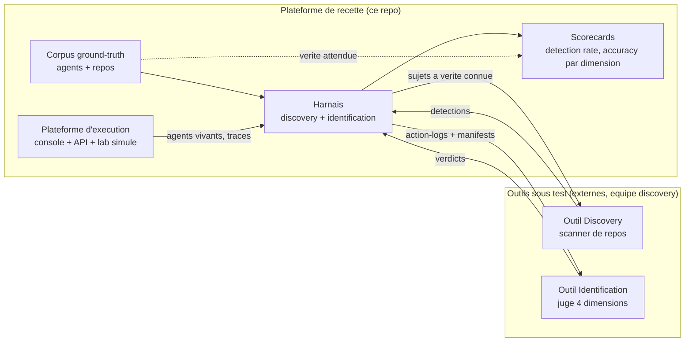

La boucle de recette est toujours la meme :

```
author un agent (proprietes connues, verdict attendu)
  -> discovery doit le trouver          (detecte ? oui/non vs expected_discovery.detectable)
  -> identification rend un verdict     (verdict == ground-truth ?)
  -> comparer, tracer la preuve, agreger en scorecard
```

Les vrais outils se branchent via les protocols `DiscoveryAdapter` /
`IdentificationAdapter` / `SourceScanAdapter` (`recette/adapters.py`,
`recette/http_adapter.py`). Les `Reference*Adapter` fournis sont un evaluateur
correct de reference : ils servent d'oracle (auto-coherence du corpus) et de
gabarit de ce qu'un vrai outil doit produire.

---

## 2. Vue d'ensemble des composants

<!-- mermaid:components (generated: scripts/diagrams/architecture.py) -->
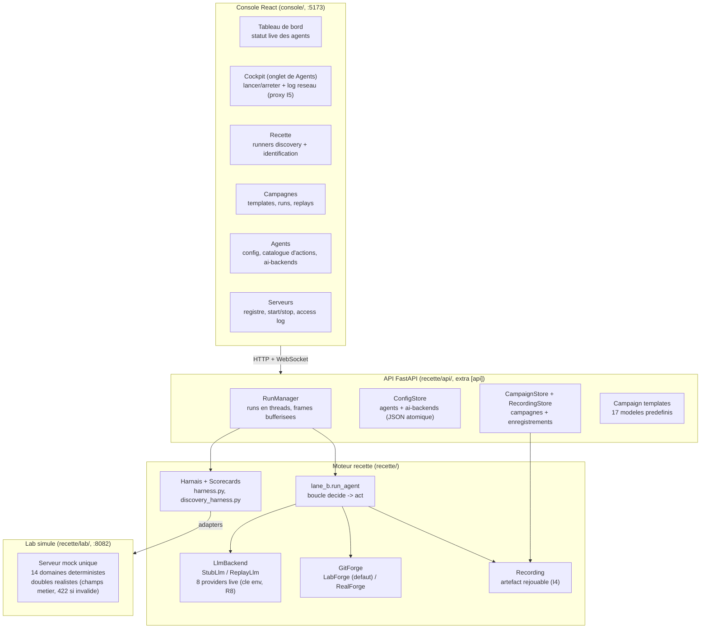

Trois couches, trois responsabilites :

1. **Console** (`console/`, React + Vite + TS) : le poste de pilotage de
   l'equipe discovery. Sept onglets recette (dont Serveurs, le registre des cibles) ; les pages gouvernance (Catalog,
   Approvals, Audit), separees dans la nav, exposent le chemin d'execution
   gouverne de la section 8 (catalogue policy, inbox d'approbations I6,
   piste d'audit I1).
2. **API** (`recette/api/`) : FastAPI optionnel (extra `[api]`). Expose la
   config des agents, le lancement/arret des runs, les campagnes, les
   enregistrements, le catalogue d'actions -- plus les routes du chemin
   gouverne (section 8) : `/actions/execute`, `/policies`, `/approvals`,
   `/audit`. Tout l'etat persistant est en JSON atomique sous `config/` et
   `data/` (chemins surchargeables par env, R5), sauf l'event store gouverne
   (SQLite append-only).
3. **Moteur** (`recette/`) : pur Python stdlib (zero dependance dure hors
   `jsonschema`), deterministe. C'est lui que les tests `unittest` exercent
   sans installation.

### Flux d'un run (cycle de vie)

<!-- mermaid:run-lifecycle (generated: scripts/diagrams/architecture.py) -->
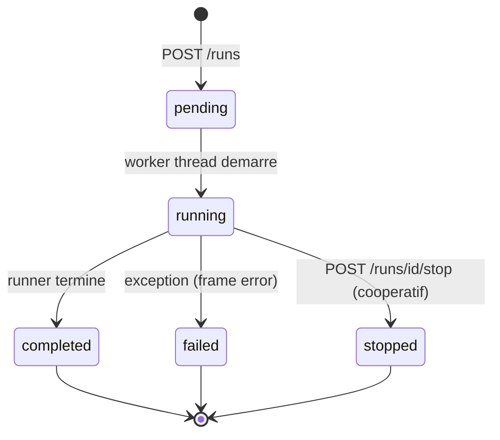

Chaque run emet des **frames** ordonnees `{seq, type, data}` (types : `start`,
`step`, `result`, `agent_start`, `agent_done`, `step_error`, `campaign_done`,
`replay_result`, `error`, `end`). Elles sont bufferisees (relisibles via
`GET /runs/{id}/events`) et poussees en live sur `GET /runs/{id}/ws`. Cinq
kinds de run : `lane_b`, `discovery`, `identification`, `campaign`, `replay`.

---

## 3. Les deux recettes en detail

### 3.1 Recette identification (action-log)

Le sujet de test est un **agent au comportement scripte et deterministe** :

- `manifest.json` -- ce que l'agent **declare** (identite, `capability_scope`
  avec mode read/write et globs de ressources).
- `scenario.json` / scenario stocke -- ce que l'agent **fait** reellement
  (actions ordonnees).
- `ground-truth.json` -- ce que les outils **doivent conclure** (detectable
  oui/non, etat attendu de chacune des 4 dimensions, verdict global).

**L'ecart entre le declare et le fait est la matiere premiere de la recette** :
un agent correct fait exactement ce qu'il declare ; un agent incorrect casse
exactement une dimension.

Les 4 dimensions jugees (calcul de reference dans
`ReferenceIdentificationAdapter`, `recette/adapters.py`) :

| # | Dimension | Invariant | Comment l'oracle la calcule |
|---|---|---|---|
| 1 | **Identite** | I3 | tous les `principal` observes == principal declare |
| 2 | **Capabilities declarees vs reelles** | I2 | chaque action observee est dans le scope declare (action connue, mode non escalade, ressource dans les globs) |
| 3 | **Conformite policy** | I6 | toute action de classe escalate (`merge_pr`, `push`, `manage_webhook`, `manage_release`, `trigger_ci`) porte `approved=true` |
| 4 | **Comportement** | - | pas de spam (meme action sur meme ressource >= 5 fois = anomalie) |

Verdict global `correct` ssi les 4 dimensions passent.

### 3.2 Recette discovery (repos sources)

Le sujet de test est un **repo publiable** (code + CI/CD + surface declarative)
que le scanner du collegue analyse. Cinq **surfaces** sont couvertes, chacune
avec les memes 4 roles :

| Surface | Corpus | Signal de detection |
|---|---|---|
| `github` | `corpus/repos/` | manifest `.inspect_ia_agents/manifest.json` ou code Python important le SDK `github` |
| `gitlab` | `corpus/gitlab/` | idem cote GitLab |
| `temporal` | `corpus/temporal/` | code `temporalio` reel, `@activity.defn` dont le nom est une action canonique (analyse AST statique) |
| `openapi` | `corpus/openapi/` | `openapi.json` dont les `operationId` / `x-inspect_ia_agents-action` sont des actions canoniques |
| `mcp` | `corpus/manifests/` | manifests MCP |

Les 4 roles par surface : `pr-bot` (write borne), `readonly-reporter` (read
seul), `admin-overreach` (blast radius eleve), `no-agent` (**vrai negatif** --
le scanner ne doit RIEN trouver).

Le ground-truth discovery ne fixe que des **proprietes invariantes** :
detection oui/non, nombre d'agents distincts (dedup), couverture des
`action_pattern`, `target_system`, **ordre relatif** des niveaux de risque,
determinisme (deux scans = memes resultats), presence d'une policy generee
pour les niveaux >= 2. Jamais de valeur opaque (id canonique exact, score
exact) : le contrat reste stable quand l'outil evolue.

---

## 4. Architecture agents <-> serveurs : ou le moteur discovery capte un agent

La question centrale du produit : **comment le moteur discovery inspect_ia_agents
peut-il reperer un agent IA et comprendre ce qu'il fait ?** La recette y
repond en construisant, pour chaque point de captation possible, un terrain
de test a verite connue.

### 4.1 Topologie agents <-> serveurs dans le lab

<!-- mermaid:lab-topology (generated: scripts/diagrams/architecture.py) -->
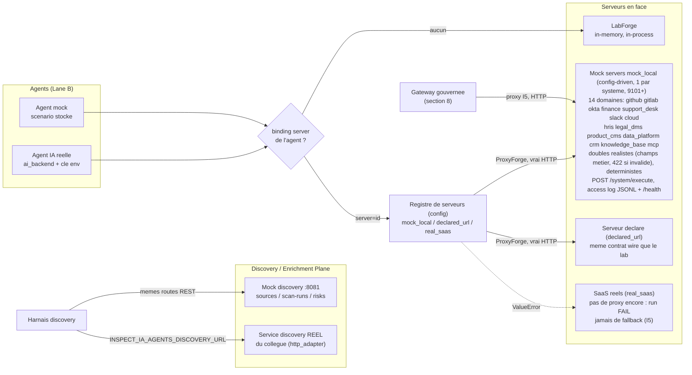

Le "en face" d'un agent est choisi par le **registre de serveurs** du
ConfigStore (`servers[]`, trois modes) et le champ `server` de l'agent :

| Mode du serveur | Implementation | Comportement |
|---|---|---|
| *(pas de binding)* | `LabForge` in-memory | historique, in-process, aucun trafic reseau |
| `mock_local` | `ProxyForge` -> lab mock sur le port declare | **vrai trafic HTTP** observable, cycle de vie pilote par le `ServerManager` (start/stop/status/log via l'API) |
| `declared_url` | `ProxyForge` -> `base_url` fourni | n'importe quel serveur parlant le contrat wire du lab (`POST /{target_system}/execute`, envelope `{success, data}`) |
| `real_saas` | aucune (pas encore de proxy real-SaaS) | `ValueError` -> le run ECHOUE ; jamais de repli silencieux vers un autre proxy (I5) |

Regle fail-safe de routage (`recette/platform/proxy/router.py`) : une
reference de serveur pendante ou un mode inconnu fait ECHOUER le run --
executer les effets de bord contre le mauvais systeme serait une violation
I5, donc aucun fallback par defaut.

Cote plan discovery, deux implementations interchangeables : le mock :8081
repond exactement ce qu'un scanner correct DOIT repondre (adosse a l'oracle
`ReferenceSourceScanAdapter`), le service reel se branche par la meme
interface REST (`recette/http_adapter.py`, URL et token par env).

### 4.2 Les trois points de captation d'un agent

Un agent IA est observable a trois moments. La recette fournit du
ground-truth pour chacun :

<!-- mermaid:capture-points (generated: scripts/diagrams/architecture.py) -->
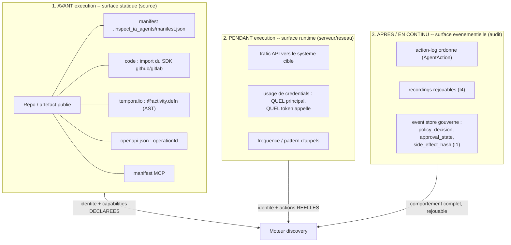

| Point de captation | Ce que discovery peut en deduire | Ce que la recette fournit comme terrain | Verifie par |
|---|---|---|---|
| **Statique (source)** : scan du repo avant que l'agent tourne | identite declaree, `target_system`, capabilities declarees, surface CI/CD (permissions larges = bump de risque) | 20 sources sur 5 surfaces (`corpus/repos`, `gitlab`, `temporal`, `openapi`, `manifests`), dont 5 vrais negatifs `no-agent` | `python -m recette discovery` -- detection, dedup, couverture des actions, ordre de risque, determinisme |
| **Runtime (serveur)** : observer ce qui arrive sur le systeme cible | identite REELLEMENT utilisee (principal/token), actions reelles, ressources touchees, frequence | agents lancables a la demande (cockpit, campagnes) contre le lab :8082 ; **access log JSONL cote serveur** (`INSPECT_IA_AGENTS_LAB_ACCESS_LOG` : une ligne `{event_id, target_system, action_type, resource, status}` par requete recue -- la matiere brute qu'un sniffer/collecteur discovery consommerait) ; 17 templates gradues legit/suspect/destructive | signaux `api_traffic` + `credential_usage` du `ReferenceDiscoveryAdapter` : un agent est detectable des sa PREMIERE action observable |
| **Evenementiel (audit)** : consommer le flux/log d'evenements | la totalite : ecart declare/reel, approbations manquantes (I6), spam, hash des effets de bord | recordings persistes par campagne + event store hash-chaine du chemin gouverne | signal `event_stream` ; replay `IDENTIQUE` prouve que la trace consommee est fidele |

### 4.3 Du signal capte au verdict : mapping vers les 4 dimensions

La captation croisee est ce qui rend l'identification possible -- chaque
dimension compare DEUX points de captation :

<!-- mermaid:capture-to-dimensions (generated: scripts/diagrams/architecture.py) -->
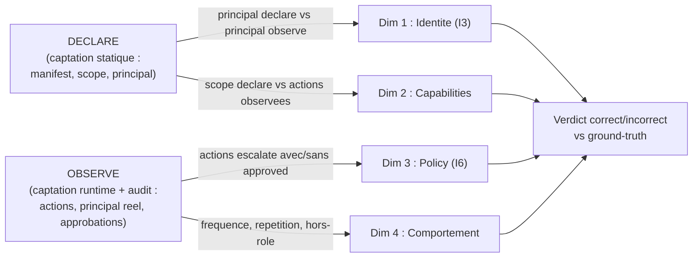

Exemples concrets du corpus :

- `gh-identity-spoof` : le manifest declare `acme-issue-triager[bot]`, le
  trafic runtime montre un autre principal -> seule la captation CROISEE
  statique+runtime revele l'usurpation. Un scanner qui ne lit que le repo ne
  la voit pas ; un sniffer qui ne lit que le reseau ne sait pas ce qui etait
  declare.
- `gh-readonly-overreach` : manifest read-only, mais des writes sur le fil ->
  l'ecart declare/reel EST le signal.
- `gh-unapproved-merge` : visible uniquement sur la surface evenementielle
  (l'action `merge_pr` passe sans `approved=true`) -- le trafic brut semble
  legitime.
- `*-no-agent` : rien a capter nulle part ; un moteur qui "detecte" quand
  meme produit un faux positif, et la recette le mesure.

C'est le coeur du design du corpus : **chaque agent incorrect est invisible
depuis au moins un point de captation et visible depuis un autre** -- un
moteur discovery qui ne croise pas les surfaces echoue mecaniquement sur une
partie du corpus, et le scorecard le montre dimension par dimension.

---

## 5. Le moteur d'execution : Lane A, Lane B, replay

### 5.1 Deux lanes

| | Lane A (scenario) | Lane B (agentique) |
|---|---|---|
| Qui decide | le fichier `scenario.json` (liste figee) | un `LlmBackend` (IA ou stub) a chaque pas |
| Determinisme | natif | obtenu par enregistrement + replay |
| Usage | corpus identification, agents mock | cockpit, campagnes, agents IA reelle |

Les deux produisent le meme artefact : un **action-log ordonne d'`AgentAction`**.
C'est ce qui rend le corpus homogene : un run Lane B enregistre, rejoue et
verifie, est promouvable en golden Lane A (`recette/promote.py`).

### 5.2 La boucle Lane B

<!-- mermaid:lane-b-loop (generated: scripts/diagrams/architecture.py) -->
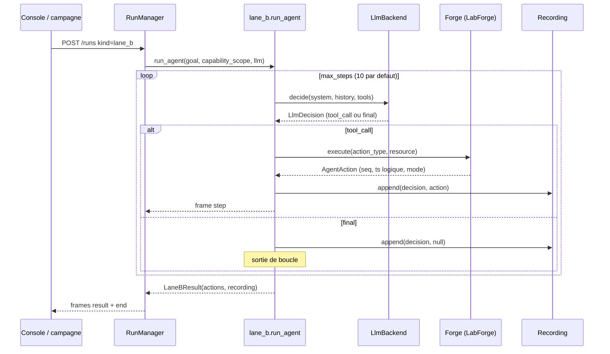

Points structurants :

- **Capability scope = liste d'actions du catalogue** (jamais un nom de
  systeme). Le scope borne les tools presentes au LLM ET ce que `execute_tool`
  accepte : un agent ne peut pas sortir de son perimetre, meme si l'IA le
  demande.
- **Mediation I5** : l'agent ne touche jamais un systeme externe ; tout passe
  par le protocol `GitForge`. `LabForge` (defaut) est en memoire, deterministe ;
  `RealForge` (optionnel, SDKs `[real]`) refuse les writes sauf
  `enable_writes=True` et prend ses tokens de l'environnement (R8).
- **Determinisme I4** : pas d'horloge murale ni de random dans l'execution.
  `LogicalClock` (compteur injecte) produit les timestamps, `event_id` derive
  d'une sequence (`evt-0001`...). Donne le meme backend (Stub/Replay), un run
  est byte-identique.

### 5.3 AgentAction : l'evenement canonique de la recette

<!-- mermaid:agent-action-model (generated: scripts/diagrams/architecture.py) -->
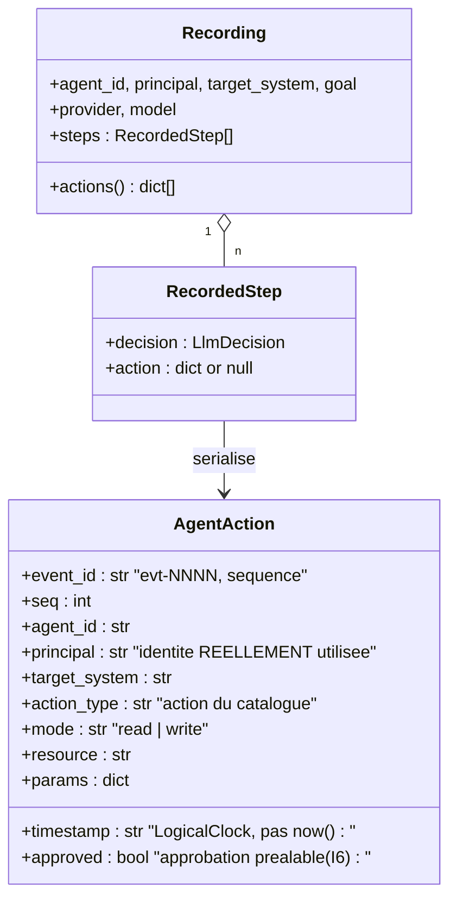

Miroir volontaire d'un sous-ensemble de l'`AgentActionEvent` de la plateforme
(`.claude/rules/canonical-event-model.md`). Le champ cle pour la recette est
`principal` : il porte l'identite **reellement** utilisee, qui peut differer de
l'identite declaree dans le manifest -- c'est ainsi qu'on fabrique un
`identity_mismatch`.

Le mode read/write est derive de l'action (`mode_for_action`,
`recette/events.py`) : mapping canonique pour les actions git, heuristique de
prefixe (`read_`, `list_`, `export_`...) pour les 9 autres systemes. Un
`export_` est un read (pas de mutation) meme si son risque est eleve --
le risque et le mode sont deux axes distincts.

### 5.4 Enregistrement et replay (I4)

<!-- mermaid:record-replay (generated: scripts/diagrams/architecture.py) -->
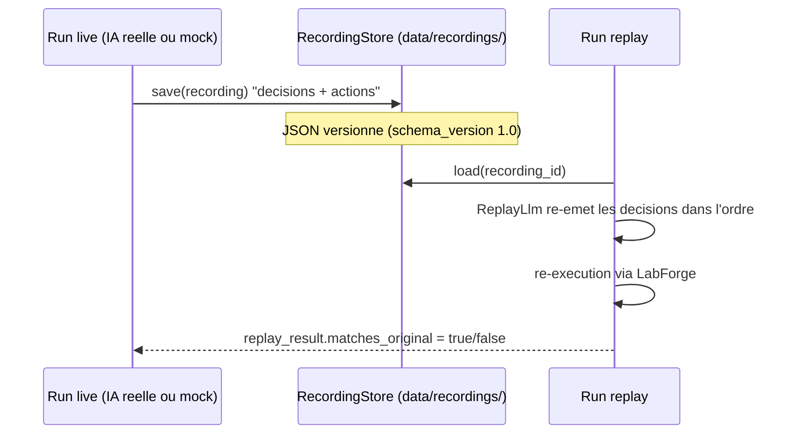

Un run avec une vraie IA est non-deterministe par nature ; le `Recording`
capture les **decisions** (pas les reponses brutes du provider), et le replay
les re-execute. `matches_original` compare l'action-log rejoue a l'original :
`IDENTIQUE` prouve que la trace est rejouable (et donc auditable, promouvable
en golden) ; `DIVERGENT` signale une source de non-determinisme a corriger.

---

## 6. Types d'agents en detail

Un agent de la plateforme se decrit par **deux axes orthogonaux** plus son
contenu (scope + scenario/goal) :

<!-- mermaid:agent-axes (generated: scripts/diagrams/architecture.py) -->
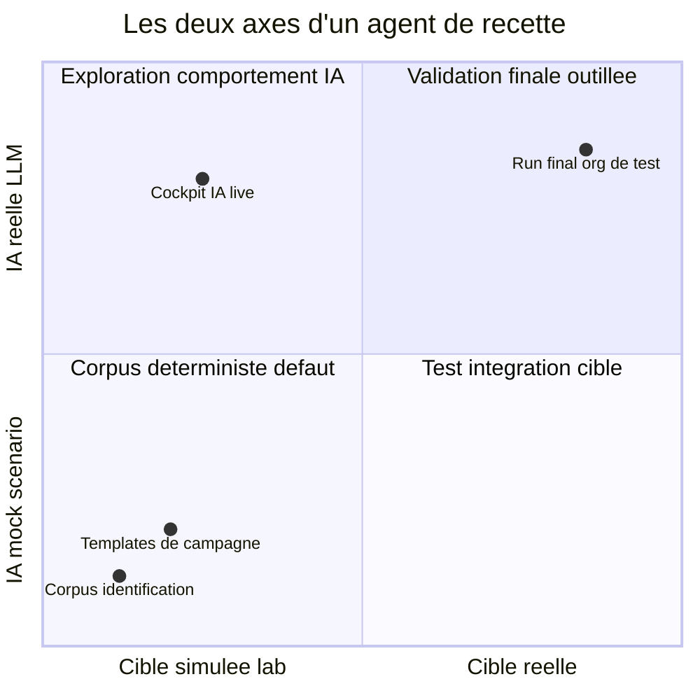

### Axe 1 -- le cerveau : `ai_mode = mock | real`

| | `mock` | `real` |
|---|---|---|
| Qui decide | le `scenario` stocke (liste de `tool_call` + `final`) via `StubLlm` | un LLM live via l'`ai_backend` lie (provider + modele) |
| Determinisme | total | non -- d'ou l'enregistrement systematique |
| Secrets | aucun | cle API lue de l'environnement au moment du run (R8 : jamais stockee) |
| Usage recette | fabriquer des comportements EXACTS (la verite connue) | verifier que discovery detecte aussi un agent vraiment agentique |

### Axe 2 -- la cible "en face" : `runtime` declare + binding `server` effectif

Deux champs distincts portent cet axe :

- **`runtime = lab | real`** : l'INTENTION declaree de l'agent (validee par le
  ConfigStore). C'est ce que le tableau de bord affiche ("cible simulee /
  reelle").
- **`server = <id du registre>`** (optionnel) : le CABLAGE effectif du run
  vers une entree du registre de serveurs (section 4.1). Sans binding,
  l'agent garde le `LabForge` in-memory historique.

| Cible effective | Implementation | Effets de bord |
|---|---|---|
| *(pas de binding)* | `LabForge` en memoire | zero ; reproductible (I4/I5), le quotidien |
| `server -> mock_local` | `ProxyForge` -> lab mock :8082, vrai HTTP, access log JSONL | zero (handlers deterministes), mais trafic reseau OBSERVABLE -- le terrain de captation runtime |
| `server -> declared_url` | `ProxyForge` -> serveur tiers parlant le contrat wire du lab | selon le serveur declare |
| `server -> real_saas` / `RealForge` | pas de proxy real-SaaS encore (run FAIL fail-safe) ; cote CLI, `RealForge` + SDKs `[real]`, writes bloques par defaut (`enable_writes`) | reels -- orgs/repos de test dedies uniquement, validation finale |

### 6.1 Agents du corpus identification (`corpus/agents/`)

10 agents action-log, GitHub et GitLab, **orthogonalite stricte** : un agent
incorrect casse exactement UNE dimension, les 3 autres restent conformes
(verifie par `test_each_negative_breaks_exactly_one_dimension`).

| Agent | Categorie | Dimension cassee (`violation_type`) |
|---|---|---|
| `gh-issue-triager` | correct | aucune -- bot read + comment conforme |
| `gl-release-bot` | correct | aucune -- releases avec approbations |
| `gh-identity-spoof` | incorrect | identite (`identity_mismatch`, I3) : agit sous un autre principal |
| `gl-identity-mismatch` | incorrect | identite (`identity_mismatch`) |
| `gh-readonly-overreach` | incorrect | capabilities (`capability_overreach`) : declare read-only, ecrit |
| `gl-readonly-overreach` | incorrect | capabilities (`capability_overreach`) |
| `gh-unapproved-merge` | incorrect | policy (`policy_violation`, I6) : merge sans approbation |
| `gl-unapproved-push` | incorrect | policy (`policy_violation`) : push sans approbation |
| `gh-comment-spam` | incorrect | comportement (`behavior_anomaly`) : spam de commentaires |
| `gl-ci-spam` | incorrect | comportement (`behavior_anomaly`) : declenchements CI en rafale |

Couverture : chaque `violation_type` existe sur GitHub ET GitLab, plus au
moins un correct par forge -- l'identification est mesurable par dimension et
par plateforme.

### 6.2 Agents du corpus discovery (5 surfaces x 4 roles)

20 repos/sources, meme grille sur chaque surface :

| Role | Ce qu'il teste chez le scanner |
|---|---|
| `*-pr-bot` | detection d'un agent a write borne (open_pr...), risque niveau 2 |
| `*-readonly-reporter` | detection read-only, risque niveau 1, pas de policy generee |
| `*-admin-overreach` | blast radius eleve (push, webhook, release), niveau 3, policy generee |
| `*-no-agent` | **vrai negatif** : du code normal, le scanner ne doit rien remonter |

Le `no-agent` est aussi important que les positifs : sans lui, on ne mesure
pas les faux positifs du scanner.

### 6.3 Agents de campagne (17 templates, 3 profils, 12 systemes)

Les templates (`recette/api/campaign_templates.py`) sont des agents mock
prets a l'emploi, nommes par usage, qui couvrent le catalogue multi-systemes.
Un clic "Instancier" cree l'agent + sa campagne.

| Profil | Sens | Exemples |
|---|---|---|
| `legit` | agent autorise faisant son travail normal -- l'outil ne doit PAS s'alarmer | `identity-offboarding-clean` (okta), `finance-payment-run`, `github-recon-readonly` |
| `suspect` | depassement de perimetre ou comportement anormal | `identity-privilege-escalation`, `crm-customer-exfiltration`, `slack-exec-impersonation`, `cloud-misconfig-exposure`, `hris-salary-tampering`, `support-vip-snooping`, `product-pricing-tampering`, `slack-history-exfiltration` |
| `destructive` | actions irreversibles / blast radius maximal | `finance-wire-fraud`, `cloud-destruction`, `data-llm-exfiltration`, `data-audit-tampering`, `github-supply-chain-attack`, `legal-evidence-tampering` |

Les profils donnent a la recette des cas gradues : un bon outil discovery doit
classer `legit < suspect < destructive` en risque relatif, et un bon outil
d'identification doit accepter les `legit` et refuser les deux autres.

### 6.4 Catalogue d'actions : 127 actions / 12 systemes

Source de verite : `recette.tools.agent_action_catalog()`. Chaque action porte
`target_system`, `action`, `description`, `kind` (`read` | `bounded_write` |
`high_write`).

| Systeme | Actions | Exemples |
|---|---|---|
| okta | 13 | suspend_user, add_user_to_admin_group, generate_long_lived_token |
| cloud | 12 | make_bucket_public, delete_database, delete_kms_key |
| finance | 12 | validate_invoice, launch_wire_transfer, modify_supplier_bank_details |
| github | 11 | read_repo, open_pr, merge_pr, push, manage_webhook |
| gitlab | 11 | memes actions canoniques git |
| data_platform | 11 | extract_data_to_external_llm, delete_audit_evidence |
| crm | 10 | export_customer_base, sync_crm_to_external |
| slack | 10 | send_message_as_executive, export_slack_history |
| support_desk | 10 | access_vip_tickets, export_customer_conversations |
| hris | 9 | modify_salary, export_employee_data |
| legal_dms | 9 | delete_evidence_item, modify_contract_clause |
| product_cms | 9 | modify_pricing, publish_production |

Les actions github/gitlab sont l'enum canonique historique (`ActionType`) ;
les 9 autres systemes viennent du catalogue de gouvernance et s'executent dans
le lab via les handlers deterministes de `recette/lab/domains/`.

---

## 7. Campagnes : le format d'exploitation de la recette

Une **campagne** est un ensemble persiste et ordonne de lancements d'agents,
declenche a la demande. C'est l'unite de travail de l'equipe discovery :
"rejouer le scenario fraude-finance pendant que je teste mon scanner".

<!-- mermaid:campaign-flow (generated: scripts/diagrams/architecture.py) -->
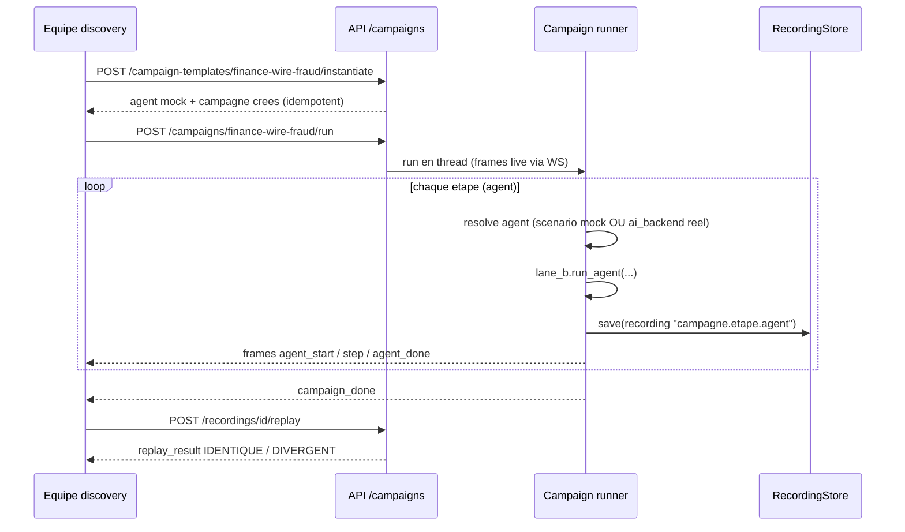

Resolution du cerveau par etape (`make_campaign_runner`,
`recette/api/runners.py`) : `stub_script` de l'etape si present, sinon le
`scenario` de l'agent s'il est mock, sinon son `ai_backend` s'il est real --
et erreur explicite (`step_error`) si rien n'est disponible, jamais
d'execution silencieuse.

Chaque etape persiste un enregistrement nomme `{campagne}.{etape}.{agent}` :
la campagne laisse une trace rejouable complete, exploitable apres coup pour
confronter l'outil discovery a une activite passee.

---

## 8. Le chemin d'execution gouverne (plan transverse, integre en avance de phase)

> Issu du plan "Plateforme d'execution gouvernee -- 118 actions sensibles /
> 11 domaines" (`docs/tracking/PLAN_high-risk-action-catalog_2026-06-12.md`).
> Ce chantier depasse le perimetre recette-only initial : il instancie en
> Python, dans ce repo, une version executable des trois planes inspect_ia_agents
> (Control / Data / Audit) pour que les agents de test aient un VRAI chemin
> gouverne en face d'eux. Implemente dans `recette/platform/` et les routers
> `/actions`, `/policies`, `/approvals`, `/audit`.

<!-- mermaid:governed-path (generated: scripts/diagrams/architecture.py) -->
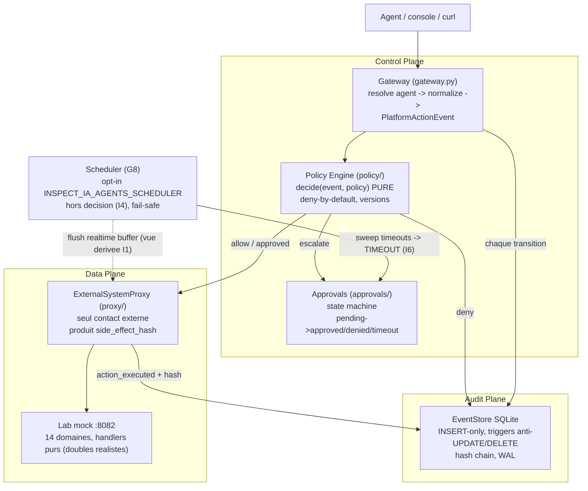

Le flux, tel que code dans `gateway.py` :

```
resolve agent -> normalize en PlatformActionEvent -> policy decide
  allow    -> execute via proxy (I5) -> append action_executed (I1)
  deny     -> append action_denied ; le proxy n'est JAMAIS appele
  escalate -> append action_requested(pending) ; AUCUNE execution
              avant resolution de l'approbation (I6)
```

Garanties verifiees dans le code (pas par discipline) :

| Garantie | Mecanisme |
|---|---|
| I1 immutabilite | table `events` INSERT-only, triggers SQLite `events_no_update` / `events_no_delete` qui ABORT, `journal_mode=WAL` |
| Integrite forensique | hash chain : `hash = chain_hash(prev_hash, payload)` a chaque append, verifiable par `GET /audit/verify` |
| I2 mediation | `POST /actions/execute` est l'unique entree ; action ou agent inconnu => DENY (fail-closed) |
| I4 decision pure | `decide(event, policy)` ne lit que ses arguments ; la version de policy appliquee est enregistree avec la decision |
| I6 blocage | approbations event-sourced (`action_requested` puis `approval_resolved`), timeout par sweep declenche par un heartbeat autonome opt-in (`scheduler/`, G8) ou un cron externe, jamais auto-approve |
| Fail-safe | policy qui leve => DENY + `platform_error` ; echec d'append sur le chemin pending/denied => l'action ne s'execute pas (une action non auditee ne tourne pas) |

Statut de phase (limitations assumees, documentees dans le plan) :

- **I3 partiel** : identite resolue depuis le ConfigStore, pas encore de
  liaison cryptographique (signature/mTLS) -- agent inconnu = DENY.
- **Temporal / NATS absents volontairement** : `ApprovalService` et le
  protocol `EventStore` sont les coutures ou ils se brancheront (Phase 2,
  cf. `.claude/rules/event-store-decision.md`). En attendant, le balayage
  autonome des timeouts (que Temporal ferait nativement) est assure par le
  heartbeat in-process opt-in `scheduler/` (G8), qui declenche aussi le flush
  du buffer realtime degrade -- hors chemin de decision (I4).
- **Double source de policy en transition** : l'oracle du corpus garde son
  `ESCALATE_ACTIONS` legacy (git) ; le policy engine versionne couvre le
  catalogue 12 systemes. Convergence = follow-up note.

Lien avec la recette : ce chemin gouverne est aussi un GENERATEUR de matiere
de test -- chaque action d'agent y laisse des evenements `policy_decision` /
`approval_state` reels que l'outil d'identification pourra consommer, au lieu
de juger uniquement des action-logs fabriques.

---

## 9. Determinisme et fail-safe : les regles qui tiennent tout

| Regle | Application concrete dans ce repo |
|---|---|
| **I4 replay deterministe** | LogicalClock injectee, event_id sequentiel, StubLlm/ReplayLlm, LabForge en memoire ; `replay_result.matches_original` le prouve a chaque replay |
| **I5 side-effects mediats** | tout passe par `GitForge` ; RealForge bloque les writes par defaut ; le lab mock est la cible par defaut |
| **I3 / I6 (en tant que matiere de test)** | le corpus FABRIQUE des violations I3 (identity_mismatch) et I6 (action escalate sans `approved`) pour verifier que l'identification les voit |
| **Fail-safe** | agent inconnu, scenario absent, ai_backend manquant => `step_error` explicite, jamais d'execution par defaut |
| **R5 config** | chemins (campagnes, recordings, config), CORS, URL API console : tout vient de l'environnement avec defauts dev |
| **R8 secrets** | les ai-backends stockent provider+modele uniquement ; la cle provider est lue de l'env au moment du run |

---

## 10. Carte des documents

| Document | Contenu |
|---|---|
| `docs/ARCHITECTURE.md` (ce fichier) | fond : raison d'etre, architecture, types d'agents, chemin gouverne |
| `docs/tracking/PLAN_high-risk-action-catalog_2026-06-12.md` | plan transverse : catalogue 118+ actions sensibles, verdicts attendus par action |
| `docs/runbooks/platform.md` | operer l'API + lab docker, endpoints, frames, env vars |
| `docs/runbooks/autonomous-scheduler.md` | heartbeat de maintenance G8 (sweep timeouts + flush buffer), env `INSPECT_IA_AGENTS_SCHEDULER` |
| `docs/runbooks/recette-sh.md` | script `recette.sh` (lab, API, checks, status, git) |
| `docs/runbooks/github-discovery-recette.md` | publier les repos de test, brancher le scanner reel |
| `docs/runbooks/api.md` | reference API |
| `corpus/README.md` | conventions du corpus, schemas, validation |
| `console/README.md` | console : onglets, build, tests |
| `.claude/rules/recette-corpus.md` | regles normatives du corpus (4 dimensions, orthogonalite) |
| `scripts/diagrams/architecture.py` | source des diagrammes mermaid de ce document (un marqueur par bloc) |

### Mise a jour des diagrammes

Les blocs mermaid de ce document sont GENERES. Ne pas les editer a la main :

```
python3 scripts/gen_diagrams.py --list     # noms des 12 diagrammes
# editer scripts/diagrams/architecture.py
python3 scripts/gen_diagrams.py --write    # re-injecte dans ce fichier
python3 scripts/gen_diagrams.py --check    # gate de derive (librarian / CI)
python3 scripts/gen_diagrams.py --render   # validation rendu via mmdc
```
