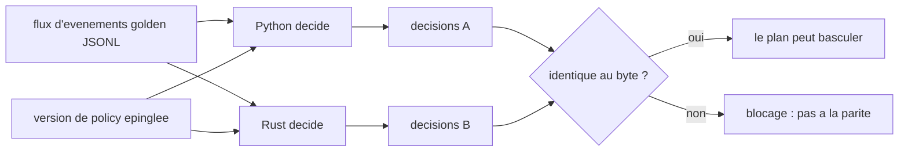

# ADR-0001 -- Phasage du langage runtime (Python comme reference maintenant, Rust sur declencheur)

- Statut : ACCEPTE (2026-06-13)
- Perimetre : le coeur de gouvernance (plans Control / Data / Audit). PAS le scanner
  de discovery, qui reste en Rust.
- Proprietaire de la decision : gabrielhociel@gmail.com (a ratifie la direction phasee).
- Remplace : rien. Complete la decision phasee sur l'event-store
  (`.claude/rules/event-store-decision.md`), meme forme « differer jusqu'a ce qu'un declencheur se produise ».

## Contexte (faits verifies, pas des hypotheses -- R13/R18)

- `CLAUDE.md` designe la stack CIBLE comme Rust (gateway Axum + plans). La realite
  de travail aujourd'hui est Python.
- Empreinte Rust mesuree : `cmd/inspect_ia_agents_recette` uniquement (le scanner de discovery,
  7 fichiers `.rs`). Il y a **zero Rust dans le coeur de gouvernance**.
- Le coeur de gouvernance est en Python : `recette/platform/` = **4229 LOC** (gateway,
  policy `decide()`, risk, eventstore, proxy, approvals, realtime, observability,
  catalog), avec 800+ tests verts.
- Le chemin de decision est une **fonction pure** :
  `decide(event, policy, catalog) -> Decision` (`recette/platform/policy/engine.py`).
  Pas d'horloge, pas d'aleatoire, pas d'I/O dans la decision (I4). Cela en fait la
  chose la plus propre possible a porter ET a prouver equivalente par replay.
- **Aucune pression de performance mesuree** : il n'existe nulle part de SLO de
  latence/debit sur la gateway, de cible p99, ni de benchmark RPS. `recette/benchmark.py`
  est une evaluation de la justesse du juge, pas un bench de perf. Rien aujourd'hui
  n'exige la vitesse ou le profil memoire qu'un portage Rust apporterait.

## Decision

**Python reste la reference de production du coeur de gouvernance maintenant. Un
portage Rust/Axum des plans critiques (gateway / policy / risk) est DIFFERE jusqu'a
ce qu'un declencheur explicite se produise.** Aucun portage n'est entame avant ce
moment ; le comportement du chemin de decision doit pouvoir se stabiliser d'abord
en Python (le corpus, le catalog et le modele de policy evoluent encore vite).

C'est une decision phasee, pas un report : elle engage Python-maintenant ET fixe
les conditions exactes dans lesquelles le portage commence ET le filet de securite
qui prouvera la correction du portage.

## Declencheurs (UN SEUL bascule vers « commencer le portage Rust »)

Consigner la date + quel declencheur s'est produit dans `decision_log.jsonl`, puis
ouvrir le portage comme un effort suivi a part entiere :

1. **Echec de SLO de perf** -- un vrai SLO de latence/debit est fixe sur la gateway
   et l'implementation Python ne peut pas l'atteindre apres un tuning raisonnable
   (mesure, pas suppose).
2. **Echelle** -- un debit de decision soutenu au-dela de ce qu'un seul processus
   Python (lie au GIL) sert, avec le scaling horizontal Python deja epuise.
3. **Temps reel dur / surete** -- un deploiement requiert une latence bornee et
   previsible ou une garantie de surete memoire qu'un runtime manage ne peut pas
   offrir.
4. **Mandat de securite** -- un client/regulateur exige la posture de surete memoire
   / supply-chain d'un coeur Rust.

En l'absence de tout declencheur, Python reste en prod et cet ADR reste en vigueur.

## Harnais de preuve de parite (REQUIS avant qu'un plan Rust ne remplace Python)

Un portage ne peut remplacer un plan Python qu'une fois la parite de comportement
PROUVEE, pas supposee. Le chemin de decision pur rend cela exact :

- Un **golden stream** partage et committe (`AgentActionEvent` JSONL) + une
  **version de policy epinglee** sont fournis aux DEUX moteurs.
- Les deux doivent emettre des `policy_decision` **identiques au byte** (verdict +
  policy_version + rule_id) ainsi que les memes transitions d'`approval_state` et
  les memes entrees de `side_effect_hash`, pour chaque evenement (le determinisme
  I4 est le contrat qui rend cela possible).
- Le harnais tourne en CI comme une gate bloquante ; une seule divergence bloque
  la bascule. Les invariants I1-I6 sont verifies contre la sortie Rust exactement
  comme ils le sont contre Python.

## Consequences

- **Maintenant** : pas de nouveau code de coeur Rust ; l'effort reste sur la
  fermeture des trous de la plateforme en Python (G1-G6 faits) et la stabilisation
  du modele policy/catalog.
- **Le scanner de discovery reste en Rust** -- il est deja livre, isole, et non
  affecte par cette decision.
- **Quand un declencheur se produit** : le portage est incremental, plan par plan,
  chacun protege par le harnais de parite ci-dessus ; Python reste l'oracle jusqu'a
  ce que chaque plan se prouve equivalent. Pas de reecriture big-bang.
- **Risque evite** : figer prematurement une cible encore mouvante dans Rust (le
  modele de policy, le catalog et le corpus evoluent), en payant un cout de
  reecriture eleve sans benefice mesure.

## Reexamen

Reevaluer cet ADR quand un declencheur se produit, ou a la prochaine revue
d'architecture. Mettre a jour le Statut et lier un ADR de suivi si la direction change.
