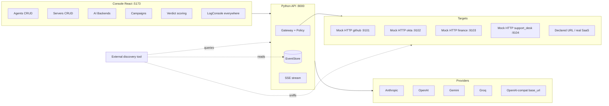

# Design: Recette Platform Hardening (mock -> functional)

Date: 2026-06-12
Status: VALIDATED
Approach: A -- keep the existing architecture, wire and harden it layer by layer.
Invariants concerned: I1 (event log), I2 (gateway mediation), I4 (deterministic replay), I5 (proxy-mediated side effects).

## Problem

The console at localhost:5173 is a recette platform meant to validate an external
discovery/identification tool against ground-truth agents. Today large parts are
unwired mocks: `ai_backends` is empty in config, Gemini/Groq providers are missing,
mock targets are not exposed as real observable HTTP servers, there is no per-window
log console, and no verdict scoring against ground truth.

A full rewrite was considered (approach B) and rejected: `llm.py` (real Anthropic and
OpenAI clients, offline-testable), `platform/` (gateway, policy, eventstore, approvals,
proxy), the ground-truth corpus, and the 8-page console are all sound. The problem is
that the pieces are neither connected nor visible, not that the architecture is wrong.

## Observation surfaces for the external tool (all three)

1. **Real HTTP traffic** -- agents hit real local HTTP servers (mock targets) the tool
   can sniff or scan.
2. **Event log** -- the tool reads the AgentActionEvent stream (JSONL export, audit API).
3. **Platform API** -- the tool queries the REST API (agents, runs, actions), as the
   existing `DiscoveryAdapter`/`IdentificationAdapter` protocols in `recette/adapters.py`.

## Architecture



Every agent action goes through the gateway (I2), every event is persisted (I1), every
log line is correlated by `agent_id`/`run_id`.

## Data model (config extension, no rewrite)

`config/inspect_ia_agents.config.json` gains a `servers` section; `ai_backends` is finally used:

```json
{
  "servers": [
    {"id": "gh-mock", "system": "github", "mode": "mock_local", "port": 9101},
    {"id": "gh-real", "system": "github", "mode": "declared_url", "base_url": "https://...", "auth_env": "INSPECT_IA_AGENTS_EXTERNAL_GH_TOKEN"},
    {"id": "gh-saas", "system": "github", "mode": "real_saas", "owner": "org-test"}
  ],
  "ai_backends": [
    {"id": "claude", "provider": "anthropic", "model": "claude-haiku-4-5", "api_key_env": "ANTHROPIC_API_KEY"},
    {"id": "gemini", "provider": "gemini", "model": "gemini-2.0-flash", "api_key_env": "GEMINI_API_KEY"},
    {"id": "groq", "provider": "groq", "model": "llama-3.3-70b", "api_key_env": "GROQ_API_KEY"},
    {"id": "local", "provider": "openai_compat", "base_url": "http://localhost:11434/v1", "model": "qwen2.5"}
  ],
  "agents": [
    {"id": "...", "ai_mode": "mock|real", "ai_backend": "claude", "server": "gh-mock"}
  ]
}
```

- An agent references one AI backend and one target server by id.
- Secrets never inline: `*_env` fields name the environment variable (R8).
- Full CRUD for the three entities from the console.

## Workstream 1 -- Server registry (observable targets)

- `lab/mock_server.py` evolves: one real local HTTP process per `mock_local` server,
  dedicated port, started/stopped from the console (start/stop + green/red status).
  Reuses the existing `lab/domains` behaviors per system.
- Every request received by a mock produces a log line and a correlated event, so the
  external tool sniffs real HTTP traffic.
- The proxy (I5) routes according to the agent's `server` reference: local mock,
  declared URL, or real SaaS (existing `RealForge`).
- API: `GET/POST/PUT/DELETE /api/servers`, `POST /api/servers/{id}/start|stop`.

## Workstream 2 -- Complete AI providers

- `llm.py` gains: `GeminiLlm` (generateContent API), `GroqLlm` and `OpenAiCompatLlm`
  (OpenAI-compatible endpoint with configurable `base_url` -- covers Groq, Ollama,
  proxies). Same pattern as existing backends: injectable HTTP client, tested offline
  without keys or network.
- `build_llm()` extended to the five providers. Keys via env only.
- Console: AI Backends panel with full CRUD plus a **Test** button calling
  `POST /api/ai-backends/{id}/test` -- performs one minimal real call, returns
  ok/error + latency. Green/red dot per backend.

## Workstream 3 -- LogConsole everywhere

- Single React `LogConsole` component: SSE-fed (`/api/stream?run=...&agent=...`),
  level/agent/run filters, pause, autoscroll, copy. Placed in: agents (per run),
  campaigns (per campaign), servers (received traffic), AI backends (provider calls),
  cockpit (global).
- Failures are visible: a refusing provider, a down mock, a policy deny -- all appear
  in red in the relevant console. **Never a silent mock fallback when real mode fails**
  (fail-safe: the run fails explicitly).
- Audit export: `GET /api/audit/export.jsonl` for the external tool.

## Workstream 4 -- Verdict scoring

- Each agent carries (or references) its ground truth: detectable yes/no, expected
  identity, 4-dimension expected verdict.
- The external tool pushes its result via the existing HTTP adapter
  (`recette/adapters.py`) or a JSON upload in the console.
- Verdict screen: per-agent table -- expected vs observed, PASS/FAIL, clickable
  evidence (event ids of the run). Aggregates: detection rate, per-dimension accuracy,
  false positives/negatives.

## Failure modes (fail-safe, mandatory)

- Provider down / missing key -> explicit run FAIL + audited failure event. No silent
  deny, no fallback to mock.
- Mock port already bound -> start error, red status, message in the servers LogConsole.
- Policy engine unchanged: deny-by-default (I2).

## Testing

- unittest stdlib. Provider clients tested with stub HTTP clients (zero network, zero
  keys). Mock servers tested with real local HTTP calls. Deterministic replay preserved
  (I4).
- Console: R16 -- real payload fixture + render-and-assert for every new component
  (LogConsole, Servers, Verdict), all state variants covered.

## Delivery order

2 (providers, shortest) -> 1 (servers) -> 3 (log consoles) -> 4 (scoring).
Each workstream ends with a flow demonstrated live in the console.
