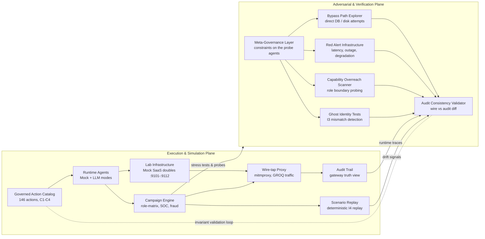

# APEX TODO -- adversarial & verification plane (red-team probes)

Date : 2026-06-15
Status : PLANNED (not started)
Invariants : I1 (audit immuable), I2 (mediation), I3 (identity binding), I4 (replay), I5 (proxy side-effects), I6 (approval)
Scope source : collaborator design graph -- the "adversarial & verification plane" branched on the existing execution & simulation plane (this repo).

## Objectif

Construire le plan adversarial par-dessus le plan d'execution/simulation existant :
un jeu d'**agents de probe** (adversariaux) + les **serveurs** qui les supportent
(honeypot direct-sink, infra de fault-injection), plus le **Audit Consistency
Validator** (diff wire vs audit). Le lab SIMULE et OBSERVE ; il n'enforce pas le
blocage reseau (c'est le job de la plateforme cible). Chaque tache porte son skill ad-hoc.

## Le graph (transcription)

## Mapping composant -> livrable -> skill

| Composant (plan adversarial) | Livrable repo | Agents / Serveurs a creer | Skill ad-hoc | Invariants | Done |
|---|---|---|---|---|---|
| **Honeypot (support Bypass)** | serveur "direct-sink" sur `:9113` : un faux DB/disk qui enregistre tout hit direct et n'est jamais une cible legitime | 1 serveur lab special `direct-sink` | `cli-developer` + lab realism | I5 | un hit direct = event d'alerte ; jamais atteint via un chemin gouverne |
| **Bypass Path Explorer** | sujet sim + campagne : un ghost agent tente d'ecrire direct au honeypot en contournant le proxy | agent `probe-bypass`, campagne `rt-bypass-*` | `recette-campaign-builder` + `recette-corpus` | I2, I5 | wire montre un flux sans event d'audit -> detecte |
| **Ghost Identity Tests** | etendre les negatifs I3 (au-dela de `gh-identity-spoof`, `gl-identity-mismatch`) sur plusieurs systemes | sujets `corpus/agents/incorrect/*identity*` (+3 a +5) | `recette-corpus` + `spec-builder` + `gen_corpus_agents` | I3 | identification verdict `identity_mismatch` ; mono-axe |
| **Capability Overreach Scanner** | formaliser la role-matrix en scanner nomme + scorecard "tout non-deny hors mandat = faille" | scorecard `probe-overreach`, reutilise `campaigns/role-matrix` | `scorecard-builder` + `recette-campaign-builder` | I2 | toute action non-deny hors mandat = test rouge |
| **Red Alert Infrastructure** | fault-injection sur les serveurs lab : latence, outage 5xx, reponses degradees ; verifier fail-safe (deny/freeze, jamais fail-open) | wrapper fault-inject + campagnes `rt-chaos-*` | `chaos-engineer` | I2, I6, failure-modes | sous panne -> deny/freeze ; jamais auto-allow |
| **Audit Consistency Validator** | module de reconciliation `wire_flows == audited_flows` + endpoint + signal de drift | `recette/platform/proxy/reconcile.py` + `GET /proxy/reconcile` | `test-master` + `python-recette` + `api-designer` | I1, I4, I5 | flux wire sans event d'audit = signal Control Plane ; deterministe |
| **Meta-Governance Layer** | contraintes sur les agents de probe : un agent adversarial est lui-meme identity-bound, audite, blast-radius borne au honeypot (une probe ne casse rien pour de vrai) | manifest + policy `redteam.*` | `spec-builder` + `secure-code-guardian` | I3, I6 | un agent de probe hors-contrainte est lui-meme deny |
| **Console verification (UX)** | onglet : resultats des probes + diff wire-vs-audit + drift | page `console/src/pages/sim/` (existant) etendue | `react-expert` + `react-recette` + `frontend-design` | R16 | fixture reelle + render-assert ; coordonner avec la session sim en cours |

## Phases APEX

### INIT
- [ ] Lire `docs/runbooks/proxy-debug-console.md` (section wire-vs-audit), `redteam-recette.md`, `recette-corpus.md`, `maf-standard.md`, `chaos-engineer/SKILL.md`.
- [ ] Snapshot etat : `./recette.sh platform status`, suite verte, coverage-guard D1-D7 vert.

### OBSERVE
- [ ] Cartographier les seams reels : `recette/platform/proxy/wire.py` (WireFlowRecorder), `tracing.py` (ProxyTrace), `route.py` (ProxyRouteRegistry), event store (audit truth), `recette/redteam_record.py` (record/replay), `campaigns/role-matrix/`.
- [ ] Identifier le point d'ingestion d'un event d'audit par flux (cle de jointure wire<->audit : agent_id + target_system + action_type + resource + side_effect_hash).

### THINK
- [ ] Definir la cle de reconciliation wire<->audit (deterministe, I4) -- decision_log.
- [ ] Definir le contrat de probe (Meta-Governance) : champs manifest, blast-radius, identity binding.
- [ ] Choisir la forme du honeypot (`direct-sink`) : endpoint + ce qu'il logge ; jamais dans `HANDLER_MODULES` gouverne (c'est un sink, pas une action catalog).

### BUILD (ordre : support -> probes -> validator -> UX)
- [ ] **Honeypot `direct-sink` :9113** (`cli-developer`) -- serveur + enregistrement des hits + `./recette.sh` lifecycle (R19, pas de hand-launch).
- [ ] **Audit Consistency Validator** (`test-master`/`python-recette`/`api-designer`) -- `reconcile.py` (wire ⊆ audit) + `GET /proxy/reconcile` + tests deterministes.
- [ ] **Ghost Identity Tests** (`recette-corpus`/`spec-builder`) -- +3 a +5 negatifs `identity_mismatch` ; regenerer le corpus ; coverage-guard D7 reste vert.
- [ ] **Capability Overreach Scanner** (`scorecard-builder`) -- scorecard sur la role-matrix existante.
- [ ] **Bypass Path Explorer** (`recette-campaign-builder`) -- agent + campagne ciblant le honeypot ; assert wire-sans-audit.
- [ ] **Red Alert Infrastructure** (`chaos-engineer`) -- fault-inject (latence/5xx/degrade) + campagnes fail-safe.
- [ ] **Meta-Governance Layer** (`spec-builder`/`secure-code-guardian`) -- contraintes de probe + policy.
- [ ] **Console verification** (`react-expert`/`react-recette`) -- onglet etendu (coordonner R21 avec la session sim).

### RECETTE (gates bloquantes)
- [ ] `./recette.sh test` (unittest stdlib) vert ; nouveaux tests deterministes (I4) pour reconcile + chaque probe.
- [ ] `make gates` (ruff + mypy + bandit) ; `make recette` (coverage-guard D1-D7 incl. nouveaux sujets/serveurs).
- [ ] `./recette.sh smoke` : preuve live wire-vs-audit (overlay mitmproxy up, un bypass simule, le validator leve le drift).
- [ ] Console : `console-build` + `console-test` + R16 contract gate pour l'onglet etendu.

### COMPLETE
- [ ] RETEX + DASHBOARD ; mettre a jour `README.md` + `docs/ARCHITECTURE.md` (le 2e plan) + `proxy-debug-console.md` (reconcile passe de "forward-looking" a "livre").
- [ ] Memoire : lecon "wire-vs-audit = detecteur ghost-agent" si non triviale.

## Nouveaux serveurs

| id | role | port | mode | note |
|---|---|---|---|---|
| `direct-sink` | honeypot DB/disk : enregistre tout hit direct | `:9113` | special (hors catalog gouverne) | jamais atteint via un chemin gouverne ; un hit = alerte |
| `chaos-*` (option) | overlay fault-inject devant un mock_local | -- | wrapper | latence/5xx/degrade, parametrable (R5) |

## Frontiere (a acter)

Le lab **simule et observe** (app-level, faisable ici). Le **hard-block reseau**
(isolation pod + handshake crypto au boot, I3) est l'enforcement de la plateforme
cible, hors scope de cette simulation. Le Bypass Path Explorer prouve la
DETECTION (wire ⊄ audit), pas la prevention.

## Related
- `docs/runbooks/proxy-debug-console.md` -- wire overlay + reconciliation (forward-looking).
- `docs/runbooks/redteam-recette.md` -- gate deterministe + recorder.
- `docs/plans/2026-06-14-redteam-sim-*.md` -- le sim red-team en cours (coordonner).
- `.claude/rules/recette-corpus.md`, `maf-standard.md`, `failure-modes.md`, `determinism-replay.md`.
- `.claude/skills/chaos-engineer/` -- fault injection local-first.
