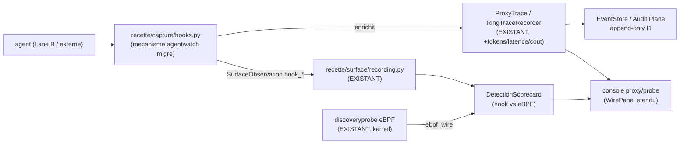

# Agent Capture multi-surface, gouvernee, enrichie -- design (synchro-first)

> Statut : VALIDE (operateur, 2026-06-16). Ferme les gaps d'observabilite des
> outils existants (agentwatch, agenttrace) SANS dupliquer : on migre le
> **mecanisme** et le **schema** prouves, re-homes dans les plans EXISTANTS du
> projet. Roadmap 3 increments sequences ; APEX sur G1.

## 0. Etoile polaire (differenciateur)

Les outils du marche **observent** un agent qui coopere (in-process hook). Ce
projet va plus loin et le garde :
- **multi-surface dont eBPF sans cooperation** -> attrape les *ghosts* (un agent
  qui contourne le SDK est quand meme vu au kernel) ;
- **gouvernance** (Control Plane : policy deny-by-default, approbation I6) ;
- **juge deterministe** (I4) + replay + red-team.

La roadmap ajoute la capture hook in-process (ce qu'agentwatch fait bien) et
l'enrichissement runtime (ce qu'agenttrace fait bien), sans perdre ces 3 atouts.

## 1. Migration, pas invention (R13)

| Source | Licence | Ce qu'on MIGRE | Ce qu'on NE prend PAS |
|--------|---------|----------------|------------------------|
| cyberark/agentwatch | Apache-2.0 | le **mecanisme d'interception** in-process (monkeypatch du client LLM + interception des tool calls MCP HTTP/SSE) | son UI, son store, son runtime parallele |
| tensorstax/agenttrace | MIT | le **schema de trace enrichie** (champs : llm call, tool call, tokens, latence, cout, erreur, session) | sa SQLite `traces.db`, son dashboard Node |

Attribution preservee (NOTICE / en-tete de fichier). Aucune logique inventee :
on adapte du code prouve aux coutures existantes.

## 2. Synchronisation avec l'existant (colonne vertebrale)

Chaque nouvelle capacite branche une couture DEJA presente. Zero silo parallele.

| Nouveau (G1) | Couture EXISTANTE reutilisee / etendue |
|--------------|----------------------------------------|
| Moteur hook (interception agentwatch) | cible = `recette/llm.py` providers (on possede le client LLM) + interception MCP |
| Detection `hook_sdk` / `hook_mcp` reelles | `recette/surface/recording.py` + `project_surfaces` + scorecard ; noms de surfaces = `discoveryprobe-core::ObservationSurface` |
| Trace enrichie (schema agenttrace) | **etend** `recette/platform/proxy/tracing.py` (`ProxyTrace` / `RingTraceRecorder`) + `wire.py` (`WireFlow`) |
| Persistance | **Audit Plane / EventStore existant** (append-only I1), cle `event_id` / `agent_id` |
| Horloge / determinisme | `recette/events.py::LogicalClock` (I4) ; metriques wall-clock (latence) = ops, hors juge (cf. MAF `created_at`, `maf-standard.md`) |
| record -> replay | `recette/recording.py` (`Recording`, `replay_backend`) |
| UX | **etend** le log reseau cockpit + `console/src/pages/proxy/` (`WirePanel`, `proxyTraceModel.ts`) + la vue **Probe** + `/probe` |
| eBPF (sans cooperation) | `discoveryprobe` (EXISTANT, Rust) reste le filet anti-ghost |

`ProxyTrace` devient le **point de convergence** : aujourd'hui il porte la requete
reseau + la reponse (hook proxy) ; G1 lui ajoute les champs enrichis (tokens,
latence, cout, erreur) captes par le hook LLM, et alimente en parallele
`SurfaceRecording` pour la detection. Une seule verite (EventStore), une seule UX
(proxy/probe), un seul juge.

## 3. Architecture G1 (cible APEX)

Composants nouveaux (minces, branches sur l'existant) :
1. `recette/capture/hooks.py` -- moteur d'interception in-process (migre
   d'agentwatch) : monkeypatch des providers `recette/llm.py` + interception MCP.
   Capte par appel : intention (tool/resource), args, reponse + metriques ops
   (tokens, latence, cout, erreur).
2. `recette/capture/trace_fields.py` -- le schema enrichi (migre d'agenttrace),
   ajoute comme champs OPTIONNELS sur `ProxyTrace` (pas un nouveau type).
3. Bridge detection -- emet `SurfaceObservation(hook_sdk|hook_mcp)` dans
   `recording.py` (reutilise tout le pipeline scorecard).

## 4. Flux de donnees

agent tourne -> hook intercepte chaque appel LLM/MCP in-process ->
(a) **enrichit le `ProxyTrace`** existant (RingTraceRecorder) -> log reseau
cockpit + EventStore (I1) ; (b) **emet `SurfaceObservation(hook_*)`** ->
`recording.py` -> scorecard detection. `ebpf_wire` continue via discoveryprobe.
**Ghost** = vu sur `ebpf_wire`, absent des surfaces hook = filet sans cooperation.

## 5. Determinisme (I4) & metriques ops

- La **detection** (`SurfaceRecording`) est une fonction pure -> rejouable
  byte-stable. La capture live (non-deterministe) est figee en recording, comme
  la boucle Groq (`recette/recording.py`).
- Les **metriques wall-clock** (latence, timestamp d'appel) sont des donnees
  OPERATIONNELLES portees par `ProxyTrace`, JAMAIS dans le chemin de
  decision/juge (coherent avec `maf-standard.md` : `created_at` ops autorise hors
  flux juge). tokens/cout sont deterministes (lus de la reponse provider) et
  peuvent etre captures dans le recording.

## 6. Failure modes (fail-safe)

- Le hook est **non bloquant** : si l'interception plante, l'agent s'execute
  quand meme (l'observation ne bloque jamais l'execution) -- MAIS l'echec du hook
  est **audite** (evenement : on sait qu'on est aveugle sur cette surface).
- eBPF reste le backstop sans cooperation : meme hook KO, `ebpf_wire` voit.
- I1 : enrichissement de `ProxyTrace` = nouvel evenement, jamais mutation d'un
  evenement committe.

## 7. Tests (R20)

- record -> replay deterministe du hook -> `SurfaceRecording` (I4).
- `ProxyTrace` enrichi serialise byte-stable (champs ops exclus du hash juge).
- cas **ghost** : un agent qui bypass le hook est quand meme detecte sur
  `ebpf_wire` (le scorecard le marque vu sur eBPF, aveugle sur hook).
- coverage guard : la nouvelle surface hook reelle est couverte, pas un trou.
- R16 : panneau Probe/proxy enrichi (fixture reelle + render-and-assert, reutilise
  `proxyTraceModel.ts`).
- gates : `make gates`, `./recette.sh test`, `make recette`, `./recette.sh
  console-test`/`console-build`.

## 8. Rust (skill appropriee)

`discoveryprobe` (eBPF) reste Rust via `rust-best-practices` + `error-handling-
patterns`. Tout enrichissement natif (ex. capture kernel de metriques) passe par
la meme skill. Le hook in-process est **Python par necessite** (on monkeypatch un
client LLM Python) -- pas un choix, une contrainte du mecanisme migre.

## 9. Roadmap (3 increments sequences)

- **G1** [APEX maintenant] capture hook in-process (agentwatch migre) -> detection
  `hook_sdk`/`hook_mcp` reelles (SurfaceRecording) + champs enrichis sur
  `ProxyTrace`. UX : log reseau + Probe etendus.
- **G2** schema d'enrichissement complet (agenttrace migre) : cost/tokens/latence/
  erreurs comme metriques ops sur le trace store existant + panneau UX dedie. Hors
  juge I4.
- **G3** adaptateurs frameworks reels (LangChain/LangGraph/Autogen/CrewAI) : meme
  mecanisme hook + discovery etendue aux agents externes (hors corpus).

## 10. Liens

- Surfaces fondateur : `docs/plans/2026-06-16-discovery-probe-recette-host-docker-design.md`.
- Sonde eBPF : `docs/plans/2026-06-16-discoveryprobe-ebpf-reference-probe-design.md`.
- Regles : `recette-corpus.md` (3 formes, surfaces), `maf-standard.md` (ops vs juge),
  `determinism-replay.md` (I4), `invariants.md` (I1/I6), `recette-and-test-constraints.md` (R20).
