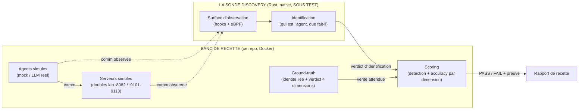
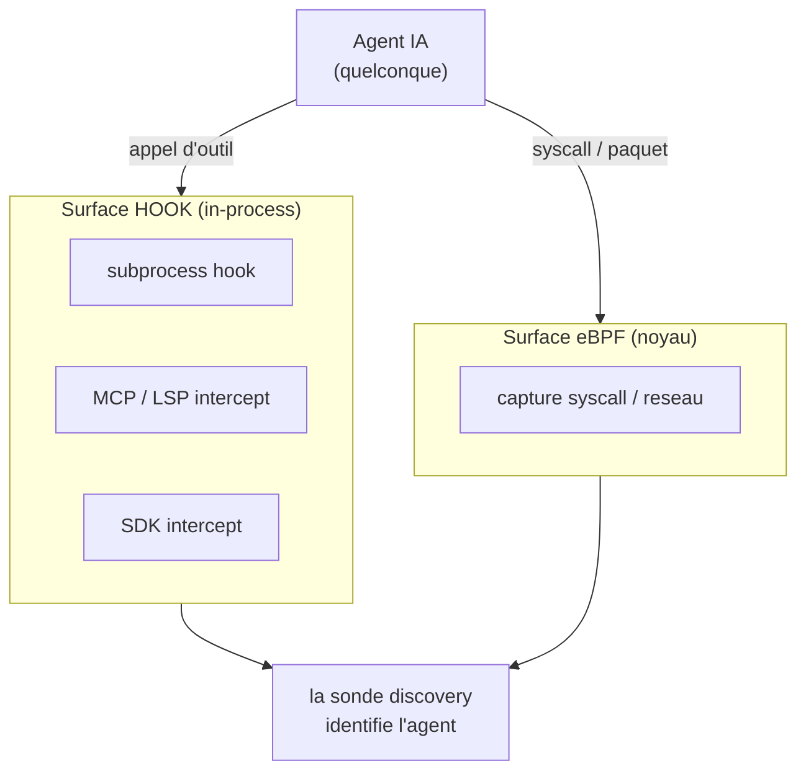
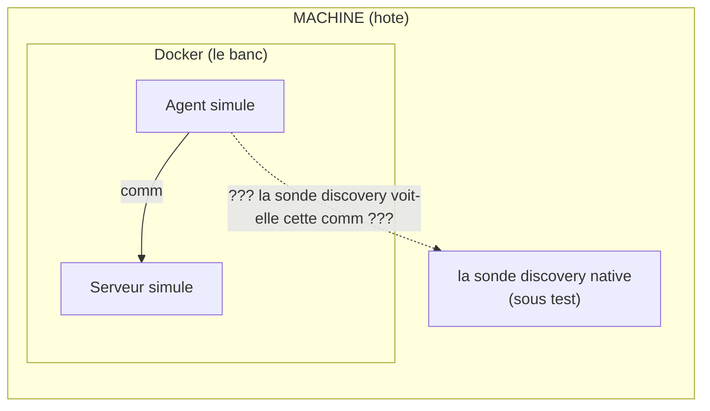
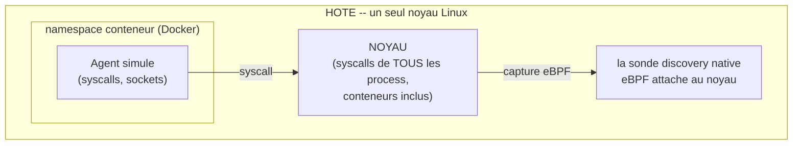
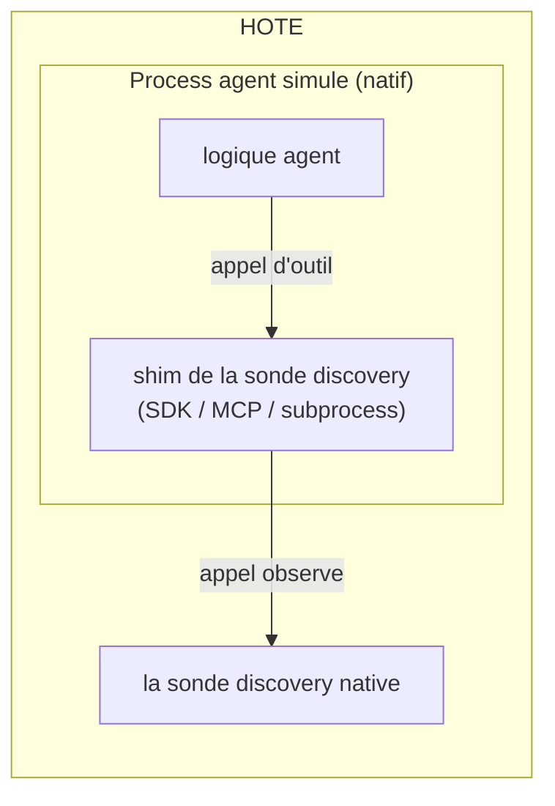
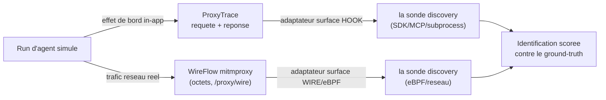
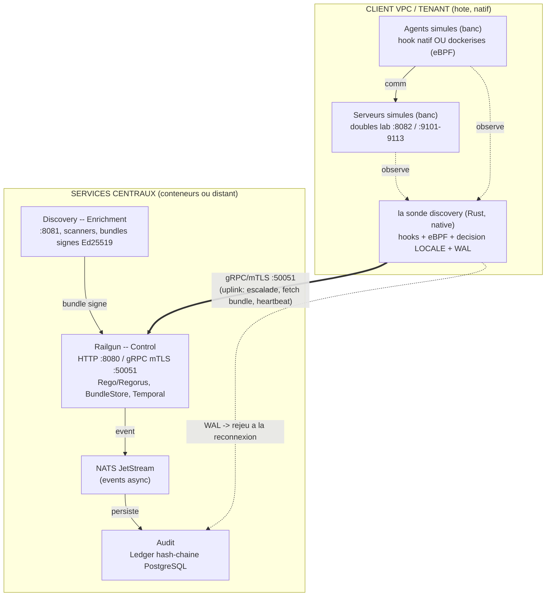
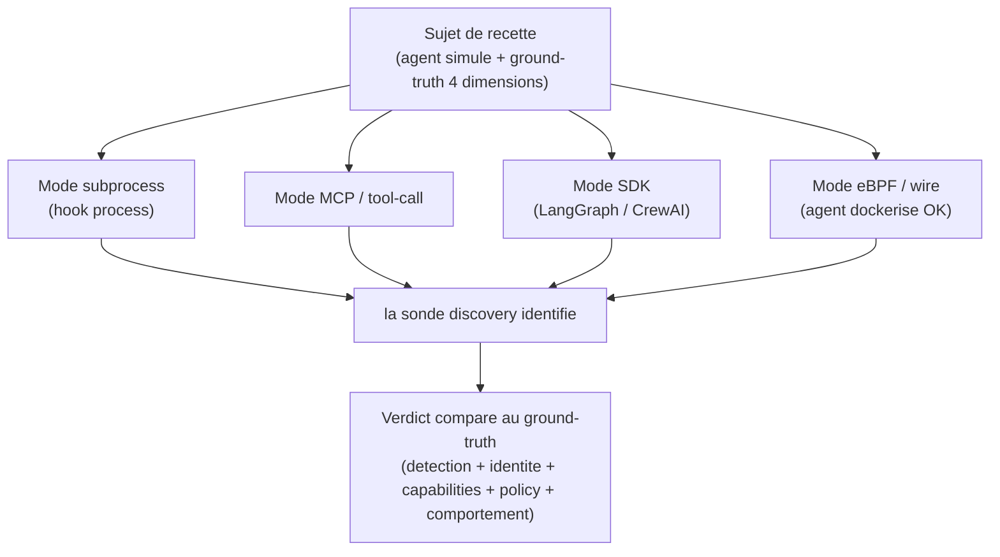
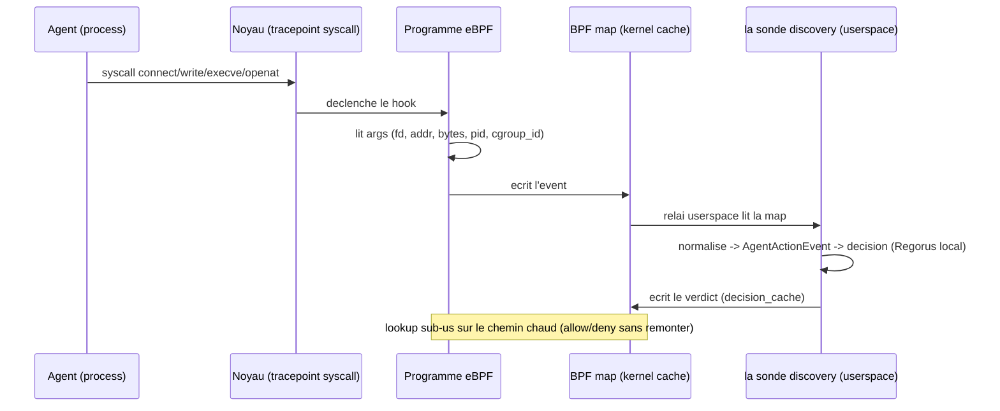
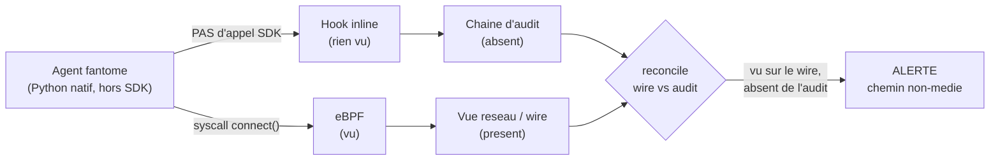

# Recette de la discovery par la sonde discovery -- voir les agents, frontiere host <-> Docker

Date : 2026-06-16
Statut : FONDATEUR (design valide en brainstorm, avant implementation)
Plans AgentRail touches : Data Plane (la sonde discovery, surface d'observation), Enrichment
Plane (Discovery), et le banc de recette (ce repo)
Invariants en jeu : I3 (liaison d'identite), I4 (replay deterministe), I5 (effets de
bord mediats), I2 (mediation Control Plane)

---

## 0. La these, en une phrase

**Si l'outil ne voit pas les agents, c'est un echec.**

Tout le reste de la gouvernance AgentRail -- decision, politique, approbation, audit --
suppose une chose prealable : que la sonde discovery **observe** reellement la communication d'un
agent. Une decision parfaite sur une action qu'on n'a pas vue ne vaut rien. La discovery
(reperer un agent et l'identifier a partir de ce qu'il fait sur le fil) est donc la
**condition de possibilite** de toute la chaine. Ce repo existe pour **prouver** que
la sonde discovery voit les agents -- ou pour montrer, de facon reproductible, ou elle est aveugle.

Ce document fixe l'architecture de cette preuve, et tranche la question qui la bloque en
pratique : **un banc en Docker, une sonde discovery native sur la machine -- comment l'outil
voit-il les agents simules par le banc ?**

---

## 1. Deux outils, ne jamais les confondre

| | Ce que c'est | Role | Ou il tourne |
|---|---|---|---|
| **La sonde discovery** | L'outil AgentRail (Rust), Data Plane, *sous test* | Intercepte la comm agent<->serveur, verifie l'identite, decide localement | **Natif** sur l'hote client (VPC tenant) |
| **Le banc** (ce repo) | La **recette** de la sonde discovery (Python) | Simule des agents + des serveurs, produit la comm, porte le **ground-truth**, **score** l'identification | **Docker** (ou natif via `recette.sh`) |

Le banc **ne bloque rien**. Il **simule** le verdict gouverne et fournit une **verite de
reference** pour que l'outil de discovery/identification ait quelque chose de correct
contre quoi etre mesure. L'enforcement (blocage, isolation reseau, hard-block) est le
travail de la plateforme AgentRail, pas du banc.



---

## 2. La surface d'observation de la sonde discovery (le coeur du sujet)

La sonde discovery n'ecoute pas d'une seule maniere. Elle a **plusieurs surfaces d'interception**,
selon le type d'agent. C'est l'architecture officielle (RFC + diagramme AgentRail) :

| Agent | Surface de la sonde discovery | Nature |
|---|---|---|
| Claude Code | subprocess hook | inline (dans le process) |
| Cursor | client LSP / MCP | inline |
| LangGraph / CrewAI | SDK intercept | inline |
| Serveurs MCP | tool-call intercept | inline |
| **N'importe quel agent** | **capture syscall eBPF** | noyau (MVP userspace -> roadmap eBPF complet) |

Deux familles, et c'est cette distinction qui resout la question Docker :

- **Surface "hook" (inline)** : le shim de la sonde discovery vit **dans le process de l'agent**. Il
  voit l'appel structure (action, ressource, payload) directement, avant le reseau.
- **Surface "eBPF / syscall"** : la sonde discovery s'attache au **noyau**. Elle voit les
  syscalls et le trafic reseau de tout process de la machine, sans etre dans le process.



> Consequence directe : **la sonde discovery doit etre native.** Les hooks inline et surtout l'eBPF
> exigent le noyau de l'hote et l'espace de process. Une sonde discovery dans un conteneur serait
> aveugle a l'hote. Docker peut heberger les *services* centraux (Railgun, Discovery,
> Audit), jamais la sonde discovery.

---

## 3. Le probleme pose proprement

Le banc simule les agents et les serveurs **en Docker**. La sonde discovery tourne **en natif**.
Question : la comm produite dans Docker, la sonde discovery la voit-elle, et **de la meme maniere
qu'en prod** ? (Sinon la recette est infidele : on validerait une observation que la prod
ne fera jamais.)



---

## 4. La reponse : on tranche par surface d'observation

La frontiere host<->Docker n'a pas **une** reponse, elle en a **deux** -- une par surface.
Et c'est exactement ce qui rend le probleme soluble.

### 4.1 Surface eBPF / syscall -- Docker est transparent

L'eBPF s'attache au **noyau de l'hote**. L'hote et **tous** les conteneurs partagent **un
seul noyau**. Une sonde discovery native privilegiee (`CAP_BPF`) voit donc les syscalls et le trafic
des agents simules **dockerises**, a travers la frontiere de namespace -- Docker ne cache
rien a l'eBPF de l'hote.



> Conclusion : pour la surface eBPF, **les agents simules peuvent tourner en Docker sans
> rien changer**. La sonde discovery native les capte. Pas de probleme de frontiere. C'est la
> demonstration meme de pourquoi la sonde discovery est native.

### 4.2 Surface hook (inline) -- le shim doit etre dans le process

Le shim de la sonde discovery (subprocess / SDK / MCP) se charge **dans le process de l'agent**. Pour
recetter cette surface fidelement, le chemin propre est de faire tourner l'agent simule
**en natif sur l'hote**, pour qu'il charge le shim de la sonde discovery directement.



Variante si l'agent doit rester en conteneur : injecter le shim **dans le conteneur** de
l'agent + relai loopback vers la sonde discovery. Plus de pieces mobiles ; l'agent natif reste la
recette la plus simple et la plus fidele.

---

## 5. Le banc a deja les deux vues -- on ne reinvente rien

Point cle pour l'implementation : **le banc possede deja les deux representations** qui
correspondent aux deux familles de surface. On n'ajoute pas de mecanisme de capture, on
ajoute un **adaptateur par surface** qui presente la comm simulee a la sonde discovery comme chaque
hook le ferait.

| Vue existante du banc | Correspond a la surface de la sonde discovery |
|---|---|
| **ProxyTrace** (requete structuree + reponse serveur, in-app) | surface **hook** (l'appel que l'agent a fait) |
| **Wire mitmproxy** (octets sur le fil, `POST /proxy/wire`) | surface **eBPF / reseau** (les octets que le syscall voit) |



> Rappel "wire vs audit" (deja construit dans le banc) : on a deux vues du meme run, (a)
> la chaine d'audit (ce qui a traverse la gateway, mediee, I5) et (b) le wire mitmproxy
> (ce qui etait reellement sur le reseau). Un agent fantome qui parle direct a une
> DB/disque **n'apparait pas** dans l'audit mais **apparait** sur le wire : "wire pas dans
> l'audit" = alerte. C'est la meme dualite qui sert ici de surface d'observation.

---

## 6. Topologie de deploiement -- ou vit chaque chose



Deux faits qui desamorcent toute la peur "Docker" :

1. **Le chemin chaud de decision est local a la sonde discovery** (bundle signe en cache + Regorus
   local + WAL). La frontiere vers les services centraux (conteneurs/distant) **n'est
   jamais dans le chemin chaud** : elle ne porte que le fetch de bundle (periodique) et le
   push d'events (async NATS). Latence/disponibilite de Docker = sans effet sur un verdict.
2. **Mode deconnecte = fail-safe.** Services injoignables -> la sonde discovery continue de decider
   sur le dernier bundle signe et bufferise dans le WAL, rejoue a la reconnexion. Jamais de
   fail-open ; pas de bundle valide en cache -> DENY par defaut.

Acces concret a travers la frontiere (Linux, verifie sur ce repo) :
- hote -> conteneur : port publie (`-p 8080:8080`), atteint sur `127.0.0.1`.
- conteneur -> hote : `host.docker.internal` (`--add-host ...:host-gateway`, Docker 20.10+).
- `network_mode: host` : partage le loopback de l'hote (pattern deja utilise par l'overlay
  wire-proxy mitmproxy du repo) -- pas de traduction conteneur/hote.
- mTLS (CN = tenant_id) : transparent a la frontiere, identique en loopback ou en reseau.

---

## 7. Modes de recette -- couverture PAR surface (critere de fidelite)

La recette n'est valide que si elle reproduit la surface **reelle** de la sonde discovery, pas un
proxy de celle-ci (legibility-first : on ne recette que ce qu'on rend observable comme en
prod). Donc on couvre **chaque surface**, chacune avec son ground-truth.



Un trou de surface (la sonde discovery aveugle sur une surface donnee) doit etre un **test rouge**,
jamais une lacune trouvee a la main. C'est la traduction directe de la these du paragraphe 0.

---

## 8. Les 4 dimensions jugees (rappel) et les invariants

Le banc juge l'identification de la sonde discovery sur les memes 4 dimensions que le reste du
corpus, plus la detection :

1. **Detection** : la sonde discovery a-t-elle **vu** l'agent ? (la condition zero).
2. **Identite (I3)** : l'agent est-il celui qu'il pretend, liaison crypto verifiee ?
3. **Capabilities** : actions reelles dans le `capability_scope` declare ?
4. **Policy** : allow / deny / escalate conformes a l'attendu ?
5. **Comportement** : l'agent fait-il ce que son role prevoit ?

Invariants engages par CE design :
- **I3** : l'identification repose sur la liaison crypto (passport / JWT Ed25519,
  DelegationVerifier). Un sujet "identite declaree != identite liee" est un negatif
  mono-axe `identity_mismatch` que la sonde discovery doit attraper.
- **I4** : la comm simulee + le ground-truth sont **deterministes** (horloge logique, pas
  de `time/now/random`), enregistres une fois, rejoues a l'octet -> l'alerte est
  reproductible, pas un flake. Condition necessaire d'un signal de detection fiable.
- **I5** : les effets de bord du banc passent par les doubles/proxies ; le wire mitmproxy
  donne la vue reseau pour la surface eBPF.
- **I2** : le banc simule la mediation Control Plane (verdict gouverne) ; il ne l'applique
  pas -- l'enforcement reste la plateforme.

---

## 9. La frontiere a tenir (ce qu'on simule vs ce qui est la plateforme)

- **Le banc simule et prepare le terrain** (app-level + reseau-level, faisable maintenant
  dans le lab) : agents, serveurs, comm, ground-truth, scoring de l'identification.
- **La plateforme applique** (network-level enforcement, isolation pod, hard-block,
  handshake d'enregistrement obligatoire). Hors banc.
- Le banc reste un **lab** : il observe et simule le chemin non-medie, il ne bloque rien.

---

## 10. Done / criteres de succes du design

- La sonde discovery **voit** les agents simules sur **chaque** surface declaree (subprocess, MCP,
  SDK, eBPF/wire) -- couverture par surface, trou = test rouge.
- La frontiere host<->Docker est tranchee : eBPF transparent (un noyau), hook in-process
  (agent natif), services centraux conteneurisables (hors chemin chaud).
- Le banc fournit un ground-truth deterministe (I4) sur les 4 dimensions + detection, et
  score l'identification de la sonde discovery sans rien bloquer.
- Reutilisation des deux vues existantes (ProxyTrace = hook, WireFlow = eBPF/reseau) via un
  adaptateur par surface -- pas de nouvelle capture.

## 11. Prochaines etapes (a transformer en plan d'implementation)

1. Definir le **contrat d'adaptateur par surface** (comment le banc presente une comm a
   la sonde discovery : hook structure vs wire/octets) -- un protocole, comme `DiscoveryAdapter` /
   `IdentificationAdapter` aujourd'hui.
2. Un **sujet de reference par surface** (un agent simule minimal + ground-truth) pour
   prouver la detection sur chaque surface.
3. Le **scorecard de detection** : taux de detection par surface, faux negatifs (agent vu
   nulle part = echec), accuracy par dimension.
4. Brancher la sonde discovery reelle via le contrat (CLI/HTTP/gRPC :50051), garder l'oracle de
   reference offline comme gabarit.

> Etape suivante recommandee : passer ce design en plan d'implementation
> (skill `writing-plans`).

---

## Annexe A -- eBPF et hook inline en detail

Les deux surfaces d'observation de la sonde discovery reposent sur deux mecanismes Linux
fondamentalement differents. Les comprendre est necessaire pour construire une recette
fidele : on ne simule pas une comm de la meme maniere selon la surface visee.

### A.1 eBPF -- une machine virtuelle dans le noyau

eBPF (*extended Berkeley Packet Filter*) est une petite machine virtuelle **dans le noyau
Linux**. On charge un mini-programme ; le noyau l'execute a des points precis (syscalls,
paquets reseau, fonctions kernel). Pas de module noyau a compiler, pas de reboot.

Chaine de vie d'un programme eBPF :

```
code C/Rust -> bytecode eBPF -> syscall bpf() -> VERIFIER (noyau)
   -> JIT (bytecode -> code natif) -> attache a un hook point -> s'execute a chaque event
```

Pieces cles :

- **Verifier** : le noyau REFUSE le programme s'il peut boucler a l'infini, dereferencer un
  pointeur invalide, ou depasser la pile. Garantie : un programme eBPF ne peut pas planter
  le noyau. C'est ce qui rend eBPF sur en production.
- **Hook points** (ou on attache) : `kprobe`/`kretprobe` (entree/sortie de fonction
  kernel), `tracepoint` (points stables du noyau), `LSM` (Linux Security Modules, pour
  decider allow/deny), `XDP`/`tc` (paquets reseau au plus tot), `uprobe` (fonctions
  userspace).
- **Maps** : structures cle/valeur partagees noyau<->userspace. Le programme eBPF ecrit
  dans une map, le demon userspace (la sonde discovery) la lit. C'est le canal de remontee des events
  -- et le cache du chemin chaud (`identity_cache`, `decision_cache` du diagramme AgentRail,
  lookup sub-microseconde).

Mecanisme de la sonde discovery (surface eBPF) :



**Ce que eBPF voit** : tout syscall de tout process -- `execve` (un agent demarre),
`connect`/`sendto` (il parle reseau), `openat`/`write` (il touche un fichier/DB). C'est le
filet **catch-all** ("Any AI Agent") : aucune cooperation de l'agent requise.

**MVP userspace vs roadmap eBPF** : au depart la sonde discovery capture en userspace (proxy,
`LD_PRELOAD`, ou ptrace) -- plus simple, moins performant, contournable. La roadmap = vrai
eBPF noyau pour la perf et la couverture totale (un agent ne peut pas l'eviter).

### A.2 Hook inline -- un shim dans le process de l'agent

Un hook inline vit **dans le process applicatif de l'agent**, pas dans le noyau. L'agent
appelle un outil ; l'appel passe d'abord par le shim de la sonde discovery, qui voit l'appel
**structure** (action, ressource, payload) avant toute execution.

Variantes (diagramme AgentRail) :
- **subprocess hook** (Claude Code) : wrapper du process / interception des sous-process.
- **SDK intercept** (LangGraph/CrewAI) : middleware dans le SDK ; chaque tool-call y passe.
- **MCP / tool-call intercept** (Cursor, serveurs MCP) : coupure sur le protocole MCP.

```
agent.appelle_outil("github.merge_pr", {repo, number})
   -> shim de la sonde discovery intercepte AVANT execution
   -> voit l'appel STRUCTURE (action_type, resource, payload)
   -> decision -> laisse passer / bloque
```

### A.3 eBPF vs hook -- la difference qui compte

| | eBPF / syscall | Hook inline |
|---|---|---|
| **Ou** | noyau (hors process) | dans le process de l'agent |
| **Voit** | syscalls + octets reseau (bas niveau) | l'appel d'outil semantique (haut niveau) |
| **Semantique** | brute : `connect(2.3.4.5:443)`, `write(fd, bytes)` -- intention a reconstruire | riche : `merge_pr` sur tel repo, deja structuree |
| **Contournable ?** | non (l'agent ne choisit pas) | oui si l'agent evite le SDK (fantome en Python natif) |
| **Cooperation agent** | aucune | oui (l'agent charge le shim) |
| **Couverture** | universelle (tout process) | par framework (un shim par SDK) |

La sonde discovery a **les deux** parce qu'ils sont complementaires : le hook donne l'intention
claire mais contournable ; l'eBPF est incontournable mais semantiquement pauvre.

### A.4 Le combo = detection du ghost agent



Un agent qui parle direct a une DB en Python natif **echappe au hook** (pas dans le SDK)
mais **apparait en eBPF** (le syscall `connect` existe). "Vu en eBPF/wire, absent du
hook/audit" = alerte. C'est exactement le `reconcile` wire-vs-audit du banc.

### A.5 Pourquoi eBPF resout la frontiere Docker

eBPF s'attache au **noyau de l'hote**. Hote + conteneurs = **un seul noyau**. Un eBPF sur
l'hote voit donc les syscalls des process **dans les conteneurs** (il a meme le `cgroup_id`
pour identifier quel conteneur). Le namespace Docker isole le reseau et les PID *entre
conteneurs*, pas le **noyau** vis-a-vis d'un observateur privilegie de l'hote.

Cote banc :
- **surface eBPF** : l'agent simule (dockerise ou non) emet un vrai syscall reseau
  observable (vrai `connect`/HTTP). L'overlay mitmproxy fournit deja cette vue reseau.
- **surface hook** : l'agent simule charge le shim de la sonde discovery -> il tourne en natif.

