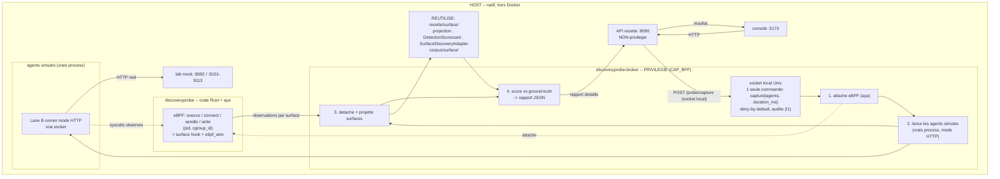
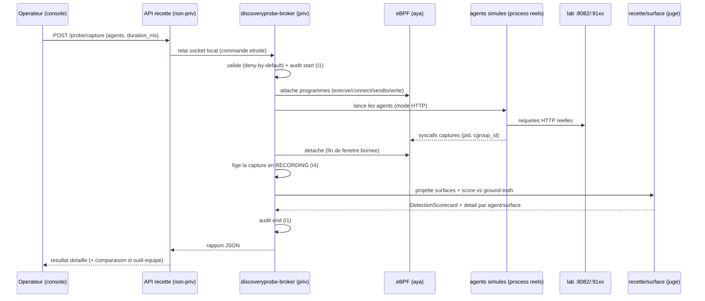
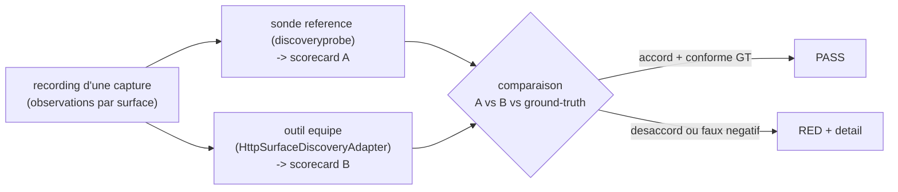
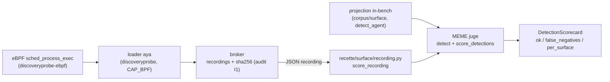

# discoveryprobe -- sonde eBPF de reference + conformite (design)

Date : 2026-06-16
Statut : FONDATEUR (design valide en brainstorm, avant implementation)
Plans AgentRail touches : Data Plane (observation runtime eBPF), banc de recette (ce repo)
Invariants en jeu : I4 (juge pur sur capture enregistree), I1 (run de capture audite),
I5 (agents -> lab via proxy), I2 (pas de contournement), securite deny-by-default

---

## 0. Objet

Le banc `recette/surface/` prouve aujourd'hui la LOGIQUE de detection sur des vues
ENREGISTREES (ProxyTrace = hook, WireFlow = wire). Il ne prouve pas encore que la
comm d'un agent est **reellement observable** sur l'hote en live. `discoveryprobe` comble
ce trou : une **sonde native eBPF** qui observe pour de vrai des agents simules
vivants, produit les memes surfaces, et alimente le **meme** `DetectionScorecard`.

Double usage (decide en brainstorm) :
1. **Sonde de reference** : preuve reelle que "voir l'agent" marche sur l'hote,
   Docker-transparent (un seul noyau).
2. **Point de conformite** : on branche l'outil de discovery REEL de l'equipe au
   meme endroit (contrat `SurfaceDiscoveryAdapter`) et on compare sonde-reference vs
   outil-equipe sur les memes agents, meme scorecard, depuis la console.

These fondatrice (rappel) : **si l'outil ne voit pas les agents, c'est un echec.**
`discoveryprobe` rend cette these mesurable en conditions reelles.

## 1. Scope (et hors-scope)

DANS le scope :
- Une sonde **runtime eBPF** en **Rust + aya** : observe `execve` / `connect` /
  `sendto` / `write` des process agents (pid, cgroup_id), derive les surfaces
  `hook_*` et `ebpf_wire`.
- Un **broker priv-separe** (seul a porter CAP_BPF) declenchable depuis la console.
- La **comparaison de conformite** sonde-ref vs outil-equipe (meme scorecard).
- L'affichage **detaille** du resultat dans la console.

HORS scope (decide) :
- Les **scanners statiques** (OpenAPI/GitHub/Temporal/MCP) : c'est de l'enrichissement
  STATIQUE, deja couvert en Python (`corpus/repos/` + `SourceScanAdapter` +
  `recette/http_adapter.py`). `discoveryprobe` ne les double pas.
- L'**enforcement** (blocage/kill inline) : le banc OBSERVE, il ne bloque pas. Le
  hard-block reste la plateforme AgentRail.
- Le **vrai RailNode prod** : `discoveryprobe` est la sonde de REFERENCE du banc, pas le
  produit. Le produit se branche via le contrat.

## 2. Decision de langage : Rust

Fait acte en brainstorm : la sonde OBSERVE et RAPPORTE, elle n'est pas dans un chemin
de DECISION -> la **milliseconde n'est pas un critere** ici (le ms ne compte que pour
le chemin chaud d'enforcement en prod). Rust est neanmoins choisi pour :
- **mirrorer l'artefact prod** (RailNode Data Plane est en Rust) ;
- **vrai eBPF** via `aya` (eBPF pur-Rust, pas de C/bcc) ;
- un **binaire statique unique** que l'equipe peut lancer.

Cout assume : nouveau toolchain cargo dans un repo Python (R22), build/recette
separes, execution privilegiee native (hors Docker).

## 3. Topologie

## 4. Composants

| Composant | Nouveau | Role | Privilege |
|-----------|---------|------|-----------|
| `discoveryprobe` (crate Rust + aya) | oui | sonde eBPF : programmes kernel + relai userspace -> observations par surface | charge par le broker |
| `discoveryprobe-broker` | oui | seul porteur CAP_BPF ; socket local ; 1 commande etroite ; orchestre la capture bornee ; rend le rapport | PRIVILEGIE |
| API `POST /probe/capture` | oui | relaie la requete console au broker via socket local ; jamais d'escalade dans l'API | NON-priv |
| Lane B runner (mode HTTP) | reutilise | lance de VRAIS process agents qui font un VRAI socket vers le lab (observable par eBPF) | NON-priv |
| `recette/surface/` | reutilise | projection + `DetectionScorecard` + `SurfaceDiscoveryAdapter` | - |
| `corpus/surface/` | reutilise | ground-truth par sujet | - |
| lab `:8082/:91xx` | reutilise | doubles deterministes | - |

## 5. Flux de donnees (cycle de capture)

## 6. Determinisme (I4) -- capture live vs juge pur

L'eBPF observe le REEL : le timing et l'ordre des syscalls sont **non-deterministes**.
On applique le pattern record-replay deja en place dans le banc (`real_mode`) :
- la **capture** est enregistree une fois en RECORDING normalise (liste d'events par
  surface, triee de maniere stable) ;
- le **juge** (`project_surfaces` + `score_detections`) reste une **fonction pure**
  sur ce recording -> rejeu byte-stable (I4), testable hors privilege.

Donc : capture = live (non rejouable), jugement = deterministe et rejouable. Un
recording fige peut etre promu en sujet `corpus/surface/` (la capture reelle devient
un sujet de regression deterministe).

## 7. Modele de privilege & contrat du broker (securite)

Decide : **la console declenche via un broker priv-separe.** Regles dures :
- **L'API reste non-privilegiee.** Elle ne fait que relayer au broker par socket local
  Unix (permissions fichier strictes), jamais d'`exec` privilegie elle-meme.
- **Le broker n'accepte qu'UNE commande parametree** : `capture { agents:[ids
  declares], duration_ms:<borne> }`. Pas d'exec arbitraire, pas de chemin libre, pas
  d'argument shell. Les `agents` sont valides contre le corpus declare (deny-by-default
  sur un id inconnu).
- **Capture bornee** : `duration_ms` plafonne ; un timeout detache l'eBPF et rend la
  main (jamais de capture infinie).
- **CAP_BPF seulement** (pas root complet si possible) sur le seul broker.
- **Chaque run audite** (I1) : start/end + parametres + hash du recording, append-only.
- Lancement par `./recette.sh` uniquement (R19), jamais hand-launch.

## 8. Conformite : sonde-reference vs outil-equipe

Les deux implementent le meme contrat `SurfaceDiscoveryAdapter` (`recette/surface/
detect.py`) -> meme `DetectionScorecard`. Le rapport de capture porte les deux colonnes
+ un verdict d'ACCORD :

Le banc dit donc deux choses a l'equipe : (a) ta detection est-elle CORRECTE vs le
ground-truth ? (b) est-elle d'accord avec la sonde de reference ? Un desaccord pointe
soit un trou de l'outil, soit un sujet a affiner.

## 9. Console -- resultat detaille

Nouvel onglet/vue "Probe" : bouton de lancement (capture bornee), puis rapport :
- par AGENT : detecte oui/non globalement, vs ground-truth ;
- par SURFACE (`hook_subprocess/mcp/sdk`, `ebpf_wire`) : visible oui/non + les events
  observes (execve/connect... ou flux) ;
- la colonne outil-equipe (si branche) + le verdict d'accord ;
- le `false_negatives` (agent vu nulle part) en rouge proeminent.
R16 : fixture payload reelle du rapport + render-and-assert (contrat frontend).

## 10. Contraintes (R20/R22/R19) & pre-requis

- **R22 Docker adequation** : `discoveryprobe`/broker = crate cargo, `target/` gitignore,
  **hors image Docker de base** (la sonde est NATIVE par nature). `aya` pin a la
  version dont l'API est verifiee. Le broker est documente comme service natif opt-in.
- **R20 gates** : cote Rust -> `cargo build` + `cargo clippy -D warnings` +
  `cargo test`. Cote Python (juge) -> unittest stdlib + I4 replay du juge sur recording.
- **R19** : lance par `./recette.sh probe ...` (broker + capture), jamais hand-launch.
- **Plateforme** : Linux + noyau eBPF + CAP_BPF. Documenter le pre-requis ; sur un hote
  sans eBPF, la sonde est N/A (jamais inventer un resultat -- R13).

## 11. Prior art (verifie)

L'observation host par eBPF zero-instrumentation est un domaine mur en 2026 : **Falco**
(CNCF, runtime security kernel-level), **Tetragon** (Cilium, observe + enforce inline),
**Pixie**, **Tracee**, **Beyla** (auto-instrumentation). Tous : natif hote, voient les
process **y compris dans les conteneurs** (un seul noyau). **aya** = eBPF pur-Rust. La
nouveaute n'est pas le substrat (eprouve) mais son application a la **discovery d'agents
IA** et son usage comme **sonde de reference d'un banc de recette**.
Sources : https://falco.org , https://tetragon.io , https://aya-rs.dev , ebpf.io .

## 12. Etapes (suivi)

1. [FAIT] PoC eBPF minimal `execve` -> objet BPF valide (commit 517df27).
2. [FAIT] Capture reelle `sched_process_exec` -> ring buffer (pid+comm) + loader
   userspace (`discoveryprobe-common`/`-ebpf`/loader, commits 753f5ea, b1cd140).
   Le format du recording = celui que `recette/surface/` consomme.
3. [FAIT] `discoveryprobe-broker` : socket local 0600, commande etroite
   `capture{agents,duration_ms}` deny-by-default, capture bornee, audit append-only
   I1 + sha256 du recording (commit 228a414).
4. [FAIT] `recette/surface/recording.py` : ingere le recording broker (JSON) et le
   passe au MEME juge (`detect` + `score_detections`). Le juge devient agnostique a
   la SOURCE -- capture live eBPF ou projection in-bench produisent la meme
   `DetectionScorecard` (I4). Entree CLI : `python -m recette surface --recording
   <fichier>`. Un nom de surface inconnu = bridge mismatch (leve), un agent capture
   nulle part = `false_negative` (echec these). Test : `tests/test_surface_recording.py`.
5. [FAIT] API `POST /probe/capture` (NON-privilegiee) : relaie la commande au broker
   par socket Unix (`INSPECT_IA_AGENTS_PROBE_SOCKET`), retourne le recording + la
   `DetectionScorecard` (juge source-agnostique). Fail-safe : socket absent /
   injoignable -> 503, jamais de capture fabriquee. `GET /probe/status`.
   `recette/api/probe_relay.py` + `routers/probe.py`. Test :
   `tests/test_api_probe.py` (stub socket broker, relai prouve sans privilege).
   Fixture R16 reelle : `console/src/pages/probe/__fixtures__/probe-capture.fixture.json`.
   La comparaison conformite (sonde-ref vs HttpSurfaceDiscoveryAdapter) reste en §7.
6. [A FAIRE] Console : vue Probe (lancement + detail + comparaison).
7. [A FAIRE] Recette de la recette : un recording fige promu en sujet `corpus/surface/`
   (regression deterministe), + test d'accord sonde-ref vs HttpSurfaceDiscoveryAdapter
   sur le meme recording.
8. [A FAIRE] PREUVE LIVE sous CAP_BPF via `recette.sh` (R19) : le vrai "voit l'agent
   Docker". Tant que non faite -> "compile verifie, capture live NON prouvee".

### Bridge capture -> juge (source-agnostique, I4)

Les deux sources (capture live eBPF, projection in-bench) convergent vers UN juge
pur : un agent vu nulle part est un `false_negative` quelle que soit la source.

## Lien

- Design fondateur surfaces : `docs/plans/2026-06-16-railnode-discovery-recette-host-docker-design.md`.
- Plan surface-detection (livre) : `docs/plans/2026-06-16-railnode-surface-detection.md`.
- Runbook : `docs/runbooks/surface-detection-recette.md`.
