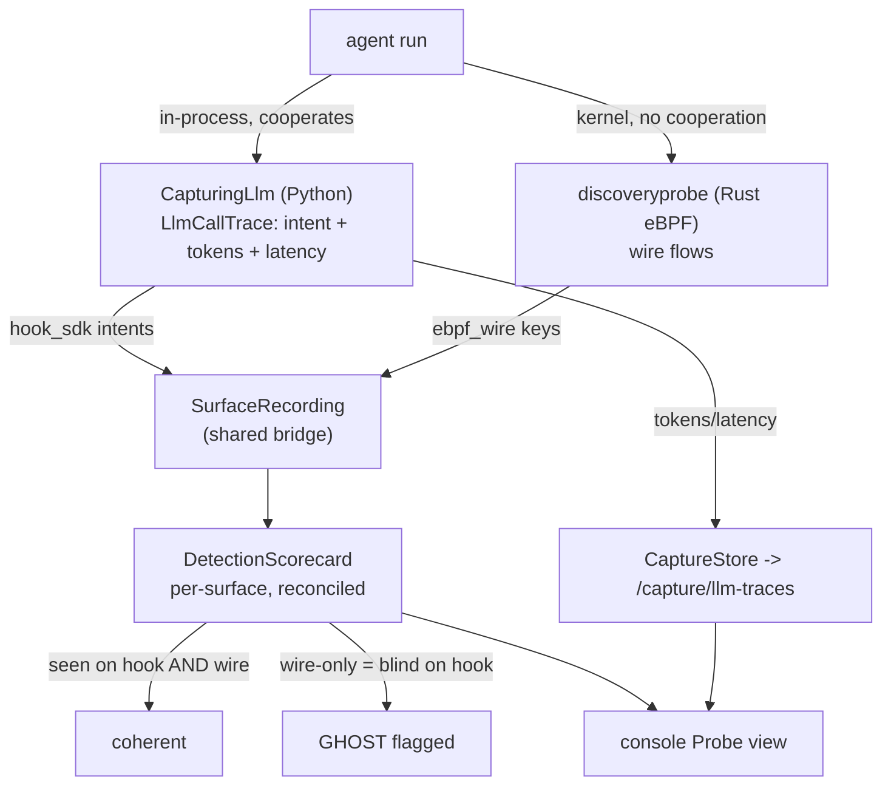

# Runbook -- in-process agent capture (G1, hook surface)

The hook surface of the multi-surface capture: an in-process wrapper records every
LLM decision an agent makes (intent + tokens + latency). Complementary to the
eBPF wire surface (discoveryprobe); both reconcile into one detection scorecard.

Design: `docs/plans/2026-06-16-agent-capture-multisurface-design.md`.
Plan: `docs/plans/2026-06-16-agent-capture-g1.md`. Attribution: `NOTICE`.

## Two surfaces, reconciled (not a menu)

The hook (Python, in-process) and the eBPF wire (Rust, kernel) run TOGETHER and
reconcile into one scorecard -- defense in depth. eBPF is kernel ground truth
(sees an agent even when in-process instrumentation is disabled); the hook adds
rich application intent (the "why"). The VALUE is the divergence: an agent caught
on eBPF but blind on hook is a ghost.



A menu (hook OR wire) would destroy the cross-check. The only "menu" is a UX
view-filter over surface columns, never a capture mode.

## What it is

`recette/capture/`:
- `CapturingLlm` -- wraps any `LlmBackend` (like `CachingLlm`); records one
  `LlmCallTrace` per `decide()`. Transparent + fail-safe (a sink error never
  breaks the run; eBPF stays the no-cooperation backstop).
- `LlmCallTrace` -- intent (`{tool}:{resource}`, matches the hook surface key) +
  ops metrics (tokens, latency, error).
- `surface_bridge.recording_from_traces` -- captured tool-calls -> `hook_sdk`
  `CaptureRecording`, scored by the SAME surface judge as eBPF (I4).

## Use it (in a run)

```python
from recette.api.runners import make_lane_b_runner
traces = []
runner = make_lane_b_runner(agent_cfg, llm, capture_sink=traces.append)
```

Default (`capture_sink=None`) = no capture, zero behaviour change.

## API + UX

- `GET /capture/llm-traces?run_id=<id>` -- the captured traces for a run
  (fail-safe: unknown run -> empty). Backed by `app.state.capture_store`.
- Console: the Probe view "Trace LLM (surface hook)" panel reads it back.

## Live proof (R14)

```
python3 scripts/run_capture_live_groq.py
```

Runs a REAL Groq agent (demo-gh-bot) through `CapturingLlm` and prints each
captured decision with real tokens + latency, then the `hook_sdk` surface keys.
Observed: read_repo + open_pr captured with real provider token counts. The
deterministic regression is `tests/test_capturing_llm.py` (no network).

## Determinism (I4)

Detection (the `hook_sdk` recording) is a pure function of the captured intents
-> byte-stable replay. `latency_ms` is wall-clock OPERATIONAL metadata and never
enters the detection/judge path (cf. `maf-standard.md`).

## Tests

`tests/test_capture_llm_trace.py`, `test_capture_usage.py`, `test_capturing_llm.py`,
`test_capture_surface_bridge.py`, `test_capture_determinism.py`,
`test_runners_capture.py`, `test_api_capture.py`; console
`LlmTracePanel.test.tsx`.
