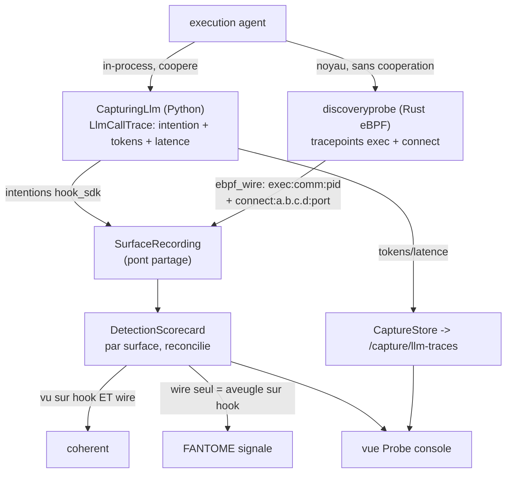

# Runbook -- capture d'agent in-process (G1, surface hook)

La surface hook de la capture multi-surface : un wrapper in-process enregistre chaque
decision LLM que prend un agent (intention + tokens + latence). Complementaire de la
surface wire eBPF (discoveryprobe) ; les deux se reconcilient en un seul scorecard de detection.

Design : `docs/plans/2026-06-16-agent-capture-multisurface-design.md`.
Plan : `docs/plans/2026-06-16-agent-capture-g1.md`. Attribution : `NOTICE`.

## Deux surfaces, reconciliees (pas un menu)

Le hook (Python, in-process) et le wire eBPF (Rust, noyau) tournent ENSEMBLE et se
reconcilient en un seul scorecard -- defense en profondeur. eBPF est la verite terrain du noyau
(voit un agent meme quand l'instrumentation in-process est desactivee) ; le hook ajoute
une intention applicative riche (le "pourquoi"). La VALEUR est la divergence : un agent capte
sur eBPF mais aveugle sur le hook est un fantome.



Un menu (hook OU wire) detruirait le recoupement croise. Le seul "menu" est un filtre de
vue UX sur les colonnes de surface, jamais un mode de capture.

## Ce que c'est

`recette/capture/` :
- `CapturingLlm` -- enveloppe n'importe quel `LlmBackend` (comme `CachingLlm`) ; enregistre un
  `LlmCallTrace` par `decide()`. Transparent + fail-safe (une erreur de sink ne casse jamais
  l'execution ; eBPF reste le filet de securite sans cooperation).
- `LlmCallTrace` -- intention (`{tool}:{resource}`, correspond a la cle de surface hook) +
  metriques ops (tokens, latence, erreur).
- `surface_bridge.recording_from_traces` -- tool-calls captures -> `CaptureRecording`
  `hook_sdk`, score par le MEME juge de surface qu'eBPF (I4).

## L'utiliser (dans une execution)

```python
from recette.api.runners import make_lane_b_runner
traces = []
runner = make_lane_b_runner(agent_cfg, llm, capture_sink=traces.append)
```

Par defaut (`capture_sink=None`) = pas de capture, zero changement de comportement.

## API + UX

- `GET /capture/llm-traces?run_id=<id>` -- les traces capturees pour une execution
  (fail-safe : execution inconnue -> vide). Adosse a `app.state.capture_store`.
- Console : le panneau "Trace LLM (surface hook)" de la vue Probe le relit.

## Preuve live (R14)

```
python3 scripts/run_capture_live_groq.py
```

Lance un VRAI agent Groq (demo-gh-bot) a travers `CapturingLlm` et affiche chaque
decision capturee avec tokens + latence reels, puis les cles de surface `hook_sdk`.
Observe : read_repo + open_pr captures avec des comptes de tokens reels du provider. La
regression deterministe est `tests/test_capturing_llm.py` (sans reseau).

## Determinisme (I4)

La detection (l'enregistrement `hook_sdk`) est une fonction pure des intentions capturees
-> replay byte-stable. `latency_ms` est une metadonnee OPERATIONNELLE wall-clock et n'entre
jamais dans le chemin de detection/juge (cf. `maf-standard.md`).

## Surface wire eBPF -- egress noyau (GR4/GR5)

La sonde noyau Rust capture DEUX tracepoints et les reconcilie sur une seule
surface `ebpf_wire` :
- `sched:sched_process_exec` -> `exec:comm:pid` (l'agent s'est execute),
- `syscalls:sys_enter_connect` -> `connect:a.b.c.d:port` (l'agent a appele vers l'exterieur,
  p. ex. son provider LLM en HTTPS -- l'egress httpcore d'agentwatch, vu au
  noyau sans cooperation ; voir `docs/migration-provenance.md`).

`discoveryprobe::recordings_from_capture(execs, connects)` pose les deux sur
`ebpf_wire`, tries + dedupliques (I4) ; le broker hashe + audite l'enregistrement
reconcilie (un seul scorecard, jamais un menu par surface).

Accord cross-language -- le loader Rust emet l'enregistrement que le juge Python
consomme, a l'identique :

```
cargo run -p discoveryprobe --example emit_wire_recording
python -m recette surface --recording <file>   # -> ebpf_wire: 1, ok: true
```

Fige dans `tests/test_surface_recording.py`
(`test_rust_emitted_wire_recording_is_judged_detected`). L'objet eBPF est
compile-verifie (vrai `Linux BPF`, deux programmes + deux maps via readelf) ; l'attache
live necessite CAP_BPF (le broker) -- NON prouvee hors d'une execution privilegiee (R14).

## Tests

`tests/test_capture_llm_trace.py`, `test_capture_usage.py`, `test_capturing_llm.py`,
`test_capture_surface_bridge.py`, `test_capture_determinism.py`,
`test_runners_capture.py`, `test_api_capture.py`, `test_surface_recording.py` ;
tests unitaires Rust `discoveryprobe-common` / `discoveryprobe` / `discoveryprobe-broker` ;
console `LlmTracePanel.test.tsx`.
