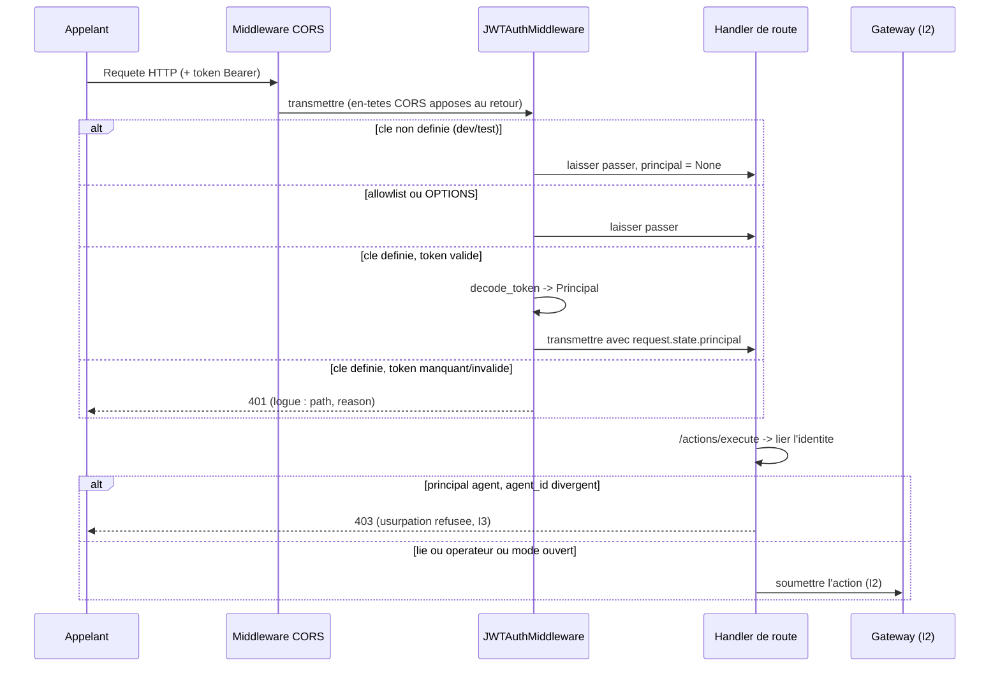
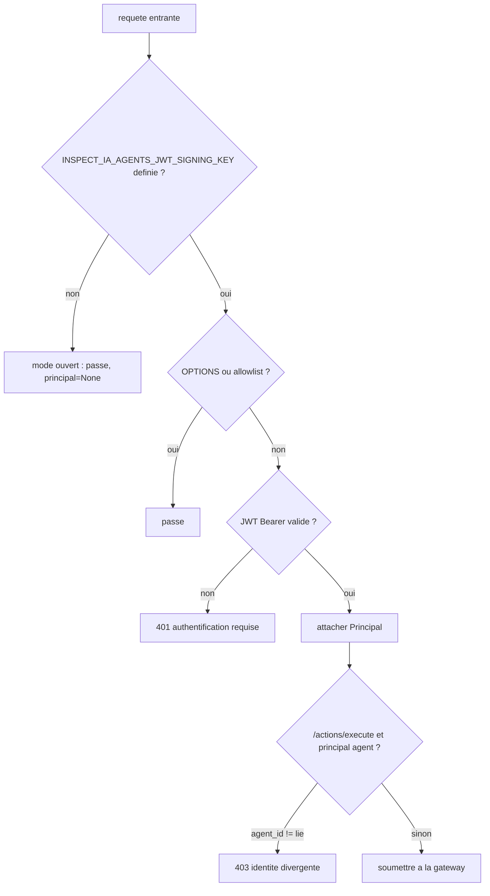

# Authentification API et liaison d'identite (I3)

Comment la console/l'API authentifie les appelants et lie une action d'agent a une
identite verifiee. Ferme le trou de plateforme G1 : auparavant, chaque route etait non
authentifiee et `/actions/execute` faisait confiance a l'`agent_id` envoye dans le corps.

## Modele

- Un appelant presente un **JWT HS256** compact via `Authorization: Bearer <token>`.
- Le token est signe avec `INSPECT_IA_AGENTS_JWT_SIGNING_KEY` (R8 -- env/secret store, jamais
  ecrit en dur). Le serveur ne fait jamais que **verifier** ; il ne fait jamais confiance a
  une claim non signee.
- Un token verifie produit un `Principal { sub, kind, agent_id }` :
  - `kind = "operator"` -- un operateur de console (gere la config, les policies, le RAG, ...) ;
  - `kind = "agent"` -- un agent, lie a l'`agent_id` au nom duquel il peut agir.
- Le verifieur n'utilise que la stdlib (`hmac`/`hashlib`), sans dependance JWT. L'algorithme
  est EPINGLE a HS256 : `alg: none` et tout `alg` asymetrique (RS*/ES*) sont refuses, ce qui
  defait les falsifications par confusion d'algorithme et `none`. La comparaison de signature
  est a temps constant ; `exp`/`nbf` sont appliques ; un `sub` est requis.

## L'application est conditionnee par la configuration

| `INSPECT_IA_AGENTS_JWT_SIGNING_KEY` | Comportement |
|----------------------------|-----------|
| **definie** (production) | deny-by-default : chaque route hors allowlist exige un token valide, sinon **401**. Les echecs sont logues de maniere structuree (R6). |
| **non definie** (dev/test) | mode ouvert : les requetes passent, un avertissement bruyant `AUTH DISABLED` est logue une fois au demarrage. |

La production DOIT definir la cle. La suite de 749 tests et le serveur de dev de la console
tournent en mode ouvert, donc le cablage de l'authentification n'a pas casse le comportement
existant.

Allowlist (accessible sans token) : `/health`, `/openapi.json`, `/docs`, `/redoc`,
`/docs/oauth2-redirect`, et toute requete preflight CORS `OPTIONS`.

## Liaison d'identite (I3) sur /actions/execute

Un principal **agent** authentifie ne peut agir qu'en tant que lui-meme : si l'`agent_id`
du corps de la requete differe de l'`agent_id` lie au token, l'action est refusee **403**
(auditee), jamais executee. Un principal operateur n'est pas soumis a cette contrainte.
Avec l'authentification desactivee, il n'y a aucune identite contre laquelle se lier
(inchange).

## Flux de requete

## Decision d'application

## Provisionnement d'un token

`recette/api/auth.py::issue_token(claims, key, ttl_seconds=...)` forge un token (pour le
provisionnement operateur/agent et les tests). Exemple de claims :

- operateur : `{"sub": "alice", "kind": "operator"}`
- agent :    `{"sub": "pr-bot", "kind": "agent", "agent_id": "pr-bot"}`

Le serveur n'emet jamais de token implicitement ; le provisionnement est une etape
explicite et hors bande.

## Env

| Variable | Usage |
|----------|-------|
| `INSPECT_IA_AGENTS_JWT_SIGNING_KEY` | Cle de signature HMAC (>= 16 octets). Definie en prod pour appliquer ; non definie = mode dev ouvert. |

## Tests

- `tests/test_api_auth.py` -- verifieur (roundtrip, confusion d'algorithme, `alg:none`,
  signature alteree, expire, `nbf`, sujet manquant, cle trop courte, mapping du principal)
  + middleware (mode ouvert, allowlist `/health`, 401 sans token, token operateur qui passe,
  mauvais token 401, un agent ne peut agir qu'en tant que lui-meme -> 403 sur usurpation).

## Mode de defaillance

Le sous-systeme d'authentification est fail-safe : une cle manquante/trop courte alors que
l'application est voulue, ou tout token malforme, aboutit a un **refus** (401), jamais a un
contournement ouvert. Le seul chemin ouvert est le mode dev explicite et logue lorsqu'aucune
cle n'est configuree.
