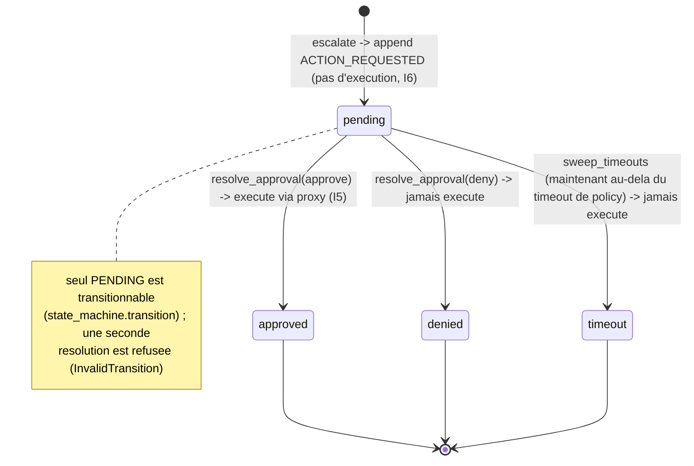
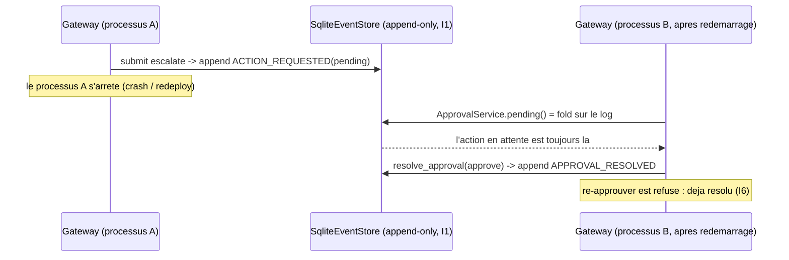

# Approbation durable (I6)

Comment une action `escalate` bloque jusqu'a ce qu'un humain la resolve ou qu'elle
expire, et pourquoi cet etat survit a un redemarrage de processus -- sans cluster
Temporal.

## Modele : l'inbox est un fold sur le log, pas une table

Il n'existe aucune table mutable des "approbations en attente". L'inbox est **derivee**
du log d'evenements append-only (I1) a chaque lecture :

- `pending()` = les evenements `ACTION_REQUESTED` **sans** evenement `APPROVAL_RESOLVED`
  correle. Une resolution est toujours un NOUVEL evenement (I1), l'evenement en attente
  n'est jamais mute.
- `resolved_ids()` = les evenements `APPROVAL_RESOLVED`, qui associent chaque id en attente
  a son etat final (`approved | denied | timeout`).

Comme l'etat ne vit que dans le log durable, il est reconstruit a l'identique apres
n'importe quel redemarrage : on jette tout objet en memoire, on reconstruit le
`Gateway`/`ApprovalService` depuis le meme store, et l'inbox en attente est exactement ce
qu'elle etait. Aucune attente en memoire, aucun sleep, aucune approbation perdue.

## Cycle de vie



## Pourquoi cela survit a un redemarrage



## Timeout : explicite, jamais d'auto-approbation

`sweep_timeouts(now_iso)` resout en **TIMEOUT** chaque action en attente plus ancienne
que l'`approval_timeout_seconds` de la policy -- jamais d'approbation, jamais d'execution
(failure modes : un systeme d'approbation incapable de decider se fige, il ne fail-open
pas). `now_iso` est capture une fois a la frontiere de l'API et passe en input (I4) ; le
chemin de decision ne lit jamais l'horloge de l'hote.

### L'unique residuel face a un workflow Temporal

L'event-sourcing offre la durabilite gratuitement, mais PAS un timer autonome : rien ne
declenche le timeout de lui-meme. `POST /approvals/sweep-timeouts` doit etre declenche par
un ordonnanceur externe (cron / timer systemd / CronJob k8s). Un workflow durable Temporal
porterait ce timer nativement. Tant que la plateforme n'adopte pas Temporal, planifiez le
sweep :

```
# every minute, resolve any approval past its policy timeout
* * * * * curl -fsS -X POST http://127.0.0.1:8080/approvals/sweep-timeouts
```

(une fois l'auth appliquee -- voir api-auth.md -- l'appel de sweep porte un token operateur.)

## Endpoints

| Methode | Route | Role |
|--------|-------|---------|
| GET | `/approvals?state=pending` | l'inbox en attente reconstruite |
| POST | `/approvals/{event_id}/approve` | resoudre -> executer (I5) |
| POST | `/approvals/{event_id}/deny` | resoudre -> jamais execute |
| POST | `/approvals/sweep-timeouts` | resoudre les expirees -> TIMEOUT (a planifier) |

Une seconde resolution de la meme action renvoie **409** (InvalidTransition).

## Tests

- `tests/test_approval_durability.py` -- durabilite au redemarrage face a un
  `SqliteEventStore` persiste : l'attente survit, la resolution survit, la double resolution
  apres redemarrage est refusee, le timeout apres redemarrage -> TIMEOUT et n'execute jamais.
- `tests/test_gateway_flow.py`, `tests/test_approval_state_machine.py` -- escalate bloque,
  deny n'execute jamais, le timeout n'auto-approuve jamais, la double resolution est rejetee.
