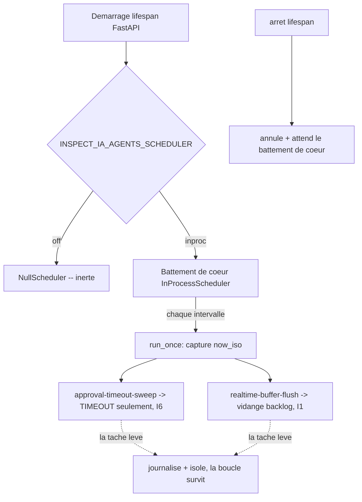

# Ordonnanceur de maintenance autonome (G8)

L'ordonnanceur est le battement de coeur ops qui declenche la maintenance periodique de la
plateforme sans declencheur manuel. Il ferme deux residus de la meme classe laisses par la
campagne platform-gaps :

- **G2** -- le balayage des timeouts d'approbation (`Gateway.sweep_timeouts`) n'avait aucun
  pilote autonome.
- **G4** -- le flush du bus degrade temps reel (`BoundedRetryBuffer.flush`) ne se vidait qu'au
  prochain publish, pas sur un battement de coeur.

Il vit EN DEHORS du chemin de decision (I4) : il n'appelle jamais `decide()`. Le balayage prend
son horloge comme un input capture et n'ajoute que des evenements TIMEOUT (n'auto-approuve
jamais, I6) ; le flush vide une copie derivee deja persistee (I1). L'horloge murale lue a la
frontiere d'un tick est une metadonnee operationnelle, pas un input de decision.

## Configuration

| Env | Defaut | Effet |
|-----|--------|-------|
| `INSPECT_IA_AGENTS_SCHEDULER` | `off` | `off` -> `NullScheduler` (aucun timer). `inproc` -> vrai battement de coeur asyncio. |
| `INSPECT_IA_AGENTS_SCHEDULER_INTERVAL_SECONDS` | `30` | Periode du battement de coeur (plancher `1`). Mal forme/sous le plancher -> `SchedulerConfigError` (fail-safe, pas de defaut silencieux). |

**Le defaut est OFF a dessein.** Une horloge auto-declenchante qui mute l'etat (ajoute TIMEOUT)
doit etre activee deliberement par deploiement pour que les tests et le replay restent
deterministes (I4). Un deploiement de production pose `INSPECT_IA_AGENTS_SCHEDULER=inproc`.

```
INSPECT_IA_AGENTS_SCHEDULER=inproc INSPECT_IA_AGENTS_SCHEDULER_INTERVAL_SECONDS=30 python -m recette.api
```

Le battement de coeur demarre dans le lifespan FastAPI et est annule puis attendu a l'arret.

## Taches enregistrees

- `approval-timeout-sweep` -- toujours enregistree.
- `realtime-buffer-flush` -- enregistree uniquement quand le transport expose `flush()` (le
  buffer du bus degrade, c.-a-d. `INSPECT_IA_AGENTS_REALTIME=nats`). Le transport in-process n'a aucun
  backlog, donc aucune tache de flush n'est ajoutee.

Une tache en echec est isolee : journalisee via le logger structure `inspect_ia_agents.scheduler` et
sautee, sans jamais tuer la boucle ni l'application (fail-safe, failure-modes.md).

## Mode de defaillance

L'ordonnanceur est lui-meme fail-safe. Un tick qui leve une exception est rattrape a deux
niveaux (par-tache dans `run_once`, et le tick entier dans la boucle). Le balayage ne peut se
resoudre qu'en TIMEOUT, jamais approuver ni executer (I6). Le flush ne retente qu'un backlog
deja durable (I1) et ne declenche jamais d'effet de bord externe.

## Alternatives considerees

- Un cron/systemd externe frappant `POST /approvals/sweep-timeouts` : toujours possible avec
  `INSPECT_IA_AGENTS_SCHEDULER=off`, mais il ne peut pas piloter `flush()` (ce n'est pas un endpoint HTTP).
- Workflow Temporal : adequation native, differe -- pas de serveur Temporal, un stub serait
  interdit (meme raison pour laquelle le timer G2 a ete differe).

## Flux


