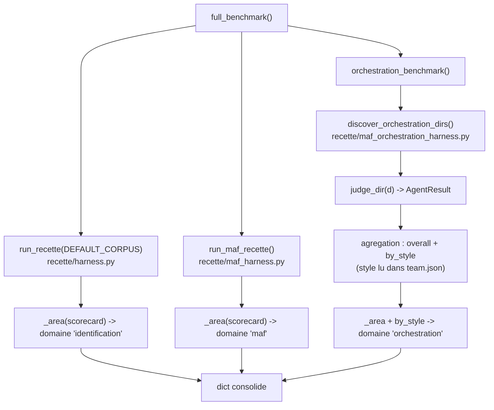

# Benchmark de recette -- precision du juge par dimension, style et domaine

> La scorecard repond a "chaque sujet correspond-il a sa ground-truth ?" (pass /
> fail). Le benchmark repond a une autre question : "a quel point le juge est-il
> precis, par dimension, par style d'orchestration et par domaine ?" -- les
> metriques que l'on compare entre corpus ou entre versions de juge. C'est une
> pure agregation deterministe (I4) au-dessus des memes juges que la recette.

## Ce que c'est et pourquoi ca existe

Le benchmark (`recette/benchmark.py`) est un harnais d'evaluation qui agrege des
metriques au-dela du simple pass/fail. La a la place de "passe / echoue", il
calcule la **precision du juge par dimension** sur les quatre dimensions de
recette, les comptes de reussites, et les faux positifs / faux negatifs, pour
trois domaines :

- `identification` -- les action-logs figes de `corpus/agents/` (`run_recette`
  sur `DEFAULT_CORPUS`).
- `maf` -- les sujets MAF mono-agent (`run_maf_recette`).
- `orchestration` -- les equipes MAF de `corpus/maf_orchestration/`, agregees
  globalement ET ventilees par `style` d'orchestration.

C'est l'equivalent maison des metriques "AF Labs" : on ne valide plus seulement
que tout passe, on mesure la qualite du juge pour la comparer dans le temps.

## Les metriques calculees

Pour chaque domaine, `_area(scorecard)` produit (voir `recette/benchmark.py`,
fonction `_area`) :

| Champ | Source (`recette/scorecard.py`) | Sens |
|-------|--------------------------------|------|
| `total` | `Scorecard.total` | nombre de sujets juges |
| `passed` | `Scorecard.passed_count` | sujets dont toutes les dimensions matchent la ground-truth |
| `false_positives` | `Scorecard.false_positives` | agent correct signale comme incorrect |
| `false_negatives` | `Scorecard.false_negatives` | agent incorrect passe comme correct |
| `dimension_accuracy` | `Scorecard.dimension_accuracy(dim)` | precision par dimension : `identity`, `capabilities`, `policy`, `behavior` |

Les quatre dimensions du benchmark sont fixees par la constante `_DIMS =
("identity", "capabilities", "policy", "behavior")` dans `recette/benchmark.py`.
La `Scorecard` connait six dimensions (`detection`, `identity`, `capabilities`,
`policy`, `behavior`, `verdict`) mais le benchmark n'en expose que ces quatre.

Il n'y a PAS de mesure de temps / latence dans ce harnais : le benchmark agrege
uniquement des verdicts deterministes, pas des durees.

## Flux

`full_benchmark()` (le point d'entree, `recette/benchmark.py`) execute les trois
domaines et renvoie un dict consolide :



Pour le domaine orchestration, `orchestration_benchmark()` parcourt chaque
repertoire d'equipe, charge `team.json` via `load_validated("maf_orchestration",
...)`, juge le repertoire avec `judge_dir(d)`, ajoute le resultat a une
`Scorecard` globale ET a une `Scorecard` par `team.get("style", "handoff")`. La
sortie porte donc `by_style` : un sous-dict `{style: _area(...)}` trie par nom de
style.

## Entrees / sorties

- **Entree** : le corpus committe (`corpus/agents/`, le corpus MAF mono-agent,
  `corpus/maf_orchestration/`). Aucune entree externe, aucun appel reseau, aucun
  vrai LLM : le benchmark rejoue des juges purs sur des artefacts figes.
- **Sortie** : un dict avec les cles `identification`, `maf`, `orchestration`
  (cette derniere portant en plus `by_style`). Le rendu texte est produit par
  `render(benchmark)` :

```
=== inspect_ia_agents Benchmark (judge accuracy) ===

identification  <passed>/<total>  ide=..  cap=..  pol=..  beh=..
maf             <passed>/<total>  ide=..  cap=..  pol=..  beh=..
orchestration   <passed>/<total>  ide=..  cap=..  pol=..  beh=..

orchestration by style:
  <style>     <passed>/<total>  ide=..  cap=..  pol=..  beh=..
```

(les abreviations `ide/cap/pol/beh` sont les trois premiers caracteres de chaque
dimension `_DIMS`).

## Points de contact concrets

### CLI

```
python3 -m recette benchmark
python3 -m recette benchmark --json
```

Le sous-parseur est declare dans `recette/cli/parser.py` (`benchmark`, drapeau
`--json`), la commande est `_cmd_benchmark` dans `recette/cli/corpus_cmds.py`
(branchee par `recette/__main__.py`). Sans `--json` elle imprime `render(bench)` ;
avec `--json` elle imprime `json.dumps(bench, indent=2)`. Le code de retour est
toujours `0` (le benchmark mesure, il ne gate pas -- la gate, c'est la scorecard
`python3 -m recette run`).

### API

| Verbe | Route | Retourne |
|------|-------|----------|
| GET | `/subjects/benchmark` | dict `full_benchmark()` (dict brut, pas d'enveloppe) |

Le routeur est `recette/api/routers/subjects.py` (prefixe `/subjects`, handler
`benchmark()` qui appelle `full_benchmark()`). Avec la plateforme demarree
(`./recette.sh platform up`, API sur `:8090`) :

```
curl -s http://localhost:8090/subjects/benchmark
```

### Console

Page **Discovery** (route `/discovery`, declaree dans `console/src/App.tsx`). Le
composant `BenchmarkPanel` (`console/src/pages/discovery/BenchmarkPanel.tsx`) est
rendu en bas de `console/src/pages/discovery/index.tsx`. Il appelle
`getBenchmark()` (`console/src/api/client.ts`, qui fait `request<Benchmark>(
"/subjects/benchmark")`) et affiche un tableau : une ligne par domaine
(`identification`, `maf`, `orchestration`) puis une ligne indentee par style
d'orchestration, avec la colonne `passed/total` et les quatre colonnes de
precision (vert si `dimension_accuracy[d] >= 1`, rouge sinon). Le type
`Benchmark` / `BenchmarkArea` est defini dans `console/src/api/client.ts`.

## Mode de defaillance (fail-safe)

Le benchmark est en lecture seule et purement deterministe : il n'execute aucune
action, ne touche pas a l'event store et ne declenche aucun effet de bord. Il ne
peut donc pas "fail-open" sur une decision de gouvernance -- il n'en prend
aucune. Cote console, si `getBenchmark()` echoue, le panneau affiche l'erreur
(bloc `data-testid="benchmark-error"`, role `alert`) au lieu de fabriquer des
chiffres ; tant que la reponse n'est pas arrivee il affiche `Loading
benchmark...`. Aucune valeur n'est inventee en l'absence de donnees.

## Invariants

- **I4 (replay deterministe)** -- le benchmark s'appuie sur les memes juges
  deterministes que la recette ; c'est une pure agregation sur le corpus committe.
  Aucune horloge, aucun aleatoire, aucun I/O dans le calcul : le meme corpus
  produit le meme benchmark, byte-stable. C'est ce qui rend la comparaison entre
  versions de juge fiable.
- **I1 (immutabilite)** -- il lit le corpus fige et ne mute rien ; il ne reecrit
  jamais une ground-truth ni un enregistrement.

Le benchmark MESURE la qualite du juge sur les axes de gouvernance (identite,
capacites, policy, comportement) mais ne prend lui-meme aucune decision de
gouvernance : la mediation (I2), la liaison d'identite (I3) et le blocage sur
approbation (I6) appartiennent au chemin de decision juge, pas a l'agregateur.

## Gates

```
.venv/bin/python -m unittest discover -s tests
make recette
./recette.sh console-test
./recette.sh console-build
```

## Liens connexes

- `recette/scorecard.py` -- la structure `Scorecard` / `AgentResult` agregee.
- `recette/harness.py`, `recette/maf_harness.py`,
  `recette/maf_orchestration_harness.py` -- les trois harnais source des domaines.
- `.claude/rules/determinism-replay.md` (I4) -- determinisme du juge.
- `.claude/rules/recette-corpus.md` -- les quatre dimensions, positifs / negatifs.
- `docs/runbooks/replay-model.md` -- le modele record / replay / freeze des sujets.
