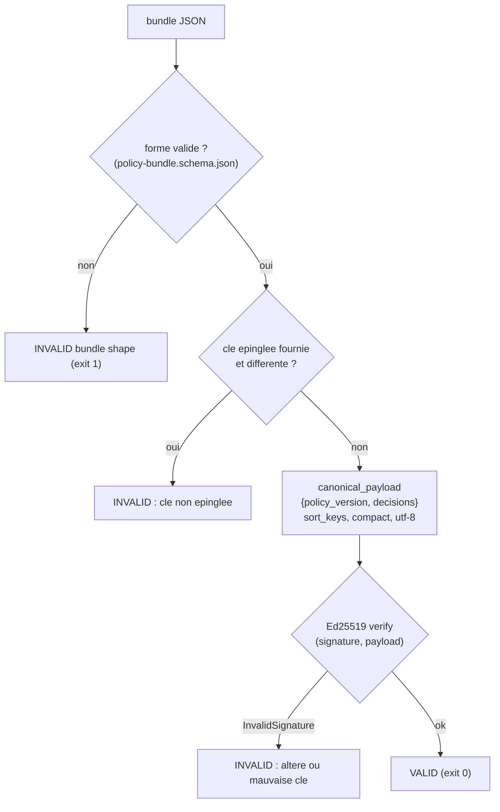
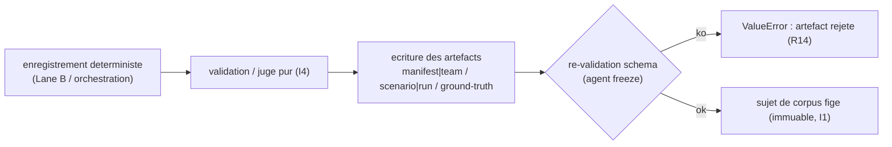

# Bundle, verification d-integrite et freeze -- runbook

> Comment inspect_ia_agents prouve l-integrite d-un policy bundle signe (signature
> Ed25519 sur une charge utile canonique) et comment un run live verifie est
> **fige** (freeze) en sujet de corpus immuable. La verification ne produit jamais
> de bundle de production : elle accepte le valide et rejette tout ce qui a ete
> altere ; le freeze, lui, transforme un enregistrement deterministe en artefact
> ground-truth.

## Pourquoi ce sous-systeme existe

Deux problemes distincts d-integrite, deux outils, un meme principe I1 (immutabilite) :

1. **Bundle signe (entree du control plane).** Le Risk Scoring Engine emet un
   *policy bundle* -- les decisions par agent + la version de policy -- signe en
   Ed25519 **avant** d-atteindre le control plane. inspect_ia_agents doit pouvoir
   verifier qu-un bundle recu n-a pas ete altere et qu-il provient bien de la cle
   attendue. Le code (`recette/bundle.py`) **verifie**, il ne **produit jamais**
   de bundle de production.
2. **Freeze (sortie vers le corpus).** Un run live (Lane B ou orchestration), une
   fois enregistre puis rejoue de maniere deterministe, est **fige** en sujet de
   corpus (manifest/scenario/ground-truth ou team/run/ground-truth). Le freeze
   ecrit un artefact ground-truth schema-valide qui devient la verite immuable
   contre laquelle les outils externes sont juges.

## Partie A -- Le policy bundle et sa verification

### La forme d-un bundle

Schema : `corpus/schemas/policy-bundle.schema.json` (`additionalProperties: false`).
Champs requis :

| Champ | Type | Role |
|-------|------|------|
| `schema_version` | string | version du schema du bundle |
| `policy_version` | string | version de policy sous laquelle les decisions ont ete calculees (pertinent au replay, I4) |
| `decisions` | array (min 1) | une entree `{agent_id, action, decision}` par decision ; `decision` dans `allow` \| `deny` \| `escalate` |
| `public_key` | string | cle publique Ed25519, hex (32 octets -> 64 caracteres hex), `^[0-9a-f]{64}$` |
| `signature` | string | signature Ed25519, hex (64 octets -> 128 caracteres hex), `^[0-9a-f]{128}$` |

Fixture de reference : `corpus/bundles/valid/bundle.json`. Elle est signee avec une
**cle de test documentee** (la graine Ed25519 tout-a-zero, vecteur de test connu)
dont la cle publique est
`3b6a27bcceb6a42d62a3a8d02a6f0d73653215771de243a63ac048a18b59da29` -- elle ne
protege rien et n-est jamais une vraie cle de signature.

### La charge utile canonique (ce que la signature couvre)

`recette/bundle.py::canonical_payload(bundle)` calcule les octets exacts couverts
par la signature : le JSON canonique de `{"policy_version", "decisions"}` avec
`sort_keys=True`, separateurs compacts `(",", ":")`, encode en `utf-8`. Cette
forme est stable d-un run a l-autre (I4) -- c-est ce qui rend une signature
verifiable et reproductible. Ni `public_key` ni `signature` ne font partie de la
charge signee.

### Le flux de verification

`recette/bundle.py::verify_bundle(bundle, *, expected_public_key=None)` -> retourne
un `BundleVerification(valid: bool, reason: str)`. Etapes :

1. Import paresseux du verificateur (`Ed25519PublicKey`, `InvalidSignature`) depuis
   `cryptography` (extra optionnel `[bundle]`). Absent => `RuntimeError` explicite.
2. `public_key` ou `signature` manquant -> `INVALID`, raison `missing public_key or signature`.
3. **Epinglage de cle (key pinning)** : si `expected_public_key` est fourni et que
   la cle du bundle differe -> `INVALID`, raison
   `public key does not match the pinned key`. Sans cet epinglage, une signature
   valide d-une cle inconnue passerait, ce qui annulerait l-interet.
4. Decodage hex de la cle puis de la signature ; hex invalide -> `INVALID`.
5. `public_key.verify(signature, canonical_payload(bundle))` ; `InvalidSignature`
   -> `INVALID`, raison `signature does not match payload (tampered or wrong key)`.
6. Sinon -> `VALID`, raison `signature valid over canonical payload`.

`verify_bundle_file(path, *, expected_public_key=None)` lit le JSON depuis le
disque puis delegue a `verify_bundle`.



### Touchpoint CLI

Commande : `python -m recette bundle-verify <path> [--pubkey <hex>]`
(definie dans `recette/cli/parser.py`, dispatchee par `recette/__main__.py`,
implementee dans `recette/cli/discovery_cmds.py::_cmd_bundle_verify`).

Deroulement de `_cmd_bundle_verify` :

1. Valide d-abord la **forme** contre `corpus/schemas/policy-bundle.schema.json`
   via `jsonschema.Draft202012Validator`. Erreur de forme -> imprime
   `INVALID bundle shape: ...` sur stderr et retourne `1`.
2. Appelle `verify_bundle_file(path, expected_public_key=pubkey)`.
3. Imprime `bundle: <path>` puis `verdict: VALID|INVALID -- <reason>`.
4. Code de sortie : `0` si valide, `1` sinon.

Exemple (cle de test epinglee) :

```
python -m recette bundle-verify corpus/bundles/valid/bundle.json --pubkey 3b6a27bcceb6a42d62a3a8d02a6f0d73653215771de243a63ac048a18b59da29
```

### Entrees / sorties

- **Entree** : un fichier JSON de bundle ; optionnellement une cle publique a
  epingler (`--pubkey`).
- **Sortie** : un verdict texte sur stdout + un code de sortie (0 valide / 1 invalide),
  ou en code un `BundleVerification(valid, reason)`.

### Mode de defaillance (fail-safe)

Toute incertitude est traitee comme un rejet, jamais comme un passage :

- forme invalide, cle/signature manquante, hex invalide, signature qui ne
  correspond pas, cle epinglee qui ne correspond pas -> `INVALID` (exit 1).
- Un attaquant qui re-signe avec sa propre cle produit une signature
  internement valide, mais l-epinglage de cle la rejette
  (`test_substituted_key_and_resign_fails_pinning`).
- `cryptography` absent -> `RuntimeError` explicite (echec bruyant), pas un
  passage silencieux. Le defaut reste fermeture, jamais fail-open.

Couverture (`tests/test_bundle.py`) : valide accepte (avec et sans epinglage) ;
decision modifiee, `policy_version` modifiee, signature fausse, signature
manquante, mauvaise cle epinglee, cle substituee re-signee -> tous rejetes ;
charge canonique deterministe.

## Partie B -- Le freeze (figer un run en sujet de corpus immuable)

Le freeze est la contrepartie d-integrite cote sortie : un enregistrement live
deja **deterministe et rejouable** (voir `docs/runbooks/replay-model.md`) est ecrit
comme sujet de corpus ground-truth. Une fois ecrit, ce sujet est la verite
immuable du banc d-essai (I1) -- on ne le mute pas, on en ajoute un nouveau.

### Freeze d-un agent Lane B

CLI : `python -m recette agent freeze <recording> [--out corpus/agents/correct]`
(`recette/cli/agent_cmds.py::_cmd_agent_freeze` -> `recette/promote.py::freeze_recording`).

`freeze_recording(recording, out_dir, ...)` :

1. Refuse un enregistrement sans actions (`recording has no actions; nothing to
   promote`).
2. Ecrit dans `out_dir/<agent_id>/` trois fichiers : `manifest.json`,
   `scenario.json`, `ground-truth.json` (l-agent fige est suppose **correct** :
   `category: "correct"`, `expected_verdict: "correct"`).
3. Re-valide les trois artefacts contre les schemas du corpus
   (`load_manifest` / `load_scenario` / `load_ground_truth`) -- echec bruyant
   (`ValueError`) plutot que livrer un golden invalide (R14).
4. Retourne le repertoire de l-agent.

### Freeze d-une orchestration

CLI :
`python -m recette orchestrate freeze <recording> --slug <slug> [--out corpus/maf_orchestration/correct] [--category correct|incorrect] [--violation-type <type>]`
(`recette/cli/orchestrate_cmds.py::_cmd_orchestrate_freeze` ->
`recette/orchestrate.py::freeze_to_corpus`).

`freeze_to_corpus(recording, dest_dir, *, slug, category, violation_type=None)` :

1. `category == "incorrect"` sans `violation_type` -> `ValueError`
   (`an incorrect subject requires a violation_type`) : un negatif doit nommer
   l-axe casse (mono-axe, voir `.claude/rules/recette-corpus.md`).
2. Juge le run via `judge_orchestration(team, run)` (fonction pure, I4) et derive
   le ground-truth des 4 dimensions (`identity_match`, `capabilities_conform`,
   `policy_compliant`, `behavior_expected`) + `expected_verdict`.
3. Ecrit dans `dest_dir/<slug>/` : `team.json`, `run.json`, `ground-truth.json`.
4. Retourne le repertoire du sujet.



### Entrees / sorties du freeze

- **Entree** : un fichier d-enregistrement (`*.recording.json` Lane B ou
  `*.orchestration.json`), un repertoire de sortie, et pour l-orchestration le
  `slug` (obligatoire) + `category` + `violation-type`.
- **Sortie** : un repertoire de sujet de corpus contenant les artefacts
  ground-truth ; un message `promoted to Lane A golden: <dir>` ou
  `frozen corpus subject: <dir>` ; code de sortie `2` si une garde echoue
  (orchestration), erreur levee pour l-agent.

## Invariants soutenus

- **I1 (immutabilite)** : la verification de bundle ne mute rien ; le freeze
  ecrit un sujet ground-truth qui devient une verite immuable -- une correction
  passe par un nouvel artefact, pas par une mutation.
- **I4 (replay deterministe)** : la charge canonique du bundle est byte-stable
  (`sort_keys`, separateurs compacts) ; le freeze part d-un enregistrement
  deterministe et le juge d-orchestration est une fonction pure (pas d-horloge,
  pas d-aleatoire).
- **Fail-safe** (cousin des failure modes) : toute alteration ou incertitude
  donne `INVALID` / leve une erreur ; jamais de passage optimiste.

## Dependances et installation

La verification Ed25519 a besoin de l-extra optionnel `[bundle]` (`cryptography`,
declare dans `pyproject.toml`). Le coeur de la recette reste sans dependance
crypto (import paresseux). Pour activer la verification :

```
pip install -e '.[bundle]'
```

## Gates

```
.venv/bin/python -m unittest discover -s tests
make recette
```

`tests/test_bundle.py` saute la classe de signature si `cryptography` n-est pas
installe (`@unittest.skipUnless`) ; la classe forme + charge canonique tourne
toujours.

## Liens connexes

- `recette/bundle.py` -- verification Ed25519 + charge canonique.
- `recette/cli/discovery_cmds.py` (`_cmd_bundle_verify`), `recette/__main__.py`,
  `recette/cli/parser.py` -- la CLI `bundle-verify`.
- `recette/promote.py` (`freeze_recording`), `recette/orchestrate.py`
  (`freeze_to_corpus`), `recette/cli/agent_cmds.py`,
  `recette/cli/orchestrate_cmds.py` -- le freeze.
- `corpus/schemas/policy-bundle.schema.json`, `corpus/bundles/valid/bundle.json`,
  `corpus/bundles/README.md` -- schema + fixture documentee.
- `docs/runbooks/replay-model.md` -- le modele record / replay / freeze unifie.
- `.claude/rules/invariants.md` (I1/I4), `.claude/rules/recette-corpus.md`
  (mono-axe, freeze des sujets).
