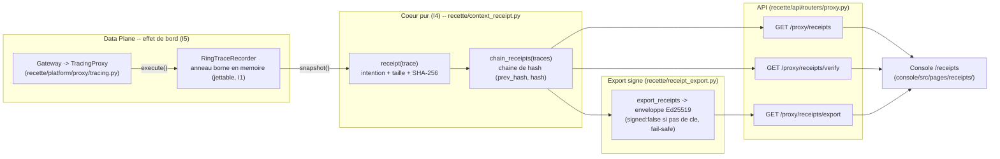

# Recus de contexte (context receipts) -- runbook

> Un **recu de contexte** est la projection SANS CONTENU d'un echange agent <->
> serveur (`ProxyTrace`) : il conserve l'intention (qui, cible, action, ressource,
> issue) et remplace les corps requete/reponse par leur **taille en octets** + leur
> **SHA-256**. Un auditeur (RSSI) peut ainsi prouver CE QUI a franchi la frontiere
> et que c'est inchange, sans que la plateforme journalise ou expose le contenu brut.
>
> Code : `recette/context_receipt.py` (pur, deterministe I4),
> `recette/receipt_export.py` (export signe Ed25519), endpoints dans
> `recette/api/routers/proxy.py`, page console `console/src/pages/receipts/`.

## Pourquoi ca existe

La trace complete d'un effet de bord (`ProxyTrace` dans
`recette/platform/proxy/tracing.py`) porte `request_payload` ET `response` : les
corps reels de l'echange. Pour un audit destine a un RSSI, exposer ces corps est
indesirable. Le recu de contexte est le compromis legibility-first du repo :
l'**intention** reste lisible, le **contenu** est reduit a une preuve verifiable
(taille + empreinte) qui n'expose rien.

Deux proprietes complementaires sont fournies :

- **Sans contenu** : un recu ne contient jamais `request_payload` ni `response`,
  seulement `request_bytes` / `request_sha256` et `response_bytes` /
  `response_sha256` (`receipt()` dans `recette/context_receipt.py`).
- **Integrite de sequence** : les recus sont chaines par hash (`chain_receipts`),
  chaque recu portant `prev_hash` et `hash`. Un verifieur prouve que la SEQUENCE
  n'a pas ete reordonnee, tronquee ni alteree -- sans toucher aux corps. C'est la
  meme posture que l'audit log immuable (I1), appliquee a une vue jettable.

## Du ProxyTrace au recu -- le flux



Chaque `execute()` cote gateway passe par le `TracingProxy`, qui enregistre un
`ProxyTrace` dans un anneau borne (`RingTraceRecorder`). Les endpoints de recus
lisent ce buffer via `snapshot()`, projettent chaque trace en recu et chainent le
tout. Le buffer est jettable -- la verite durable reste l'audit log append-only
(I1) ; les recus sont une vue de lecture.

## Pre-requis : le tracing proxy doit etre actif

L'anneau n'est alimente que si le tracing de debug du proxy est active, via la
variable d'environnement `INSPECT_IA_AGENTS_PROXY_DEBUG`
(`DEBUG_ENV` dans `recette/platform/proxy/tracing.py` ; valeurs vraies : `1`,
`true`, `yes`, `on`). Cablage : `recette/api/app.py` construit
`TracingProxy(base_proxy, trace_recorder, enabled=proxy_debug_enabled)`.
Debug eteint => aucune trace enregistree => les endpoints repondent une liste de
recus vide (et la page console affiche l'etat "Aucun recu").

## Endpoints (prefixe `/proxy`, `recette/api/routers/proxy.py`)

| Methode + chemin | Role | Parametres |
|------------------|------|------------|
| `GET /proxy/receipts` | Recus sans contenu, chaines, dans l'ordre `seq` croissant. | `run_id` (filtre une execution), `tail` (N derniers) -- `run_id` applique avant `tail`. |
| `GET /proxy/receipts/verify` | Recompute la chaine depuis le genesis et signale la premiere rupture. | `run_id` |
| `GET /proxy/receipts/export` | Enveloppe transferable, signee Ed25519 quand une cle est configuree. | `run_id` |

Les trois routes sont en lecture seule et sans contenu (aucun corps n'est jamais
renvoye). Cote client TypeScript : `getContextReceipts`, `verifyContextReceipts`,
`exportContextReceipts` dans `console/src/api/client.ts`.

### Entrees / sorties

- **Entree** : les `ProxyTrace` du buffer (`snapshot()`), eventuellement filtres
  par `run_id` / `tail`.
- **Sortie de `/proxy/receipts`** : `{"receipts": [ContextReceipt, ...]}`. Champs
  d'un `ContextReceipt` (cf. `receipt()` et `console/src/types/platform.ts`) :
  `seq`, `event_id`, `timestamp`, `agent_id`, `target_system`, `target`,
  `action_type`, `resource`, `ok`, `status_code`, `side_effect_hash`, `run_id`,
  `request_bytes`, `request_sha256`, `response_bytes`, `response_sha256`,
  `prev_hash`, `hash`. Un corps vide donne `0` octet et un digest vide `""`.
- **Sortie de `/proxy/receipts/verify`** : `{"ok": bool, "checked": int,
  "first_break_seq": int | null}`.
- **Sortie de `/proxy/receipts/export`** : enveloppe
  `{"schema": "inspect_ia_agents-receipt-export-v1", "count", "chain_head",
  "receipts", "signed"}`. Si signee, elle ajoute `public_key` et `signature` (hex).

## Export signe (recette/receipt_export.py)

L'export englobe les recus chaines dans une enveloppe et signe le payload
canonique avec Ed25519, le meme mecanisme que le bundle de policy
(`recette/bundle.py`). Points cles :

- Le payload signe est le JSON canonique de `{chain_head, receipts}`
  (`canonical_payload`) : trie, compact, utf-8 -- donc deterministe (I4).
- La cle de signature vient de l'environnement, jamais en dur (R8) :
  `SIGNING_KEY_ENV = "INSPECT_IA_AGENTS_RECEIPT_SIGNING_KEY"` (graine 32 octets en
  hex).
- `cryptography` est l'extra optionnel `[bundle]`, importe paresseusement : le
  coeur de la recette garde zero dependance crypto (R20).
- `verify_export(envelope, expected_public_key=...)` verifie la signature hors
  plateforme avec la seule cle publique ; le pinning de cle est optionnel.

Comme les recus sont deja sans contenu, l'export ne transporte aucun corps : il
rend la piste d'audit verifiable par quiconque detient la cle publique.

## Page console

Route `/receipts` (`console/src/App.tsx`), page `console/src/pages/receipts/`.
Elle charge `getContextReceipts()` + `verifyContextReceipts()`, affiche un badge
d'integrite de chaine (`chaine verifiee (N)` ou `chaine rompue @ seq ...`), un
tableau sans contenu (agent, action, cible/ressource, statut, tailles et SHA-256
tronques) et un bouton `Exporter (signe Ed25519)` qui telecharge l'enveloppe
`context-receipts-export.json`. La fixture de contrat (R16) vit dans
`console/src/pages/receipts/__fixtures__/receipts.fixture.json`.

## Mode de defaillance (fail-safe)

- **Pas de cle de signature** : l'export est renvoye NON signe (`signed: false`),
  jamais une fausse signature (`export_receipts`).
- **Extra `[bundle]` absent** : l'enveloppe porte `sign_error` et reste non signee
  (import paresseux protege).
- **Cle invalide** (hex / longueur) : `sign_error` explicite, non signee.
- **Chaine alteree** : `verify_chain` / `verify_export` retournent `ok/valid:
  false` avec la raison ou la `first_break_seq` -- une rupture est rendue bruyante.
- **Debug eteint / buffer vide** : reponse vide, jamais une erreur ouverte.

Aucun chemin ne degrade vers l'exposition d'un corps ni vers une preuve fabriquee.

## Invariants tenus

- **I1 (immutabilite)** : la chaine de hash des recus est une preuve d'integrite
  de sequence (comme l'audit log) ; le buffer est jettable, la verite durable
  reste l'event store append-only.
- **I4 (replay deterministe)** : `receipt`, `chain_receipts`, `canonical_payload`
  sont des fonctions pures (SHA-256 sur du JSON canonique, genesis `prev_hash`
  vide) -- ni horloge, ni aleatoire.
- **I5 (effets de bord mediats)** : les recus ne projettent que des `ProxyTrace`
  produits au bord `ExternalSystemProxy` (`TracingProxy`), jamais un appel direct.

## Verification rapide (live)

Services lances UNIQUEMENT par `./recette.sh` (R19), debug proxy actif.

```
INSPECT_IA_AGENTS_PROXY_DEBUG=1 ./recette.sh platform up
curl -s http://localhost:8090/proxy/receipts | head
curl -s http://localhost:8090/proxy/receipts/verify
curl -s http://localhost:8090/proxy/receipts/export | head
```

Le smoke console couvre la page : `_verify_receipts` dans
`scripts/smoke_console.py` (via `./recette.sh smoke`).

## Gates

```
.venv/bin/python -m unittest discover -s tests
make recette
./recette.sh console-test
./recette.sh console-build
```

Tests dedies : `tests/test_context_receipt.py` (sans contenu, taille/digest
verifiables, determinisme, chaine + detection de falsification, forme de
l'endpoint) et `tests/test_receipt_export.py` (non signe fail-safe sans cle,
aller-retour signature, falsification rejetee, pinning de cle, payload
deterministe).

## Liens connexes

- `docs/runbooks/replay-model.md` -- modele record/replay/freeze (I4).
- `docs/runbooks/private-dns.md` -- autre vue du chemin proxy / `ProxyTrace.target`.
- `.claude/rules/determinism-replay.md` (I4) -- coeur pur teste au replay.
- `.claude/rules/no-hardcoded-secrets.md` (R8) -- la cle de signature vient de l'env.
- `.claude/rules/frontend-contract-gate.md` (R16) -- fixture de la page receipts.
