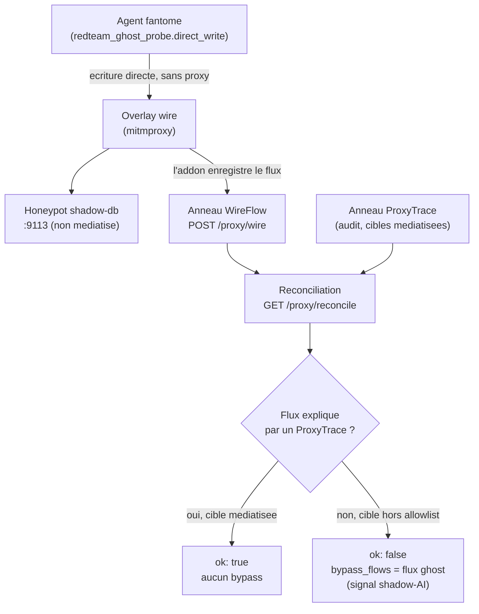

# Recette de detection (adversarial) -- runbook

> La recette de detection prouve qu'un tiers peut REPERER un agent et detecter
> qu'il echappe a la gouvernance, sur deux surfaces complementaires : le
> **reperage statique** de l'outillage d'observabilite dans la source d'un agent
> (`/detect`), et la **detection adversariale** d'une egress fantome qui contourne
> le proxy gouverne, par reconciliation wire-vs-audit (`/proxy/reconcile`).
> Toutes les routes sont des fonctions pures de leurs entrees (I4) et fail-safe :
> elles signalent, elles n'effondrent jamais (pas de 500), et le lab OBSERVE le
> chemin non mediatise -- il ne BLOQUE pas le reseau.

Code source :

- Reperage statique : `recette/api/routers/detect.py`, table
  `corpus/detect/observability-signatures.json`, agregation
  `recette/api/routers/discovery.py`.
- Detection adversariale : `recette/redteam_ghost_probe.py`,
  `recette/platform/proxy/reconcile.py`, routes dans
  `recette/api/routers/proxy.py`, capture eBPF dans
  `recette/api/routers/probe.py`.
- Console : `console/src/pages/detect/`, `console/src/pages/discovery-overview/`,
  `console/src/pages/probe/`.
- Preuve live : `scripts/smoke_reconcile.py`.

---

## 1. Pourquoi ce sous-systeme existe

Principe legibility-first du produit : on ne recette que ce qu'on peut observer.
La detection repond a deux questions qu'un outil tiers doit savoir trancher :

1. **Reperage (discovery, vue source)** -- la source d'un agent declare-t-elle
   un outillage d'observabilite (tracage, passerelle LLM, evaluation, audit,
   replay) ? Un agent qui n'expose ni audit ni replay est non-recettable :
   l'axe de gouvernance (`audit` + `replay`) est mis en avant.
2. **Detection adversariale (vue reseau)** -- un agent fantome ("ghost") qui
   ecrit directement vers une cible SANS passer par l'`ExternalSystemProxy` est
   une violation deliberee de I2/I5. Le banc red-team doit la detecter : un flux
   reseau sans evenement d'audit derriere lui est le signal du shadow-AI.

---

## 2. Reperage statique de l'outillage d'observabilite (`/detect`)

### Ce que c'est

Un detecteur statique : on lui donne le texte d'une source, il rapporte quels
outils d'observabilite agent/LLM elle utilise, en faisant correspondre une table
committee d'identifiants PUBLICS (noms de package, chemins d'import, cles de
variable d'environnement, marqueurs d'appel). La table est la donnee propre de
la recette, chargee depuis un seul fichier committe
`corpus/detect/observability-signatures.json` (config-first R5, surchargeable via
`INSPECT_IA_AGENTS_DETECT_SIGNATURES`).

Chaque entree porte `tool`, `category` (parmi `tracing` / `gateway` / `eval` /
`audit` / `replay`), une liste triee `capabilities` (par defaut `[category]`
quand la source l'omet) et une liste `needles` (les indices litteraux).

### Algorithme (verbatim de `_detect`)

Pour chaque signature dans l'ORDRE DU FICHIER, le premier `needle` qui est une
sous-chaine du texte declenche l'outil (une seule correspondance par outil) ;
les correspondances sont ensuite triees par nom d'outil croissant. Cet
algorithme AGREE octet pour octet avec le detecteur de reference Rust
(`discoveryprobe/discoveryprobe-detect`). Determinisme (I4) : aucune horloge,
aucun aleatoire ; le meme texte produit le meme rapport.

### Endpoints

| Verbe | Route | Corps | Retourne |
|-------|-------|-------|----------|
| GET | `/detect/signatures` | -- | `{tools: [{tool, category, capabilities[], needles[]}], categories: [triees]}` |
| POST | `/detect/scan` | `{text: str}` | `{matches: [{tool, category, matched}]}` |

Les deux reponses sont brutes (pas d'enveloppe `{success, data}`) : le client
console retourne le JSON parse directement.

### Vue d'ensemble (`/discovery/overview`)

`GET /discovery/overview` agrege les deux surfaces de discovery en une projection
pure (I4) : le catalogue declaratif (`_load_catalog`) et la table de signatures
(`_load_signatures`). Il retourne
`{catalog: {total, with_tools, tags}, detect: {tools, by_category, by_capability}}`.
`by_capability` fait remonter `audit` et `replay` -- l'axe de gouvernance -- meme
quand ils ne sont jamais une categorie primaire. Les cles sont triees pour un
resultat stable.

### Console

- Page **Reperage** -- route `/detect`
  (`console/src/pages/detect/index.tsx`) : au chargement, `GET /detect/signatures`
  liste le catalogue par categorie ; une zone de saisie POST `text` vers
  `/detect/scan` et affiche les correspondances (outil + badge categorie + le
  `needle` correspondant comme preuve). Etat vide explicite : "aucun outil
  detecte".
- Page **Discovery** (vue d'ensemble) -- route `/discovery-overview`
  (`console/src/pages/discovery-overview/index.tsx`) : tuiles catalogue +
  reperage, avec une puce "gouvernance" sur `audit` et `replay`.

### CLI associee (cote source des repos publies)

La recette discovery sur les vrais repos passe par
`python -m recette discovery --adapter reference|http [--surface ...]`
(`recette/cli/discovery_cmds.py`, `_cmd_discovery`) ; `GET /discovery/check`
expose le meme resultat a la console.

---

## 3. Detection adversariale : la sonde fantome et la reconciliation

### La sonde fantome (`recette/redteam_ghost_probe.py`)

C'est une sonde de banc red-team, PAS un chemin de production. Elle modelise un
agent non enregistre qui ecrit directement vers une cible (le honeypot
shadow-db) sans passer par l'`ExternalSystemProxy` -- la violation I2/I5 que le
banc doit detecter. La construction de la requete est pure et testee
(`build_probe_request`), l'envoi reel est separe (`direct_write`).

Garde fail-safe : `build_probe_request` rejette tout schema autre que
`http`/`https` (un `sink_url` mal configure ne peut pas devenir une ecriture de
fichier local). `direct_write` route via le proxy wire quand `proxy_url` est
fourni, et retourne le code d'erreur (ou `0`) au lieu de lever -- la sonde ne
crashe pas le smoke, la DETECTION est l'assertion. L'en-tete de run par defaut
est `x-inspect-run-id` (`DEFAULT_RUN_HEADER`).

### La reconciliation wire-vs-audit (`recette/platform/proxy/reconcile.py`)

Un run legitime ne parle qu'a des cibles MEDIATISEES (le lab, les serveurs
`mock_local`, les backends LLM configures). Tout flux reseau dont la cible
(`host:port`) sort de cette allowlist est un chemin non mediatise -- le signal
du ghost. `build_allowlist` construit l'allowlist ; un honeypot (tout `mode`
different de `mock_local`) en est deliberement exclu, donc un flux vers lui est
toujours un bypass.

Trois niveaux de jointure, tous purs et deterministes (I4) :

- `reconcile(wire_flows, allowlist)` -- signale tout flux hors allowlist ; un
  hote vide est traite comme SUSPECT (jamais autorise silencieusement,
  classification deny-by-default). Sortie ordonnee par `seq`.
- `reconcile_run(wire_flows, proxy_traces, allowlist)` -- jointure wire<->audit
  par run (etape 4 du scenario ghost-direct-db) ; ajoute `audited_run_ids` (les
  runs ayant produit un `ProxyTrace` mediatise).
- `reconcile_strict(...)` -- jointure phase 3 par `side_effect_hash` recalcule
  par flux : attrape aussi un ghost qui frappe une cible ALLOWLISTEE en direct.
  Chaque bypass porte un `bypass_reason` : `non_mediated_target` ou
  `no_audit_event`.

Le rapport `ReconcileReport` expose `{ok, bypass_flows, audited_run_ids}`. `ok`
est vrai si et seulement si aucun flux n'est tombe hors allowlist.

### Endpoints (`recette/api/routers/proxy.py`)

| Verbe | Route | Parametres | Role |
|-------|-------|-----------|------|
| GET | `/proxy/reconcile` | `run_id?`, `strict?` | Rapport `{run_id, strict, ok, bypass_flows, audited_run_ids}` |
| GET | `/proxy/reconcile/status` | `run_id?`, `strict?` | Statut synthetique |
| GET | `/proxy/discovery-exchange` | `run_id?`, `strict=true` | Verdict de discovery superpose a l'echange reel (hook + wire), ghosts dans `scorecard.false_negatives` |

Le lab OBSERVE le chemin non mediatise ; il ne BLOQUE pas. La levee d'un bypass
comme evenement compensatoire (immuabilite I1) passe par
`POST /proxy/reconcile/raise`.

### Capture eBPF de reference (`/probe`)

La surface eBPF est servie separement par
`recette/api/routers/probe.py` :

- `GET /probe/status` -> `{configured, socket_env, mode}` ; `mode` vaut `replay`
  (broker non privilegie, rejeu deterministe du corpus `corpus/surface`) ou
  `live` (broker eBPF privilegie, CAP_BPF). Le statut est expose pour que la
  console ne presente jamais un replay comme une capture live (R13/R14).
- `POST /probe/capture` avec `{agents: [ids], duration_ms: <int>}` -> relaie une
  capture bornee au broker et la score. Validation : liste d'agents non vide,
  `duration_ms` entier positif sous le plafond (`INSPECT_IA_AGENTS_PROBE_*`).
  Retourne `{recording, scorecard}` (scorecard seulement si `status == "ok"`).

La page console **Probe eBPF** (route `/probe`,
`console/src/pages/probe/index.tsx`) montre, par agent et par surface
d'observation (`hook_subprocess`, `hook_mcp`, `hook_sdk`, `ebpf_wire`), ce que la
sonde a VU. Un agent vu nulle part est un faux negatif affiche en rouge : l'echec
de la these "si l'outil ne voit pas les agents, c'est un echec". Le scorecard
`DetectionScorecard` (`recette/surface/scorecard.py`) porte `ok`, `total_agents`
et `false_negatives`.

### CLI

`python -m recette surface [--recording <fichier.json>]`
(`recette/cli/discovery_cmds.py`, `_cmd_surface`) execute la recette de detection
par surface et imprime le scorecard ; sortie 1 si un agent est detecte sur aucune
surface. Avec `--recording`, il score une capture du broker discoveryprobe figee
en JSON via le MEME juge.

---

## 4. Flux de la detection adversariale



---

## 5. Entrees / sorties

| Surface | Entree | Sortie |
|---------|--------|--------|
| Reperage | `text` (source) + table de signatures | `matches[]` (tool, category, matched) |
| Vue d'ensemble | catalogue + table de signatures | `{catalog, detect}` (compteurs tries) |
| Reconciliation | snapshots des anneaux WireFlow + ProxyTrace + allowlist | `{ok, bypass_flows, audited_run_ids}` |
| Capture eBPF | `{agents, duration_ms}` | `{recording, scorecard}` |

---

## 6. Mode de defaillance (fail-safe)

- `/detect/signatures` et `/detect/scan` : un fichier de signatures absent,
  illisible ou mal forme produit un catalogue VIDE (aucun outil, aucune
  correspondance) avec un avertissement journalise -- jamais un 500.
- `/discovery/overview` : sources vides ou absentes -> tous les compteurs a zero.
- `reconcile*` : un hote vide ou inclassable est SIGNALE (suspect), jamais
  autorise silencieusement (deny-by-default).
- `direct_write` : une erreur de connexion/HTTP retourne son code (ou `0`) au
  lieu de lever ; un schema non `http(s)` est rejete a la construction.
- `/probe/capture` : broker non configure -> 503 explicite ; entree invalide ->
  400 ; le deny-by-default vit dans le broker.
- `scripts/smoke_reconcile.py` : sans Docker ou avec l'API a l'arret, il SKIPPE
  avec une raison au lieu d'echouer ; la regression deterministe vit dans la
  suite unittest.

Conformement a la politique du systeme : le lab OBSERVE le chemin non mediatise,
il ne l'ENFORCE pas (pas de blocage reseau ici) -- la mediation reste le role du
proxy gouverne.

---

## 7. Invariants tenus

- **I1 Immutabilite** -- la levee d'un bypass est un evenement compensatoire
  (`POST /proxy/reconcile/raise`), jamais une mutation de l'historique.
- **I2 Mediation Control Plane** -- la sonde fantome modelise precisement le
  chemin qui CONTOURNE la Gateway/le proxy ; la reconciliation est ce qui le
  rend visible.
- **I4 Replay deterministe** -- toutes les routes de detection sont des fonctions
  pures de leurs entrees (table triee, jointures ordonnees par `seq`, aucune
  horloge ni aleatoire) ; le mode `replay` de la sonde rejoue le corpus
  `corpus/surface` octet pour octet.
- **I5 Side-effects mediats** -- la detection s'appuie sur le fait que seul le
  proxy produit un `ProxyTrace` ; un effet de bord sans trace est, par
  definition, un bypass.

---

## 8. Operer la recette

```
python -m recette discovery --adapter reference
python -m recette surface
./recette.sh platform up
python scripts/smoke_reconcile.py
```

- `recette discovery` : recette de reperage sur les repos publies (offline,
  oracle de reference).
- `recette surface` : recette de detection par surface (faux negatif = echec).
- `smoke_reconcile.py` : preuve live de bout en bout du scenario ghost-direct-db
  (necessite Docker + API gouvernee via `./recette.sh platform up` -- R19 :
  unique lanceur, ports fixes).

Cote console, ouvrir `/detect` (reperage), `/discovery-overview` (vue
d'ensemble) et `/probe` (capture eBPF) une fois la plateforme demarree.
