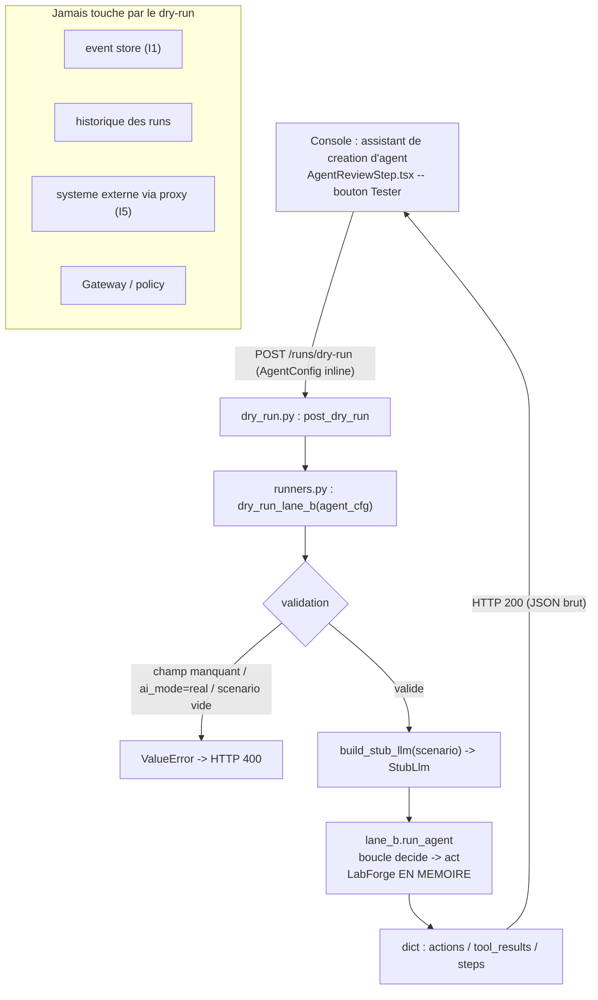

# Dry-run d'action gouvernee -- runbook

> Apercu pre-creation d'un agent : on rejoue le scenario mock d'un agent
> EN MEMOIRE pour voir le journal d'actions qu'il PRODUIRAIT, sans rien
> persister, sans toucher de systeme externe, et de maniere deterministe.
>
> Code : endpoint `recette/api/routers/dry_run.py`, logique
> `recette/api/runners.py` (`dry_run_lane_b`), boucle d'agent
> `recette/lane_b.py` (`run_agent`), page console
> `console/src/pages/agents/AgentReviewStep.tsx`.

## Ce que c'est, et pourquoi

Le dry-run est un apercu (preview) destine a l'assistant de creation d'agent de
la console. Avant de sauver un agent, l'operateur veut savoir ce que l'agent
ferait reellement a partir de son `scenario` declare. Le dry-run repond a cette
question : il execute le scenario mock de l'agent et renvoie le journal d'actions
qu'il produirait, le tout SANS effet de bord et SANS persistance.

La config de l'agent est envoyee inline dans le corps de la requete -- elle n'a
PAS besoin d'etre deja sauvee. C'est un coup d'essai jetable : rien n'est ecrit
dans l'event store ni dans l'historique des runs.

Cle de lecture : c'est ce que l'agent DECIDE / FERAIT, lisible avant de
l'enregistrer (legibility-first). Le scenario mock est rejoue, pas un vrai LLM
ni un vrai serveur.

## Difference avec `/actions/execute`

`/actions/execute` (`recette/api/routers/actions.py`) est la face API de la
Gateway : il soumet une action a la Gateway, capture l'horloge murale une fois a
la frontiere (`_capture_timestamp`), evalue la policy (allow/deny/escalate),
mediatise l'effet de bord, ajoute l'evenement gouverne a l'event store
append-only et le publie. Une action en `escalate` repond `202` et bloque sur
approbation (I6).

`/runs/dry-run` ne fait RIEN de tout cela. Il n'evalue pas de policy, n'appelle
pas la Gateway, n'ecrit aucun evenement, ne touche aucun systeme externe. Il
construit un `StubLlm` a partir du `scenario` et fait tourner la boucle Lane B
sur un `LabForge` en memoire. C'est un apercu pur, pas une execution gouvernee.

## Flux de controle



## Points de contact concrets

### Endpoint HTTP

- `POST /runs/dry-run` -- prefixe `/runs` (`router = APIRouter(prefix="/runs")`
  dans `recette/api/routers/dry_run.py`), enregistre dans l'app via
  `app.include_router(dry_run_router.router)` (`recette/api/app.py`).
- Corps : la `AgentConfig` inline (un objet JSON).
- Reponse : JSON brut (pas d'enveloppe `{success, data}`).
- `400` sur entree invalide : champs manquants, agent real-AI, ou scenario vide
  (le `ValueError` de `dry_run_lane_b` est remappe en `HTTPException(400)`).

### Console

- Page Agents (`/agents`, route declaree dans `console/src/App.tsx` :
  `<Route path="/agents" element={<AgentsPage />} />`).
- Etape de revue de l'assistant : `AgentReviewStep.tsx`. Le bouton
  `Tester (dry-run, mock, sans sauver)` appelle `handleDryRun`, qui invoque
  `dryRunAgent(preview.config)` (`console/src/api/client.ts`,
  `request<DryRunResult>("/runs/dry-run", { method: "POST", ... })`).
- Le resultat affiche le nombre d'actions jouees et rappelle que rien n'a ete
  sauve ni execute en reel (testids `agents-dryrun-result`,
  `agents-dryrun-actions`).

### Pas de CLI dediee

Le dry-run est un point d'API piloté par la console ; il n'a pas de
sous-commande `python -m recette ...`. Pour le tester en ligne de commande on
appelle l'endpoint directement (voir Preuve live ci-dessous).

## Entrees / sorties

Entree (`agent_cfg`, valide par `dry_run_lane_b`) -- champs requis :

- `principal`, `target_system`, `goal`, `capability_scope` (tous obligatoires ;
  sinon `ValueError: agent missing [...]`).
- `ai_mode` doit etre mock : `ai_mode == "real"` est refuse
  (`dry-run is mock-only (a real-AI agent would call a live provider)`).
- `scenario` : liste de decisions non vide (sinon
  `dry-run needs a mock scenario`). Chaque entree porte `kind`
  (`tool_call` / `final`), `tool_name`, `tool_args`, `text` -- convertie en
  `LlmDecision` par `build_stub_llm`.
- `id` optionnel (defaut `"dry-run"`) ; `memory` optionnel (fenetre de memoire
  bornee via `_memory_window`).

Sortie (dict renvoye par `dry_run_lane_b`) :

- `actions` -- le journal d'actions ordonne (`AgentAction.to_dict()` par action
  executee). Dans le type console `DryRunResult`
  (`console/src/types/platform.ts`) chaque action expose au moins
  `action_type`, `target_system`, `resource`.
- `tool_results` -- le texte de resultat d'outil renvoye au modele par action,
  dans l'ordre (auditable : legibility-first).
- `steps` -- les etapes enregistrees (`recording.to_dict()["steps"]`), incluant
  les `tool_call` ET l'eventuelle decision `final`.

Note : le `scenario` declare peut contenir une etape `final`, donc `steps` est
generalement plus long que `actions` (seuls les `tool_call` produisent une
action).

## Determinisme et invariants

- I1 -- Immutabilite : le dry-run n'ecrit RIEN. Ni event store, ni recording, ni
  run record (`persisting nothing`).
- I4 -- Replay deterministe : `StubLlm` rejoue les decisions du scenario dans
  l'ordre et la boucle utilise une horloge logique ; pas d'horloge murale, pas
  d'aleatoire. Le test `test_is_deterministic`
  (`tests/test_api_dry_run.py`) asserte que deux dry-runs sont byte-identiques.
- I5 -- Side-effects mediats : aucun systeme externe n'est touche. Le `LabForge`
  par defaut de `run_agent` (`forge = forge or LabForge()`) est en memoire ;
  aucun proxy reseau n'est construit.

## Mode de defaillance (fail-safe)

Le dry-run refuse plutot que d'agir a l'aveugle :

- Champs requis absents -> `400` (`agent missing [...]`).
- Agent real-AI (`ai_mode == "real"`) -> `400` : un dry-run n'appelle JAMAIS un
  provider live ni ne consomme une cle API.
- Scenario vide ou absent -> `400` (`dry-run needs a mock scenario`).

Toute entree douteuse est rejetee ; aucune execution partielle, aucune ecriture.
Comme rien n'est persiste ni envoye sur le reseau, un dry-run rate ne laisse
aucun etat residuel.

## Preuve live (R14)

Avec la plateforme demarree (`./recette.sh platform up`, API sur `:8090`) :

```
curl -s -X POST http://localhost:8090/runs/dry-run -H 'content-type: application/json' -d '{"id":"dry-bot","principal":"bot@acme","target_system":"github","goal":"read then open","capability_scope":["read_repo","open_pr"],"ai_mode":"mock","scenario":[{"kind":"tool_call","tool_name":"read_repo","tool_args":{"resource":"acme/x"}},{"kind":"tool_call","tool_name":"open_pr","tool_args":{"resource":"acme/x"}},{"kind":"final","text":"done"}]}'
```

Attendu : `actions` = deux entrees (`read_repo`, `open_pr`), `steps` = trois
(deux tool calls + final). Un meme appel rejoue le meme corps renvoie le meme
JSON (I4). Un corps avec `"ai_mode":"real"` renvoie `400`.

## Gates

```
.venv/bin/python -m unittest discover -s tests
make recette
./recette.sh console-test
./recette.sh console-build
```

Test dedie : `tests/test_api_dry_run.py` (fonction `dry_run_lane_b` +
route `POST /runs/dry-run` via `TestClient`).

## Liens connexes

- `docs/runbooks/replay-model.md` -- le pattern record / replay / freeze ; le
  dry-run est l'apercu mock jetable en amont de ce pattern.
- `.claude/rules/determinism-replay.md` (I4) -- `StubLlm` + horloge logique.
- `.claude/rules/invariants.md` -- I1 (immutabilite), I5 (side-effects mediats).
- `.claude/rules/frontend-contract-gate.md` (R16) -- contrat de la console
  (`DryRunResult`, fixtures capturees en live).
