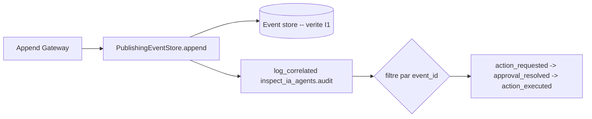

# Journalisation de correlation forensique (G6, R6)

> Chaque evenement gouverne emet un enregistrement de log structure indexe par
> `event_id` et `agent_id`, de sorte qu'un auditeur reconstruit le flux complet
> d'une action a partir des seuls logs. Cela complete l'event store append-only
> (la source de verite, I1) : le store est l'enregistrement durable, les logs
> correles sont la vue forensique operationnelle.

## Ce que cela apporte

Filtrez les logs sur un seul `event_id` et vous obtenez tout le cycle de vie de
l'action ; une resolution d'approbation renvoie en arriere via
`correlates_event_id`.



## Champs (les cles de jointure forensique)

`event_id` (primaire), `agent_id`, `correlates_event_id` (relie une resolution a
son action), `kind`, `verdict`, `target_system`, `action_type`. Seuls ceux-ci
sont promus sur l'enregistrement de log ; tout le reste demeure dans le message
humain. Aucun d'eux n'ajoute de non-determinisme au chemin de decision (I4) --
ils sont lus depuis l'evenement qui existe deja.

## Format de sortie (R5 -- pilote par l'environnement)

| `INSPECT_IA_AGENTS_LOG_FORMAT` | Sortie |
|------------------------|--------|
| `json` | un objet JSON par ligne (ingestion forensique) |
| toute autre valeur (defaut) | texte humain |

`INSPECT_IA_AGENTS_LOG_LEVEL` definit le niveau (defaut INFO). Appelez
`configure_observability_from_env()` une fois au demarrage du processus
(idempotent -- il remplace l'ensemble des handlers, n'empile jamais de doublons).

## Exemple concret (un vrai flux escalate -> approve -> execute)

```
{"agent_id":"agent-admin","event_id":"EV...001","kind":"action_requested","level":"INFO","verdict":"escalate"}
{"agent_id":"agent-admin","correlates_event_id":"EV...001","event_id":"EV...002","kind":"approval_resolved"}
{"agent_id":"agent-admin","correlates_event_id":"EV...001","event_id":"EV...003","kind":"action_executed","verdict":"escalate"}
```

Interroger `event_id == EV...001 OR correlates_event_id == EV...001` renvoie les
trois enregistrements dans l'ordre : la demande, son approbation, l'execution.

## Ou cela est branche

`PublishingEventStore.append` (l'entonnoir d'append du chemin API) emet un
enregistrement correle par evenement gouverne avant de le diffuser au transport
temps reel (G4). Parce que la gateway fait passer chaque issue (executed /
denied / requested / resolved / error) par le store, chaque evenement gouverne
est journalise avec ses cles de correlation.

## Tests

`tests/test_observability.py` -- promotion des champs, suppression des champs
None/inconnus, reconstruction du flux par event_id, validite du formateur JSON,
configuration par l'environnement (json/text/level/idempotent), et l'emission
branchee de `PublishingEventStore`. La correlation de bout en bout
escalate->approve->execute a ete verifiee en live a travers la gateway API.

## Etat ops associe (perimetre G6)

- CI : `.github/workflows/recette.yml` execute deja les gates strictes (ruff +
  ruff format + mypy + bandit) et la suite de tests complete comme etapes
  bloquantes sur chaque push vers main ET chaque pull request -- une CI rouge
  bloque un merge.
- OTel : `recette/otel.py` exporte un run d'orchestration sous forme de spans
  GenAI pour n'importe quel backend OTel (une vue separee, au niveau du run).

## Residuel

- Gestionnaire de secrets : le `BackendSecretStore` par backend plus
  l'environnement (R8) couvrent les credentials aujourd'hui ; une couture pour un
  gestionnaire de secrets externe enfichable pour les proxies est l'element G6
  restant.
