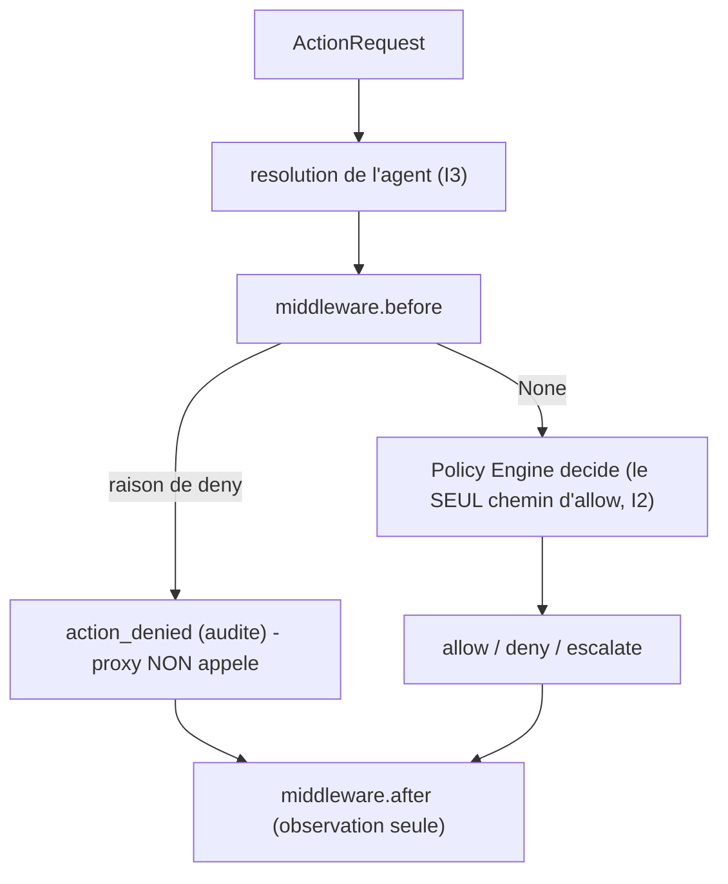

# Runbook -- pipeline de middleware de la gateway (I2)

Un patron de reference (le `_middleware.py` d'agent-framework) adapte a la
discipline de plan Control d'inspect_ia_agents. Un middleware enveloppe la
soumission a la gateway avec deux hooks ; il peut **observer** chaque soumission
et peut forcer un **deny**, mais il ne peut **jamais accorder** -- seul le Policy
Engine produit un allow (I2 preserve).

## Contrat (`recette/platform/middleware.py`)

```python
class Middleware(Protocol):
    def before(self, request) -> str | None: ...   # deny reason, or None to continue
    def after(self, request, outcome) -> None: ...  # observe-only
```

- `before` renvoie une raison de deny -> l'action est refusee et auditee (le proxy
  n'est jamais appele), exactement comme un deny de policy.
- Un `before` qui **leve une exception** -> deny (fail-safe, jamais fail-open).
- `after` observe l'outcome produit ; une exception a ce niveau est avalee afin que
  l'observation ne puisse jamais changer un outcome.
- Les middlewares doivent etre **deterministes** (pas d'horloge/random) pour
  preserver le replay (I4).

## Cablage (additif, comportement par defaut inchange)

```python
from recette.platform.middleware import MiddlewarePipeline, RecordingMiddleware, DenyListMiddleware

gateway = Gateway(
    catalog=..., policy_store=..., event_store=..., proxy=...,
    id_generator=..., agent_resolver=...,
    middleware=MiddlewarePipeline([RecordingMiddleware(), DenyListMiddleware(["legacy_system"])]),
)
```

Une Gateway construite sans `middleware=` se comporte exactement comme avant.



## Middlewares fournis

- `RecordingMiddleware` -- observabilite : enregistre `(agent, target, action)` avant
  et `(action, verdict)` apres.
- `DenyListMiddleware(targets)` -- un garde fail-safe qui refuse toute soumission
  vers un `target_system` liste avant l'evaluation de policy.
