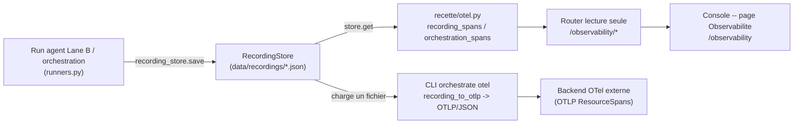

# Observabilite -- OTel GenAI, traces et spans (runbook)

> L'Observabilite rend un run d'agent **lisible** : elle projette un enregistrement
> (recording) persiste en un arbre de spans OpenTelemetry GenAI -- une invocation
> d'agent racine, un span d'execution d'outil par action -- afin qu'un tiers qui n'a
> pas ecrit l'agent comprenne, depuis la trace seule, ce que l'agent a demande, sur
> quel systeme, avec quelle identite et sous quel etat d'approbation.
>
> Code : builder de spans `recette/otel.py` (pur, deterministe), router lecture seule
> `recette/api/routers/observability.py`, page console `console/src/pages/observability/index.tsx`,
> commande CLI `recette/cli/orchestrate_cmds.py` (`_cmd_orchestrate_otel`).

## Pourquoi ce sous-systeme existe

Le log d'audit est plat. Pour la recette legibility-first, l'operateur a besoin de
voir un run comme une **hierarchie** : qui a invoque quoi, dans quel ordre, et ce
que chaque appel d'outil a reellement fait. `recette/otel.py` mappe les
enregistrements internes vers les conventions semantiques **OpenTelemetry GenAI**
(operations `invoke_agent` / `execute_tool`, attributs `gen_ai.provider.name`,
`gen_ai.request.model`, `gen_ai.agent.name`, `gen_ai.tool.name`), reprises de
`microsoft/agent-framework`. Resultat : l'audit inspect_ia_agents interopere avec
n'importe quel backend OTel, et la console affiche un arbre de spans natif.

Le module est **sans dependance** et **deterministe par construction** (I4) : les
identifiants `trace_id` / `span_id` derivent d'un digest stable
(`hashlib.blake2b`) du run, et les timestamps sont **logiques** (une base fixe plus
un pas par span, `_STEP_NANO = 1_000_000`, soit 1 ms logique), jamais l'horloge
murale. Le meme enregistrement exporte donc des spans byte-identiques. L'export est
une **vue derivee, jamais une mutation** (I1) : les enregistrements sont lus, pas
modifies.

## Le flux de donnees



1. Un run d'agent (Lane B ou orchestration) persiste un enregistrement via
   `recording_store.save(rec_id, result.recording)` (`recette/api/runners.py`).
2. Les enregistrements vivent dans `RecordingStore` (`recette/api/campaign_store.py`),
   par defaut sous `data/recordings/` (override par `INSPECT_IA_AGENTS_RECORDINGS_DIR`).
3. Le router lit le store (`request.app.state.recording_store`), reconstruit les
   spans avec `recording_spans(recording, recording_id)` et les sert en JSON plat.
4. La console liste les traces puis affiche l'arbre selectionne. Le CLI, lui,
   exporte un enregistrement d'orchestration en OTLP/JSON pour un backend externe.

## Les builders de spans (`recette/otel.py`)

Chaque builder produit une liste de `GenAiSpan` (`name`, `span_id`,
`parent_span_id`, `trace_id`, `start_nano`, `end_nano`, `attributes`). Tous
emettent un span racine `invoke_agent {agent}` puis des spans enfants.

| Fonction | Source | Spans produits |
|----------|--------|----------------|
| `recording_spans(recording, seed)` | un recording Lane B | racine `invoke_agent`, puis un `execute_tool` par etape avec une action (une reponse finale sans tool-call ne produit pas de span) |
| `orchestration_spans(team, run)` | un run d'orchestration | racine `invoke_agent` (l'equipe), un `invoke_agent` par participant route (hops + ordre), un `execute_tool` par appel d'outil |
| `action_log_spans(action_log)` | un action-log canonique (git/MAF) | racine `invoke_agent`, un `execute_tool` par action enregistree |
| `capture_spans(traces, seed)` | les traces LLM capturees d'un run | spans `execute_tool` **riches en tokens** : `gen_ai.usage.input_tokens` / `output_tokens` et `inspect_ia_agents.cost_usd` quand une table de prix les a chiffres ; duree = `latency_ms` capture |

Attributs portes par les spans d'outil (au-dela des attributs GenAI standards) :
les champs canoniques `AgentActionEvent` sans equivalent GenAI sortent en
`inspect_ia_agents.*` -- `inspect_ia_agents.target_system`,
`inspect_ia_agents.principal` (I3), `inspect_ia_agents.mode` (read/write),
`inspect_ia_agents.resource`, `inspect_ia_agents.approved` (I6, `0`/`1`).

Le rendu de sortie :

- `span_to_dict(span)` -- vue JSON plate pour la console (avec `duration_nano`
  precalcule ; `parent_span_id` permet de reconstruire l'arbre cote viewer).
- `to_otlp(spans, service_name="inspect_ia_agents-recette")` -- document
  **OTLP/JSON `resourceSpans`** consommable par tout backend OTel ; chaque attribut
  est encode via `_attr_value` (`boolValue` / `intValue` / `stringValue`).
- `recording_to_otlp(recording_path)` -- charge un recording d'orchestration et
  rend son OTLP GenAI (utilise par le CLI).

## Points de contact concrets

### Endpoints HTTP (lecture seule, prefixe `/observability`)

| Verbe | Route | Retourne |
|------|-------|---------|
| GET | `/observability/traces` | une ligne par recording : `trace_id`, `recording_id`, `agent_id`, `target_system`, `provider`, `span_count` |
| GET | `/observability/traces/{trace_id}` | `{trace_id, recording_id, spans: [...]}` -- l'arbre complet (spans plats relies par `parent_span_id`) |
| GET | `/observability/spans/{span_id}` | un span unique recherche dans tous les recordings ; `404` si absent |

`span_count` est compte en rendant reellement l'arbre (les enregistrements sont
petits et le build est pur, I4) : une reponse finale sans appel d'outil ne compte
pas de span. Une `trace_id` inconnue renvoie `404` (`no trace ...`).

### CLI

Exporter un enregistrement d'orchestration en OTLP GenAI :

```
python -m recette orchestrate otel <chemin/recording.json>
python -m recette orchestrate otel <chemin/recording.json> --out spans.otlp.json
```

Sans `--out`, l'OTLP/JSON est imprime sur stdout ; avec `--out`, il est ecrit dans
le fichier et le nombre de spans est affiche (`wrote N GenAI spans (OTLP): ...`).

### Page console

Route `/observability` (montee dans `console/src/App.tsx`, lien de navigation
"Observabilite"). La page liste les traces (une par recording, filtrable par agent,
systeme ou recording), et a la selection affiche l'arbre de spans avec, par appel
d'outil : l'action (tool), le systeme cible, la ressource, le mode d'acces, le
principal et l'etat d'approbation. Un en-tete recapitule le nombre d'actions,
d'ecritures, d'actions non approuvees, et les systemes cibles. Les attributs bruts
d'un span sont depliables ligne a ligne.

## Correlation par event_id / agent_id

Tous les builders **graînent** le `trace_id` sur l'identite du sujet
(`_trace_id(seed)`), et chaque `span_id` derive de `(seed, index)` -- donc un meme
agent / recording produit toujours les memes ids. Les spans portent `agent_id`
(`gen_ai.agent.id`) et le `gen_ai.tool.call.id` est l'identifiant de l'action
(`seq` de l'action). La page console le note : le **payload requete/reponse** de
chaque outil n'est pas dans le span -- il vit dans le **log reseau du cockpit**,
correle par l'event id de l'action. Les deux surfaces se relient ainsi par
identite + seq.

## Entrees / sorties

- **Entree** : un enregistrement persiste (`RecordingStore`,
  `data/recordings/*.json`), ou -- pour le CLI -- un fichier de recording
  d'orchestration ; pour `capture_spans`, les dicts `LlmCallTrace.to_dict(pricing)`.
- **Sortie** : soit des dicts de spans plats (console, via `span_to_dict`), soit un
  document OTLP/JSON `resourceSpans` (CLI / backend externe, via `to_otlp`).

## Mode de defaillance (fail-safe)

L'Observabilite est **purement en lecture** : elle n'execute, ne decide et ne mute
rien. En consequence il n'y a pas de chemin fail-open a proteger -- l'echec est
borne et explicite :

- une `trace_id` ou un `span_id` introuvable renvoie `404` (jamais une trace
  fabriquee) ;
- s'il n'y a aucun enregistrement, `/observability/traces` renvoie une liste vide et
  la console affiche "Aucune trace pour l'instant" (avec un lien vers le cockpit) ;
- une etape sans appel d'outil ne genere simplement pas de span (pas d'invention de
  donnee, R4).

Aucune valeur de decision n'est lue ici : la duree d'un span est logique (ou la
`latency_ms` capturee, une valeur operationnelle), jamais l'horloge murale.

## Invariants respectes

- **I1 Immutabilite** : l'export/la projection est une vue derivee read-only des
  enregistrements -- aucune mutation du log.
- **I3 Liaison d'identite** : chaque span d'outil porte le `principal`
  (`inspect_ia_agents.principal`) et l'`agent_id` lie ; rien d'anonyme.
- **I4 Replay deterministe** : ids derives d'un digest stable, timestamps logiques,
  ordre d'iteration stable -> meme run = spans byte-identiques. Le build est une
  fonction pure (pas d'horloge, pas d'aleatoire, pas d'I/O dans la decision).
- **I6 Blocage sur approbation** : l'etat d'approbation des actions sous garde
  (`inspect_ia_agents.approved`) est surface tel quel ; la console met en evidence
  les actions non approuvees.

## Liens connexes

- `docs/runbooks/replay-model.md` -- d'ou viennent les enregistrements (record /
  replay / freeze) que l'Observabilite projette.
- `.claude/rules/canonical-event-model.md` -- les champs `AgentActionEvent`
  (`target_system`, `principal`, `mode`, `resource`, `approved`) portes en
  attributs `inspect_ia_agents.*`.
- `.claude/rules/determinism-replay.md` (I4) -- la propriete de determinisme du
  builder de spans.
