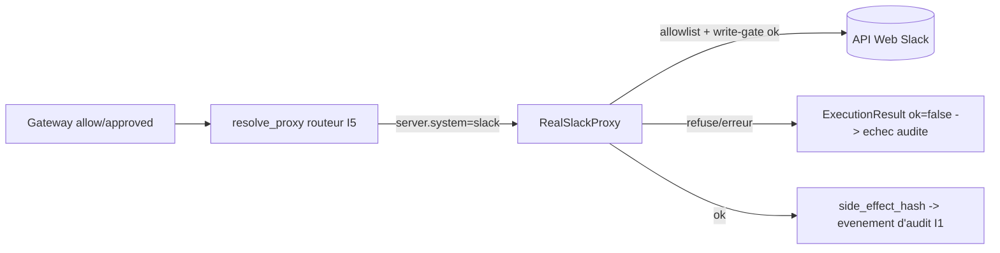
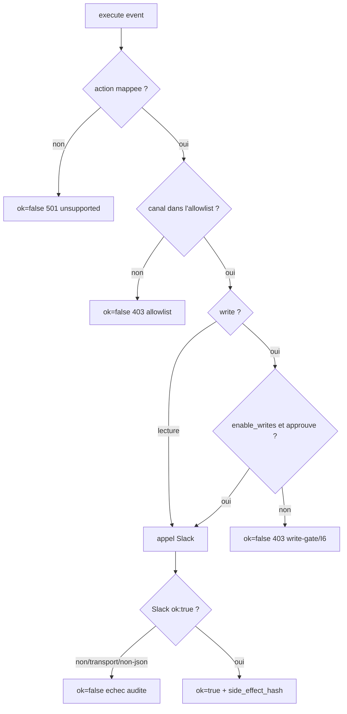

# Proxy Slack reel (G5) -- un ExternalSystemProxy SaaS reel (I5)

> `RealSlackProxy` est le deuxieme proxy reel apres la forge git. Il relie le
> protocole de proxy I5 a l'API Web Slack reelle. Le lab reste le mode par defaut ; ce proxy
> est opt-in et fail-safe par construction -- il ne peut pas toucher un workspace reel
> sauf s'il est explicitement configure et approuve.

## Ou il se situe (I5)

Le code metier/de decision n'appelle jamais Slack directement. Tout effet de bord passe par
le proxy, qui est le seul composant detenant le token (R8) et qui produit
le `side_effect_hash` enregistre dans l'evenement d'audit.

## Configuration (R8/R5 -- env uniquement, jamais dans le code)

| Variable | Signification | Valeur fail-safe par defaut |
|----------|---------|-------------------|
| `SLACK_BOT_TOKEN` | token de bot Slack, envoye en `Authorization: Bearer` | requis (sinon refus de construction) |
| `INSPECT_IA_AGENTS_SLACK_CHANNEL_ALLOWLIST` | ids/noms de canaux separes par virgules que le proxy peut toucher | vide => tout est refuse |
| `INSPECT_IA_AGENTS_SLACK_API_URL` | base de l'API (override pour self-host/test) | `https://slack.com/api` |
| `INSPECT_IA_AGENTS_SLACK_ENABLE_WRITES` | `true` pour autoriser les methodes d'ecriture | desactive => ecritures refusees |

## Mapping des actions (action_type canonique -> methode Slack)

Seuls les action_types existants du catalogue `slack` sont mappes (aucune action inventee) :

| action_type canonique | Methode Slack | Cote |
|-----------------------|--------------|------|
| `send_message_external_channel` | `chat.postMessage` | write |
| `publish_company_announcement` | `chat.postMessage` | write |
| `create_public_channel` | `conversations.create` | write |
| `delete_channel` | `conversations.archive` | write |
| `access_confidential_channel` | `conversations.info` | read |
| `export_slack_history` | `conversations.history` | read |

Tout autre action_type (par ex. `modify_workspace_permissions`,
`send_message_as_executive`) retourne `ok=False` (statut 501, audite) -- un
refus explicite, pas un stub.

## Couches fail-safe (failure-modes.md)

Une ecriture exige A LA FOIS `enable_writes` ET une action approuvee (`approval_state ==
approved`) -- defense en profondeur par-dessus le blocage I6 de la gateway. Toute erreur de
transport ou tout `ok:false` Slack est mappe en `ok=False` ; le proxy ne remonte jamais
d'exception a travers la gateway et ne la contourne jamais.

## Activation du cablage

Un run reel lie un agent a une entree de serveur `real_saas` dont le `system` est
`slack`. Le routeur I5 (`resolve_proxy`) le dispatche via la fabrique injectee
`build_real_proxy_factory()` vers un `RealSlackProxy` (la meme couture que celle utilisee par la
forge git). La fabrique lit les variables d'env ci-dessus ; les chemins lab/mock ne le construisent jamais.

## Tests

- `tests/test_real_slack_proxy.py` -- de bout en bout sur du HTTP REEL contre un emulateur
  Slack local fidele (verification du Bearer, mapping methode/parametres, rejet par l'allowlist,
  write-gate, refus d'ecriture non approuvee, action non supportee, `ok:false` Slack,
  echec de transport, hash deterministe, dispatch de la fabrique, aller-retour complet du routeur
  `resolve_proxy`). 14 cas.
- `tests/test_real_slack_live.py` -- en LECTURE seule (`conversations.info`) contre l'API
  Slack REELLE. Skip sauf si `SLACK_BOT_TOKEN` + `INSPECT_IA_AGENTS_TEST_SLACK_CHANNEL`.

## Residuels

- Le live contre Slack reel est skip-sauf-si (pas de token sur cet hote). Le code du proxy
  est production-reel (vraie requete urllib, en-tete Bearer, vrai parse JSON, vrai
  hash) ; le test toujours-execute le pointe vers un emulateur Slack local sur de vraies
  sockets, la meme approche que les verifications docker Postgres/NATS (G3/G4).
- Les 10 domaines restants (okta, crm, finance, data_platform, support_desk,
  cloud, hris, legal_dms, product_cms, knowledge_base) tournent encore en lab uniquement ;
  chacun suit le meme pattern (un proxy, creds par env, allowlist, write-gate).
