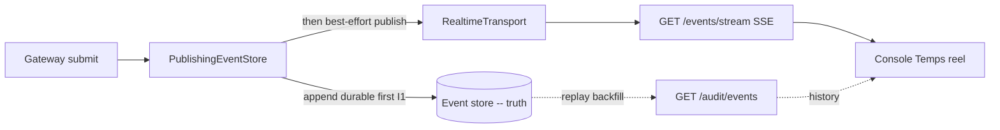
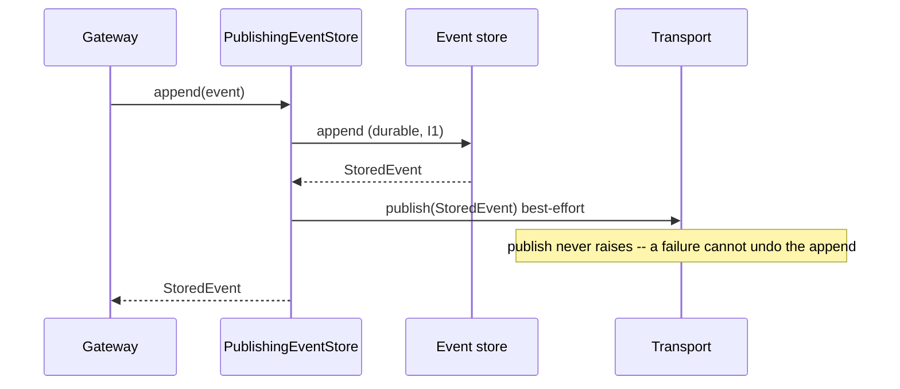

# Realtime transport (G4) -- live event fan-out

> Data Plane component. Diffuses governed events to live consumers (the console
> "Temps reel" page) over Server-Sent Events. It is NEVER the source of truth
> (I1): the append-only event store is. A dropped realtime copy is recoverable
> by replaying the store -- the transport only diffuses, it never decides or
> executes a side effect.

## Phasing (mirrors the SQLite/Postgres event-store decision)

| Phase | Backend | When | Selector |
|-------|---------|------|----------|
| 1 (default) | `InProcessTransport` | mono-host -- real in-process pub/sub | `AGENTRAIL_REALTIME=inproc` (or unset) |
| 2 (opt-in) | `NatsJetStreamTransport` | multi-host / cross-process fan-out | `AGENTRAIL_REALTIME=nats` |

Phase 1 is a real transport, not a stub: it fans out to live subscribers via
thread-safe bounded queues. Phase 2 swaps in NATS JetStream behind the same
`RealtimeTransport` protocol; nothing else changes.

### Phase 2 configuration (R5/R8 -- env, never hardcoded)

| Variable | Meaning | Default |
|----------|---------|---------|
| `AGENTRAIL_REALTIME` | `inproc` or `nats` | `inproc` |
| `AGENTRAIL_NATS_URL` | NATS server URL (required for nats) | -- |
| `AGENTRAIL_NATS_SUBJECT` | subject events are published on | `agentrail.events` |
| `AGENTRAIL_NATS_STREAM` | JetStream stream name | `AGENTRAIL_EVENTS` |

The `[nats]` extra (`nats-py`) is only needed for Phase 2.

## Architecture -- where the transport sits



The store is written first; only a durable event is ever diffused. The console
gets live events from the SSE stream and backfills history from the audit
endpoints -- the bus never carries history.

## Ordering and the no-loss guarantee



"No event loss" is carried by the durable store, not by the buffer: every
published event is already persisted, so a buffer overflow drops only a
replayable copy.

## Failure mode (Phase 2 bus degradation)

`NatsJetStreamTransport` is wrapped in a `BoundedRetryBuffer` by the factory.
When the bus is unreachable:

- events are held in a BOUNDED backlog and retried FIFO (order preserved);
- `publish` NEVER raises into the gateway -- a governed action is not failed by a
  degraded bus, and no external side effect is executed by the transport;
- on overflow the oldest backlogged copy is evicted and counted (`dropped`),
  still recoverable from the store;
- call `flush()` (from a scheduler/heartbeat) to drain a recovered bus.

`GET /events/status` exposes `{degraded, pending, dropped}` for the console
badge. The in-process Phase 1 transport is never degraded.

## Operator checks

```
curl -s localhost:8090/events/status            # {"degraded":false,"pending":0,"dropped":0}
curl -sN localhost:8090/events/stream           # live SSE tail (Ctrl-C to stop)
```

Run a governed action in another terminal; a `data: {...}` frame appears on the
stream within the event's append.

## Tests

- `tests/test_realtime_transport.py` -- in-process fan-out, bounded-retry chaos
  (downstream down -> buffer + retry, never raises, recovery drains in order),
  decorator store-first ordering, factory. Offline, deterministic.
- `tests/test_realtime_nats.py` -- verified against a REAL NATS JetStream
  (`docker run -p 14222:4222 nats:2.10 -js`,
  `AGENTRAIL_TEST_NATS_URL=nats://127.0.0.1:14222`). Skipped without it.
- `tests/test_api_events.py` -- diffusion through the API (executed AND denied
  events reach a live subscriber) + `/events/status` shape.
- Console `src/pages/live/index.test.tsx` -- R16 contract gate against a real
  captured SSE payload (`__fixtures__/liveEvent.fixture.json`).

## Residuals

- `/events/stream` is auth-allowlisted because the browser `EventSource` cannot
  set an `Authorization` header. A keyed deployment must front it with a
  token-in-query or cookie gate (tracked).
- The `BoundedRetryBuffer.flush()` drain is not yet wired to a scheduler; a
  recovered bus is drained on the next `publish`. Wiring a periodic flush is the
  same residual class as the approval-timeout sweep (G2).
