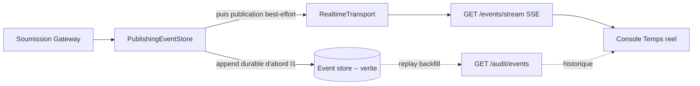
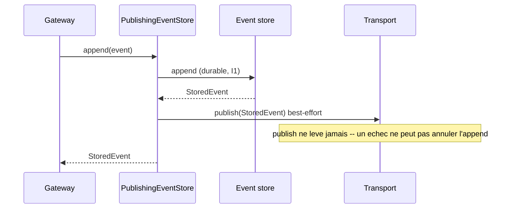

# Transport temps reel (G4) -- diffusion d'evenements en direct

> Composant du plan Data. Diffuse les evenements gouvernes vers les consommateurs
> en direct (la page console "Temps reel") via Server-Sent Events. Il n'est JAMAIS
> la source de verite (I1) : c'est l'event store append-only qui l'est. Une copie
> temps reel perdue est recuperable en rejouant le store -- le transport ne fait
> que diffuser, il ne decide jamais et n'execute jamais d'effet de bord.

## Phasage (calque sur la decision event-store SQLite/Postgres)

| Phase | Backend | Quand | Selecteur |
|-------|---------|------|----------|
| 1 (defaut) | `InProcessTransport` | mono-hote -- vrai pub/sub in-process | `INSPECT_IA_AGENTS_REALTIME=inproc` (ou non defini) |
| 2 (opt-in) | `NatsJetStreamTransport` | multi-hote / diffusion cross-process | `INSPECT_IA_AGENTS_REALTIME=nats` |

La Phase 1 est un vrai transport, pas un stub : elle diffuse vers les abonnes en
direct via des files bornees thread-safe. La Phase 2 substitue NATS JetStream
derriere le meme protocole `RealtimeTransport` ; rien d'autre ne change.

### Configuration Phase 2 (R5/R8 -- env, jamais en dur)

| Variable | Signification | Defaut |
|----------|---------|---------|
| `INSPECT_IA_AGENTS_REALTIME` | `inproc` ou `nats` | `inproc` |
| `INSPECT_IA_AGENTS_NATS_URL` | URL du serveur NATS (requise pour nats) | -- |
| `INSPECT_IA_AGENTS_NATS_SUBJECT` | sujet sur lequel les evenements sont publies | `inspect_ia_agents.events` |
| `INSPECT_IA_AGENTS_NATS_STREAM` | nom du stream JetStream | `INSPECT_IA_AGENTS_EVENTS` |

L'extra `[nats]` (`nats-py`) n'est necessaire que pour la Phase 2.

## Architecture -- ou se situe le transport



Le store est ecrit en premier ; seul un evenement durable est diffuse. La console
recoit les evenements en direct depuis le flux SSE et complete l'historique depuis
les endpoints d'audit -- le bus ne transporte jamais l'historique.

## Ordonnancement et garantie de non-perte



La "non-perte d'evenement" est portee par le store durable, pas par le buffer :
tout evenement publie est deja persiste, donc un debordement de buffer ne perd
qu'une copie rejouable.

## Mode de defaillance (degradation du bus en Phase 2)

`NatsJetStreamTransport` est enveloppe dans un `BoundedRetryBuffer` par la factory.
Quand le bus est injoignable :

- les evenements sont conserves dans un backlog BORNE et reessayes en FIFO (ordre preserve) ;
- `publish` ne leve JAMAIS dans la gateway -- une action gouvernee n'est pas mise
  en echec par un bus degrade, et aucun effet de bord externe n'est execute par le transport ;
- en cas de debordement, la plus ancienne copie en backlog est evincee et comptee (`dropped`),
  toujours recuperable depuis le store ;
- appeler `flush()` (depuis un scheduler/heartbeat) pour vider un bus retabli.

`GET /events/status` expose `{degraded, pending, dropped}` pour le badge de la
console. Le transport in-process de la Phase 1 n'est jamais degrade.

## Verifications operateur

```
curl -s localhost:8090/events/status            # {"degraded":false,"pending":0,"dropped":0}
curl -sN localhost:8090/events/stream           # live SSE tail (Ctrl-C to stop)
```

Lancez une action gouvernee dans un autre terminal ; une frame `data: {...}`
apparait sur le flux au moment de l'append de l'evenement.

## Tests

- `tests/test_realtime_transport.py` -- diffusion in-process, chaos bounded-retry
  (downstream down -> buffer + retry, ne leve jamais, le retablissement vide dans l'ordre),
  ordonnancement store-first du decorateur, factory. Offline, deterministe.
- `tests/test_realtime_nats.py` -- verifie contre un VRAI NATS JetStream
  (`docker run -p 14222:4222 nats:2.10 -js`,
  `INSPECT_IA_AGENTS_TEST_NATS_URL=nats://127.0.0.1:14222`). Ignore sans lui.
- `tests/test_api_events.py` -- diffusion a travers l'API (les evenements executes ET
  refuses atteignent un abonne en direct) + forme de `/events/status`.
- Console `src/pages/live/index.test.tsx` -- gate de contrat R16 contre un vrai
  payload SSE capture (`__fixtures__/liveEvent.fixture.json`).

## Residus

- `/events/stream` est en allowlist d'authentification car le `EventSource` du
  navigateur ne peut pas poser d'en-tete `Authorization`. Un deploiement avec cle
  doit le proteger via une gate token-in-query ou cookie (suivi).
- Le drain `BoundedRetryBuffer.flush()` n'est pas encore branche a un scheduler ; un
  bus retabli est draine au prochain `publish`. Brancher un flush periodique est la
  meme classe de residu que le balayage de timeout d'approbation (G2).
