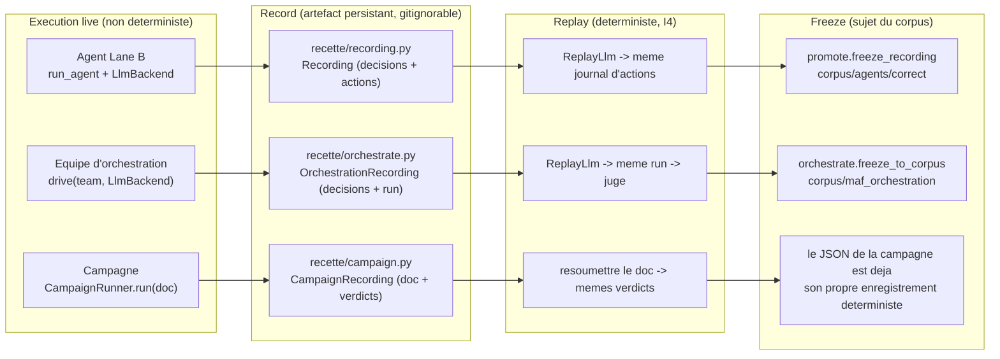
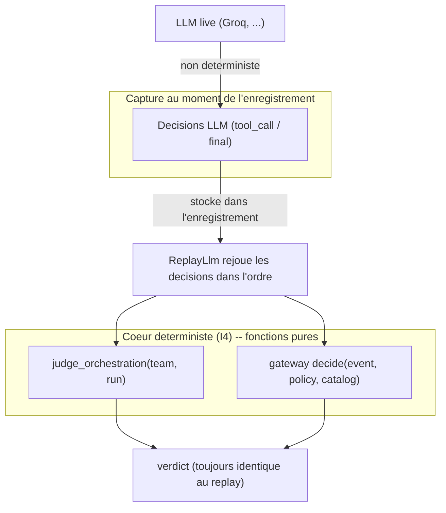
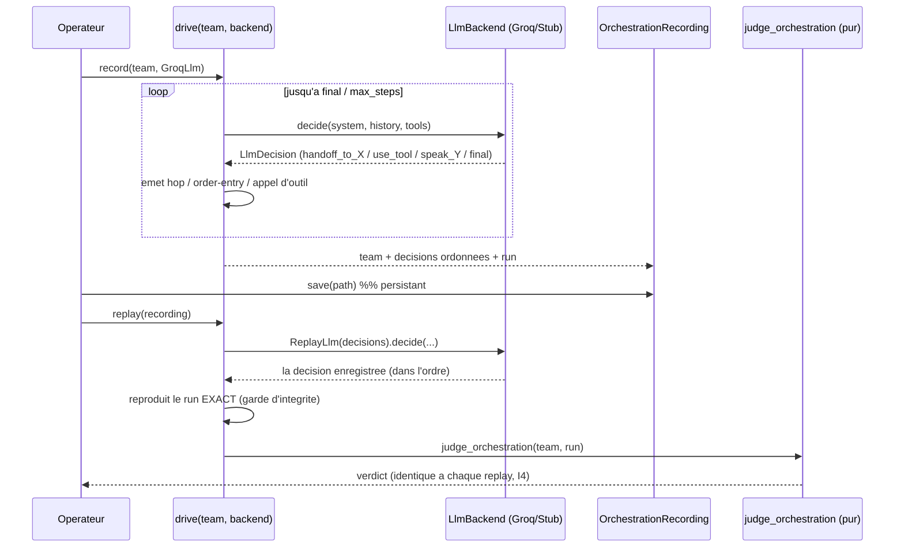
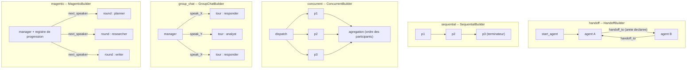
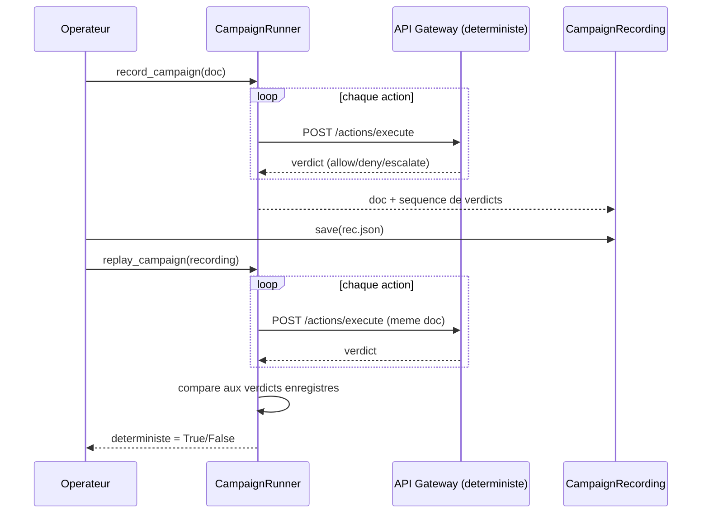
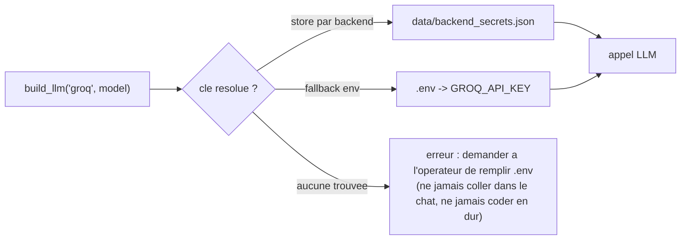
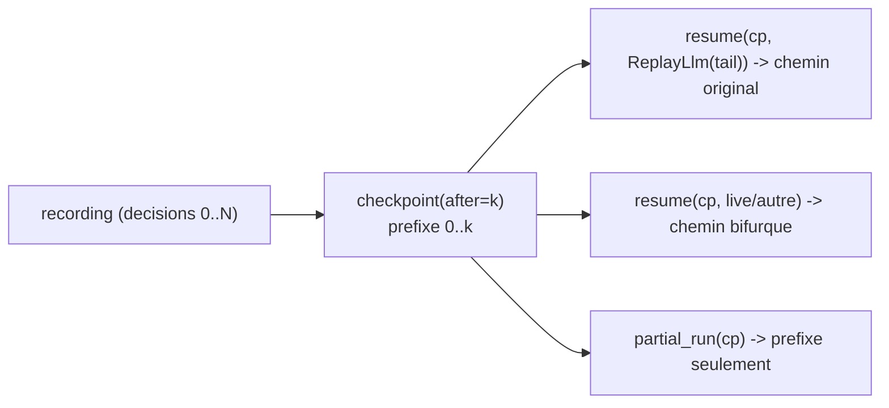
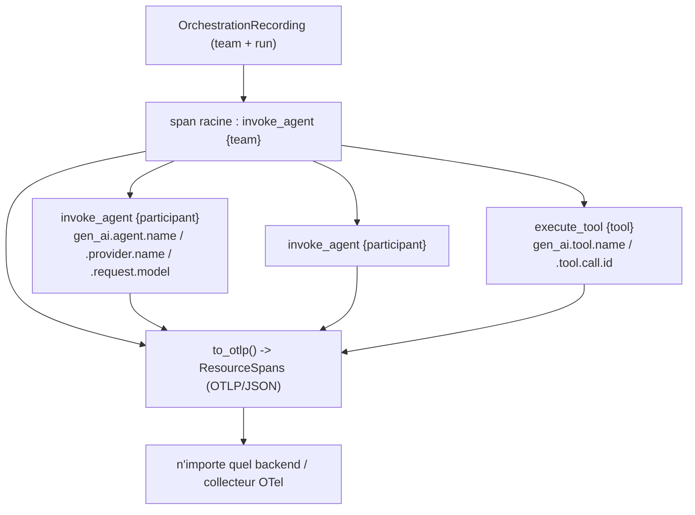

# Le modele de replay unifie -- agents, equipes, campagnes

Chaque sujet de recette dans inspect_ia_agents suit la meme forme record / replay /
freeze, de sorte qu'une execution live non deterministe (un vrai LLM, de vrais
verdicts) devient un artefact deterministe et persistant que l'on peut rejouer
"pour voir ce que ca fait" puis, une fois valide, figer dans le corpus. Le juge /
la gateway reste deterministe (I4) ; tout le non-determinisme est capture une seule
fois, au moment de l'enregistrement.

## Trois sortes de sujets, un seul pattern



## Ou vit le non-determinisme, et comment il est capture



## Orchestration : drive -> record -> replay -> freeze



## Les quatre styles d'orchestration (ancres sur les vrais builders MAF)



Axe comportement par style : handoff = demarrer a start_agent, dans la borne de
terminaison, sans boucle ; sequential = ordre d'execution == ordre declare,
chacun une fois ; concurrent = chaque participant declare une fois ; group_chat =
tours bornes, aucun participant ne monopolise ; magentic = rounds bornes, pas de
blocage (le meme locuteur selectionne trois rounds d'affilee).

## Enregistrement de campagne -> replay (I4 au niveau campagne)

Une campagne d'actions scriptees est deja deterministe (la decision de la gateway
est une fonction pure de event + policy + catalog). L'enregistrement capture la
sequence de verdicts ; le replay resoumet le meme document et asserte que les
verdicts se reproduisent.



CLI :

```
python3 -m recette.campaign record campaigns/identity-offboarding.campaign.json --out /tmp/c.json
python3 -m recette.campaign replay /tmp/c.json
```

Les demos de campagne live pilotees par LLM (`scripts/run_*_live_groq.py`) sont la
contrepartie non deterministe : pour rendre l'une d'elles rejouable, enregistrer
les decisions du LLM live exactement comme le fait `recette/orchestrate.py` et les
rejouer a travers la meme gateway gouvernee -- le meme pattern record / replay /
freeze que ci-dessus.

## Secrets au moment de l'enregistrement (R18)



Voir `.claude/rules/secrets-source-of-truth.md` (R18) et
`docs/runbooks/orchestration-recette.md`.

## Checkpoint / voyage dans le temps (I4)

Parce que `drive` est une fonction pure du flux de decisions, un run peut etre fige
a n'importe quelle etape et repris -- pour reproduire le chemin original ou pour
bifurquer vers un autre. `recette/checkpoint.py` : `checkpoint(recording, after=k)`
fige les k premieres decisions ; `resume(cp, tail)` rejoue le prefixe puis continue
avec `tail` (un `ReplayLlm` du tail original reproduit le run ; un backend live ou
different bifurque) ; `partial_run(cp)` est le run tronque au checkpoint. Reflete
le concept de `_workflows/_checkpoint.py` de l'agent-framework, garde sans
dependance et deterministe.



## Export OpenTelemetry GenAI (interop d'audit, I1/I4)

Un enregistrement s'exporte vers des spans OpenTelemetry GenAI afin qu'une piste
d'audit inspect_ia_agents interopere avec n'importe quel backend OTel. Les noms
d'attributs/operations sont les conventions semantiques GenAI canoniques tirees du
veritable `agent_framework/observability.py` (`invoke_agent` / `execute_tool`,
`gen_ai.provider.name`, `gen_ai.request.model`, `gen_ai.agent.name`,
`gen_ai.tool.name`). Sans dependance et deterministe (I4) : les ids de span/trace
sont un digest stable du run, les timestamps sont logiques (pas d'horloge murale),
de sorte que le meme run exporte des spans byte-identiques ; l'enregistrement est
en lecture seule (I1).



```
python3 -m recette orchestrate otel /tmp/run.json --out spans.json
```

`recette/otel.py` : `orchestration_spans(team, run)` -> `to_otlp(spans)`. Un vrai
exporteur OTel (extra optionnel `[otel]`) reestampille les temps d'horloge murale a
l'emission ; la recette garantit seulement que la structure est reproductible.
