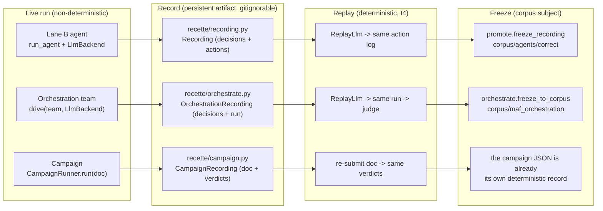
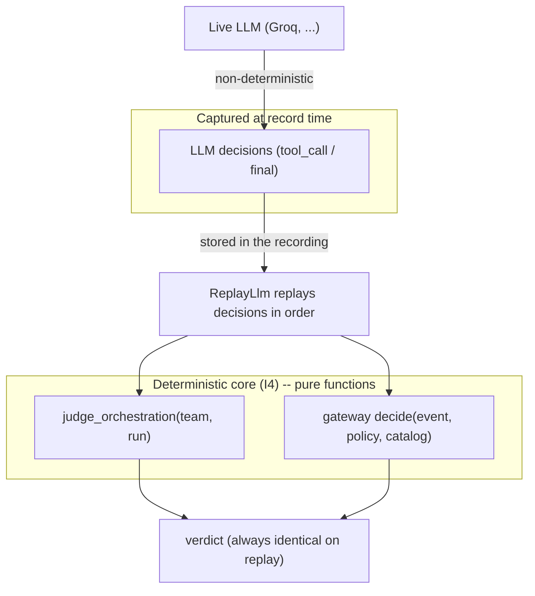
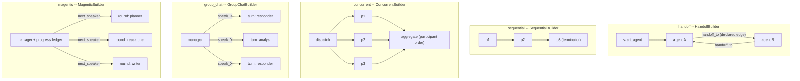
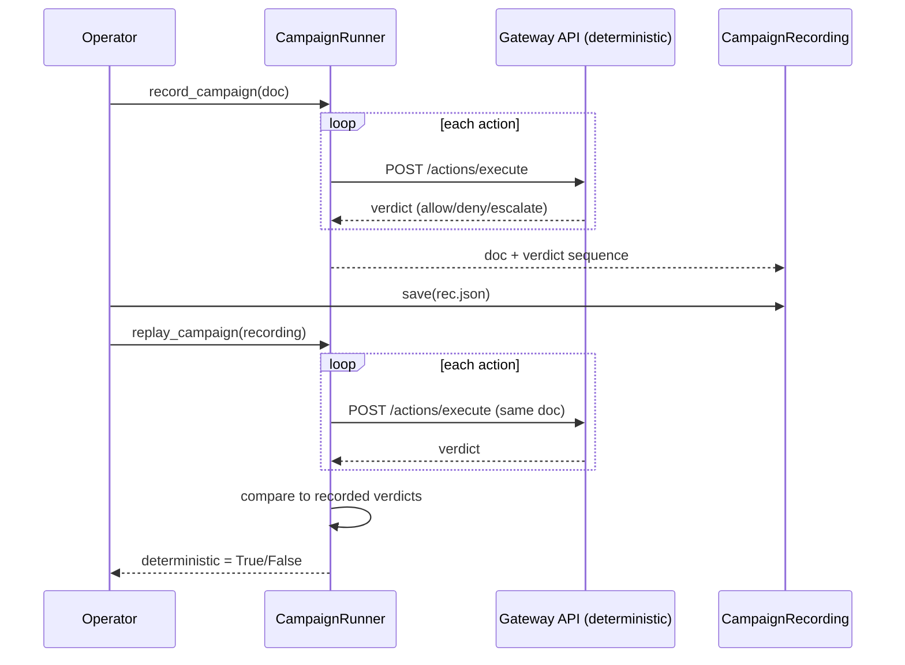
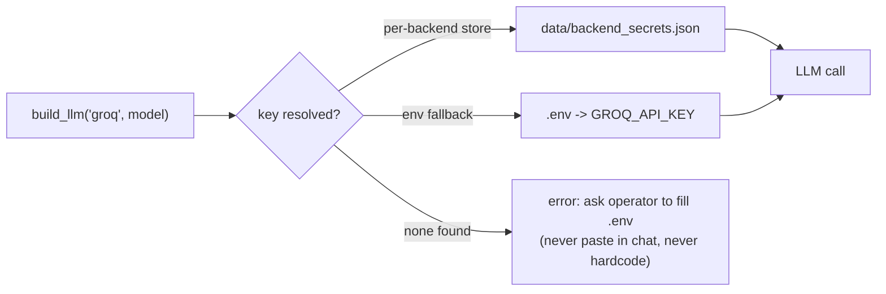
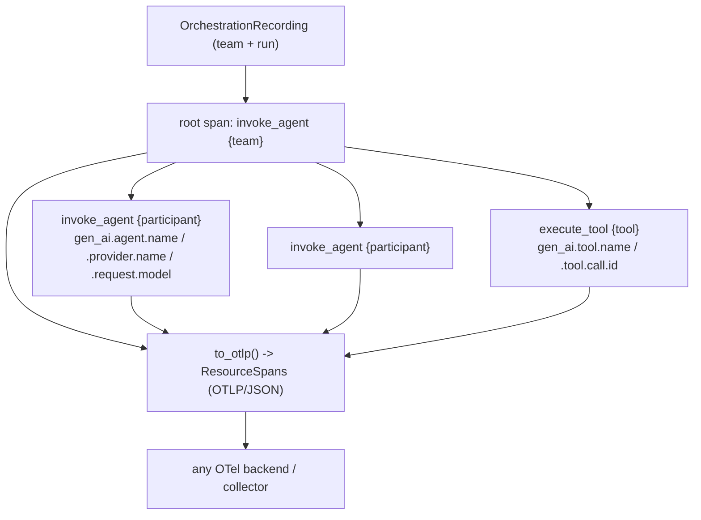

# The unified replay model -- agents, teams, campaigns

Every recette subject in AgentRail follows the same record / replay / freeze
shape, so a non-deterministic live run (a real LLM, real verdicts) becomes a
deterministic, persistent artifact you can replay "pour voir ce que ca fait" and,
once vetted, freeze into the corpus. The judge / gateway stays deterministic
(I4); all non-determinism is captured once, at record time.

## Three subject kinds, one pattern



## Where the non-determinism lives, and how it is captured



## Orchestration: drive -> record -> replay -> freeze


## The four orchestration styles (grounded on the real MAF builders)



Behavior axis per style: handoff = start at start_agent, within the termination
bound, no loop; sequential = executed order == declared order, each once;
concurrent = each declared participant once; group_chat = bounded turns, no
participant monopolises; magentic = bounded rounds, no stall (same speaker
selected three rounds in a row).

## Campaign record -> replay (I4 at the campaign level)

A campaign of scripted actions is already deterministic (the gateway decision is
a pure function of event + policy + catalog). Recording captures the verdict
sequence; replay re-submits the same document and asserts the verdicts reproduce.



CLI:

```
python3 -m recette.campaign record campaigns/identity-offboarding.campaign.json --out /tmp/c.json
python3 -m recette.campaign replay /tmp/c.json
```

Live, LLM-driven campaign demos (`scripts/run_*_live_groq.py`) are the
non-deterministic counterpart: to make one replayable, record the live LLM
decisions exactly as `recette/orchestrate.py` does and replay them through the
same governed gateway -- the same record / replay / freeze pattern as above.

## Secrets at record time (R18)



See `.claude/rules/secrets-source-of-truth.md` (R18) and
`docs/runbooks/orchestration-recette.md`.

## OpenTelemetry GenAI export (audit interop, I1/I4)

A recording exports to OpenTelemetry GenAI spans so an AgentRail audit trail
interoperates with any OTel backend. The attribute/operation names are the
canonical GenAI semantic conventions taken from the real
`agent_framework/observability.py` (`invoke_agent` / `execute_tool`,
`gen_ai.provider.name`, `gen_ai.request.model`, `gen_ai.agent.name`,
`gen_ai.tool.name`). Dependency-free and deterministic (I4): span/trace ids are a
stable digest of the run, timestamps are logical (no wall clock), so the same run
exports byte-identical spans; the recording is read-only (I1).



```
python3 -m recette orchestrate otel /tmp/run.json --out spans.json
```

`recette/otel.py`: `orchestration_spans(team, run)` -> `to_otlp(spans)`. A real
OTel exporter (optional `[otel]` extra) re-stamps wall-clock times at emit; the
recette only guarantees the structure is reproducible.
