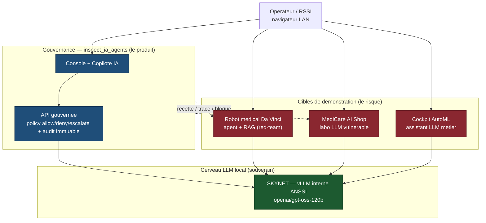

# Demonstration SKYNET — descriptif executif

**Objet.** Montrer, de bout en bout et sans dependance cloud externe, la mise
en oeuvre d'applications reelles pilotees par notre **LLM local SKYNET** (vLLM
interne ANSSI, modele `openai/gpt-oss-120b`), et surtout la **gouvernance** qui
rend ces usages recettables, tracables et surs.

**Message cle.** Un LLM local ne suffit pas : ce qui differencie une
demonstration d'un produit, c'est la **couche de gouvernance runtime** qui
mediatise chaque action d'agent, applique une politique deterministe
(allow / deny / escalate), exige l'approbation humaine quand il le faut, et
conserve un audit rejouable. La demonstration met cette couche face a des
cibles volontairement vulnerables pour prouver qu'elle attrape ce qu'elles
laisseraient passer.

---

## Vue d'ensemble

Lecture : tout le monde partage **le meme LLM SKYNET** (vert). La **gouvernance**
(bleu) recette, trace et bloque les comportements que les **cibles vulnerables**
(rouge) laisseraient passer. La chaine complete — usage applicatif ET maitrise
du risque — tourne en local.

---

## Les trois briques

### 1. inspect_ia_agents — la couche de gouvernance (le produit)

Plateforme de **recette et de gouvernance runtime d'agents IA**. Toute action
d'un agent est normalisee, evaluee par une politique deterministe, et
n'atteint un systeme externe qu'apres decision `allow` (ou `approved`). Le
journal d'audit est immuable et rejouable (forensique). La console embarque un
**Copilote IA** contextuel (assistant operateur branche sur SKYNET) et une
page de personnalisation des prompts. Un lab simule 11 systemes d'entreprise
(okta, github, finance, RH, juridique…) pour recetter sans effet de bord reel.

**Ce que ca prouve :** un agent LLM peut etre rendu *lisible*, *recettable* et
*deny-by-default* — condition d'un deploiement en environnement sensible.

### 2. Cibles de demonstration — le risque a maitriser

- **Simulateur robot medical « Da Vinci »** : un agent medical avec une base de
  connaissances **RAG**. Le parcours red-team (`/redteam`, `/redteam/rag`)
  exerce l'**empoisonnement de la base** — un RAG pollue ne doit jamais
  declencher une action interdite.
- **MediCare AI Shop** : application LLM **volontairement vulnerable** (prompt
  injection, exfiltration, contournement), cible d'entrainement offensif.

**Ce que ca prouve :** sans gouvernance, un LLM local reproduit les memes
vulnerabilites qu'un LLM cloud — le risque est intrinseque a l'usage agentique,
pas au fournisseur.

### 3. Cockpit AutoML — l'inspiration produit

Outil metier (pipeline ML) dote d'un assistant LLM. Il a servi de modele
d'ergonomie pour le Copilote IA de la plateforme de gouvernance : consolidation
des echanges, aide contextuelle, prompts parametrables.

---

## Souverainete & securite

- **Local d'abord** : aucun appel LLM ne sort du reseau interne ; SKYNET est le
  seul cerveau, joignable via une gateway gouvernee.
- **Deny-by-default** : en cas de defaillance d'un composant de securite, le
  systeme se ferme (deny / freeze), jamais il ne s'ouvre.
- **Auditabilite** : chaque decision est un evenement immuable, rejouable a
  l'identique (meme flux + meme version de politique => meme resultat).
- **Point de vigilance releve** : une cle API SKYNET a ete trouvee en clair
  dans l'environnement d'un conteneur de demonstration (POC medical) — a faire
  tourner et a deplacer vers un secret store. Cote plateforme gouvernee, les
  cles vivent deja dans un stockage gitignore, jamais dans le code.

---

## Acces (reseau LAN de confiance)

| Brique | Interface | Port |
|--------|-----------|------|
| Gouvernance — console + Copilote IA | navigateur | `5174` |
| Gouvernance — API gouvernee | API | `8090` |
| Robot medical Da Vinci — front (`/redteam`, `/redteam/rag`) | navigateur | `5175` |
| Robot medical — backend + RAG (ChromaDB) | API | `8042` / `8043` |
| MediCare AI Shop — labo vulnerable | navigateur | `5176` |
| Cockpit AutoML — front / back | navigateur / API | `5173` / `8000` |
| SKYNET (via gateway LiteLLM) | interne | `4000` |

> Exposition LAN opt-in cote plateforme : `INSPECT_IA_AGENTS_CONSOLE_LAN=1
> ./recette.sh console start` (voir `docs/runbooks/console-lan-exposure.md`).
> Reseau de confiance uniquement — l'API n'a pas d'authentification activee en
> mode demonstration.

---

## En une phrase

Un LLM souverain (SKYNET), des applications qui l'exploitent, et surtout une
**couche de gouvernance qui transforme un usage agentique risque en un usage
recette, trace et maitrise** — le tout demontre en local, de bout en bout.
